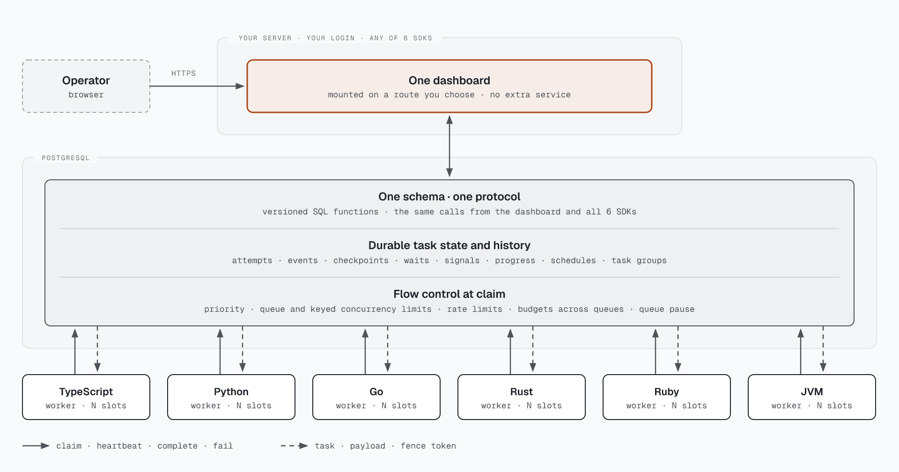
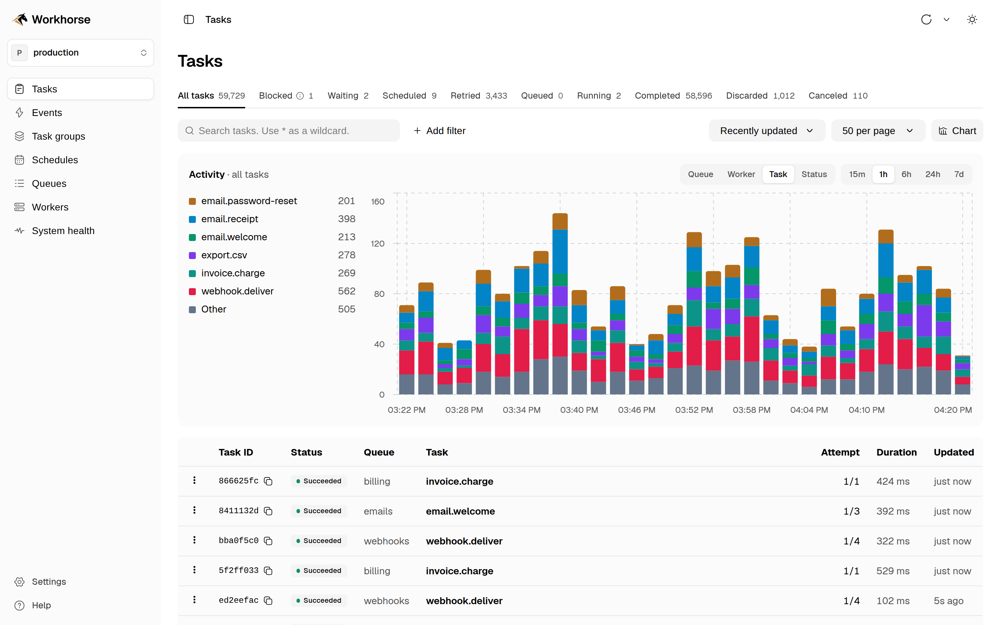

# Workhorse

A durable task queue for PostgreSQL, with TypeScript, Python, Go, Rust, Ruby, Java, Kotlin, and C#
workers on one SQL protocol.

Workhorse is versioned SQL functions inside the database you already run. Every language gets the
same workers, the same durable waits, and the same dashboard, with no broker or server beside
PostgreSQL.

> **Public beta:** You can use Workhorse for evaluation and for early production use. A 0.x minor
> release can change behavior, so read the changelog before you upgrade. A minor release does not
> make you create your database again. Migrations are ordered, and inside a major line a migration
> only adds. Thus, a running deployment upgrades in place.

[Documentation](https://workhorse.run/docs) · [Quickstart](https://workhorse.run/docs/quickstart) ·
[Live demo](https://demo.workhorse.run) · [Compatibility](docs/compatibility.md) ·
[Security policy](SECURITY.md) · [For AI agents](https://workhorse.run/llms.txt)

## Why Workhorse

Applications often need a database change and a background task to succeed together. Workhorse
enqueues through the same PostgreSQL transaction, so a rollback cannot leave one without the other.

PostgreSQL owns queue state, scheduling, retries, recovery, and immutable history. Workers claim tasks
with fence tokens, so a worker that resumes after losing its lease cannot overwrite newer work.

Handlers receive at-least-once delivery. Workhorse records durable progress and outcomes, but external
effects still need stable provider idempotency keys or compensation.

<picture>
  <source media="(max-width: 600px) and (prefers-color-scheme: dark)" srcset="site/public/diagrams/readme-overview-narrow-dark.png">
  <source media="(max-width: 600px)" srcset="site/public/diagrams/readme-overview-narrow-light.png">
  <source media="(prefers-color-scheme: dark)" srcset="site/public/diagrams/readme-overview-dark.png">
  
</picture>

## See it operate

The dashboard exposes task activity, lifecycle events, system health, worker capacity, queues, and
schedules without making the queue's PostgreSQL tables part of your operator interface.

  <a href="https://demo.workhorse.run">
    <picture>
      <source media="(max-width: 600px) and (prefers-color-scheme: dark)" srcset="site/public/screenshots/demo-tasks-mobile-dark.png">
      <source media="(max-width: 600px)" srcset="site/public/screenshots/demo-tasks-mobile.png">
      <source media="(prefers-color-scheme: dark)" srcset="site/public/screenshots/demo-tasks-dark.png">
      
    </picture>
  </a>

Open the [live demo](https://demo.workhorse.run) to explore the dashboard, including recurring
schedules and task details.

## When it fits

Choose Workhorse when your application already depends on PostgreSQL and needs durable background
work that can share application transactions. Choose a dedicated broker when queue scale or
availability must be independent from the application database.

## Learn and operate

- [Guides](https://workhorse.run/docs) explain enqueue, workers, retries, durable execution, and
  integrations.
- [API reference](https://workhorse.run/docs/api) documents the public TypeScript surface.
- [Architecture](docs/architecture.md) defines exact protocol behavior and invariants.
- [Feature matrix](docs/features.md) separates supported, partial, and unsupported behavior.
- [Compatibility](docs/compatibility.md) defines supported runtimes, schema policy, and releases.
- [Operations](https://workhorse.run/docs/operations) covers health, retention, and maintenance.
- [Dashboard](https://workhorse.run/docs/dashboard) explains the operator UI and deployment boundary.
- [Changelog](CHANGELOG.md) records releases and required schema versions.

## Contributing

Read [CONTRIBUTING.md](CONTRIBUTING.md) before sending a change, sign the [contributor
agreement](CLA.md), and use the development commands defined in [package.json](package.json).

## License

Workhorse is available under the [Apache License, Version 2.0](LICENSE). Attribution lives in
[NOTICE](NOTICE).
