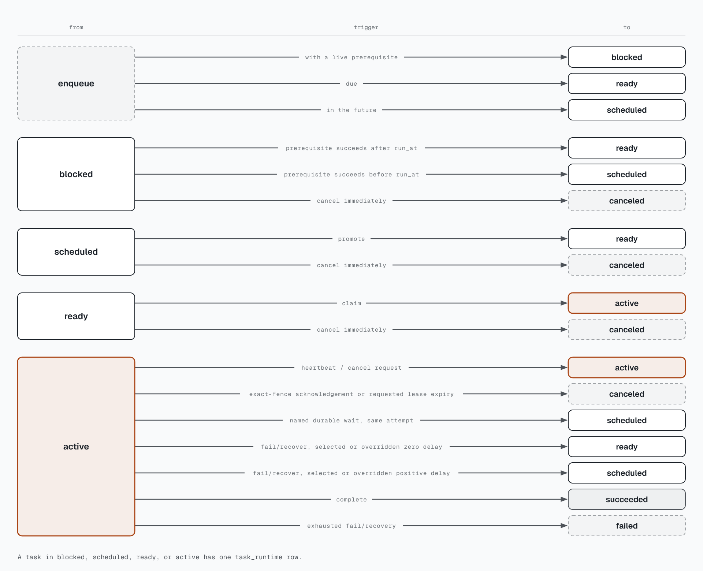
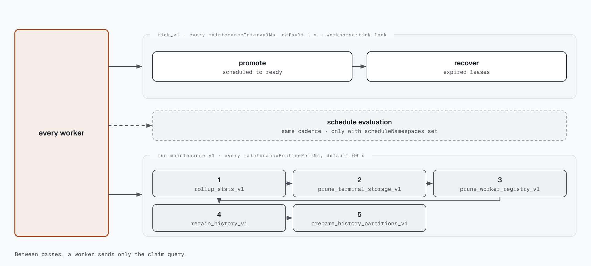
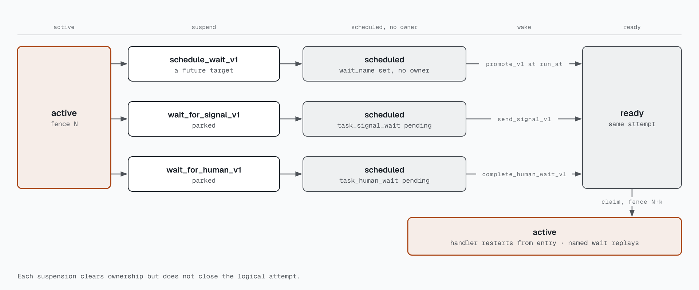
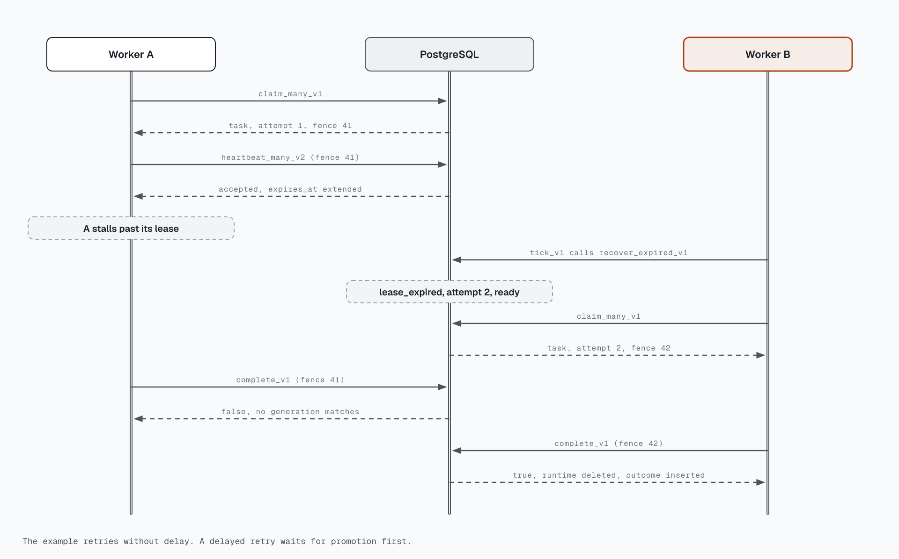

# Workhorse architecture: task lifecycle

This page is part of the [Workhorse architecture reference](../architecture.md). It owns the atomic
lifecycle transitions from enqueue to terminal outcome, delivery semantics, and the read models and
health snapshot.

## Atomic lifecycle

<picture>
  <source media="(max-width: 600px) and (prefers-color-scheme: dark)" srcset="../../site/public/diagrams/task-states-narrow-dark.png">
  <source media="(max-width: 600px)" srcset="../../site/public/diagrams/task-states-narrow-light.png">
  <source media="(prefers-color-scheme: dark)" srcset="../../site/public/diagrams/task-states-dark.png">
  
</picture>

### Enqueue

#### Batch validation

- A batch holds at most 1,000 requests.
- `enqueue_batch_v1` parses and validates every request against one timestamp.
- A request can carry an optional priority, persisted retry policies, and up to 100 dependency
  identities.
- Priority defaults to 0 and must be an integer from 0 through 100.
- If a request in the batch is invalid, `enqueue_batch_v1` rolls back the full batch.

`enqueue_batch_v1` returns `(ordinal, task_id, accepted)` for each input. `accepted` is true only
when the statement created the durable task. The input order controls the returned IDs and the
allocation of ready sequences.

If a batch has more than one invalid request, these rules select the request that the error
reports:

- The request loop reports the first request that it rejects in input order.
- The loop runs before the edge insert. Thus a rejection in the loop has precedence over a
  dependency bound.
- Each bound check names the lowest task identity that exceeds the bound, in any input order.

#### Batch write order

One `enqueue_batch_v1` call writes `task`, optional `task_dependency` edges, `task_runtime` or a
policy-selected terminal outcome, and acceptance events in the caller's transaction.

The loop over requests writes no full-tier task row. For each new full-tier request it:

1. Validates the request.
2. Locks and reads its prerequisites.
3. Settles its idempotency key.
4. Buffers its `task` row, `task_runtime` row, `task_dependency` edges, and `enqueued` event
   details.

After the last request, `enqueue_batch_v1`:

1. Writes `task`, then `task_runtime`, then all edges together with their `dependency_blocked` or
   `dependency_released` events. Each write is one statement in input order.
2. Passes every distinct terminal prerequisite to one `resolve_dependents_many_v1` call in identity
   order.
3. Inserts the `enqueued` events in input order.
4. Calls `terminalize_deadline_v1` for each task whose deadline has already passed.

For each blocked runtime, `pending_prerequisites` stores the number of edges that
`enqueue_batch_v1` inserts as pending. This number is every prerequisite without an outcome plus
every terminal prerequisite whose policy rejects. `enqueue_batch_v1` holds key-share locks on the
prerequisites. These locks keep the count exact if a concurrent terminal transition occurs.

Thus each task keeps the event order that one-row writes produced. Only the interleaving between
tasks changes. The buffer never hides a prerequisite. The batch generates every new task identity.
A caller can name only a task that existed before the batch.

PostgreSQL delivers `NOTIFY workhorse_tasks` at commit. The batch sends one notification for each
distinct queue that gained ready work.

#### Enqueue results

`enqueue_many_v1` keeps the `enqueue_batch_v1` contract. It returns
`(ordinal, task_id, outcome, reason)`. For an ordinary request, it maps `accepted` to `accepted` or
`replayed` and returns a null `reason`.

If a batch contains `debounce` or `throttle` requests, it locks every scoped idempotency, debounce,
or throttle key in bytewise order. It locks the keys before it processes the requests in caller
order. This keeps mixed batches atomic. It also prevents overlapping batches from locking the keys
in reverse order.

`Queue.enqueueWithResult` and `Queue.enqueueManyWithResults` expose the discriminated
`EnqueueResult` union:

- Its `outcome` is `accepted`, `replayed`, `replaced`, `non_replaceable`, or `coalesced`.
- Only `non_replaceable` carries `reason`.
- That `EnqueueNonReplaceableReason` is `incompatible_key_mode`, `not_pending`, or
  `window_elapsed_pending`.

`Queue.enqueue` and `Queue.enqueueMany` keep their string-ID return values. They project these
values from the same structured results.

#### Keyed ingress modes

Each keyed mode has one contract:

- Idempotency replays one materially equivalent request and rejects a conflicting reuse.
- Debounce replaces one pending definition while arrivals continue.
- Throttle reuses one accepted identity without changing it.

These contracts serialize acceptance in PostgreSQL. They do not make handler effects exactly once.
A handler can run again after a lost lease or a process failure. Thus external effects still
require their own idempotency boundary.

ADR 0031 keeps these keyed ingress modes mutually exclusive. The `EnqueueOptions` union rejects
invalid combinations during TypeScript compilation. PostgreSQL rejects malformed direct requests.
The modes share one ownership table, hash, and lock order. This sharing does not merge `replayed`,
`replaced`, `non_replaceable`, and `coalesced` into one outcome.

#### Keyed debounce

`EnqueueOptions.debounce` contains these fields:

| Field      | Constraint                                                      |
| ---------- | --------------------------------------------------------------- |
| `key`      | At most 512 UTF-8 bytes, the idempotency key limit.             |
| `scope`    | Optional. At most 256 UTF-8 bytes, the idempotency scope limit. |
| `windowMs` | An integer from 1 through 31,536,000,000 (365 days).            |
| `schedule` | `reset` or `preserve`.                                          |

A request with `debounce` cannot also supply `idempotency`, `runAt`, `prerequisiteTaskId`, or
`dependencies`. `Queue.enqueueManyWithResults` rejects these combinations before querying
PostgreSQL. `enqueue_debounce_v1` rejects them for direct SQL callers. PostgreSQL derives the
initial run time from `clock_timestamp() + windowMs`.

`enqueue_debounce_v1` hashes the scoped key and takes the same transaction advisory lock as enqueue
idempotency. It stores `coalescing_mode = 'debounce'` on `enqueue_idempotency`. It never persists
the raw key. For a new key, it creates one scheduled task through `enqueue_batch_v1` and returns
`accepted`.

##### Replacement

PostgreSQL replaces a pending definition only if the retained runtime meets all of these
conditions:

- It is `scheduled` or `ready`.
- It has a null `attempt_started_at` and `wait_name`.
- It is on `current_attempt = 1`.
- The key window is still active.

PostgreSQL validates the replacement through `enqueue_batch_v1`. It then updates the accepted task
definition and runtime atomically. The stable task ID and current attempt do not change.

- `reset` derives a new run time and key expiry from the statement clock.
- `preserve` keeps both.

A `debounced` event records the safe key preview and the first 12 hexadecimal key-digest
characters. It also records the schedule policy, window, expiry, prior request digest, and
replacement request digest.

##### Rejection

If the retained state is one of these, PostgreSQL returns `non_replaceable` with the retained task
ID:

- an active runtime;
- a started or waiting runtime;
- a terminal outcome;
- an incompatible idempotency key;
- an elapsed-but-still-pending runtime.

A `scheduled` or `ready` runtime counts as started in either case below. Its reason is
`not_pending`.

- `attempt_started_at` or `wait_name` is set.
- `current_attempt` exceeds 1 after a retry.

`enqueue_many_v1` also returns `not_pending`, `incompatible_key_mode`, or `window_elapsed_pending`
as its reason. PostgreSQL discards the payload of the new request. It does not change the accepted
definition. It appends `debounce_rejected` with the same bounded reason.

##### Fresh acceptance

- If the key window elapsed after the old task became active or terminal, Workhorse can accept a
  new pending identity.
- Queue purge removes the key before the task identity. Thus a purged key can also accept new work.
  A task that the purge cancels keeps its key, as after a cancel
  ([Data model: Queue purge](data-model.md#queue-purge)).
- `run_task_now_v1` deletes the debounce identity of a released task. Thus Workhorse returns
  `accepted` for the next request with the same key, as a new task.

These rules keep one runtime or outcome for each accepted identity. They also prevent promotion lag
from creating two pending tasks for one elapsed key.

#### Keyed throttle

`EnqueueOptions.throttle` contains these fields:

| Field      | Constraint                                                      |
| ---------- | --------------------------------------------------------------- |
| `key`      | At most 512 UTF-8 bytes, the idempotency key limit.             |
| `scope`    | Optional. At most 256 UTF-8 bytes, the idempotency scope limit. |
| `windowMs` | An integer from 1 through 31,536,000,000 (365 days).            |

A request cannot combine `throttle` with `idempotency`, `debounce`, `prerequisiteTaskId`, or
`dependencies`. `Queue.enqueueManyWithResults` and `enqueue_throttle_v1` enforce the dependency
exclusions. A throttled request can supply `runAt`. Explicit scheduling stays material to request
equivalence.

`enqueue_throttle_v1` hashes the scoped key and takes the shared transaction advisory lock. It
converts the throttle window into the `enqueue_batch_v1` idempotency retention contract. PostgreSQL
stores `coalescing_mode = 'throttle'` and derives expiry from `clock_timestamp() + windowMs`.

##### First request

The first request returns `accepted`. Its `enqueued` event adds `details.throttle`, which contains:

- `scope`;
- the first 12 hexadecimal key-digest characters;
- `key_length`;
- `window_ms`;
- `expires_at`.

##### Repeat before expiry

An equivalent request before expiry returns the retained task ID with `coalesced`.

- It creates no task, runtime, ready sequence, or notification effect.
- PostgreSQL appends one `throttled` event with the same safe key evidence. The event never stores
  the raw key.
- The caller emits a `workhorse.task.throttled` debug log and increments
  `workhorse.tasks.enqueue.outcomes`.

A change before expiry to the payload, queue, type, priority, scheduling, retry, contract, tag,
deadline, timeout, or window raises `EnqueueIdempotencyConflictError`.

Coalescing stays valid while the retained task is ready, scheduled, active, or terminal. Throttle
controls acceptance, not execution. A retained key cannot change among idempotency, debounce, and
throttle modes before expiry.

##### Fresh acceptance after expiry

- After expiry, a new request gets a new stable identity, even if Workhorse still retains the prior
  identity.
- Queue purge removes the binding of a `blocked`, `ready`, or `scheduled` task that it deletes. A
  task that the purge cancels keeps its binding, as after a cancel. Removal also permits a
  new acceptance.

### Promotion

`promote_v1` moves due runtime rows from scheduled to ready. It:

1. Reads `clock_timestamp()` once into `v_now`.
2. Locks a bounded due set with `FOR UPDATE SKIP LOCKED`. It selects rows with `run_at <= v_now`.
   Thus the scan seeks `task_runtime_scheduled_idx` to the current time and does not filter every
   delayed row.
3. Updates those runtime rows from scheduled to ready. It keeps their priority and assigns new FIFO
   sequences.
4. Appends events and emits a wake hint.

Every promoted row emits `promoted`. The locked `due` CTE of `promote_v1` also carries any durable
`wait_name` through the update. Thus `promote_v1` appends `wait_elapsed` for a timer-backed row
before it clears the marker.

#### Maintenance cadence

In production, workers own maintenance. Workhorse splits maintenance by cadence and by failure
domain.

<picture>
  <source media="(max-width: 600px) and (prefers-color-scheme: dark)" srcset="../../site/public/diagrams/maintenance-cadence-narrow-dark.png">
  <source media="(max-width: 600px)" srcset="../../site/public/diagrams/maintenance-cadence-narrow-light.png">
  <source media="(prefers-color-scheme: dark)" srcset="../../site/public/diagrams/maintenance-cadence-dark.png">
  
</picture>

Each worker calls `tick_v1` at most once per configured `maintenanceIntervalMs` (default
1,000 ms). The same cadence drives in-process schedule evaluation. Under the transaction-scoped
`workhorse:tick` advisory lock, `tick_v1`:

1. Records `maintenance_state.last_started_at`.
2. Performs bounded promotion.
3. Performs bounded expired-lease recovery.
4. Records `last_completed_at` if both phases complete without an error.

The lock prevents only overlapping ticks. Thus every worker runs one tick per interval. Promotion
and the deadline and timeout scans seek indexes. Thus a tick that finds nothing due has a low cost.
The expired-lease scan reads every active row instead. An `expires_at` index would make every
heartbeat lose its HOT update. Since migration 0061 (schema version 60), `tick_v1` skips that one
scan when another tick ran it within half the shortest live maintenance interval:

1. It takes the shortest `maintenance_interval_ms` among live `worker_registry` rows. A row is live
   while its `last_heartbeat_at` is within its own `lease_ms`. `worker_client_protocols_v1` uses
   the same rule.
2. It skips the scan if `maintenance_state.lease_recovery_started_at` is within half that interval.
   Otherwise it runs the scan. If the recovery phase reaches the scan and succeeds, it records the
   start time of the tick there. If other recovery work fills its limit, recovery returns before
   the scan.
3. If no row is live, as for a direct `tick_v1` caller, every tick runs the scan.

A spaced tick still promotes, recovers deadlines and timeouts, and reports `skipped_lock = false`.
While registered workers keep ticking, the registered worker that ticks most often reaches the scan
within one of its intervals. Recovery then occurs at most that interval after a lease expires. A
direct call to `recover_expired_v1` always runs the scan.

Only registered workers set the spacing. A worker that opts out of the registry writes no
`worker_registry` row. Thus its interval never counts. Each SDK has an opt-out:

| SDK        | Opt-out                           |
| ---------- | --------------------------------- |
| TypeScript | `registryIntervalMs: 0`           |
| Python     | `registry_interval_ms=0`          |
| Go         | `WorkerOptions.DisableRegistry`   |
| Rust       | `WorkerOptions::disable_registry` |
| Ruby       | `disable_registry: true`          |

For example, one registered worker has a 60 s maintenance interval, and ten unregistered workers
tick every 1 s. The shortest live registered interval is 60 s. Thus the spacing is 30 s.

1. At 0 s a tick runs the scan.
2. At 1 s a lease expires.
3. The ticks from 1 s to 29 s skip the scan, because the last scan is less than 30 s old.
4. At 30 s the next tick runs the scan and recovers the lease.

Before migration 0061, the tick at 2 s would have recovered the lease. In general, the scan runs at
the first tick from any worker after the spacing has passed. Thus, while registered workers are
live, recovery waits up to the spacing plus one interval of the fastest unregistered worker. It
never waits longer than one interval of the fastest registered worker. The ticks of that worker
still reach the scan.

A fleet with no live registration runs the scan on every tick. Thus a fleet of only unregistered
workers keeps the one-interval bound. Each bound holds only while recovery reaches the scan. If
other recovery work fills the limit, the scan waits for a later tick.

`tick_v1(p_promote_limit, p_recover_limit)` receives no interval from its caller. Thus Workhorse
does not count unregistered workers. To restore the shorter bound, register the fast workers or
decrease the maintenance interval of the registered workers.

Concurrent callers return immediately with `skipped_lock = true` and do not change the state.

A skipped tick still uses the interval of the caller. The TypeScript, Python, Ruby, and JVM workers
record their last tick time, also if a phase skipped. The Go and Rust maintenance loops wait for
their next ticker fire.

This behavior is intentional. At that moment, the lock holder does promotion and recovery. Thus a
skip gives the work to the lock holder and does not drop it. A retry can become due after the
promote statement of the holder starts. That retry waits for the next tick from any worker. That
tick is at most one interval away, which is the same bound as for a fleet without contention.

#### First maintenance pass

A long-running worker registers before its first claim. But it does not wait for its first
maintenance pass. These entry points start that pass at the same time as dispatch:

- the TypeScript `Worker.run()`;
- the Python `Worker.run()` and `AsyncWorker.run()`;
- the Go `Worker.Run`;
- the Rust `Worker::run`;
- the Ruby `Worker#run`;
- the JVM `Worker.run()` and `Worker.start()`.

Thus the first claim of a new worker skips one `tick_v1`, schedule evaluation, and
`run_maintenance_v1` round. [ADR 0078
](../decisions/0078-start-a-long-running-workers-first-claim-beside-its-startup-maintenance-pass.md)
records this order.

A single pass (TypeScript `runOnce()`, Go `RunOnce`, Rust `run_once`) runs maintenance before it
claims. The Python `run_once()`, the Ruby `run_once`, and the JVM `runOnce()` do this each time their
maintenance interval has elapsed.

The Python worker runs the first pass and every later pass on a dedicated maintenance thread:

- The thread offers `tick_v1` and schedule evaluation on `maintenance_interval_ms`.
- It offers `run_maintenance_v1` on `maintenance_routine_poll_ms`, each on its own cadence.
- Full slots, a local or remote pause, and the empty-claim wait never delay a pass.
- It is the only caller during `run`. Thus passes never overlap.
- If a pass fails, the run stops. `run` reports the error after the claimed tasks drain.

#### Background routines

Every TypeScript, Python, Go, Rust, Ruby, and JVM worker calls `run_maintenance_v1(p_now)` from its
slow maintenance cycle. The function calls, in order:

1. `rollup_stats_v1`
2. `prepare_history_partitions_v1`
3. `retain_history_v1`
4. `prune_terminal_storage_v1`
5. `prune_worker_registry_v1`

| SDK        | Offer interval option                         | Default    |
| ---------- | --------------------------------------------- | ---------- |
| TypeScript | `maintenanceRoutinePollMs`                    | 60 seconds |
| Python     | `maintenance_routine_poll_ms`                 | 60 seconds |
| Go         | `WorkerOptions.MaintenanceRoutineInterval`    | 60 seconds |
| Rust       | `WorkerOptions::maintenance_routine_interval` | 60 seconds |
| Ruby       | `maintenance_routine_interval:`               | 60 seconds |
| JVM        | `Worker.Builder.maintenanceRoutineInterval`   | 60 seconds |

[ADR 0011](../decisions/0011-daily-retention-and-split-maintenance.md) decided that default, and
[ADR 0072](../decisions/0072-converge-the-worker-runtime-defaults.md) holds the SDKs to it.

PostgreSQL checks the persisted due state under the advisory lock of each routine. Thus extra
offers have no effect. No routine shares the promotion advisory lock. Each routine has its own
default cadence:

| Routine                  | Default cadence                                                                                                     |
| ------------------------ | ------------------------------------------------------------------------------------------------------------------- |
| Statistics rollup        | Every minute.                                                                                                       |
| Partition preparation    | Every six hours.                                                                                                    |
| Terminal storage cleanup | Every five minutes. Five seconds after a pass that ended with a full batch.                                         |
| History retention        | Once per local date at or after `maintenance_policy.history_retention_local_time` in `maintenance_policy.timezone`. |

Partition retirement stops a DDL lock attempt after 250 ms. It does not wait without a limit behind
dispatch.

Failure handling:

- Each maintenance function keeps its existing phase exception subtransactions. A reported phase
  error therefore does not roll back successful sibling phases.
- An unexpected top-level failure from the first four functions still rejects the pass.
- The orchestrator catches a failure of registry pruning separately. It reports that failure as
  `worker_registry` after the other phases.

Terminal storage reports `enqueue_idempotency`, `released_dependencies`, `terminal_tasks`, then
`task_groups`. Released-edge compaction runs first. Thus the same pass can prune a prerequisite that
compaction just unpinned. The `task_groups` phase calls `maintain_task_groups_v1`.
[Maintenance](task-groups.md#maintenance) on the task group page states what it does.

Each phase deletes at most `retention_policy.terminal_task_prune_limit` rows per batch. The
`terminal_tasks` phase repeats `prune_terminal_tasks_v1` while each batch fills, until the phase has
run for one second. Its `rows_affected` is the sum of all batches. If a phase has an error,
PostgreSQL rolls back all batches of that phase.

If any phase reached the limit in its last batch, the pass ends with a backlog. The pass then sets
`maintenance_state.terminal_cleanup_backlog_since`, or keeps its earlier value. While that column is
set, the next pass is due after the follow-up delay, or after `terminal_cleanup_interval_ms` if that
is shorter. `terminal_cleanup_follow_up_delay_ms_v1()` returns that delay, 5,000 ms.

`prune_terminal_storage_v1` uses this function as its gate. `dashboard_cron_v1` derives the `due`
flag of the routine from the same function. Thus the two cannot disagree. A successful pass without
a backlog clears the column and restores the configured interval. A failed pass clears nothing.

Thus, with the default limit of 1,000 and one worker that offers the routine every 60 seconds, a
backlog loses at least 1,000 tasks each minute. A pass usually deletes more, because its batches
repeat for up to one second.

#### Terminal-task pruning

Terminal-task pruning selects a bounded candidate window of identities that meet all of these
conditions:

- they have outcomes;
- both minimum windows have elapsed;
- they have no live runtime;
- they have no retained schedule occurrence;
- their history boundaries are behind the global retained-through watermark.

`prune_terminal_tasks_v1` then:

1. Locks at most `LEAST(p_limit * 4, 100000)` such identities, oldest `finished_at` first, with
   `SKIP LOCKED`.
2. Drops candidates that a retained enqueue key, a dependency edge, or an unprunable child pins.
3. Deletes at most `p_limit`. The bounded delete cascades outcome, checkpoints, and waits.

The full and fast tiers share `p_limit`. The tier that goes first gets half of it, rounded up. The
other tier gets the rest of `p_limit`. If the first tier used its whole share and the batch still
has room, the first tier runs again for the remainder. Thus a share that one tier cannot use goes to
the other tier.

`maintenance_state.terminal_prune_fast_first` alternates the first tier on every call. Thus, at a
limit of 1, the tiers alternate. A backlog in either tier cannot starve the other tier. Each of
`prune_full_terminal_tasks_internal_v1` and `prune_fast_terminal_tasks_internal_v1` runs the share
of one tier.

Since migration 0066, the window also excludes a member task whose task group is not `finished`.
Such a group needs the outcomes of its member tasks when it finishes. A sealed group can wait longer
than the retention period.

Since migration 0049, the window itself excludes a redrive source through
`task_redrive_source_time_idx`. A source waits for its younger target. Without this exclusion, a
window of sources would hide the targets that release them. Then every pass would delete nothing.

History insert triggers serialize with parent deletion. They move the watermark backward when old
history arrives late. Queue purge explicitly removes history before identity.

#### Maintenance telemetry

All maintenance functions return one row per phase,
`(phase, rows_affected, duration_ms, skipped_lock, error)`.

- The four dashboard routines persist the same phase measurements in `maintenance_run`.
- History retention uses `incomplete` when bounded work remains without a phase error.
- `WorkerMaintenanceLoop` is the shared `tick | statistics_rollup | background_routines` taxonomy
  for phase telemetry and drift metrics.
- The worker exposes the latest phase rows through `worker.maintenanceTelemetry()`. It also sends
  each row to the optional `onMaintenance` callback.

Between passes, a worker sends only the claim query.

### Durable timer suspension

ADR 0030 reserves **timer wait** for the immutable `task_wait` record. Signal boundaries, human
decisions, child joins, and dependency gates keep separate meanings, although they share storage.

The three suspensions below have the same structure. Each suspension clears ownership but does not
close the logical attempt. Each wake path makes the same attempt claimable under a new fence.

<picture>
  <source media="(max-width: 600px) and (prefers-color-scheme: dark)" srcset="../../site/public/diagrams/durable-suspensions-narrow-dark.png">
  <source media="(max-width: 600px)" srcset="../../site/public/diagrams/durable-suspensions-narrow-light.png">
  <source media="(prefers-color-scheme: dark)" srcset="../../site/public/diagrams/durable-suspensions-dark.png">
  
</picture>

#### Scheduling a timer wait

`schedule_wait_v1` accepts either a relative bigint duration or an absolute timestamp. It locks the
exact active worker/fence generation. After it gets the runtime lock, it checks lease expiry again.

- The wait name holds 1 to 200 characters.
- A relative duration is 1 through 31,536,000,000 ms (365 days), `MAX_WAIT_DURATION_MS`.
- An absolute target must be finite. The TypeScript and Python SDKs also reject a first target more
  than `MAX_WAIT_DURATION_MS` ahead.

| Case                           | Behavior                                                                                                           |
| ------------------------------ | ------------------------------------------------------------------------------------------------------------------ |
| First future target            | Inserts `task_wait`, changes runtime to wait-marked scheduled state, clears ownership, and emits `wait_scheduled`. |
| First past-due target          | Still recorded, but leaves runtime active and returns elapsed.                                                     |
| Relative replay                | Returns the first stored target even if later configuration supplies another duration.                             |
| Absolute target or mode change | Conflicts.                                                                                                         |
| Reaching an elapsed name       | Emits `wait_replayed`.                                                                                             |

#### Worker suspension

Suspension aborts the cooperative signal of the handler. It exits through private worker control
flow. The heartbeat stops, and the worker slot becomes free for another claim.

If the handler catches that signal and returns, the worker applies the recorded suspension again.
It also emits `workhorse.handler.signal_swallowed` at warning severity with
`workhorse.handler.outcome = suspended`.

Suspension does not call failure or completion and does not increment attempts. Later, normal
promotion makes the same logical attempt claimable with a new fence. Maintenance cadence and worker
availability bound wake latency. There is no exact wall-clock guarantee. Queue health reports the
number of sleeping and overdue waits plus the next durable wake target.

### Durable signal suspension

`wait_for_signal_v1` takes an advisory lock scoped to task identity and signal name. It then locks
and revalidates the active runtime generation.

Its nullable `p_timeout_ms` selects a shorter boundary than the default or accepted task deadline.
If the caller omits it, the value is `MAX_EXTERNAL_WAIT_TIMEOUT_MS`. Thus the effective boundary is
`LEAST(deadline_at, declaration + COALESCE(p_timeout_ms, 604800000)
milliseconds)`. It inserts `task_signal_wait`, clears ownership, and parks runtime outside the
ready and active indexes.

The worker uses the same private suspension control path as a timer wait. Thus the worker writes no
failure, completion, or attempt-history row.

#### Signal delivery

`send_signal_v1` takes the same advisory lock. If a pending row still owns the waiting boundary, it
retains the request. It then changes runtime to ready with a new FIFO sequence. After that, it
notifies workers.

- Competing deliveries serialize at this transition.
- Cancellation, deadline materialization, or another lifecycle transition makes an undelivered row
  stale.
- A delivered row stays replayable through later handler retries. It follows the retention of the
  parent task.

#### External wait health

`QueueHealth.externalWaits` reports `pendingSignals`, `pendingHumanDecisions`, `overdue`,
`oldestPendingAgeMs`, `rejectedDeliveries`, and `capped`. `rejectedDeliveries` counts rejection
events since `p_rejected_since`. The SDKs pass the time `EXTERNAL_WAIT_REJECTION_WINDOW_MS`
(86,400,000 ms, 24 hours) before now. The SQL default is also one day.

Separate scans read at most 10,001 rows of each of these:

- pending signals;
- pending human decisions;
- overdue signals;
- overdue human decisions;
- recent rejection events.

Counts cap at 10,000. `task_event_rejected_delivery_idx` restricts rejection scans by event type and
time. Thus health and metrics never scan unrelated retained events.

An overdue row adds the critical `overdue-external-waits` reason until the deadline reaper
materializes it. `WorkhorseMetricsObserver` exports `workhorse.wait.pending`,
`workhorse.wait.overdue`, and `workhorse.wait.delivery.rejected` by queue and the bounded `signal`
or `human` kind only.

### Human decision suspension

`wait_for_human_v1`:

1. Serializes on the stable task and token name.
2. Validates the active fence.
3. Stores bounded decision context and the effective optional `p_timeout_ms`.
4. Parks the runtime without closing the logical attempt.

It computes that boundary in the same way as `wait_for_signal_v1`. This includes the
`MAX_EXTERNAL_WAIT_TIMEOUT_MS` default if the caller omits `p_timeout_ms`. A replay must provide
equal JSON context.

`complete_human_wait_v1` serializes competing operator results. It retains the first accepted
completion. In the same transaction, it moves the runtime to ready and notifies workers. The handler
restarts from entry and receives that retained result at the named wait.

### Claim

A claim moves admissible ready work to active under a new fence.

#### Entry points and limits

- `Queue.claim` uses `claim_v1`, which is `claim_many_v1` with a limit of 1.
- `claim_many_v1(queue, worker, limit, lease_ms)` accepts a limit from 1 through 100 and a lease
  from 100 through 86,400,000 ms.
- On either tier, if either value is NULL or outside its range, `claim_many_v1` raises before any
  lock. Since migration 0047, every function that bounds a required limit or lease rejects NULL in
  the same way.
- On a fast-tier queue, `claim_many_v1` branches to `fast_claim_v1` instead ([Fast
  claim](fast-tier.md#fast-claim)).

A claim skips a ready row that another transaction locks. `heartbeat_many_v2` does not wait for the
lock of a settlement, so it does not hold the row of a settled task. A `heartbeat_many_v1` call of an
old worker can still hold that lock for a short time ([A renewal that meets a
lock](#a-renewal-that-meets-a-lock)).

One runtime update changes the selected row to active. It writes the worker, global fence,
acquisition, heartbeat, and expiry data. The same transaction appends the claim event before it
returns these values:

- identity;
- payload;
- normalized `retryPolicy`;
- contract version;
- result limit;
- error-redaction flag.

No transaction stays open while user code runs.

#### Isolation requirement

Every claim entry point, `claim_v1`, `claim_many_v1`, and `complete_many_and_claim_v1`, requires
read committed isolation.

Admission counts active leases after it takes its locks. Only a statement snapshot taken after those
locks sees the committed lease of a concurrent claim. Under repeatable read or serializable, the
transaction snapshot can be older than the lock wait. Then two claims could both admit work past
the `maxActive` of a shared budget.

Since migration 0048, each entry point raises SQLSTATE `0A000` before any lock unless
`transaction_isolation` is `read committed` or `read uncommitted`. PostgreSQL runs
`read uncommitted` as read committed.

#### Admission policies

`claim_v1` takes shared advisory locks for concurrency and rate-policy deployment. It then reads the
matching policy rows without locking them. On a governed queue, it then holds at least one
[admission shard](data-model.md#admission_shard). It computes acquisition and lease timestamps after
those locks, which can block.

| Policy                | Selection                                                                                                                     |
| --------------------- | ----------------------------------------------------------------------------------------------------------------------------- |
| No concurrency policy | Selects the strict-priority head through `task_runtime_ready_idx`.                                                            |
| Concurrency policy    | Counts only unexpired active rows through `task_runtime_active_queue_key_expiry_idx` and stops when its held shards are full. |
| Rate policy           | Refills the held shards from PostgreSQL time and returns null when they hold no whole token.                                  |

Priority dispatch has no aging or fair-share control. A sustained stream of higher-priority ready
work can starve lower-priority rows in the same queue.

#### Budgets

If the first 100 ready rows of the queue name budgets, `claim_policy_batch_v1` also takes one
exclusive advisory lock for each budget name. It takes them in name order, before it reads the
clock. See [`budget`](data-model.md#budget-and-budget_bucket).

- It checks each candidate with `budget_admission_v1`. Thus the claim skips a saturated budget
  inside the same 100-row window.
- It reads budget room together with shard room.
- Claims of unrelated budgets do not serialize.
- A queue with no budget-named ready work takes no budget lock.
- A claim that skips a saturated budget locks no ready row.

#### Key limits and the policy window

If concurrency-key or rate-key limits apply, `claim_policy_batch_v1` inspects at most the first 100
ready rows. It orders them by priority descending, FIFO sequence, and task identity. It selects the
earliest candidate whose queue-scoped key has concurrency capacity and a rate token.

- Saturated or throttled candidates stay ready. Thus later admissible work can continue without an
  unbounded prefix scan.
- The transaction consumes queue and key tokens only after its runtime update selects a candidate.
- Competing worker processes serialize on each shard lock. Thus one durable token admits one start,
  even if claims overlap.
- If the claim reads the full window and admits nothing, it returns null. The Worker then enters
  its normal bounded empty-claim wait, not a claim loop.

That window reads without locking. `claim_policy_batch_v1` takes a row lock, with
`FOR NO KEY UPDATE SKIP LOCKED`, only on the candidates that it admits. Thus, if a claim admits
nothing, another claim can lock every row that it read.

The admission decision cannot become stale between the read and the lock. Every rule that skips a
row holds a lock until the claim transaction ends:

- `max_active_per_key` and a per-key rate cap give the queue one admission shard. The claim holds
  the lock of that shard.
- A budget holds `workhorse:budget:<budget_name>`.

`pnpm benchmark:saturated-claim` measures a claim on a queue whose keys are all saturated. The claim
writes no row lock and one WAL record. The earlier window lock wrote 100 row locks and 101 WAL
records.

#### Batched admission rounds

On every full-tier queue, `claim_many_v1` admits the batch as a set through `claim_policy_batch_v1`.
Before schema version 41, a queue with no concurrency or rate-limit policy row called `claim_one_v1`
once per task. That repeated the policy locks, the budget sample, and the key-bucket prune for every
start (SM-948).

The batch takes the same shared advisory locks once and reads both policies. On a governed queue,
it then computes the shard count and a home shard, `pg_backend_pid() % shards`. If the stored
`admission_shard` rows do not match that count, it calls `rebalance_admission_shards_v1` and holds
every shard. The batch then runs rounds. Each round:

1. Locks the budgets that the first 100 ready rows name, in name order. Only a first round that did
   not rebalance waits for each lock. Any other round uses `pg_try_advisory_xact_lock` and skips a
   budget that it cannot lock. A queue with no ready row that names a budget skips this sample.
2. In the first round, takes the first shard lock that it can get at once, starting at the home
   shard. If every shard is already locked, it waits for the home shard. If a batch must not wait
   for locks, it returns nothing instead and publishes the queue on `workhorse_tasks`.
3. Reads the clock once. The first round also prunes up to 100 fully refilled key buckets, as
   `claim_one_v1` does.
4. Reads every shard's room and refilled tokens:
   - A shard's room is its concurrency share minus its unexpired active leases.
   - A shard's tokens are its refilled balance, capped at its rate share.
   - The held room is the room of the held shards. Each shard that the batch does not hold and that
     is over its share reduces the held room. That overdraft comes from leases that were counted on
     a shard before a rebalance.
   - The held tokens are the whole tokens of the held shards.
   - The room of the queue is the smallest of the held room, the held tokens, and the remaining
     limit.
5. If that room is less than what the whole queue could start, borrows other shards. It starts at
   the home shard. Without waiting, it tries the lock of each shard that it does not hold and that
   has room and tokens. It stops when it holds enough. The home shard is included, because the
   first round can have skipped it. It then reads the shards again. The batch never counts a shard
   that another claim holds. Thus the batch never spends room that another claim can be spending. A
   round with no room ends the batch.
6. Reads the first 100 admissible ready rows without locking, in priority, sequence, and
   task-identity order. It computes each key's room from `max_active_per_key` and the key bucket. It
   computes the room of each locked budget from `budget.max_active` and `budget_bucket`. A budget
   that the claim never locked has no room. A row fits if its rank within its key and its rank
   within its budget are both within that room. A round with no `max_active_per_key`, no
   `per_key_limit`, and no locked budget skips the window instead. Such a direct round locks the
   first ready rows, up to the room of the queue, with `FOR NO KEY UPDATE SKIP LOCKED`. It keeps
   them up to the first row that names a budget. Reading past a budget that the claim never locked
   has no bound. It ends the batch after step 8.
7. Locks fitting rows, up to the room of the queue, with `FOR NO KEY UPDATE SKIP LOCKED`, as
   `claim_one_v1` does. Thus the key-share lock of a dependent enqueue hides no ready row. It
   allocates their fences from `fence_token_seq` in ascending order, activates them in one update,
   and appends one claim event per row. The update sets `admission_shard` for each row. It fills
   the room of the held shards in held order. If no concurrency policy applies, every row takes the
   first held shard.
8. Charges the held shards, in held order, each key bucket, and each budget bucket once for the
   starts that it admitted. A shard gives at most the tokens that it holds. A missing bucket starts
   full. Refill never runs from a clock ahead of the claim.

A round returns its rows in fence order. The batch stops in these cases:

- It fills the limit or the queue's own room.
- The window held every ready row, and the round activated every fitting row. The exception is a
  row with both a limited key and a limited budget. Only that combination can leave a greedy
  admission incomplete within one round. In that case, the batch runs another round.

The batch reads the policy rows only after it holds the shared deployment locks. Thus, if a policy
is synchronized before the batch starts, the policy applies to the batch. A queue with no policy
row, no per-key rule, and no locked budget runs one direct round.

A batch can stop when its held room is full, while a shard that it could not lock has room. In that
case, the batch publishes the queue on `workhorse_tasks` before it returns. Another worker claims
that room after the holder of the shard commits. Thus a queue with room never waits longer than one
claim round.

#### Plan caching

The declarations of `claim_many_v1` and `claim_policy_batch_v1` include
`SET plan_cache_mode = force_generic_plan`. Their statements over the batch arrays have a
pessimistic generic row estimate. Thus, under the default mode, PL/pgSQL planned them again on every
call. That planning doubled the latency of a limit-1 policy claim. Every such claim holds a shard
lock.

### Worker concurrency and lifecycle

#### Worker options

`WorkerOptions.concurrency` accepts an integer from 1 through 100 and defaults to 1. The worker
exposes the configured value as readonly `worker.concurrency`. `worker.runtimeState()` returns the
process-local snapshot `{ concurrency, activeSlots, paused, draining }`. It is an operational view
of this object, not durable liveness or membership state.

The constructor requires a safe integer for every timing and limit option. Thus `NaN`, the
infinities, and fractions throw before any queue operation.

| Option                     | Accepted range                                                   |
| -------------------------- | ---------------------------------------------------------------- |
| `leaseMs`                  | At least 1.                                                      |
| `heartbeatMs`              | 1 through 2,147,483,647, and less than `leaseMs`.                |
| `pollMs`                   | 0 through 2,147,483,647.                                         |
| fixed `retryDelayMs`       | At least 0.                                                      |
| `maintenanceIntervalMs`    | 100 through 2,147,483,647.                                       |
| `maintenanceRoutinePollMs` | 100 through 2,147,483,647.                                       |
| `registryIntervalMs`       | 0, which opts out of registration, or 100 through 2,147,483,647. |
| `scheduleCatchupLimit`     | 1 through 10,000.                                                |

The default of `leaseMs` is 30,000 ms. The default of `heartbeatMs` is
`max(100, floor(leaseMs / 3))` ms. The smallest supported `heartbeatMs` is 100 ms. The worker
accepts a shorter value, but it does not keep its leases reliably on a loaded host ([Supported
heartbeat interval](#supported-heartbeat-interval)).
`maintenanceIntervalMs` defaults to 1,000 ms.

#### Queue set

- `WorkerOptions.queues` accepts one or more non-empty queue names. The worker merges duplicate
  names into one entry and keeps the order of first occurrence.
- `WorkerOptions.queue` stays the single-queue compatibility option.
- If the caller supplies both options, the worker throws.
- If the caller omits both options, the worker uses `WorkerQueueApi.defaultQueue`.

One worker identity, pause state, and `concurrency` budget cover the complete configured queue set.

#### Dispatch loop

Each claim requests a number of slots through `claim_many_v1`. Every task in the batch passes
ordering, policy, rate-token, and fence checks inside that call. The batch admits the tasks in the
batch in rounds ([Claim](#claim)). The worker advances the queue cursor after every batched queue
attempt. Each claimed task starts one independent per-task handler task. On a queue whose tier
probe answers fast, the worker claims and completes through `complete_many_and_claim_v1` instead
([Workers on a fast-tier queue](fast-tier.md#workers-on-a-fast-tier-queue)).

`dispatchLoop` in `typescript/core/src/worker.ts` keeps more than one claim in flight, as [ADR
0076](../decisions/0076-keep-overlapping-batched-claims-in-flight-to-fill-worker-slots.md) decides
for every SDK. A claim in flight reserves its limit. The free slots are `concurrency` minus the
running handlers minus the reserved slots.

- If no claim is in flight, any free slot starts a claim for all free slots.
- If a claim is in flight, another claim starts only when the free slots reach
  `dispatchRefillBatch(concurrency)`, which is `ceil(concurrency / 4)`. Thus at most four claims
  are in flight.
- The loop waits for the first finished handler, returned claim, or wake. It never awaits a claim
  inline.

A claim counts as empty if it returns no row, or only rows of unhandled types that it releases
through `release_owned_v1`. After an empty claim, the loop starts no claim until the poll deadline
or until a dispatch wake that is newer than that claim.

The notification claim delay of `NOTIFICATION_CLAIM_DELAY_MS` applies only while
`consecutiveEmptyClaims` is above zero. It spreads idle workers and does not slow a busy worker. A
dependency release sends a notification on every completion. A busy worker that paid the delay on
each claim spent most of a chain or fan-in run asleep. The delay runs inside the claim. If the
worker paused or stopped during the delay, the worker never sends the claim.

If a claim returns tasks after `stop`, `pause`, a handler failure, or a claim error, those tasks
still run. Each of these tasks holds a lease. On stop, the loop drains every claim in flight, runs
the tasks that they return, and then awaits every handler.

The runtime fixture `busy-worker-refills-slots-with-overlapping-batched-claims` pins, in every SDK:

- the claim limits 8, 1, and 2 at concurrency 8;
- two claims in flight;
- at most 0.75 claims per task.

This limits claim and connection pressure, but it does not serialize user handlers. A handler
slot stays active through completion, retry/failure handling, or durable-wait suspension. Every
active task owns its own worker heartbeat registration, abort controller, fence checks, and final
transition.

#### Batch handlers

`Worker.handleBatch(type, { maxSize, lingerMs }, handler)` registers one `BatchHandler` for a task
type.

- `maxSize` is a safe integer from 1 through 100 and cannot exceed `WorkerOptions.concurrency`.
- `lingerMs` is a safe integer from 0 through 60,000.

Tasks in ordinary active slots rendezvous in the type's process-local coordinator. A full batch
dispatches immediately. A partial batch dispatches after its first task has waited `lingerMs`.
This timer does not depend on `LISTEN` notifications.

Every `BatchHandlerItem` keeps its payload and a `BatchHandlerContext`. This context omits `sleep`,
`sleepUntil`, `waitForSignal`, `waitForHuman`, `runChild`, and `runChildren`. A task in the batch
cannot suspend while the shared callback owes an outcome for every task in the batch. The context
keeps the task, abort signal, checkpoint reads and writes, wait reads, and progress reads and
writes.

The coordinator sorts the tasks in the batch by priority descending and coordinator arrival order.
One invocation contains only tasks of the same configured queue and registered task type.

The handler returns one `BatchHandlerOutcome` for each task in the batch, in the same order:

- `{ status: "succeeded", result }` submits the result of that task.
- `{ status: "failed", error }` submits the failure of that task through its persisted retry policy
  and remaining attempt budget.
- A thrown error, non-array return, wrong outcome count, or invalid outcome rejects every task in
  the batch. Each per-task execution path still submits that failure under its own fence.

##### Batch admission

PostgreSQL admits each task in the batch inside `claim_many_v1` before the process-local
rendezvous. The batch is not an atomic admission unit. Every admitted task in the batch consumes:

- one worker slot;
- one queue or keyed active count;
- one queue rate token and one keyed rate token, when the matching policy applies.

Thus a policy can produce a partial batch. During linger time, each admitted task in the batch
continues to consume its lease and policy capacity. Priority controls PostgreSQL admission first.
The sort of the coordinator only orders the tasks in the batch that PostgreSQL already admitted.

The fenced SQL transitions release the policy capacity of each task in the batch after completion,
failure, cancellation, expiry, or recovery. A stale fence rejects only its task. `Worker.stop()`
drains the admitted tasks in the batch and their heartbeats but prevents another claim pass.

##### Batch evidence

At dispatch, the coordinator generates one UUID. It calls
`record_batch_dispatch_v1(batch_id, task_ids, attempts, fence_tokens, worker_id)` before it calls
the callback.

- The function accepts 1 through 100 unique task IDs with equal-length attempt and fence arrays.
- PostgreSQL verifies every task in the batch against its immutable `claimed` event. Cancellation
  or lease loss during the linger therefore does not erase an actual dispatch.
- The wrapper delegates to `record_batch_event_v1`, which validates all the tasks in the batch
  before it writes any event.
- The helper locks the batch ID while it writes. Thus a retry returns the original number of tasks
  in the batch and does not append duplicate evidence.
- The `task_event_batch_id_idx` partial expression index limits the lookup to matching batch
  evidence.
- Dispatch and failure evidence must name identical tasks in the batch. If the same batch ID
  already names different evidence, PostgreSQL rejects the write.

PostgreSQL then appends one `batch_dispatched` `task_event` for each task in the batch. Each event
records `batch_id`, ordered `members` containing `task_id` and `attempt`, `size`, `worker_id`, and
the `fence_token` of that task.

`Worker` serializes these announcements. But callbacks run with the ordinary concurrency of the
`Worker`. If PostgreSQL rejects the evidence write, `Worker` logs the failure and still calls the
callback. Thus an observability failure does not become a task failure.

If the callback throws or returns an invalid outcome list, `Worker` calls `record_batch_failure_v1`
before it rejects the tasks in the batch. PostgreSQL appends one `batch_failed` event for each
claimed task in the batch, with the same batch fields. A failure to append this evidence does not
replace the callback error or prevent per-task settlement.

`DashboardTaskDetail.batchExecutions` projects every retained `batch_dispatched` event for the
selected task. Each execution includes the batch ID, selected attempt, dispatch time, and ordered
task identities in the batch. If the matching attempt of a task in the batch has closed, the
execution also includes its outcome and error. The task drawer links the other task identities in
the batch. It labels a batch-wide failure only if the selected task has a retained `batch_failed`
event for that batch ID.

Two logs cover batches, without payloads or task IDs:

- `workhorse.handler.batch_dispatched` logs the bounded size, measured linger, full/partial flag,
  queue, type, and worker identity.
- `workhorse.handler.batch_evidence_failed` warns when PostgreSQL cannot record either the dispatch
  or its shared callback failure.

#### Pause, resume, and stop

- `pause()` prevents later claims while maintenance and active tasks continue.
- `resume()` clears the pause and makes claims immediately eligible.
- `stop()` enters draining state and prevents later claims. It allows every already active handler
  and its final fenced transition to finish before `run()` resolves.

These process-local controls do not apply queue weights. `concurrency_policy` enforces a durable
active-work budget across worker processes. `rate_limit_policy` enforces a durable start-rate budget
across worker processes.

#### Capacity release notifications

An update that moves a governed runtime away from active, or deletes it, runs
`notify_concurrency_capacity_v1` before the row changes. Completion, failure, retry release,
cancellation, durable wait, and recovery can therefore wake a worker in another process without
waiting for its fallback poll. A worker that gets a notification while idle delays its next claim.

The trigger publishes the queue on `workhorse_tasks` if one or more of these conditions is true:

- the row's [admission shard](data-model.md#admission_shard) has its share of active rows;
- the queue's active rows, counted up to `max_active`, reach `max_active`;
- the row's `concurrency_key` has `max_active_per_key` active rows.

Only such a release can unblock a claim. A full shard counts even if the queue has room. The reason
is that a claim that has not committed can have filled the other shards. A release below every cap
publishes nothing, unless an open claim holds its shard or a sync changed the shard count. The next
sections describe these two cases.

The count includes the released row and every concurrent release that has not committed. Thus the
first release from a full queue always publishes, even if one statement releases several rows.

The `WHEN` clauses of `task_runtime_concurrency_capacity_update` and
`task_runtime_concurrency_capacity_delete` repeat the first test of the function. Thus a claim, a
promotion, or the delete of a row that was never active calls no function. Every release of an
active row still calls it, even on a queue with no policy row. If a policy is synchronized while a
lease is held, the policy must see that lease end. The wait in the next section orders the release
after any open claim.

##### Shard lock check

Before it counts, the trigger tries `pg_try_advisory_xact_lock_shared` on the lock of the shard of
the row, `COALESCE(admission_shard, 0) % shards`. A claim holds that lock until it commits. That
claim can have filled the shard with leases that the count cannot see.

- If the trigger cannot get the lock at once, it publishes the queue without counting. It never
  waits. Thus a release never blocks behind an open claim, and releases still run in parallel.
- If a claim wants the shard after the trigger holds it, the claim waits for the release to commit.
  Then the claim counts the release.
- While it holds the lock, the trigger reads both policies again. It publishes the queue if the
  policy is gone or the shard count changed. In that case, the shard that it computed can differ
  from the shard where a claim counts the row.

The count includes active rows whose lease has expired, although claim admission excludes them.
Thus, if a lease expires after a claim finds a shard full, the lease cannot hide the cap from a
later release.

##### Lease expiry

When a lease expires, no row changes. Thus neither `notify_concurrency_capacity_v1` nor
`notify_budget_capacity_v1` runs when a lease expires. Claim admission sees the returned capacity at
once. But a worker whose claim found the queue full continues to sleep. It finds the capacity at
the first of two events: its next fallback poll, or the release of the expired row by
`recover_expired_v1`.

That release still counts the expired row toward `max_active`. Thus it publishes the queue. The
budget trigger wakes every queue that waits on the budget.

Every worker offers `tick_v1` once per maintenance interval, one second by default. While
registered workers keep ticking, a tick reaches the expired-lease scan at least once per shortest
maintenance interval among live registered workers. Each run recovers a bounded batch of expired
rows. Unregistered workers do not shorten that interval, as
[Maintenance cadence](#maintenance-cadence) explains. Thus the wake occurs at most that interval
after expiry, unless more expired leases wait than one tick recovers.

PostgreSQL has no event that fires at a stored timestamp. Thus Workhorse leaves this wake to
recovery and does not add such an event.

##### Releases inside a caller's transaction

The shared shard lock lasts until the releasing transaction commits, not until the trigger returns.
A claim that wants that shard waits for the release. Other claims take a free shard. The releases
that Workhorse itself sends are single statements that commit at once.

A TypeScript `Queue` bound to a caller's transaction through `forTransaction` can call `complete`,
`fail`, `releaseOwned`, `scheduleWait`, or `recoverExpired` there. Then claims that want the shards
of the released rows wait until the caller commits.

A synchronization rebalances each affected queue and waits for every shard lock. But a release
never waits for a shard lock. Before schema version 43, the release waited on the policy row. A
pruning sync could then deadlock with one transaction that released tasks from several capped
queues.

A sync can still get `40P01` from a caller's transaction that claims from several queues:

- It is safe to repeat the concurrency sync, because it writes the complete desired set. Thus every
  SDK sends an aborted `sync_concurrency_policies_v1` again, up to 3 attempts in total.
- Every SDK sends `sync_rate_limit_policies_v1` once. Its caller receives the `40P01`.
- Inside a caller's transaction, the deadlock has already aborted that transaction. The SDK raises
  the original `40P01`, and the caller repeats the transaction.

### Heartbeat

#### Single renewal

`heartbeat_v1` locks the exact active `task_id`, `worker_id`, and `fence_token` row with
`FOR NO KEY UPDATE`. Then it does one `UPDATE` on that row. It takes no advisory or
concurrency-policy row lock, because renewal does not change admission counts.

Since migration 0051 (schema version 50), it reads `clock_timestamp()` after the row lock, as
`update_progress_v1` does. Thus, if a lease expired while the call waited for the lock,
`heartbeat_v1` does not renew it. A renewed lease counts from the time after the lock.

The function returns `accepted`, `cancel_requested`, `deadline_exceeded`, `timeout_exceeded`, or
`stale`. It changes heartbeat, expiry, and `updated_at` only for `accepted`.

#### Batched renewal

`heartbeat_many_v2(p_worker_id, p_leases jsonb)` accepts 1 through 100
`{ taskId, fenceToken, leaseMs }` entries. Since migration 0073 (schema version 72), every SDK
worker sends its rounds through it ([ADR 0105](../decisions/0105-skip-a-locked-row-in-a-heartbeat-and-report-the-lease-as-busy.md)).

1. It locks the worker's named rows on both tiers with `FOR NO KEY UPDATE SKIP LOCKED`: first
   `fast_task_runtime`, then `task_runtime`, each in `task_id` order. It does not wait for a row
   that another transaction locks.
2. It reads `clock_timestamp()` after both lock steps.
3. One `UPDATE ... FROM` for each tier renews only the rows that it locked. Each `UPDATE` keeps the
   task, worker, fence, and `state = 'active'` filters.

The function returns `(ordinal, task_id, status)` in input order. The statuses are the statuses of
`heartbeat_v1`, and `busy`:

| Status  | Condition                                                                                                                                                                            | Changes |
| ------- | ------------------------------------------------------------------------------------------------------------------------------------------------------------------------------------ | ------- |
| `busy`  | The function did not lock the row, and a plain read in the same statement still shows the generation active.                                                                         | nothing |
| `stale` | No `UPDATE` matched, and the lease is not `busy`. This includes a missing or replaced generation.                                                                                    | nothing |
| `stale` | The `UPDATE` matched, but `expires_at` is at or before the time of step 2. No cancel request, passed deadline, or passed attempt timeout applies, because those statuses come first. | nothing |

`busy` means no renewal and no ownership verdict. It does not mean that the worker still owns the
lease: a settlement can have changed the row in a transaction that has not committed yet. A
`FOR KEY SHARE` lock, as a foreign-key check takes, does not conflict with the lock step, so it
does not cause `busy`. A mixed batch, which names tasks of both tiers, uses the same steps. It calls
no single-lease function.

`heartbeat_many_v1` has the same input. It locks with `FOR NO KEY UPDATE` and waits for a locked
row. A mixed batch goes through `heartbeat_v1` one lease at a time, in task ID order. It never
returns `busy`. It stays for workers that do not know the status.

Each worker runs one heartbeat round at a time. It sends every active lease in one round, and Ruby
and JVM send one statement for each worker on the pool. Per-task deadline timers and abort signals
stay independent.

#### A renewal that meets a lock

A heartbeat round can start while another transaction holds a task row. For example, a settlement
such as `expire_owned_v1` holds the row with `FOR UPDATE`.

1. `heartbeat_many_v2` skips the row and reports the lease `busy` at once. It holds no lock on the
   row.
2. The settlement moves the row to `ready` with no worker, and commits.
3. A claim selects ready rows with `FOR NO KEY UPDATE OF runtime SKIP LOCKED`. No heartbeat holds the
   row, so the claim takes the task.
4. The next round of the old owner reports `stale` for that lease.

Before migration 0073, `heartbeat_many_v1` waited for the settlement in step 1. After the commit,
PostgreSQL locked the new row version for the heartbeat, which then reported `stale` and kept the
lock until its transaction ended. A claim skipped the ready row during that time (SM-1434). An old
worker that still calls `heartbeat_many_v1` keeps that behavior.

`SKIP LOCKED` does not stop every wait. If another transaction updates and commits the row between
the snapshot of the lock step and the lock, PostgreSQL follows the update chain to the new row
version. That walk waits for a transaction that locks the new version, as
[ADR 0081](../decisions/0081-release-a-fused-claim-lock-before-it-can-deadlock.md) records for a
claim. In a test on PostgreSQL 18, the heartbeat waited until that transaction committed, and it
reported `stale`. The round's server timeouts bound such a wait
([Heartbeat round deadline](#heartbeat-round-deadline)), so a bounded round never holds the row past
its deadline.

**Healthy operations that make a lease busy.** These functions lock the task row for the time of
their transaction:

- `update_progress_v1`, `save_checkpoint_v2`, and the durable sleep and wait functions, which a
  handler calls;
- `cancel_v1`;
- each settlement: `complete_v1`, `fail_v1`, `release_owned_v1`, `expire_owned_v1`, and
  `recover_expired_v1`.

The tick locks only a lease that has already expired. A short lock makes only the round that meets
it busy. `SKIP LOCKED` gives no fairness: if a handler takes the row lock again and again, each round
can meet it. A lock that stays held, for example a progress update in a long transaction of the
caller (`forTransaction`), blocks every renewal until that transaction commits. If it commits after
the watchdog end, the attempt loses its lease.

#### Busy retry

A busy lease renews nothing. So the worker retries it soon, not only at the next regular round. A
busy retry is a round that sends only the leases that the latest round reported busy. The same rules
apply in every SDK:

1. A busy answer never moves the watchdog. Only `accepted` moves it. The lease stays in the
   heartbeat set, and the handler continues.
2. A result counts only for the membership that the round sent: the same registered lease, with the
   same task and fence token. A lease that left or was replaced while the round ran gets nothing
   from that result. A late answer never revives a watchdog that has ended.
3. After a round with a busy lease, the scheduler records the busy leases and schedules one busy
   retry. It falls due after `base × (1 + random)`, with `base = min(100 ms, interval / 8)`.
4. Regular rounds and busy retries share one scheduler and one in-flight rule. A busy retry does not
   move the regular slot ([Heartbeat schedule](#heartbeat-schedule)).
5. When the retry falls due, it keeps only the leases that are still registered with the same
   membership and whose watchdog has not ended. If none remains, nothing runs before the regular
   slot. At or after the regular slot, the scheduler drops the selection, and the regular round
   sends every registered lease, busy ones too.
6. A bounded busy retry ends by `min(retry start + round bound, next regular slot, earliest watchdog
   end of its leases)`. It uses the same transaction and server timeouts as a regular round. A round
   without a client deadline, under shared heartbeats, retries with no deadline.
   If the deadline of a bounded busy retry is less than 20 ms after its start, the retry sends
   nothing. The 20 ms is the 8 ms that a round needs at its settings statement ([Heartbeat round
   deadline](#heartbeat-round-deadline)), plus a margin of 12 ms for the payload, the wait for the
   connection, and `BEGIN`. The retry does not touch the connection and schedules no other retry.
   The regular round then sends every registered lease, busy ones too
   ([ADR 0105](../decisions/0105-skip-a-locked-row-in-a-heartbeat-and-report-the-lease-as-busy.md),
   amendment of 2026-10-20).
7. Each round, regular or retry, replaces the recorded selection. A busy retry that fails schedules
   no other retry, and the next regular round tries again.

A busy retry is an opportunity to renew, not a guarantee.

| SDK        | Base constant        | Minimum constant        | Where the retry runs                                                                         |
| ---------- | -------------------- | ----------------------- | -------------------------------------------------------------------------------------------- |
| TypeScript | `BUSY_RETRY_BASE_MS` | `BUSY_RETRY_MINIMUM_MS` | `scheduleHeartbeatBatch` and `takeBusyRetry` in `worker.ts`                                  |
| Python     | `BUSY_RETRY_BASE_MS` | `BUSY_RETRY_MINIMUM_MS` | `_run_heartbeats` and `_take_busy_retry` in `worker.py`, for every Python worker             |
| Go         | `busyRetryBase`      | `busyRetryMinimum`      | `runHeartbeats` and `busyRetrySelection` in `worker.go`                                      |
| Rust       | `BUSY_RETRY_BASE`    | `BUSY_RETRY_MINIMUM`    | `run_heartbeats` and `State::retry_selection` in `worker/heartbeat.rs`                       |
| Ruby       | `BUSY_RETRY_BASE`    | `BUSY_RETRY_MINIMUM`    | `rounds` and `take_busy_retry` in `worker/heartbeat.rb`, on the heartbeat thread of the pool |
| JVM        | `BUSY_RETRY_BASE_MS` | `BUSY_RETRY_MIN_NANOS`  | `rounds` and `takeBusyRetry` in `Heartbeat.java`, on the heartbeat thread of the pool        |

**Lease margin with the defaults.** The lease is 30,000 ms and the interval 10,000 ms. After an
accepted round sent at 0 s, the watchdog ends at 30 s. The regular rounds at 10 s and 20 s can both
be busy, and the regular round at 30 s comes at the watchdog end. So a lease can have two busy
regular rounds in sequence. Between them, busy retries start about every 100 ms to 200 ms, plus the
time of each round. If no round locks the row by 30 s, the watchdog ends the attempt, as
[Lease watchdog](#lease-watchdog) describes. Settlement then records `lease_lost`.

**Paths outside the busy retry.** `heartbeat_v1`, which TypeScript `Queue.heartbeat()` and
`Queue.heartbeatStatus()` call, renews one lease and still waits for a row lock. A TypeScript
`Worker` with a custom `WorkerQueueApi` that has no `heartbeatMany` renews each lease through
`heartbeatStatus`. That path never reports `busy`, and it can wait. The built-in `Queue` always has
`heartbeatMany`. SM-1461 owns a successor for the single-lease path.

#### Lease watchdog

In every SDK, if a heartbeat round throws, every task continues to run. The next round tries again.
The result of that round gives no information about ownership. Thus the worker never aborts or
fails a task because of it.

Each attempt instead keeps a local lease watchdog:

| SDK          | Watchdog                                                                                                                                                    |
| ------------ | ----------------------------------------------------------------------------------------------------------------------------------------------------------- |
| TypeScript   | `TaskAttempt`                                                                                                                                               |
| Python       | the per-attempt expiration thread                                                                                                                           |
| Go           | the attempt's watchdog timer                                                                                                                                |
| Rust         | the `watchdog` timer in `Inner::execute`, which cancels the `CancellationToken` with `CancelReason::LeaseLost`                                              |
| Ruby         | the `workhorse-expiration-<task ID>` thread that `Worker#own` starts, which runs `watch_expiration` and cancels with `:lease_lost`                          |
| Java, Kotlin | the `workhorse-expiration-<task ID>` virtual thread that `Worker.own` starts, which runs `watchExpiration` and cancels with `CancellationReason.LEASE_LOST` |

The watchdog measures from the time when the claim request left. Every `accepted` heartbeat moves
the start to the time when the request of that round left. A `busy` answer does not move it. Both times are earlier than the renewal
in the database. Thus the local window never lasts longer than the stored `expires_at`.

The TypeScript worker reads both times from `monotonicNow()` in `timers.ts`, which is
`performance.now()`. Thus, if the wall clock of the worker steps forward or backward, the window
does not move.

A claim or heartbeat answer can arrive after its window has already ended. `TaskAttempt` then ends
the window at once, not on the next timer turn. `TaskAttempt.requireLease()` also ends a spent
window before it answers. The worker calls it just before the handler. Thus a claim answer that
arrives a full lease late never starts the handler.

If one lease passes without a newer accepted renewal, the watchdog does these steps:

1. Submits `lease_expired`.
2. Stops the heartbeat.
3. Aborts the handler's signal, token, or context.

Settlement then records `lease_lost` without calling `fail_v1`.

Step 2 does not wait for the handler. The attempt leaves the heartbeat set at once, so if the
handler ignores its cancellation and continues, no later round renews its lease. In Rust,
`Inner::execute` calls `Membership::leave` (SM-1445).

If a heartbeat call never settles, it blocks later rounds, because rounds do not overlap. Thus the
watchdog sets the limit on how long a handler continues after its lease ends.

#### After the handler returns

A Rust task leaves the heartbeat round when its handler returns. A TypeScript, Python, or Go task
stays in the heartbeat round, and keeps its watchdog, until the worker writes its final transition.
Thus result validation and the fenced write can wait on the pool for longer than a lease. They do
not give a finished task to recovery. Every accepted renewal still extends the lease.

A Ruby or JVM task keeps its heartbeat membership and its watchdog while the handler runs, which
includes its checkpoint and durable wait writes, and while the worker encodes and checks the
result. Then `Worker.Ownership.release` (Ruby `Worker::Ownership#release`) leaves the heartbeat
round and waits for the watchdog. The final write runs after that release: the completion, the
failure, the release for shutdown, or the acknowledgement of a cancellation. No round renews the
lease while that write waits. If the write waits until the lease expires, recovery can take the
task, and the fence then refuses the write.

The SDKs differ in what a refusal does after the handler has returned.

- TypeScript `TaskAttempt` has no handler-returned state. A `stale` renewal or a lapsed watchdog
  submits `lease_expired`. A due deadline or attempt timeout calls `expire_owned_v1`, as
  [Local timers](#local-timers) describes. A `stale` renewal that arrives while that request is in
  flight waits for its answer.
- Go `superviseOwnership` and Python `_run_supervised_attempt` record the time when the handler
  returned. After that time, a refused renewal, a lapsed watchdog, or a due expiration only stops
  the renewal. Then the fenced completion or failure gets the same verdict in PostgreSQL:
  - `fail_v1` settles a due deadline or attempt timeout itself.
  - `complete_v1` and `fast_complete_many_v1` refuse it, and also a requested cancellation, without
    a write.
  - Python `_reconcile_rejected_completion` then calls `expire_owned_v1` under the attempt's fence.
    It writes `deadline_exceeded` or `timeout_exceeded`, or acknowledges a `cancel_requested` answer
    with `acknowledge_cancel_v1`. Go `reconcileRejectedSettlement` does the same.
  - A `stale` or `not_due` answer leaves the task to recovery. Python raises `StaleLeaseError`.

Python ends supervision in one outer `finally` in `_execute_claimed_task_within_span`, on every
path, including a `BaseException` from the handler.

#### Heartbeat connection

TypeScript workers send heartbeat rounds on one reserved pooled connection. Thus handlers that hold
every other connection cannot starve lease renewal.

Reservation requirements:

- The pool is the attached pool of the queryable. If there is none, the pool is the queryable itself
  when it has `connect()`, as a node-postgres `Pool` does.
- The reservation needs a known capacity (`options.max`) of at least 3. That leaves room for the
  notification listener and one claim.
- If a `Queue` cannot lend the connection, the `Worker` constructor throws. The message names the
  reason (no pool, unknown size, or the size found) and the opt-out.
- `WorkerOptions.sharedHeartbeats` skips the reservation and sends rounds through the queue's
  queryable.
- The worker does not check a custom `WorkerQueueApi` that is not a `Queue`, because that API
  chooses its own transport.

Every worker on one pool shares the reservation. Like the listener, the reservation has the pool
object as its key. The last holder that closes it returns the client to the pool. Closing does not
wait for a connect that is still pending behind an exhausted pool. If a client arrives later, the
reservation releases it.

- `Worker.run()` takes a hold before its first maintenance pass and keeps it until the run ends.
- `runOnce()` takes one when the first attempt registers its lease, before the handler starts, and
  closes it with the last lease.

`heartbeatRoundMs` bounds each round on the reservation, as [Heartbeat round
deadline](#heartbeat-round-deadline) describes. It is at most `heartbeatMs`, and up to 50 ms it
equals `heartbeatMs`. The workers on the pool take turns on the reservation: a round starts only
when the round before it has ended, and the wait counts against its deadline. If a statement of a
round fails or passes the deadline, the round releases the client with an error. node-postgres then
destroys the connection and does not return it to the pool. If a round passes its deadline while it
waits for a connect, it sends nothing on that client, and the next round takes the client. A failed
round asks the pool for the replacement when it ends.

The reservation listens for the `error` event of the client while it holds the client. An error
between rounds destroys the client in the same way, for example when PostgreSQL terminates the
backend of an idle worker. That error changes no lease. A checked-out node-postgres client has no
listener of its own. Without this listener, the error would end the process.

The reservation keeps no session state. Its round timeouts are transaction-local
(`set_config(..., true)`), so the reservation is safe under transaction pooling.

The Go, Python, and Rust drivers report a lost connection only on the next statement. That statement
fails the round and discards the connection. Their heartbeat connections work as follows:

- Go workers use the pool's dedicated heartbeat connection unless `WorkerOptions.SharedHeartbeats`
  opts out. The invocations of a Go worker share one hold. `Worker.Run` and `Worker.RunOnce` take it
  after they get the execution permit. They release it before they return the permit. Thus a
  `RunOnce` that waits for the permit cannot release the hold of the invocation that it waits
  behind.
- A Python worker takes its dedicated heartbeat connection from the supplied pool.
- A Rust worker reserves one pooled heartbeat connection unless `WorkerOptions::shared_heartbeats`
  is set. It bounds a round on that connection by `heartbeat_round_bound`. It discards the connection
  if the round fails. A round under `shared_heartbeats` borrows a connection like any other
  statement. That round has no bound.

#### Heartbeat round deadline

A worker stops waiting for a bounded heartbeat round at its deadline. Closing the connection does
not stop the statement on the server. So each bounded round also sets server timeouts that end the
heartbeat statement, and any idle wait inside its transaction, by the same deadline. Thus a slow
heartbeat statement cannot keep its row locks, or renew a lease, after the worker gave up on it.
The one exception is a `COMMIT` that PostgreSQL has already started, as this section describes
below.

Each bounded round does these steps, all before one deadline:

1. Builds the lease payload. The deadline starts before this step, so serialization counts
   against it.
2. Waits for its turn on the connection (TypeScript and Go, where workers share the connection), and
   takes the connection, or a new one after a failed round. In TypeScript, Go, and Python, a failed
   round starts the replacement when it ends, so the connect starts before the next round. If the
   replacement is not ready, a TypeScript round waits for it until its own deadline, and a Go or
   Python round starts its own checkout. A Rust round starts the replacement inside its own
   deadline. If the connect is not ready by the deadline, it continues, and each later round waits
   for the same connect until its own deadline. A pool without a wait timeout can keep that connect
   pending for several rounds. Ruby and JVM hold their connection between rounds, and take a new one
   in their loop before the next round waits for its slot.
3. Sends `BEGIN`.
4. Sends `SELECT set_config('statement_timeout', $1, true), set_config('idle_in_transaction_session_timeout', $2, true)`
   as its own statement, so that both values apply to the statements after it.
5. Sends the `heartbeat_many_v2` statement, or a busy retry's selection of it.
6. Sends `COMMIT`. The worker counts the renewals only after `COMMIT` succeeds.

PostgreSQL measures `statement_timeout` for each statement and
`idle_in_transaction_session_timeout` for each idle gap, and it restarts both every time. While the
round can hold a row lock, it has one idle gap before step 5, step 5, and one idle gap before step 6.
So the budgets are set from the time that remains at step 4, in whole milliseconds:

| Budget                                | Share of the time that remains | Least value |
| ------------------------------------- | ------------------------------ | ----------- |
| `statement_timeout` (`$1`)            | one half                       | 1 ms        |
| `idle_in_transaction_session_timeout` | one eighth, for each idle gap  | 1 ms        |
| Kept for `COMMIT`                     | one quarter                    | none        |

The heartbeat and both idle gaps together end within three quarters of the time that remains. The
settings statement in step 4 also uses time, so it may use at most the last quarter. If it takes
longer, the round fails before it sends the heartbeat. If less than 8 ms remains at step 4, the
round also fails before it sends the heartbeat. At 8 ms each budget
is at least 1 ms, so no positive budget becomes 0, which would turn the timeout off.

The worker sends no command after the deadline. If an idle gap passes its budget,
`idle_in_transaction_session_timeout` ends the session, and PostgreSQL releases its row locks. The
round then fails, and the worker discards the connection. On a connection that workers share, each
other worker loses at most that one round, and each attempt keeps its own watchdog deadline.

No setting bounds `COMMIT` on the supported PostgreSQL versions, which start at 15. A `COMMIT` that
PostgreSQL has already started can thus finish after the deadline, and keep its row locks until
then. The worker checks the deadline again after `COMMIT`, and does not count a renewal that ends
after it.

Some drivers prepare a statement in a cycle of its own, and PostgreSQL restarts the statement timer
after that cycle. So the drivers below prepare no statement of the round in a cycle of its own
after step 4. A preparation uses time before the deadline, but none of the server budgets.

- Go and Rust prepare the heartbeat statement before step 4.
- Python with asyncpg prepares the settings statement and the heartbeat statement before step 3, once
  on each connection (`AsyncpgExecutor.prepare`). It sends `BEGIN`, `COMMIT`, and `ROLLBACK` as
  simple queries, which asyncpg does not prepare. Without a statement cache, asyncpg parses the
  prepared statement again in the cycle that runs it.
- Python with psycopg sends each statement of the round with `prepare=False`. PostgreSQL then parses
  the statement in the cycle that runs it, inside the budget of that statement.

If a preparation uses the time that remains, the Python round fails before it sends `BEGIN`.

A failed statement rolls back while time remains. In TypeScript, Go, and Python, a deadlock
(`40P01`) is then sent again in a new transaction with the time that remains. In Rust, Ruby, and
JVM, a deadlock fails the round, and a later round sends again. A round
that fails or passes its deadline discards its connection, because the worker cannot know its state.
As before, a failed round changes no lease: every task continues, and the next round tries again.

A round that expires before it sends the heartbeat statement keeps its connection, because no
statement of the round can still run. The worker keeps the connection in these cases:

1. Less than 8 ms remains before step 3. The round sends nothing.
2. After step 3, and before step 5, less than 8 ms remains at step 4, or the settings statement uses
   more than its quarter. The round then sends `ROLLBACK`, under the rollback rule above. If the
   `ROLLBACK` succeeds, the worker keeps the connection, and the next round uses it.

The worker discards the connection if the `ROLLBACK` cannot be sent, fails, or does not end in its
bound. It also discards the connection if the deadline passes while a statement is in flight, and
after any failure at or after step 5. The kept round still counts as a failed round: it renews no
lease, and a busy retry schedules no other retry. In Ruby and JVM, the round then sends no later
statement, and the results of its earlier statements still count. Thus a handler that holds every
other pool connection cannot make a short round take the heartbeat connection away
([ADR 0071](../decisions/0071-give-every-worker-a-pool-and-a-dedicated-heartbeat-connection.md)).

Each SDK keeps the deadline in one named value, and computes it with one helper that uses the same
formula in every SDK:

`round bound = max(1 ms, interval × 3 / 4, min(50 ms, interval))`

The bound depends on the interval:

| Interval          | Round bound                                              | Example                  |
| ----------------- | -------------------------------------------------------- | ------------------------ |
| Up to 50 ms       | the interval, as before SM-1444                          | 10 ms gives 10 ms        |
| 51 ms to 66 ms    | 50 ms                                                    | 66 ms gives 50 ms        |
| 67 ms to 199 ms   | three quarters of the interval, or 50 ms if that is more | 69 ms gives 51 ms        |
| 200 ms and longer | three quarters of the interval                           | 10,000 ms gives 7,500 ms |

Thus no interval gets a shorter bound than it had before SM-1444, unless the bound is still at
least 50 ms. A short interval still leaves time for a round.

| SDK        | Named value             | Helper                      | Interval                     | Where the round runs                                                                            |
| ---------- | ----------------------- | --------------------------- | ---------------------------- | ----------------------------------------------------------------------------------------------- |
| TypeScript | `heartbeatRoundMs`      | `heartbeatRoundBoundMs`     | `heartbeatMs`                | the reservation (`ReservedConnection`)                                                          |
| Go         | `heartbeatRoundBound`   | `heartbeatRoundBoundFor`    | `HeartbeatInterval`          | the shared heartbeat connection, or one acquired pool connection under `SharedHeartbeats`       |
| Python     | `_heartbeat_round_ms`   | `heartbeat_round_bound_ms`  | `heartbeat_ms`               | the dedicated connection, on a thread of its own, so the heartbeat thread stops at the deadline |
| Rust       | `heartbeat_round_bound` | `heartbeat_round_bound_for` | `heartbeat_interval`         | the reserved connection                                                                         |
| Ruby       | `round_bound`           | `Heartbeat.round_bound`     | the shortest member interval | the dedicated connection                                                                        |
| JVM        | `roundBoundNanos`       | `roundBoundNanos`           | the shortest member interval | the dedicated connection; each read gets a network timeout of the time that remains             |

**Short intervals.** A round fails before its heartbeat if less than 8 ms remains at the settings
statement. Near this minimum, renewal depends on the load of the host and on the driver. The payload,
the wait for the connection, and `BEGIN` use part of the bound first. In one trace, an async
psycopg worker with an interval of 10 ms had a median of 8.59 ms left at the settings statement.
More than half of its rounds failed before the heartbeat. Thus the smallest supported interval is
100 ms ([Supported heartbeat interval](#supported-heartbeat-interval)).

Rounds under `sharedHeartbeats` (TypeScript), `shared_heartbeats` (Python, Rust, Ruby), and the
JVM's shared heartbeats do not change. They have no client deadline and no server timeouts. The
worker waits for the statement, so it never leaves an abandoned heartbeat statement.

The Go driver also sends a cancel request when a deadline interrupts a query. That request needs a
second connection and can be lost, so the server timeouts do not depend on it.

A round that reaches its deadline renews no lease in it, however many leases the round holds. The
exception is a `COMMIT` that PostgreSQL has already started: it can finish later and renew the
stored leases, but the worker does not count that renewal. The next round still falls due on the
schedule that [Heartbeat schedule](#heartbeat-schedule) describes.

#### Supported heartbeat interval

The smallest supported heartbeat interval is 100 ms, in all six SDKs. At 100 ms, the round bound is
75 ms. With that bound, a worker renewed its leases in tests on a loaded host. A supported interval
does not guarantee renewal: the [margin rule](#heartbeat-schedule) and the load of the host still
apply.

Below 100 ms, the behavior of the worker does not change. The worker accepts the interval, and it
does not reject or warn about it. But on a loaded host, the round bound can be shorter than one
round needs. Then a round can miss its deadline every time. Each failed round also discards its
connection, so the worker must take a new one, as step 2 of [Heartbeat round
deadline](#heartbeat-round-deadline) describes.

If every renewal of a lease misses its deadline, the worker never renews that lease. In Ruby and
JVM, one round can send more than one statement, so one statement can renew its leases while a later
statement fails. When the watchdog of an attempt expires, the attempt loses its lease, and recovery
makes the task available again.

In Ruby and JVM, one heartbeat thread sends the rounds of every worker on a pool that uses its
dedicated connection. The shortest interval among the leases in those rounds sets the round bound.
Thus one worker below 100 ms also shortens the rounds of the other workers on that connection.

The minimum applies to the interval option of each SDK:

| SDK        | Interval option                                        | Smallest supported value |
| ---------- | ------------------------------------------------------ | ------------------------ |
| TypeScript | `WorkerOptions.heartbeatMs`                            | 100                      |
| Python     | `heartbeat_ms` of `Worker` and `AsyncWorker`           | 100                      |
| Go         | `WorkerOptions.HeartbeatInterval`                      | 100 ms                   |
| Rust       | `WorkerOptions::heartbeat_interval`                    | 100 ms                   |
| Ruby       | `heartbeat:` of `Worker`, in seconds                   | 0.1                      |
| JVM        | `Worker.Builder.heartbeat` and `WorkerScope.heartbeat` | 100 ms                   |

The minimum also applies to a worker that uses shared heartbeats.

#### Heartbeat schedule

Each heartbeat scheduler starts its rounds on a fixed schedule. A scheduler is the loop that sends
the rounds of one worker, or of every worker on one pool in Ruby and JVM. Thus a slow or failed round
does not move later rounds toward the end of the lease. Before SM-1444, the next round fell due one
interval after a failed round ended. So one timed-out round left about 0 s of margin with the
defaults.

The scheduler follows these rules in every SDK:

1. A round falls due one heartbeat interval after the previous round started, not after it ended.
   The first round falls due one interval after the first lease registers.
2. One round is in flight at a time. A lease that registers during a round joins the next round. The
   TypeScript worker keeps an explicit flag, `heartbeatInFlight`, because a new lease can schedule a
   timer while a round runs.
3. If a round ends after its next slot, the scheduler starts one overdue round at once. The next
   slot is one interval after the start of that overdue round. The scheduler sends no round for the
   other missed slots.
4. A wake of the loop starts no early round. Go, Python, and Rust wake the loop when the last lease
   leaves, so that it can stop.
5. A replaced connection keeps the schedule. Ruby (`@previous`) and JVM (`previous`) keep the start
   of the latest round in the heartbeat object, outside the loop that replaces a failed connection.
   After a failed round, JVM takes a new connection at once. If the pool refuses a connection, JVM
   waits 100 ms, or until the next slot if that is sooner (`retryWaitNanos`), before it asks again.
6. When no lease remains, the scheduler stops. The next lease starts a new schedule. In TypeScript,
   a lease that registers while the round of an earlier lease is in flight gets its slot one
   interval after it registers.
7. A busy retry runs between two regular slots and does not move them ([Busy
   retry](#busy-retry)). It shares the in-flight rule of rule 2.
8. The schedule uses a monotonic clock: `monotonicNow()` in TypeScript, the monotonic reading of
   `time.Now()` in Go, `time.monotonic()` in Python, `tokio::time::Instant` in Rust,
   `CLOCK_MONOTONIC` in Ruby, and `System.nanoTime()` in JVM.

A replacement connection never starts a second round. Each SDK opens at most one replacement at a
time:

| SDK        | Where the replacement opens                                                     | Bound on the open                                                   |
| ---------- | ------------------------------------------------------------------------------- | ------------------------------------------------------------------- |
| TypeScript | when the failed round ends, in `ReservedConnection.reserve`, asynchronously     | the `connectionTimeoutMillis` of the pool (none by default)         |
| Go         | when the failed round ends, in `heartbeatConnection.replace`, a goroutine       | one round bound                                                     |
| Python     | when the failed round ends, in `_replace_heartbeat_connection`, on its thread   | the `timeout` of a psycopg pool (30 s by default); none for asyncpg |
| Rust       | in the next round, inside its deadline (`replacement_connection`), a Tokio task | the wait timeout of the deadpool pool (none by default)             |
| Ruby       | in the loop of the heartbeat thread, before the next round waits for its slot   | the checkout timeout of the connection pool                         |
| JVM        | in the loop of the heartbeat thread, before the next round waits for its slot   | the `getConnection` timeout of the `DataSource`                     |

In TypeScript, Go, and Python, the open does not hold the scheduler. The next round starts at its
slot. If the replacement is not ready, the round waits for it (TypeScript) or starts its own
checkout (Go and Python), in both cases only until its own deadline. A Rust connect that is not
ready by the deadline continues, and each later round waits for it until its own deadline. A pool
without a wait timeout can keep it pending for several rounds. In Ruby and JVM, the heartbeat thread
opens the connection itself. If the open ends after the next slot, the next round is overdue, and it
starts when the open ends. Only one round is in flight in each case.

A Ruby or JVM round sends one statement for each worker on the pool, and JVM also one for each 100
leases. On the dedicated connection, all statements of one round share one deadline: the start of
the round plus the round bound. A statement that would start after that deadline is not sent, and
its leases wait for the next round. Thus a slow statement of one worker cannot move the renewal of
another worker past the margin. Each dedicated round starts with the next statement in turn
(`ordered_groups` in Ruby, `nextFirstBatch` in JVM). So a statement that is always slow cannot keep
a later statement from its turn. A shared round has no deadline, and sends every statement.

**Margin rule.** After one timed-out round, the next round falls due two intervals after the start
of the last accepted round. That round ends by its deadline. So an attempt keeps its lease after one
timed-out round when `2 × interval + round bound < lease`. This rule gives a margin only where the
bound is below the interval. From an interval of 200 ms up, the round bound is three quarters of the
interval. The default interval is one third of the lease. The rule then leaves one quarter of the
interval for timer delay and for the answer to reach the watchdog. Below an interval of 200 ms the
bound is larger, so the margin at the default ratio is smaller. Up to an interval of 50 ms, the
bound equals the interval. A timed-out round then leaves about 0 ms of margin, as before SM-1444.

A round that uses its whole bound of one interval ends at the next slot. The scheduler then starts
the next round at once, as one overdue round. Only one round is in flight at a time.

| Value (defaults)                             | Milliseconds |
| -------------------------------------------- | ------------ |
| Lease (`leaseMs`)                            | 30,000       |
| Heartbeat interval (`leaseMs / 3`)           | 10,000       |
| Round bound (three quarters of the interval) | 7,500        |
| Start of the round after the timed-out round | 20,000       |
| Latest end of that round                     | 27,500       |
| Margin before the watchdog expires           | 2,500        |

The worker accepts any heartbeat interval shorter than the lease. It does not reject or warn about
an interval that breaks the margin rule. For example, take an interval of 20,000 ms and a lease of
30,000 ms. If the round at 20,000 ms times out, the next round falls due at 40,000 ms. The lease
ended at 30,000 ms, so one timed-out round gives no margin.

Rounds without a client deadline (`sharedHeartbeats` in TypeScript, `shared_heartbeats` in Python,
Rust, and Ruby, and the shared heartbeats of JVM) follow the same schedule. They have no round
bound, so a slow shared round can delay the next round past the margin.

### Cancellation

`cancel_v1` locks the sole runtime row. This serializes cancellation with completion, failure,
checkpoint, wait, heartbeat, and recovery.

`cancel_v1` raises before the lock if a supplied `p_requested_by` is outside 1 to 200 characters.
It also raises if a supplied `p_reason` is outside 1 to 2,000 characters. Both are optional.

#### Inactive work

For ready, future-scheduled, and durable-wait continuations, cancellation deletes runtime and
inserts one immutable `canceled` outcome immediately.

- Never-started work emits no attempt history.
- A durable wait whose logical attempt already started closes exactly one canceled attempt with
  retained provenance.
- A task returned through `release_owned_v1` with no retained provenance for its current attempt
  closes like never-started work, as [Owned release](#owned-release) describes.

#### Active work

1. The first request stores its timestamp, optional `requestedBy`, and optional reason, then appends
   one `cancel_requested` event. Repeated requests keep the first committed metadata.
2. Heartbeat status aborts the handler's `AbortSignal` with `CancellationRequestedError`.
3. `acknowledge_cancel_v1` accepts only the exact unexpired worker/fence. It creates one canceled
   outcome, attempt row, and terminal event.

If the handler ignores the signal until expiry, bounded recovery materializes cancellation and does
not retry.

Cancellation is cooperative, not an out-of-band lease revocation. Workhorse cannot interrupt
JavaScript by force. External effects stay at least once. A handler should observe `AbortSignal`,
stop starting new effects, and use provider idempotency, outbox/inbox, or compensation.
`requestedBy` is only audit attribution. The calling application or operator layer owns
authorization.

#### Races with terminal transitions

In a race between cancellation and completion or failure, the first transaction that commits wins.
All terminal paths own the same runtime lock and exclusivity invariant.

- After cancellation commits, stale completion, failure, checkpoint, wait, heartbeat, and
  acknowledgement calls cannot recreate runtime or overwrite outcome.
- After success or failure commits, cancellation reports that existing terminal state.
- Repeated terminal requests do not duplicate events, outcomes, or attempt history.

A recurring schedule owns definitions and occurrence deduplication, not the lifecycle of every fired
task. Canceling one occurrence does not disable the definition or change its revision. It does not
prevent the next occurrence from enqueueing independently.

### Deadlines and execution timeouts

| Boundary          | Scope                                                                                                                                        | Behavior when reached                                                                                                                                                                               |
| ----------------- | -------------------------------------------------------------------------------------------------------------------------------------------- | --------------------------------------------------------------------------------------------------------------------------------------------------------------------------------------------------- |
| Enqueue deadline  | The stable task identity. An absolute wall-clock boundary that keeps advancing while work is ready, scheduled, waiting, retrying, or active. | PostgreSQL prevents the expired task from entering a new claim and materializes one immutable failed outcome with deadline-specific evidence. A deadline never creates another attempt.             |
| Execution timeout | One logical attempt. Active execution consumes the budget. A named durable wait releases the lease and pauses that accounting.               | PostgreSQL closes the attempt with timeout-specific history. It schedules the next attempt through the persisted retry policy, or materializes terminal failure when the retry budget is exhausted. |

Both boundaries are optional. `execution_timeout_ms` is an integer from 1 through 31,536,000,000.

`terminalize_deadline_v1` closes an expired task in one of three ways:

- An active row closes the current attempt with the owning worker and fence.
- An inactive row whose current attempt retains a wait, signal, or human-wait row closes that attempt
  with the latest retained attribution.
- Any other inactive row, including a task returned through `release_owned_v1`, closes with fence 0
  and no `attempt_history` row.

A pending cancellation request takes precedence over all three and closes the task `canceled`.

An ordinary handler should complete within 110 seconds. Then rolling deployments keep practical
drain headroom. A longer operation should use durable execution boundaries: idempotent stages,
named checkpoints, and lease-releasing waits. This recommendation is not a hard database limit,
because deployment grace periods are different. An application should still set execution timeouts
on purpose and not rely on an unbounded handler.

#### Local timers

The worker copies the authoritative timestamps into local timers for prompt cooperative delivery.
At the earlier of `deadline_at` and `attempt_timeout_at`, the local timer calls `expire_owned_v1`
with the current worker and fence. PostgreSQL then closes the timed-out attempt and schedules its
retry or terminal failure. It does not wait for lease expiry.

The TypeScript `TaskAttempt` does not use the wall clock of the worker for that timer:

1. The claim's database time is `leaseExpiresAt` minus the worker's `leaseMs`, because PostgreSQL
   computes the lease and the attempt timeout from one clock reading.
2. The timer runs on `monotonicNow()` for the time from that reading to the expiry, plus 1 ms for
   millisecond truncation. It starts when the attempt starts, after the claim answer arrived. Thus
   it can fire late but never early.
3. The attempt aborts the handler signal only after PostgreSQL confirms the expiry.
   `deadline_exceeded` aborts with `DeadlineExceededError`, `timeout_exceeded` with
   `ExecutionTimeoutError`, and `stale` with a lease-loss error. `cancel_requested` takes the
   cancellation path.
4. If the answer is `not_due`, the handler continues to run under its lease. The attempt asks again
   after the database-relative due time, and at least after a backoff that starts at 5 ms and
   doubles up to 1 s. It stops asking when another outcome wins. It also stops when the attempt
   stops, unless a heartbeat has reported the expiry.
5. A failed request is not a confirmation either. The handler continues to run. The timer asks again
   after the same backoff. The lease watchdog still ends an attempt whose lease nobody renews.

A `deadline_exceeded` or `timeout_exceeded` heartbeat answer is already the verdict of the database.
The worker then aborts the handler at once and calls `expire_owned_v1` in the background. The
worker continues to ask until PostgreSQL closes the attempt, even if an earlier timer request got
`not_due`.

A `stale` heartbeat answer can come from the expiry of the attempt itself. `expire_owned_v1` commits
the expiry. A heartbeat that PostgreSQL evaluates after that commit finds no active row. Its answer
can arrive before the answer of the expiry. Thus, while an `expire_owned_v1` request is in flight, a
`stale` heartbeat answer only stops the heartbeat.

The answer of the expiry selects the abort reason, as step 3 lists. If that request fails, the
attempt aborts with the lease-loss error and stops asking. The lease watchdog continues to run
during this time. Thus, if an answer never arrives, the watchdog still ends the attempt one lease
after the last accepted renewal. If no expiry request is in flight, a `stale` answer aborts with the
lease-loss error at once.

Workhorse does not preempt JavaScript or external effects by force. The completed timeout transition
still fences every late completion, failure, heartbeat, checkpoint, or wait write. Heartbeat and
bounded maintenance stay fallbacks for process loss and races. Row locks order the races between
cancellation, completion, deadline, timeout, and lease expiry. In each race, the first transaction
that commits wins.

### Retry and recovery

#### Failure

`fail_v1` locks the matching unexpired active generation.

- If budget remains, it calls the PostgreSQL delay selector. It increments the attempt with a
  compare-and-set. It persists any next jitter state and puts the row in ready or scheduled state.
- Otherwise it deletes runtime and inserts a failed outcome.

In both cases it closes attempt history and appends an event atomically. `retry_scheduled` details
include `retry_policy`, `retry_delay_ms`, and `retry_delay_source`.

#### Expired-lease recovery

`recover_expired_v1` cooperatively locks expired active rows in bounded batches.

- A row carrying a cancellation request becomes canceled and does not retry.
- For other rows, it does policy selection and an increment-and-requeue or delete-and-outcome
  transition. The observed fence and expiry are the CAS guards.

If the caller omits the delay, `Queue.recoverExpired(limit)` passes SQL `NULL`. This permits
persisted policy selection. An explicit number stays an override. `lease_expired` details include
the policy, selected delay, and source. An old worker cannot complete later, because its active
generation no longer exists.

The deadline, timeout, and lease scans compare against one `v_now` read at entry:

- The deadline and timeout scans seek `task_runtime_deadline_idx` and `task_runtime_timeout_idx` to
  the current time.
- The lease scan reads every active row through `task_runtime_expired_active_idx`, which has no
  `expires_at` key. A tick skips it if another tick ran it recently, as
  [Maintenance cadence](#maintenance-cadence) describes.
- The writes and their per-row compare-and-set guards still read `clock_timestamp()`.

The sequence below shows why a resumed worker cannot overwrite newer work. Recovery replaces the
generation that the old worker held. Thus the late write of that worker matches no row. The lease
watchdog of a worker usually abandons the attempt before that write. If the watchdog does not,
Workhorse still rejects the stale write.

The example retries without delay. A delayed retry waits for promotion first.

<picture>
  <source media="(max-width: 600px) and (prefers-color-scheme: dark)" srcset="../../site/public/diagrams/lease-recovery-narrow-dark.png">
  <source media="(max-width: 600px)" srcset="../../site/public/diagrams/lease-recovery-narrow-light.png">
  <source media="(prefers-color-scheme: dark)" srcset="../../site/public/diagrams/lease-recovery-dark.png">
  
</picture>

#### Recovery telemetry

`recover_expired_v1` also sets transaction-local counts for expired leases and tasks returned to
live work. `recover_expired_telemetry_v1` returns those counts with total affected rows. `tick_v1`
carries them on its `recover` phase. The production worker path and direct `Queue.recoverExpired`
calls therefore emit the same recovery span and counters.

`expire_owned_telemetry_v1` wraps prompt timeout settlement by a live worker. It returns the exact
next state. Thus `Queue.expireOwned` emits a retry span and increments the retry counter only if
PostgreSQL starts another attempt.

#### Owned release

`release_owned_v1(task, worker, fence)` returns an owned task to its queue without consuming
`current_attempt`. A claim has no task-type filter. Thus a worker can hold a task of a type that it
has no handler for. The attempt belongs to the worker that reaches the handler.

`release_owned_v1` locks the matching unexpired active generation, then:

- answers `cancel_requested` when one is pending;
- delegates to `expire_owned_v1` if `deadline_at` or `attempt_timeout_at` has already passed, so
  that a release never hides a boundary that the database was about to record;
- answers `stale` to a worker whose fence PostgreSQL no longer recognizes.

Otherwise it:

1. Sets the row to `ready` with a new `sequence`.
2. Clears `worker_id`, `fence_token`, `acquired_at`, `heartbeat_at`, `expires_at`, `wait_name`,
   `attempt_timeout_at`, and `error`.
3. Adds the elapsed lease to `execution_used_ms` the way `schedule_wait_v1` does.
4. Notifies `workhorse_tasks`.
5. Appends a `released` event carrying `worker_id` and `fence_token`.

It writes no `attempt_history` row, because the attempt is not closed.

The released row keeps `attempt_started_at` and the accumulated `execution_used_ms`. But no wait,
signal, or human-wait row records it. No worker reached the handler. Thus the release leaves no
attribution for the attempt. Until a later claim reaches a handler, cancellation and deadline
recovery close the task like never-started work:

- The outcome carries fence 0.
- They write no `attempt_history` row.
- The terminal event carries no attempt, and a `deadline_exceeded` event reports `started` as false.

A task that suspended earlier in the same logical attempt keeps the attribution that its suspension
retained. Thus a later release does not erase it. Before schema version 56, `cancel_v1` raised for a
released task. Also, `terminalize_deadline_v1` rolled back the whole recovery pass that reached a
released task.

Each SDK releases a task of an unregistered type through `release_owned_v1` and records the
`released` handler outcome. A claim whose tasks were all released counts as empty. The release also
sends a notification, so the continuous loop starts a release wait that a notification does not end.

##### Continuous loop

The continuous loop is TypeScript `Worker.run()`, Python `Worker.run()` and `AsyncWorker.run()`, Go
`Worker.Run`, Rust `Worker::run`, Ruby `Worker#run`, and JVM `Worker.run()`. All six do the same
steps:

1. The worker claims a task that it has no handler for. The claim counts as empty.
2. The loop starts a release wait. Its deadline is the next empty wait: the base poll interval
   while the listener is active, or the poll backoff without a listener.
3. The worker releases the task. `release_owned_v1` sets the task to `ready` and calls
   `pg_notify('workhorse_tasks', queue_name)`.
4. The worker's own listener gets the notification and wakes dispatch. The wake does not end the
   release wait. The wait ends only at its deadline, on stop, or on pause.
5. After the deadline, the worker claims again. If the task is first in its queue, the worker gets
   it and releases it again.

Thus a worker that has no handler for a ready task claims it at most once in each empty wait. With
the default 5,000 ms poll interval and an active listener, a fleet of N such workers claims the task
at most N times in about 5 s. The [Polling cadence](operations.md#polling-cadence) table gives the
wait.

The release wait replaces an empty wait that a notification could end. Thus the notification of the
release cannot end the wait early. While the release wait is active, a notification for new work
does not start a claim. The worker claims that work at the deadline. Workers that did not release
the task react to the notification as usual.

An empty claim that returned no task keeps the earlier rule: a notification that arrives after the
claim started ends its empty wait. The next claim then waits the notification claim delay, a random
time from 0 through 50 ms. The SDKs name that delay `NOTIFICATION_CLAIM_DELAY_MS` (TypeScript),
`_NOTIFICATION_CLAIM_DELAY_SECONDS` (Python), `notificationClaimDelay` (Go),
`MAX_NOTIFICATION_DELAY_MS` (Rust), and `NOTIFICATION_CLAIM_DELAY` (Ruby). Rust picks the delay in
whole milliseconds.

The SDKs mark the release wait in the empty-wait state of the loop. TypeScript and Go set a
`release` flag on `emptyWait`. Python, Rust, and Ruby store no wake version (`None` or `nil`) in
`empty_wait`. The shared runtime fixture
`a-listening-worker-claims-a-released-task-again-only-after-its-poll-interval` runs a listening
worker with a 1,000 ms poll interval for 2,500 ms. It requires 2 or 3 releases, at least 900 ms
apart. Each runner also requires a session in `pg_stat_activity` whose last query is
`LISTEN workhorse_tasks`, because the fixture proves nothing without a listener.

A pause ends a release wait. Thus a resume claims at once, as it does after an ordinary empty wait.

A fused completion claim does not start while an empty wait is active. In every SDK, a fused claim
that returns only tasks of unregistered types releases them and does not change the backoff.

##### Single-pass call

The single-pass call is TypeScript `runOnce()`, Python `run_once()` and `AsyncWorker.run_once()`,
Go `Worker.RunOnce`, Rust `Worker::run_once`, Ruby `Worker#run_once`, and JVM `Worker.runOnce()`. It
opens no listener, so a notification does not affect it.
[ADR 0099](../decisions/0099-report-a-released-only-single-pass-as-no-progress.md)
gives all six SDKs one result and one wait rule:

1. The call returns `true` only if a handler ran. If the call released every task that it claimed,
   it returns `false`, as a call that claimed no task does.
2. The worker keeps no state between single-pass calls for this case. The next call claims at once.
   If the released task is first in its queue, the worker claims it and releases it again.
3. The `false` result is the wait rule. A caller that loops on the single-pass call must wait after
   `false`. `pollMs` and the release wait do not apply to the single-pass call.

Before ADR 0099, TypeScript `runOnce()` returned `true` for a released-only pass. After that pass
or an empty pass, a second call inside `pollMs` returned `false` without a claim.

The shared runtime fixture `missing-handler-releases-the-task-with-its-attempt-intact` checks two
calls of a worker that has no handler for the one ready task. Its poll interval is 5,000 ms, so a
call that waited for it could not claim again:

- The first call returns `false` and writes one `released` event.
- The second call also returns `false`. It writes a second `released` event, because it claims the
  task again at once.

The TypeScript, Python, Go, Rust, Ruby, and JVM runners make both calls before a worker that has the
handler runs the task.

### Terminal transitions

`complete_v1`, exhausted failure, and cancellation consume the matching runtime row. Runtime
deletion, outcome insertion, any truthful attempt closure, and event append commit or roll back
together. Completion and failure reject a runtime that already carries a cancellation request.

### Enqueue and replay

`enqueue_batch_v1` first validates and canonicalizes every request against one classification
timestamp.

1. Keyed requests get scoped-ownership locks in a deterministic sorted order before ordinal
   processing. This prevents a deadlock between overlapping batches.
2. Exact equivalents return the retained task ID and skip all acceptance side effects. A mismatch
   aborts the whole batch.
3. Then, in caller order, new keyed and unkeyed requests insert identity, runtime, one `enqueued`
   event, and FIFO placement when ready. `enqueue_batch_v1` sends at most one commit-delivered
   notification for each ready queue.

This keeps same-batch duplicates, caller transaction rollback, and ordinary unkeyed behavior.

## Delivery semantics

Workhorse provides durable at-least-once execution. Enqueue idempotency can make repeated acceptance
attempts converge on one durable task identity. It does not make handler execution or external
effects exactly once.

A process can die at either of these points:

- after an external effect but before completion commits;
- after completion commits but before observing the response.

Applications must use provider idempotency keys or transactional outbox/inbox patterns for
non-idempotent effects.

Schedule occurrence deduplication prevents duplicate enqueue for one occurrence second. The
evaluator in PostgreSQL supplies the planned occurrence slot as the key. If concurrent workers race
to fire the same occurrence, a per-occurrence advisory lock and the durable key make them converge
on one task. This does not change handler delivery semantics. After a worker crash, a scheduled task
can still run more than once.

## Read models and health

`Admin.getTask(id)` joins the stable `task` identity and accepted definition to both lifecycle
relations. It coalesces the relation that exists. It keeps `retryPolicy` and the
cancellation-request metadata for active work.

### Health snapshot

`queue_health_v1(p_rejected_since timestamptz)` returns the queue health snapshot. These SDK methods
call it:

- TypeScript `Queue.health()`;
- Go `Queue.Health()`;
- Python `Queue.health()` and `AsyncQueue.health()`.

The function reads every correctness-sensitive value in one statement. One MVCC snapshot covers the
verified schema version, state counts, and dispatch depths. It also covers dependency, child,
deadline, timeout, promotion, concurrency, rate-limit, rollup, and retention pressure.

- `historyPartitionDays` reports whether each required daily history partition exists.
- `capturedAt` is PostgreSQL's transaction timestamp for the statement.
- `terminal_cleanup_backlog_since` copies `maintenance_state.terminal_cleanup_backlog_since`. It is
  the start of the pass that first ended with a full batch. It is null while terminal cleanup has
  no backlog. Go, Python, Rust, and Ruby return the document as a map. Thus the key reaches callers.
  TypeScript `Queue.health()` maps it to `terminalCleanupBacklogSince`.

#### Snapshot cost

The cost of the snapshot depends on live work, not on lifetime history.

- Live-state counts and depths come from `task_runtime` and are exact.
- Terminal state counts stop scanning `task_outcome` at `HEALTH_HISTORY_SCAN_LIMIT` (100,000) rows.
- The `task_stat_bucket` count stops at the same cap.
- `terminalCountsCapped` and `statistics.bucketsCapped` mark capped values as lower bounds that are
  exact until the cap.

The rate-limit block uses the same SQL as `Queue.rateLimitStatuses()`. Thus the two surfaces cannot
disagree about throttle semantics.

#### JIT

Singleton CTEs carry `LIMIT 1` planner hints. Without them, the row estimates of PostgreSQL start
JIT compilation. This adds approximately one second to each snapshot.

The hints alone do not prevent JIT when the queue grows. One statement covers every
correctness-sensitive value, so the plan has hundreds of expressions. Above a few thousand ready
rows, the estimated cost is more than the inlining and optimization thresholds of PostgreSQL. LLVM
then uses seconds to compile a statement that runs in tens of milliseconds.

Thus `queue_health_v1` disables JIT for itself. The four dashboard reads that embed the snapshot
also disable it:

- `dashboard_human_waits_v1`
- `dashboard_queues_v1`
- `dashboard_settings_v1`
- `dashboard_system_v1`

#### Observations

PostgreSQL planner and collector readings are observations, not transactional facts.
`queue_health_v1` returns them under `QueueHealth.observations`:

- per-relation size and tuple statistics from `pg_stat_user_tables`, summed across
  `pg_partition_tree`;
- `oldestTransactionAgeMs` and `lockWaitCount` from `pg_stat_activity`;
- `pg_notification_queue_usage()`.

`queue_health_v1` reads them after the correctness snapshot in the same function call. They can lag
until the statistics collector flushes.

### Health verdict

`evaluate_queue_health_v1(snapshot, policy)` produces `status.level` (`healthy`, `degraded`,
`critical`) and `status.reasons`. Each reason is `{ code, severity, observed, budget }`, plus:

- `queue` on queue admission codes;
- `budgetName` on `budget-blocked`;
- `category` on retention lag.

A critical code means that work is stopping or is lost:

- `expired-leases`
- `overdue-deadlines`
- `overdue-execution-timeouts`
- `overdue-external-waits`
- `stalled-promotion`, if the oldest due scheduled runtime exceeds `promotionLagMs`
- `missing-history-partitions`, counting each absent partition side across the current day and the
  three days after it

A degraded code costs storage or throughput: `rollup-stalled`, `retention-lag`,
`terminal-cleanup-backlog`, `eligible-history-partitions`, `default-history-rows`,
`concurrency-blocked`, `rate-limit-throttled`, and `budget-blocked`.

`terminal-cleanup-backlog` fires if `terminal_cleanup_backlog_since` is older than
`terminal_cleanup_backlog_ms`. Its `observed` value is the milliseconds from that start to
`capturedAt`. Its `budget` is `terminal_cleanup_backlog_ms`. The evaluator reads `capturedAt` as a
timestamp. Thus `evaluate_queue_health_v1` is `STABLE`.

The reason covers a state that `retention-lag` misses. If completions are approximately equal to
the cleanup pace, every pass ends with a full batch, and the tables grow. Cleanup deletes the oldest
rows first. Thus the oldest eligible row can stay younger than its budget.

Schemas 62 and 63 judged the backlog by `row_retention_lag_ms`. Schema 64 gives the backlog its own
budget. Thus an operator can warn on a saturated cleanup and not make `retention-lag` stricter. Its
6 h default is equal to the row retention default. Migration 0065 sets its start value from the
installed row retention values.

The default is large enough for a routine daily release. A saturated cleanup drains such a release
within hours. A zero budget would fire after every such release. Observations do not carry the
backlog start. They hold lagging statistics, and this value is exact.

#### Health policy

`queue_health_policy` uses `singleton` as its primary key. It owns these thresholds:

| Column                        | Default                       | Application default column                |
| ----------------------------- | ----------------------------- | ----------------------------------------- |
| `promotion_lag_ms`            | 10,000 milliseconds           | `application_promotion_lag_ms`            |
| `rollup_stalled_lag_ms`       | 1,800,000 milliseconds        | `application_rollup_stalled_lag_ms`       |
| `row_retention_lag_ms`        | 21,600,000 milliseconds (6 h) | `application_row_retention_lag_ms`        |
| `partition_retention_lag_ms`  | 172,800,000 milliseconds      | `application_partition_retention_lag_ms`  |
| `eligible_history_partitions` | 2 partitions                  | `application_eligible_history_partitions` |
| `terminal_cleanup_backlog_ms` | 21,600,000 milliseconds (6 h) | `application_terminal_cleanup_backlog_ms` |

`operator_overrides` records provenance. `updated_at` records the last policy change. Migration
0065 appended the two backlog columns after `updated_at`. It copied each column from its row
retention counterpart. It also added `terminal_cleanup_backlog_ms` to `operator_overrides` if
`row_retention_lag_ms` had an override. After that, the two budgets are independent.

| Function                          | Behavior                                                                                                                         |
| --------------------------------- | -------------------------------------------------------------------------------------------------------------------------------- |
| `sync_queue_health_policy_v2`     | Seeds all six application values without replacing overrides unless `p_force` is true.                                           |
| `sync_queue_health_policy_v1`     | Retained. Seeds the first five and does not change `terminal_cleanup_backlog_ms`. `p_force` also restores its application value. |
| `override_queue_health_policy_v1` | Accepts named non-negative integer values.                                                                                       |
| `revert_queue_health_policy_v1`   | Restores named application defaults.                                                                                             |
| `get_queue_health_policy_v1`      | Returns the policy row.                                                                                                          |

`QueueHealth.budgets` reports the values that the returned verdict used. Callers cannot supply
per-call thresholds. `queue_health_v1` reports the backlog budget as
`budgets.terminalCleanupBacklogMs`. If the schema is older than 64, TypeScript `Queue.health()`
reports `rowRetentionLagMs` there, because those schemas apply that budget.

### Health consumers

`workhorse health --json` writes the same `QueueHealth` object. It exits 2 if the level is not
`healthy`.

#### Dashboard health cache

`createDashboardQueueHealthReader` reads the raw `queue_health_v1()` document with one SQL
statement. Earlier, it called `Admin.health()`. Its consumers now give the document back to
PostgreSQL as procedure input. A converted `QueueHealth` would need a conversion back.

- It shares an in-flight read and its document for 3,000 milliseconds.
- The readers in the `DashboardRpcContext` of one host workspace use that cache.
- The reader never caches a failed read.
- The Go `backend.queueHealth` method and the Python `DashboardBackend._queue_health` method keep
  the same cache with the same bound.

`dashboard_system_v1` and `dashboard_settings_v1` call `queue_health_v1` inside PostgreSQL instead.

#### System page

`DashboardSystemPage.status` carries `level` and the raw reasons.

- The SPA derives human wording through `healthCheckMessages`.
- It lists all 14 reason-code checks through `systemHealthChecks`, including passing checks.
- Individual critical and degraded checks appear first with advice and documentation links.
- The SPA labels `rate-limit-throttled` as `Throttling`. It labels `concurrency-blocked` and
  `budget-blocked` as `Limiting`. These labels show neutral operating states. They do not change
  the protocol severity.
- It does not display `status.level` or add health thresholds.

`DashboardSystemPage.kpis` also projects `dependencies`, `children`, and `externalWaits` from the
same snapshot for current-pressure drill-downs.

`dashboard_system_v1` groups ready rows by `queue_name` and `priority`. Each
`DashboardSystemQueueRow.priorityBacklog` returns `priority`, `ready`, and `oldestReadyMs`, ordered
by priority descending. PostgreSQL orders queue rows by `queue_name`. The SPA applies display-risk
order.

### Retention health

Retention health includes:

- the persisted policy;
- oldest retained timestamps;
- per-category cleanup lag;
- counts of fully eligible event and attempt partitions;
- bounded row counts for both default partitions.

Fallback counts are exact through 10,000 rows. `defaultHistoryRowsCapped` marks 10,001 as a lower
bound.

Terminal identity lag excludes live tasks. Terminal identity and terminal outcome lag count only
rows that `prune_terminal_tasks_v1` could delete now. A row also waits until its
`history_through_at` is earlier than the `history_retained_before` of the `history_retention`
routine. That cutoff moves forward once a day. Thus a row that only this cutoff holds is not lag. A
stalled history pass appears as task event and attempt history lag instead.

One history pass releases a whole day of rows at once. The bounded prune then needs several runs to
delete them. Thus row lag counts from the later of two instants:

- the time when the row passes its row window;
- the first scheduled pass due to release the row.

A pass at time t sets the cutoff to the start of the current UTC day, minus the longer of
`task_event_retention_days` and `attempt_history_retention_days`. Thus history through h is
releasable from the start of the UTC day after h plus that window. The due pass is the first
`history_retention_local_time` in `maintenance_policy.timezone` at or after that instant. The
instant is fixed for each row. Thus, if a prune stops, the lag still grows.

If a pass runs late, its rows also count as late. Health measures only the oldest eligible row:
`eligible_task_identity_at` for identity lag and `eligible_terminal_outcome_at` for outcome lag.
`queue_health_v1` removes the `history_through_at` values of those rows from the public document.

History lag is based only on fully droppable partitions or expired default rows. It excludes the
intentionally retained partial boundary day.

Row lag grows only after the oldest eligible row has waited longer than its budget.
`terminal_cleanup_backlog_since` shows a terminal cleanup backlog earlier. If the value stays set
across several passes, completions are faster than cleanup. When it is older than
`terminal_cleanup_backlog_ms`, the evaluator raises `terminal-cleanup-backlog`, as
[Health verdict](#health-verdict) describes. Each recorded `terminal_storage` run in
`maintenance_run` gives the rows that the pass deleted. Thus successive runs give the deletion rate.

#### Schedule run retention lag

Only the daily `history_retention` routine deletes schedule runs. Thus the oldest run ages by up to
a day between passes. For this reason, their `retention-lag` reason follows that routine, not
`schedule_occurrence_lag_ms`. That value stays the raw time past the occurrence window. It is also
the `observed` value of the reason.

`queue_health_v1` computes two internal lags and removes both from the public document:

- `schedule_occurrence_pass_lag_ms` measures the oldest row with `fired_at` at or before
  `maintenance_state.last_started_at`, as of that start, against
  `schedule_occurrence_retention_days`.
  - A failing or incomplete pass still records its start. Thus rows that it did not delete stay
    visible.
  - It is 0 if `last_completed_local_date` is NULL and the pass started before
    `retention_policy.updated_at`. A retention-policy change resets completion, and that pass used
    the earlier window.
  - A maintenance-policy change also resets completion but keeps the window. Thus it does not
    trigger this guard.
- `schedule_occurrence_due_lag_ms` is the time since the first scheduled pass after the latest start
  fell due.
  - A start at or after `history_retention_local_time` in `maintenance_policy.timezone` counts as
    the pass of that local day. The next pass then becomes due at that time on the next day.
  - A `last_completed_local_date` covers its whole local day. This includes a forced pass before
    the scheduled time.
  - If there is no recorded start or completed date, the due pass is the first scheduled time at or
    after the oldest run passed its window. That pass was the first that could delete the run. Its
    time stays fixed until a pass starts.
  - The lag continues to grow while no pass starts. Incomplete event or attempt retention does not
    affect it.

`evaluate_queue_health_v1` reports schedule runs in either case:

- the pass lag exceeds `row_retention_lag_ms`;
- the due lag exceeds it while `schedule_occurrence_lag_ms` is above 0.

Between on-time passes, expired runs alone do not degrade health. Every other row category keeps the
direct `row_retention_lag_ms` comparison.
