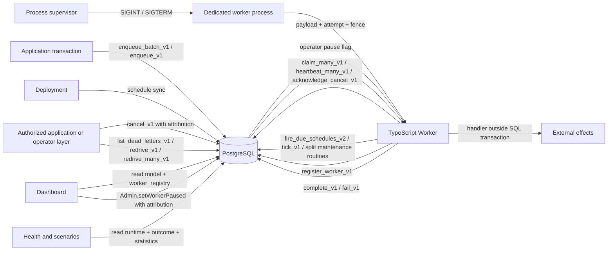

# Workhorse architecture: overview

This page is part of the [Workhorse architecture reference](../architecture.md). It owns the design
objective, the system context and adapter contract, errors, and tenancy.

## Design objective

The design objective is that the dispatch cost scales with live work, not with lifetime completed
work. Schema version 1 stores:

- stable identity and the current accepted definition in `task`. A pending keyed debounce can
  replace the definition before dispatch.
- exactly one mutable `task_runtime` row only while a task is scheduled, blocked, ready, or active
- exactly one immutable `task_outcome` row after success or terminal failure
- at most one bounded mutable `task_progress` projection, separate from payload and outcome
- immutable audited `task_redrive` edges between failed sources and fresh target identities
- append-only, time-partitioned `task_event` and `attempt_history`

## System context

PostgreSQL is the durable authority. A worker owns a task only while the active `task_runtime` row
matches its worker ID and fence token and has not expired.

### Connections and clients

`@stablemates/workhorse` exports node-postgres `Pool` as its default connection implementation.

- `Queue`, `Admin`, and schema operations accept that pool or another `Queryable` that an adapter
  supplies.
- `Worker` accepts a `Queue` or another `WorkerQueueApi`.

### Worker processes

Workers run in dedicated processes. Each process owns:

- its adapter
- its Workers
- an optional probe-only listener
- termination signals
- bounded drain
- final resource close

Web frameworks have no part in the worker lifecycle. See
[`worker-processes.md`](../worker-processes.md) and
[ADR 0012](../decisions/0012-dedicated-worker-processes.md).

### ORM adapters

`@stablemates/workhorse-drizzle`, `@stablemates/workhorse-prisma`, `@stablemates/workhorse-typeorm`,
`@stablemates/workhorse-kysely`, and `@stablemates/workhorse-knex` convert the database objects and
transaction objects of a provider into `Queryable`.

Each adapter finds the node-postgres pool differently:

| Factory                | How it finds the pool                                                                                                                                |
| ---------------------- | ---------------------------------------------------------------------------------------------------------------------------------------------------- |
| `createDrizzleAdapter` | Discovers the retained node-postgres pool through `$client`.                                                                                         |
| `createTypeOrmAdapter` | Discovers it as `dataSource.driver.master`, which TypeORM's `PostgresDriver` creates on `initialize()`. The adapter finds it at worker construction. |
| `createPrismaAdapter`  | Accepts the option `pool`.                                                                                                                           |
| `createKyselyAdapter`  | Accepts the option `pool`. Kysely callers can pass the pool that `PostgresDialect` uses.                                                             |

Each adapter exposes `queue` and `admin`. `forTransaction` and `adminForTransaction` bind the
related client to a caller-owned transaction. Neither method commits, rolls back,
disconnects, or destroys that transaction.

Each adapter closes resources only through its configured `close` callback.
`WorkhorseAdapter.close()` calls that callback once.

#### Prisma and TypeORM queryables

`prismaQueryable` sends the statement and positional values through `$queryRawUnsafe`.
`typeOrmQueryable` sends them through `query`.

Both require a row array. Both create the `QueryResult` metadata that core does not read:

- an empty `command`
- the row-array length as `rowCount`
- zero as `oid`
- an empty `fields` array

`PrismaQueryError` and `TypeOrmQueryError` keep the statement and the original `cause`. Neither
copies parameter values into the message. Their error-code searches process at most 16 queued
entries. They accept only five-character uppercase alphanumeric codes.

- `PrismaQueryError` prefers `meta.code` over Prisma's outer raw-query code.
- `TypeOrmQueryError` follows `driverError` and `cause`.

Each adapter copies the discovered code to its wrapper's `code` property. Core uses it to preserve
typed SQL conflicts.

#### Drizzle queryable

`drizzleQueryable` rebuilds the statement as a Drizzle `SQL` value. Each positional `$N` becomes
`sql.param`, and the text between parameters becomes `sql.raw`.

The scan follows PostgreSQL's lexer. A `$N` stays text inside any of these:

- a string literal
- an `E''` escape string
- a quoted identifier
- a line comment
- a nested block comment
- a dollar-quoted body
- an identifier

Comment and continuation rules:

- A line comment ends at a line feed or a carriage return.
- If whitespace that contains a newline separates two literals, the literals form one constant.
  The continuation keeps the escape rules of the first segment.
- A line comment counts as that whitespace. Thus a quote in a line comment never starts a
  continuation.
- A block comment between two literals keeps them separate.

Thus the plpgsql bodies of a schema script get to PostgreSQL with no change. If a real `$N` has no
matching value, the result is a `RangeError`.

For a parameter-free script with several statements, node-postgres returns one result per
statement. `executeDrizzle` returns the rows of the last one.

#### Kysely queryable

`kyselyQueryable` builds a `CompiledQuery.raw` from the statement and positional values. It then
calls `executeQuery` on either a `Kysely` database or `Transaction`. It maps `QueryResult.rows` into
the same synthetic node-postgres metadata as the Prisma and TypeORM queryables.

`KyselyQueryError`:

- keeps the statement and the original `cause`
- follows at most 16 nested causes
- accepts only five-character uppercase alphanumeric codes
- copies the discovered code to its wrapper

#### Knex queryable and Objection recipe

`knexQueryable` in `@stablemates/workhorse-knex` accepts a Knex database or transaction with
`client: "pg"`. It sends each statement through
`raw(statement).options({ text: statement, values: [...values] })`. The released fixture pins Knex
3.3.0, pg 8.23.1, and Objection 3.1.5. Other versions are not certified.

Knex rewrites question marks, also those in literals, comments, dollar quotes, and JSON operators.
The native `text` option restores the SQL after that rewrite. Repeated and out-of-order `$N`
parameters keep the native PostgreSQL semantics.

The adapter rejects `postProcessResponse` at adaptation and before every execution. It accepts only
one native result with object `rows`. Result arrays from multi-statement scripts fail, and
transformed rows also fail. Custom clients and listeners that change queries are outside the
verified boundary.

Rows keep the native values and order of pg. The shared provider creates the same metadata that the
earlier sections describe. `KnexQueryError` keeps `statement`, the original `cause`, and the
SQLSTATE `code` through the shared `QueryError` implementation.

The adapter does not extract connections. It does not bypass the Knex guard against completed
transactions. Callers own transactions, savepoints, and Knex destruction. The adapter does not
validate the database of a transaction against its base executor. The Objection call
`Model.query(transaction)` uses that same Knex transaction. It needs no additional package.

Workers use compatible pg pools that are configured separately. A Knex adapter accepts an explicit
`pool` for dedicated heartbeat sessions and listener sessions. It never extracts the internal pool
of Knex. Without `pool`, a worker requires the explicit `sharedHeartbeats` opt-out.

### What an adapter must guarantee

`typescript/core/src/adapter.ts` owns the shared implementation of every guarantee below.
`@stablemates/workhorse` exports it as `QueryError`, `rowsToQueryResult`, `attachConnectionPool`,
`createProviderQueryable`, `createProviderAdapter`, and `createWorkhorseAdapter`. If an adapter uses
them, it supplies only the way that its ORM runs a statement. If an adapter does not use them, it
must still give the same guarantees.

1. **Statement execution.**
   - `query(text, values)` sends `text` unmodified with `values` as positional parameters.
   - It returns a `QueryResult` whose `rows` preserve result order.
   - `rowsToQueryResult` sets `rowCount` to the row-array length, `command` to the empty string,
     `oid` to zero, and `fields` to an empty array. Core reads only `rows` and `rowCount`.
   - If a provider answers with a value that is not a row array, the query fails. The result is not
     an empty result.
2. **Transaction adaptation.**
   - `forTransaction(transaction)` returns a `Queue` bound to the caller's transaction.
   - `adminForTransaction(transaction)` returns the matching `Admin`.
   - Neither client commits, rolls back, disconnects, or destroys the transaction.
   - A claim through either client requires that the transaction runs at read committed. See
     [Claim](lifecycle.md#claim).
3. **Error translation.**
   - A failed statement throws an error extending `QueryError`. The error retains `statement` and
     the original `cause`, and copies the SQLSTATE to `code`.
   - The code comes from `databaseErrorCode` in `typescript/core/src/errors.ts`. It searches
     breadth-first over `cause`, `driverError`, and `meta`. It visits at most 16 objects, and it is
     cycle-safe.
   - It accepts only five-character uppercase alphanumeric codes. It prefers a nested SQLSTATE over
     a Prisma `P\d{4}` code that carries `meta`.
   - Core uses this code through any ORM wrapper to raise these errors:
     - `EnqueueIdempotencyConflictError` for SQLSTATE `P1001`
     - `RedriveIdempotencyConflictError` for `P1002`
     - `DependencyCycleError` for `P1003`
     - `DependencyLimitExceededError` for `P1005`
   - Messages never copy parameter values.
4. **Failures that pass through untranslated.**
   - A `QueryError` is already translated. The adapter rethrows it as-is and does not nest it
     again.
   - A `RangeError` states that the statement itself is malformed. It has a placeholder with no
     matching value. That is an error of the caller, not of the database.
5. **Connection pool.**
   - An adapter gives workers a node-postgres pool through `attachConnectionPool`. It stores the
     pool, or a function that finds the pool, on the queryable under an internal symbol.
   - A value counts as a pool only if it has `connect()`. `options.max` gives its capacity.
   - The pool object is the sharing identity. Queryables built from one pool share one listener and
     one heartbeat connection.
   - Transaction queryables never carry a pool, because that session ends.
   - Without a pool, a worker refuses to start unless `sharedHeartbeats` is set. If that option is
     set, the worker dispatches by bounded polling.
   - `connectionPoolOf(database)` resolves that pool for any caller. `@stablemates/workhorse`
     exports it with its `ConnectionPool` type. It checks in this order:
     1. an attached pool, calling the function when the adapter attached one
     2. the queryable itself, when it has `connect()`
     3. otherwise `undefined`
   - With the function form, TypeORM can attach the pool of its driver before the data source
     connects. Thus a caller resolves the pool at use, not once.
6. **Resource ownership.**
   - An adapter closes nothing it did not create.
   - `WorkhorseAdapter.close()` calls the configured `close` callback at most once, for any number
     of calls.

### Connection poolers

Every production statement is self-contained. No code path issues `SET`, holds a cursor, or takes a
session-level advisory lock. Thus `pool_mode = transaction` serves every queue operation.

Two kinds of session state are the exceptions. `integration-pooling.test.ts` runs each pooler and
pool mode as a separate lane to prove the boundary.

#### `LISTEN` notifications

`LISTEN workhorse_tasks` is session state. The table gives the behavior of each pooler:

| Pooler and mode               | Behavior                                                                                                                                                                                                                                                              |
| ----------------------------- | --------------------------------------------------------------------------------------------------------------------------------------------------------------------------------------------------------------------------------------------------------------------- |
| PgBouncer session mode        | Delivers `NOTIFY` normally.                                                                                                                                                                                                                                           |
| PgBouncer in transaction mode | Accepts `LISTEN`, returns success, and then releases the server connection. The pooler never delivers a notification, and no error gets to `onNotificationError`. The subscription reports that it listens, while the `Worker.run()` fallback poll does the dispatch. |
| PgCat, either pool mode       | Relays a buffered notification only with the next query result of the client. Thus an idle `LISTEN`ing worker gets no notification.                                                                                                                                   |

To restore wake hints, use a worker pool that connects to PostgreSQL without those poolers. An
example is the `pool` of the Prisma or Kysely adapter. The alternative is a `Queue` whose queryable
has no `connect()`. That `Queue` uses only polling, and its workers need `sharedHeartbeats`.

#### Advisory locks

Session advisory locks (`pg_advisory_lock`, `pg_advisory_unlock`, `pg_try_advisory_lock`) stay
with the server session that ran them. They continue after the client checkout ends. Under
transaction pooling, a second client can acquire a key that the first client holds. Also, grants
leak onto pooled backends.

Every Workhorse advisory lock is transaction-scoped (`pg_advisory_xact_lock`,
`pg_try_advisory_xact_lock`, `pg_advisory_xact_lock_shared`). This includes the schema-migration
lock. No production path is affected. The session forms exist only in test harnesses.

#### Heartbeat connection

The reserved heartbeat connection of the TypeScript worker holds no session state. It runs only
`heartbeat_many_v1`, and it bounds each round on the client. It never issues `SET`. It works in
every pool mode.

#### Connection budgets per language

Before handlers and cohorts take connections, each language holds these connections:

| Language   | Listener connection                                                                                                                                | Heartbeat connection                                                                  |
| ---------- | -------------------------------------------------------------------------------------------------------------------------------------------------- | ------------------------------------------------------------------------------------- |
| TypeScript | One `TaskNotificationHub` per pool in `notifications.ts`, holding one pooled connection. `listeningPool` skips it when `options.max` is 1 or less. | One shared heartbeat connection per pool in `heartbeat-connection.ts`.                |
| Go         | One `taskNotificationHub` per `*pgxpool.Pool`. `subscribeToTaskNotifications` polls instead when `MaxConns` is below 2.                            | `holdHeartbeatConnection` holds the shared heartbeat connection.                      |
| Ruby       | One `Worker::Listener.shared(pool)` per pool object, holding one pool connection.                                                                  | One `Worker::Heartbeat.dedicated(pool)` per pool object, holding one pool connection. |
| Python     | One per `Worker` or `AsyncWorker`, from the supplied Psycopg or asyncpg pool.                                                                      | One per `Worker` or `AsyncWorker`, from the same pool.                                |
| Rust       | Opened per worker by `notifications::listen` from `WorkerOptions::listen_config`, outside the pool.                                                | One per worker, from the pool.                                                        |

TypeScript keys both its listener and its heartbeat connection by the pool object. Go follows the
same pattern.

In every language, a dedicated heartbeat connection needs a pool of at least 3 connections, unless
the opt-out is set:

- `sharedHeartbeats` in TypeScript
- `SharedHeartbeats` in Go
- `shared_heartbeats` in Python, Rust, and Ruby

#### Schema operations

Schema operations run under transaction pooling.

- `installSchema` sends `schema.sql` as one multi-statement simple query.
- Each migration step is one `BEGIN`…`COMMIT` script. It takes its transaction-scoped lock behind
  `SET LOCAL lock_timeout`.

### Queue module seams

`Queue` is the application and worker facade. `Admin` is the operator facade. Both constructors
call `createQueueModuleContext` and `createQueueModules`. `typescript/core/src/index.ts` exports
neither factory. Thus both clients share modules and do not expose the module graph.

`createQueueModuleContext` returns an immutable `QueueModuleContext`. The context contains the
`Queryable`, the default queue name, and the validated `QueueOptions`. Every internal module extends
`QueueModule`. `QueueModule` keeps the context for relocated behavior.

`createQueueModules` constructs nine receivers:

- `EnqueueContractsModule`
- `ClaimLeaseFenceModule`
- `CheckpointsProgressWaitsModule`
- `QueueAdministrationModule`
- `WorkerRegistryModule`
- `RetentionMaintenanceModule`
- `CronSchedulesModule`
- `OperatorReadsModule`
- `ChildTasksModule`, for fenced child creation and joining

#### `EnqueueContractsModule`

- `EnqueueContractsModule.enqueue` and `enqueueMany` own enqueue serialization, tracing,
  telemetry, and `P1001` conflict translation.
- `taskAcceptance` selects and validates the current payload contract for direct enqueue and
  schedule synchronization.
- `validateResult` validates completion against the contract version accepted by the claimed task.
- `validateQueueOptions` checks contract configuration before `Queue` creates the immutable module
  context.

`Queue.enqueue`, `enqueueMany`, `syncSchedules`, and `complete` delegate these operations without
changing their public signatures. `typescript/core/src/queue.ts` still re-exports the four public
error classes.

#### `ClaimLeaseFenceModule`

`ClaimLeaseFenceModule` owns `cancel`, `claim`, `heartbeat`, `heartbeatStatus`, `expireOwned`,
`acknowledgeCancel`, `complete`, `fail`, and `recoverExpired`. `Queue` delegates without changing
its public signatures.

- `FencedLease` converts a `ClaimedTask` and worker ID into the exact task ID, worker ID, and
  decimal fence token tuple. Every owned SQL transition in that module uses that tuple.
- `complete` calls the result-contract validation of the enqueue module before the fenced
  transition.
- `recordRecoveryTelemetry` stays shared with `Queue.tick`. `Queue.tick` reports the same recovery
  counters from the combined maintenance function.
- `rowTimestamp` and `nullableRowTimestamp` own PostgreSQL timestamp mapping for this module and
  for the row mappers that remain in `Queue`.

#### `Admin` and operator reads

`Admin` delegates these operations to those modules:

- task lookup, listing, and timelines
- dead letters, redrive, and lineage
- checkpoint and wait reads
- worker inspection
- queue controls

`Queue` does not expose those operator methods.

`OperatorReadsModule.validateTaskListQuery` and `validateTaskTimelineQuery` use
`validateTaskListQuery`, `validateTaskTimelineCursor`, and `validatePageLimit` from
`typescript/core/src/queue/filter-cursor.ts`. The validators enforce the limits exported as
`MAX_TASK_QUERY_PAGE_SIZE`, `MAX_TASK_QUERY_PAYLOAD_BYTES`, and `MAX_TASK_QUERY_REDACT_KEYS`.

### Python and Go admin clients

The Python package exports `Admin` over a caller-owned Psycopg connection. It exports `AsyncAdmin`
through `from_psycopg` or `from_asyncpg`. Both clients expose these methods:

- tasks: `list_tasks`, `get_task`, `get_task_timeline`
- dead letters: `list_dead_letters`, `redrive`, `redrive_many`
- checkpoints and progress: `get_checkpoint`, `list_checkpoints`, `get_progress`
- waits: `get_wait`, `list_waits`, `list_signal_waits`, `list_human_waits`
- workers: `list_workers`, `set_worker_paused`
- queues: `pause_queue`, `resume_queue`, `purge_queue`

`AdminAudit` carries `actor`, `reason`, and `request_id`. Every method uses the same versioned SQL
and row mappers for Psycopg and asyncpg. Neither client commits, rolls back, or closes the caller's
connection.

The Python dashboard backend creates `Admin` from its existing `SyncExecutor`. Thus shared wait
reads and audited queue or worker controls use the public client. They do not use a SQL path that
only the dashboard has.

The Go module exports `NewAdmin(Executor)` beside `NewQueue`. `Admin` uses the caller-owned pgx or
`database/sql` executor. It checks schema compatibility for every operation. It maps the same
versioned protocols:

- task, timeline, and dead-letter reads
- checkpoint, wait, and worker reads
- redrive
- queue pause, queue resume, and queue purge

`AdminAudit` carries `Actor`, `Reason`, and `RequestID` for every mutation. `go/dashboard`
constructs one `Admin` and sends queue and worker controls through it.

### Operator dashboard

The operator dashboard is a separate boundary from the worker fleet. It is a framework-neutral
request host. It reads everything it shows from PostgreSQL, including worker identity, runtime
state, and policy provenance. Thus a caller can mount it in a process that runs no workers.

- Mounting requires only a database connection.
- Policy mutation additionally requires `operator.mode
  === "writable"` and a `DashboardSettingsController`.
- Every call that mutates a policy carries an actor, a reason, a request ID, and an occurrence time
  that the server assigns.

#### Workspaces

`createDashboardHost` accepts exactly one of `database` and `workspaces`.

`workspaces` maps a name to `DashboardWorkspaceOptions`. Each entry carries its own `Queryable` and
optional overrides for:

- `environment`
- `configuredWorkers`
- `maintenanceLoops`
- `operator`
- the five controllers
- `projectDurability`

If an entry omits an override, the host-level option applies.

`DashboardWorkspaceOptions.databaseHost` and `DashboardWorkspaceOptions.databaseName` are optional
labels for display only. They give the host and the name of the backing database. The dashboard
host never derives them from the connection, because a `Queryable` carries no address.

The demo derives its labels from `DATABASE_URL_PRIMARY` and `DATABASE_URL_SECONDARY`:

- `demoDatabaseHostLabel` gives `hostname[:port]`, or the `host` query parameter when the URL names
  no network host.
- `demoDatabaseNameLabel` gives the URL path without its leading slash.

#### Workspace routing

Each workspace gets its own `Admin`, `Queue`, schema-compatibility probe, and RPC context.

- A workspace mounts at `{path}/{name}`, with its endpoint at `{path}/{name}/rpc`.
- The mount path answers a 302 redirect to `{path}/{defaultWorkspace}/tasks`. `defaultWorkspace`
  defaults to the first configured workspace.
- If the first segment names no workspace, the response is 404.
- A workspace name matches `/^[a-z0-9](?:[a-z0-9_-]{0,62}[a-z0-9])?$/i`. It is never `rpc`,
  `assets`, `login`, or `logout`.
- `authorize(request, workspace)` receives the resolved workspace name. It receives null in
  single-workspace mode and outside every workspace.
- Single-admin authentication stays host-wide at `{path}/login` and `{path}/logout`.

#### Workspace switcher

`DashboardRuntimeConfig` carries two fields so that the browser renders its switcher:

- `workspaces`: one `{ name, url, databaseHost?, databaseName? }` for each workspace that
  `authorize(request, workspace)` grants for this request. The database labels appear only when
  configured.
- `workspace`: the rendered one.

In single-workspace mode, the two fields are `[]` and `null`. The switcher menu shows
`databaseHost` and `databaseName` joined by `·` as a dimmed line under the workspace name.

#### Standalone entry point

The standalone entry point accepts `DashboardStandaloneTarget<Database>`. That is either a bare
database or `{ workspaces, defaultWorkspace }`.

`workhorse dashboard` builds one from two sources:

- repeatable `--workspace <name=url>` flags
- a `--config` JSON file whose entries state `url` or `urlEnv`

## Errors

### Error hierarchy

Every error that Workhorse raises on purpose extends `WorkhorseError`
(`typescript/core/src/errors.ts`). `WorkhorseError` extends `Error`, and each subclass sets `name`.

`instanceof WorkhorseError` therefore means "Workhorse rejected this call", not "this call failed".
These errors propagate with no change and do not carry the base:

- a PostgreSQL error
- a handler's own throw
- a driver connection failure

The exported subclasses include:

- `DependencyCycleError` and `DependencyLimitExceededError`, for dependency graph rejection
- `SchemaCompatibilityError`, for a startup refusal. Its `code` is a `SchemaCompatibilityCode`. Its
  `installedVersion` and `expectedVersion` name the two versions that disagree.

`typescript/core/src/index.ts` is the complete export inventory.

### Reading database error codes

An ORM can wrap a PostgreSQL failure. To recognize the failure, the code reads through each
wrapper.

- `databaseErrorCode(error)` returns the SQLSTATE.
- `databaseErrorDetails(error)` returns every `DETAIL` string along the chain.

Both walk breadth-first over `cause`, `driverError`, and `meta`. Both visit at most 16 objects.
Both record visited objects. Thus the walk stops on a cyclic `cause`.

A candidate SQLSTATE must match `/^[0-9A-Z]{5}$/`. If an object carries `meta` and a Prisma code
that matches `/^P\d{4}$/`, the walk holds back that code. The walk returns it only when no nested
object supplies a real SQLSTATE. Prisma reports `P2010` on the same field and keeps the true
SQLSTATE under `meta`.

### SQLSTATE registry

Workhorse owns the following SQLSTATE registry. `schema-sqlstates.test.ts` scans every declaration
and fails if a code gains an unregistered meaning.

| SQLSTATE | Meaning                              | TypeScript result                                           |
| -------- | ------------------------------------ | ----------------------------------------------------------- |
| `P1001`  | Enqueue idempotency conflict         | `EnqueueIdempotencyConflictError`                           |
| `P1002`  | Redrive idempotency conflict         | `RedriveIdempotencyConflictError`                           |
| `P1003`  | Dependency cycle                     | `DependencyCycleError`                                      |
| `P1004`  | Child creation lost the parent lease | SQL changes it to the `stale` status of the child operation |
| `P1005`  | Dependency graph bound exceeded      | `DependencyLimitExceededError`                              |
| `P1006`  | Purge idempotency conflict           | `PurgeIdempotencyConflictError`                             |
| `P1007`  | Fast-tier queue rejects a feature    | `FastTierUnsupportedError`                                  |

`Queue` decodes the diagnostics of each exposed error from `DETAIL`.
[Rejected features and `P1007`](fast-tier.md#rejected-features-and-p1007) lists every feature text
and the matching Python, Go, and Rust errors.

If a payload fails shape validation, Workhorse discards it and uses sanitized placeholder details.
Workhorse does not propagate that payload. `DETAIL` is diagnostic text that an operator or an ORM
can also write.

### Missing rows

`expectOneRow(result, source)` takes the single row that a statement returns by definition. If the
result is empty, it throws `MissingRowError` with the name `source`.

If a set-returning function declares one row and returns an empty result, the installed schema and
this client disagree.

## Tenancy

Workhorse has no tenant object. It documents two tiers. [ADR
0069](../decisions/0069-isolate-tenants-by-database-and-carry-tenant-identity-as-task-metadata.md)
records the decision.

### Isolated tenancy

_Isolated tenancy_ installs the schema into one database per tenant. PostgreSQL enforces the
boundary.

- Every table, policy, budget, schedule, retention window, and dashboard session is separate,
  because each tenant has a separate database.
- Each database runs `workhorse schema migrate` independently.
- Each `Worker` binds to one database.

### Shared tenancy

_Shared tenancy_ carries the tenant on three task fields that already exist:

| Field                                    | Bounds                                                           | Role                                                                                                                                                                                                                                                                            |
| ---------------------------------------- | ---------------------------------------------------------------- | ------------------------------------------------------------------------------------------------------------------------------------------------------------------------------------------------------------------------------------------------------------------------------- |
| `task.concurrency_key`                   | 1 through 256 UTF-8 bytes, queue-scoped                          | `concurrency_policy.max_active_per_key` and the `rate_limit_policy` per-key bucket give the tenant fair share inside one queue.                                                                                                                                                 |
| `task.budget_name`                       | 1 through 256 UTF-8 bytes                                        | One `budget` row per tenant limits the active tasks or the start rate of that tenant across every queue. `sync_budgets_v1` accepts at most 10,000 definitions per call. On the benchmark host, one budget per tenant is a deployment cost of about 130 microseconds per tenant. |
| One `tenant:<id>` element of `task.tags` | `task.tags` holds at most 20 tags of at most 100 characters each | `task_tags_gin_idx` serves the `&&` and `@>` filters in `list_dead_letters_v1`, `redrive_many_v1`, `dashboard_tasks_v1`, `dashboard_tasks_cursor_v1`, and `dashboard_activity_v1`. The dashboard wire validator accepts at most 20 selected tags.                               |

What shared tenancy does not scope:

- `schedule_definition` retains `concurrency_key` and carries neither tags nor a budget.
- `namespace` on schedules, policies, and budgets identifies the owning deployment, not a tenant.
- `retention_policy` is a singleton, so retention windows are per installation.
- Metric attributes never include a key or tag.
- Spans carry `workhorse.task.id` and `workhorse.task.type` rather than the key or tags.
- No function scopes a read or an operator action to a tenant. Tag filters narrow a result, but
  they do not enforce a boundary.

### Admission cost

Admission cost is independent of tenant count. `claim_v1` counts one key through
`task_runtime_active_queue_key_expiry_idx` and one budget through
`task_runtime_active_budget_expiry_idx`. If a per-key limit or budget can skip saturated work, the
claim inspects at most 100 ready rows.

`pnpm benchmark:tenant-cardinality` loads one queue with 100 through 100,000 tenants. Each tenant
has a key, a tag, and optionally its own budget. The queue has 80 saturated rows at the head of the
window.

Results across the whole ladder:

- Median claim latency measured 2.2 through 3.5 ms without budgets.
- Median claim latency measured 3.7 through 4.4 ms with budgets.
- Each admission count used three buffer hits.
- The dashboard task list filtered by tag grew from 1 ms to 94 ms. It materializes the whole task
  projection before it filters.
- `queue_health_v1` reached 2.7 s at 200,000 ready rows.

Both of the last two track total rows, not tenants
([analysis](../benchmarks/2026-09-16-tenant-cardinality-analysis.md)).
