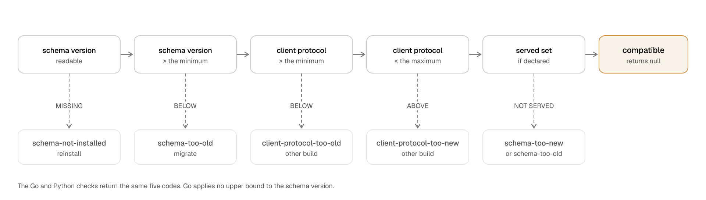

# Workhorse architecture: schema and SQL protocol

This page is part of the [Workhorse architecture reference](../architecture.md). It owns the schema
version, the migration plan and runner, and SQL protocol conformance.

Workhorse is a durable queue in PostgreSQL. Its lifecycle transitions that correctness depends on
are in versioned SQL functions. The TypeScript, Python, Go, Rust, Ruby, and JVM `Queue`, `Admin`,
and `Worker` stay thin protocol clients.

## Schema versions and migrations

The schema version identifies the installed database objects. The migration runner moves an
installation from one version to the next.

### Current version and baseline

The current schema version is 73 (`WORKHORSE_SCHEMA_VERSION`) and the migration baseline is 6
(`WORKHORSE_SCHEMA_BASELINE_VERSION`). `sql/releases/0006.sql` contains the baseline clean-install
artifact, which is the 0.2.0 schema.

The chain started at 1. When support for 0.1.x stopped, the chain was cut to this baseline
([ADR 0073](../decisions/0073-prune-the-migration-chain-to-the-0-2-0-baseline.md)). Thus
`applySchemaMigrationPlan` refuses an installed version below 6. Its message names Workhorse 0.2.1
as the last release that migrates such a version.

SQL protocol functions keep their independent `_vN` suffix. A schema migration does not rename a
function or give that suffix a different meaning.

### Install, migrate, and contract

- `installSchema` reads `sql/schema.sql`. It accepts a fresh database or an already-current schema.
- `migrateSchema` applies `SCHEMA_MIGRATIONS` from `sql/migrations/` through the same path as
  `workhorse schema migrate`. It stops before the first step whose `kind` is `contract`, and reports
  that step in `MigrateSchemaResult.contractStop`.
- `contractSchema` applies the one contract step that is pending at the installed version, through
  `workhorse schema contract`. That command requires `--yes`. First, it names every worker that is
  still live on a retiring protocol.

The current migration plan has one contract step. `0025-add-a-fast-task-tier.sql` moves schema 24 to
25 and retires protocols 1 through 4. Thus, on an older installation, `migrateSchema` stops at
schema 24, and `contractSchema` applies step 25. The additive steps 26 through 73 follow. A second
`migrateSchema` run then completes the plan.

Their files run from `0026` to `0074`. File number `0035` was reserved and never used. Thus, from
`0036` on, the number of a file is one above the version that it produces.

Step 25 ships without the usual retention window, as
[ADR 0077](../decisions/0077-add-a-fast-task-tier-that-records-one-outcome-row-per-task.md) §6
records.

### Migration history and served protocols

A clean installation records `(6, 'baseline')` in `workhorse.schema_migration`, then one row per
later step.

`workhorse.protocol_version` records the served SQL protocol versions (currently exactly 5). It is
independent of that history. `readProtocolVersions` reads it. If that table is absent, it returns
null.

### The migration plan

`migrateSchema` gives the ordered execution to the internal `applySchemaMigrationPlan` function. Its
`SchemaMigrationPlan` has `baselineVersion`, `currentVersion`, `steps`, and `readStep` fields.

Each `SchemaMigrationStep` has `fromVersion`, `toVersion`, `file`, `description`, `kind`,
`execution`, and `retiresProtocolVersions` fields:

- `kind` is `additive` or `contract`.
- `retiresProtocolVersions` is required on a contract step and forbidden on an additive one.
- `execution` is `transactional` or `nontransactional`. If it is absent, it defaults to
  `transactional`.

Every migration file starts with a `-- workhorse-migration: {"kind": ...}` declaration. The runner
requires that this declaration agrees with its `SCHEMA_MIGRATIONS` entry on both `kind` and
`execution`.

### Transactional steps

The plan runner wraps every step file in one transactional script, in this order:

1. `BEGIN`.
2. The `pg_advisory_xact_lock(hashtext('workhorse:schema-migration'))` lock.
3. A guard that raises unless exactly one `workhorse.schema_version` row equals `fromVersion`.
4. The step body.
5. The bookkeeping that advances `workhorse.schema_version` and inserts the
   `workhorse.schema_migration` row.
6. `COMMIT`.

Before execution, the runner rejects a body that contains any of these:

- `BEGIN`, `COMMIT`, `ROLLBACK`, or `START TRANSACTION`.
- A statement-ending `END` or `ABORT`.
- `PREPARE TRANSACTION`.

When a step fails, the runner reports one of two outcomes:

- If a concurrent migrator committed the same step, the runner treats the failure as the success of
  that migrator.
- Any other failure rolls back atomically and reports
  `Workhorse migration <file> failed and was rolled back`.

Before the runner reads the version back, it sends `ROLLBACK`. If the caller passed a single
`Client` rather than a `Pool`, a failed step leaves an aborted transaction. The `ROLLBACK` ends it.

### Nontransactional steps

A step that declares `execution: "nontransactional"` runs outside that script. Thus
`CREATE INDEX CONCURRENTLY` can reach PostgreSQL outside a transaction block.

`splitSqlStatements` divides its body at semicolons outside strings, quoted identifiers, comments,
and dollar-quoted bodies. The runner sends the guard, then each statement, then the bookkeeping, as
separate queries. The runner repeats the guard inside the bookkeeping transaction, behind the
advisory lock. The runner does not set `lock_timeout` for such a step.

Nothing rolls back. If a statement fails, the earlier statements stay applied at the starting
version. The runner reports `Workhorse migration <file> failed part-way and rolled nothing back`.

### Refused installations

Each of these fails without running a migration:

- An installed version below the baseline 6 or above the current 73.
- A version no step starts from.
- A `workhorse.schema_version` table without exactly one row.

`isMissingDatabaseRelationError` unwraps database errors through `databaseErrorCode`. It returns
true only for PostgreSQL SQLSTATE `3F000` (invalid schema name) or `42P01` (undefined table).

### Migration tests

`typescript/core/test/schema-migrations.test.ts` migrates every frozen artifact under
`sql/releases/`. It requires that the schema-only dump is equal to the dump of a clean installation.

## SQL protocol conformance

The SQL protocol is the set of versioned functions and views that clients use. Shared fixtures make
sure that each language uses the protocol in the same way.

### Manifest and compatibility fixture

`protocol/v1/manifest.json` declares fixture format 1 and SQL protocol 5. It accepts installed
schema versions 73 and newer inside the major line, and client protocol 5 only. Schema version 73
is the floor because it adds `heartbeat_v2`, which every SDK catalogue names. Schema version 72
added `heartbeat_many_v2`, which every SDK catalogue also names
([ADR 0105](../decisions/0105-skip-a-locked-row-in-a-heartbeat-and-report-the-lease-as-busy.md)).
Before that, schema version 69 was the floor because it fences a member add in
`add_task_group_members_v1`. On an earlier schema, a worker whose lease expired can still add tasks
to the group of its member task. Schema version 70 does not raise the floor: it changes only the lock
order of `purge_queue_internal_v1`, which no SDK statement calls directly. Schema version 71 does
not raise the floor either: it changes how that function treats a prerequisite of a waiting
dependent, and no SDK statement or result shape changes. Schema version 68 adds `save_checkpoint_v2`, which every SDK catalogue
names. Schema version 67 adds `list_newest_task_group_events_v1`, which the task group detail of each SDK dashboard calls.
Schema version 66 adds `dashboard_task_groups_v1`, which the dashboard of
each SDK also calls. Schema version 65 adds the task group functions that every SDK catalogue calls. Earlier, the floor
was 54, because earlier schemas treat the terminal failure override as an immediate retry.

`MINIMUM_SCHEMA_VERSION` holds the `schema.minimumVersion` value of `protocol/v1/manifest.json`.
That value is derived, not written by hand. It is the newest schema version that added an
object that this release calls. `docs/schema-lifecycle.md` states how it is derived and what
enforces it.

The manifest also pins `dashboard_signal_wait_v1` and `dashboard_human_wait_v1` as read contracts.
Their projections support public lists of external waits and do not expose private tables.

`protocol/v1/compatibility.json` compares the installed schema with the protocol version of the
client. It identifies an absent, older, current, or newer schema. Every incompatible case requires
a refusal before a mutating function runs.

### Governed surface

`protocol/v1/governed-surface.json` records the wider set. It lists every `workhorse.` function,
view, and column that a supported release reads. It lists the internal helpers next to them.

`scripts/generate-sql-catalogues.ts` derives that file from these sources. Then it classifies a
change against the file:

- the manifest's statement catalogue;
- the three dashboard backends;
- the published `dashboard_*_v1` views.

`pnpm sql-catalogues:check` fails a removed or retyped entry by name. It passes an addition. The
generator can add to that file, but it must never remove an entry from it. Thus a migration that
drops a function fails, even when `sql/schema/current.sql` also drops it.

### Scenario fixture

`protocol/v1/scenarios.json` runs raw versioned PostgreSQL functions and versioned dashboard views.
It covers enqueue, claim, heartbeat, completion, failure, cancellation, retry, checkpoint,
timer boundaries, coalescing, dependencies, child tasks, signals, and human decisions.

Its matching rules:

- Exact JSON surrounds typed placeholders for UUIDs, timestamps, and integers.
- Captured values keep identity and fence relationships across later steps.
- Structured errors pin SQLSTATE, message, canonical JSON detail, and deterministic digests.

### Interpreter fixture

`protocol/v1/interpreter.json` pins the semantics of `$type`, `$ref`, normalization, capture reuse,
and structured-error matching. It does not query PostgreSQL. Each language runs it through its own
functions:

| Language   | Functions                                                                                                |
| ---------- | -------------------------------------------------------------------------------------------------------- |
| TypeScript | `materializeInterpreterValue`, `normalizeFixtureValue`, `assertFixtureValue`, `assertProtocolErrorValue` |
| Go         | `materializeInterpreterValue`, `normalizeProtocolValue`, `matchFixtureValue`, `matchProtocolErrorValue`  |
| Python     | `materialize_interpreter_value`, `normalize`, `assert_value`, `assert_error_value`                       |

### Runtime fixtures

`protocol/v1/runtime.json` defines worker behavior above the SQL protocol. The TypeScript suite runs
every fixture through `Worker`. Python, Go, Rust, Ruby, and JVM runtimes must run the same fixtures.

| Fixture      | Pins                                                                                                                                                                                                 |
| ------------ | ---------------------------------------------------------------------------------------------------------------------------------------------------------------------------------------------------- |
| Batch        | Priority order, positional outcomes, retries, terminal failures, and independent attempt state.                                                                                                      |
| Suspension   | Durable-timer suspension, immediate worker-slot release, replay within one logical attempt, and reuse of completed checkpoints.                                                                      |
| Ownership    | Cooperative cancellation, database-authoritative deadline and execution-timeout settlement, lease-loss fencing, non-overlapping worker heartbeat batches, and graceful drain without further claims. |
| Poll cadence | The empty-claim backoff step.                                                                                                                                                                        |

In the poll-cadence fixture, `emptyPollsBeforeEnqueue` names the step under test. Each language
holds its worker at the end of every empty claim. Thus the enqueue occurs on that step, not on the
step that the runner reached. `enqueueStallMs` then delays the enqueue past one full step. Thus an
executor that only counts empty polls fails on every run instead of once under load.

### Durable replay conflicts

All six SDK workers settle durable replay conflicts through `fail_v1` with `p_retry_delay_ms = -1`.
Schema version 54 reserves that override for terminal failure, even when
`current_attempt < max_attempts`. Earlier schemas read the terminal override as an immediate retry.
Thus workers require schema version 54 or newer. The current floor, 73, includes it.

Both `fail_v1` and `fast_fail_v1` keep the current attempt and write the usual failed outcome and
history. The ownership, cancellation, deadline, and execution-timeout checks still occur before the
failure settlement.

The retry-delay argument has these other meanings:

- NULL uses the persisted retry policy.
- Zero requests an immediate retry.
- Other negative values keep their legacy zero-delay behavior.

#### Conflict classes

The terminal classes are `CheckpointConflictError`, `CheckpointInputConflictError`,
`WaitConflictError`, `ChildConflictError`, and `HumanWaitConflictError`. `ChildConflictError`
includes a changed child set. `CheckpointInputConflictError` occurs when a checkpoint name is stored
with the fingerprint of a different input
([Data model: `task_checkpoint`](data-model.md#task_checkpoint)). A checkpoint call raises it
only when the call gives an input. `protocol/v1/runtime.json` does not pin it.

A worker also treats a conflict that the handler wraps in its own error as terminal. Each SDK
follows the cause chain of its language, so Python and Ruby also count an implicit cause.
TypeScript, Python, Ruby, Rust, and the JVM read the cause chain to a depth of 16 errors, including
the outer error. Go uses `errors.As`, which reads the whole chain. The failure envelope then
records the name of the conflict. Its fields `message` and `stack` stay those of the outer error.

- Go identifies wrapped conflicts with `errors.As` and keeps their class names.
- Rust converts `Error::Conflict` for `Operation::Checkpoint`, `Sleep`, `RunChild`, `RunChildren`,
  and `WaitForHuman` into those named `HandlerError` values. Its generic error conversion requires
  an owned (`'static`) error, so that it can examine the error chain. The conversion examines at
  most 16 errors, including the root. Thus a cyclic source chain cannot block the settlement.
- Rust marks the converted `HandlerError` with a private conflict flag. `fail_with_state` reads that
  flag, not the name. Thus a handler error built with `HandlerError::named("WaitConflictError", …)`
  retries under the policy of the task.
- Rust converts `Error::CheckpointInputConflict` into the `HandlerError` named
  `CheckpointInputConflictError`, with the same conflict flag.
- Ruby uses `ConflictError`. Its message identifies the operation and the retained name. Its
  subclass `CheckpointInputConflictError` also identifies the stored and the requested fingerprint.
- Python makes `CheckpointInputConflictError` a subclass of `CheckpointConflictError`, so the worker
  settles it with the other terminal classes.
- Go finds a wrapped `*CheckpointInputConflictError` with `errors.As` and records the name
  `CheckpointInputConflictError`. It is a separate type, so `errors.As` does not match it as a
  `*CheckpointConflictError`.

#### Settling a conflict

For these errors, the worker skips its retry-delay callback. Then it records the conflict name in
the failure envelope. Only the conflict settlement sends `-1`. A TypeScript `retryDelayMs` callback
can return a value other than `undefined` or a safe integer from 0 through 2,147,483,647. If it
does, the callback throws before `fail_v1`. Python and Ruby raise an error for a negative callback
result. Go replaces a negative result with nil. Configured redaction still records
`RedactedTaskError`. The terminal classification occurs before redaction.

Transient failures, lease loss, child-limit refusals, and already-waiting signal refusals keep their
existing settlement behavior. `protocol/v1/runtime.json` pins terminal conflicts and those retryable
controls in every SDK.

#### Replay stored state in a test

The TypeScript SDK exports `replayHandler(handler, payload, state, options)` from
`typescript/core/src/handler-replay.ts`. It runs a handler against the stored durable state of one
task, before a deployment. It uses no database, no worker, and no SQL function. The other SDKs have
no equivalent.

`state` is a `DurableState`, a plain JSON value with one optional record for each kind of name.
Each record is keyed by name. Dates are ISO 8601 strings, so a fixture file can hold the state.

| Field         | Entry type               | Entry fields                                                                           |
| ------------- | ------------------------ | -------------------------------------------------------------------------------------- |
| `checkpoints` | `DurableStateCheckpoint` | `value`, optional `inputFingerprint`                                                   |
| `waits`       | `DurableStateWait`       | `mode`, `wakeAt`, `durationMs` for `relative`, optional `pending`                      |
| `signals`     | `DurableStateSignal`     | `payload`, or `pending: true`                                                          |
| `humanWaits`  | `DurableStateHumanWait`  | `context` and `result`, or `context` and `pending: true`                               |
| `children`    | `DurableStateChild`      | `type`, `payload`, optional `options` in JSON form, optional `set`, optional `outcome` |

A checkpoint entry is an object, so a later field can join `value` without a change to the other
fields. `inputFingerprint` holds the stored fingerprint that `TaskCheckpoint.inputFingerprint`
returns. Omit it for a checkpoint saved without an input. `set` is `settled` for a child that `runChildren` created and `all_success` for a child that
`runChildrenAll` created. It is absent for a child of `runChild`, as `task_child.created_as_set` is
false for that child. A child without `outcome` is not terminal. A pending entry, or a child without
`outcome`, marks the boundary where the task is suspended.

The replay gives the handler a `HandlerContext` that reads only `state`:

1. A stored checkpoint returns its `value`, and its operation does not run.
2. A stored wait, signal, human decision, or terminal child returns as a live worker returns it. A
   pending boundary stops the replay with outcome `suspended`.
3. A name that `state` does not hold is new. A new checkpoint runs its operation, and later calls
   with that name return its value. A new wait, signal, human decision, or child stops the replay
   with outcome `suspended`.
4. `getCheckpoint` and `getWait` mark a stored name as replayed. They never mark a name as new.
5. `getProgress` returns the last value that `setProgress` gave in the replay, or null.
   `taskGroup.get` returns null, and `taskGroup.add` rejects with a `TypeError`.

Overlapping `checkpoint` calls with one name share one operation, as in a live handler. A
`checkpoint` call compares its `input` as a live handler does: only when both sides carry a
fingerprint. A
`waitForHuman` call with the name of an earlier call in the replay must give the same context, in
`JSON.stringify` form. Otherwise it is a conflict, also after the first call stopped the replay. The
claimed task has ID `replay`, type `replay`, and attempt 1, unless `options.task` gives other
fields.

The replay raises `HandlerReplayError` at the first problem. It records the problem, so a handler
that catches the error cannot hide it. `HandlerReplayError.problem.reason` is one of these values:

| Reason              | Cause                                                                                                                                                                                                                                                                                                                                                                           |
| ------------------- | ------------------------------------------------------------------------------------------------------------------------------------------------------------------------------------------------------------------------------------------------------------------------------------------------------------------------------------------------------------------------------- |
| `new_before_stored` | The handler asks for a new name while `state` holds a name that the handler has not asked for. The replay raises the error before a new checkpoint operation runs.                                                                                                                                                                                                              |
| `conflict`          | A checkpoint gives an input whose fingerprint differs from the stored `inputFingerprint` or from an earlier call with the name. A wait changes its mode or its absolute target, a human decision changes its context, or a child changes its type, payload, options, or join call. A child set names other children than the stored children. Values are compared in JSON form. |

`options.allowNew` lists names that the new code adds on purpose, for example a version checkpoint.
A listed name is new, but it does not cause `new_before_stored`. A changed relative wait duration is
not a conflict, as `task_wait` keeps the first target.

A replay without a problem returns `HandlerReplayReport`. `HandlerReplayError.names` holds the same
three lists:

- `replayed`: stored names that the handler asked for, in the order of the first request.
- `new`: names that `state` does not hold, in the order of the first request.
- `unused`: stored names that the handler did not ask for. An unused name is not a problem.

The report `outcome` is `completed` with the handler result, or `suspended` with the boundary. An
error that the handler throws reaches the caller unchanged, unless the replay found a problem or
reached a suspension first.

The child rules follow `create_child_v2` and `create_children_v1`:

1. A task creates one child through `runChild`. A `runChild` call conflicts when `state` holds a
   child with another name, or when the replay already asked for another `runChild` name. A child
   of `runChild` conflicts with a stored child that has `set`. A child set conflicts with a
   stored child that has no `set`, or that has another `set` value.
2. When `state` holds children, a child set must name each stored child and no other child. A task
   holds one child set. An empty child set conflicts when `state` holds a child.
3. When `state` holds no child, the names of a child set are new, and the replay stops at the first
   child.
4. A repeated name in one child set throws a `TypeError` before the replay compares the set.
5. A `runChild` call with the name of an earlier `runChild` call, and a child set after an earlier
   child set, must make an equal request. Otherwise it is a conflict, also after the first call
   stopped the replay. The replay compares these requests as a live handler compares calls in
   flight: structured clones, where an omitted set `options` differs from `{}`.

A stored child with a `failed` or `canceled` outcome makes `runChild` and `runChildrenAll` throw a
`TypeError`, because a live parent task does not resume after that outcome. `runChildren` returns
each settled outcome.

The state comes from the caller. `Admin.listCheckpoints` and `Admin.listWaits` return checkpoints
and timer waits. No admin read returns a delivered signal payload, a human decision context or
result, a child result, or the stored child request (`task_child.request_fingerprint`).

### Failure envelope

`protocol/v1/failures.json` pins the JSON error envelope that a worker passes to `fail_v1`.

| Envelope   | Fields                                                                                                 |
| ---------- | ------------------------------------------------------------------------------------------------------ |
| Unredacted | Exactly `name`, `message`, and `stack`. `stack` is a string or null.                                   |
| Redacted   | Exactly `name` and `message`, holding `RedactedTaskError` and `Task handler failed; details redacted`. |

The redacted values are the values that `redact_error_details_v1` writes. Thus an envelope that a
worker redacts locally has the same shape as an envelope that PostgreSQL redacts.

#### Error names and stacks

Each language gets `name` from its own error. It never gets `name` from its type system.

- TypeScript reads `Error.name`. For a thrown non-`Error`, it records `NonErrorThrown` with a null
  stack.
- Python reads `type(error).__name__`. It always renders a stack through
  `traceback.format_exception`.
- Go has no name on an error. `handlerErrorName` keeps a wrapped durable conflict's class.
  Otherwise, it uses the first of these:
  1. the result of `ErrorName()` on any error in the chain that implements `ErrorNamer`;
  2. the declared name of an exported concrete error type;
  3. `Error`.

In Go, `handlerErrorStack` reads `ErrorStack()` from any error in the chain that implements
`ErrorStacker`. Otherwise, it records null. `errors.As` walks the chain. Thus a wrapped error still
gives the name and the stack of the failure that it reports. Both interface lookups ignore an empty
string.

An error that names nothing is the one value that the languages cannot share. The base error type
of each language names itself. TypeScript, Go, and Rust record `Error`, and Python records
`Exception`. `failures.json` pins that value for each language, so that it cannot drift.

`HandlerPanicError` holds the stack that was captured where `callHandler` or `callBatchHandler`
recovered the panic. Thus a Go panic records the same three fields as a TypeScript or Python
exception.

#### JSON number precision

JSON numbers are the other area where the runtimes are different. PostgreSQL stores a `jsonb` number
at full precision.

- Python decodes a JSON integer as an unbounded `int`.
- TypeScript and Go decode it as an IEEE-754 double. If an integer is beyond 2^53 - 1 in magnitude,
  it arrives rounded, and no error occurs.
- Go's `decodeContractJSON` is the exception. Contract validation decodes with `json.Number`. The
  reason is that a schema bound must be checked against the stored value, not against a double.
- Rust decodes through `serde_json` without `arbitrary_precision`. An integer stays exact within the
  signed and unsigned 64-bit ranges. Beyond them, it becomes a double.

Workhorse does not reject a value past that bound. The reason is that PostgreSQL accepts it and some
languages read it correctly. `docs/parity.md` records the bound and tells a caller to send a larger
identifier as a string.

### Request and schedule fixtures

Both fixtures map public inputs to exact PostgreSQL JSON. The listed methods run every mapping.

| Fixture                      | Maps                  | TypeScript            | Python                      | Go                        |
| ---------------------------- | --------------------- | --------------------- | --------------------------- | ------------------------- |
| `protocol/v1/requests.json`  | Public enqueue inputs | `Queue.enqueueMany`   | `Queue.enqueue_with_result` | `Queue.EnqueueWithResult` |
| `protocol/v1/schedules.json` | Recurring definitions | `Queue.syncSchedules` | `Queue.sync_schedules`      | `Queue.SyncSchedules`     |

`manifest.fixtureCoverage` declares the complete identifier set for `requests`, `schedules`, and
`interpreter`. Each language compares the declaration with the file identifiers. It also compares
the declaration with the identifiers that its runner executes.

### Schema compatibility checks

The TypeScript, Go, and Python checks return the same five refusal codes:

- `schema-not-installed`
- `schema-too-old`
- `schema-too-new`
- `client-protocol-too-old`
- `client-protocol-too-new`

#### TypeScript

TypeScript `PROTOCOL_VERSION` is 5, and `MINIMUM_PROTOCOL_VERSION` and `MAXIMUM_PROTOCOL_VERSION`
are also 5.

`schemaCompatibilityRefusal(state, clientProtocolVersion)` in `typescript/core/src/schema.ts`
applies the tests in the order that `protocol/v1/compatibility.json` sets. It returns a
`SchemaCompatibilityRefusal` that holds a `code` and a `message`, or it returns null.
`clientProtocolVersion` defaults to `PROTOCOL_VERSION`. A caller passes another version only to ask
what a different client gets. The `code` strings are the same as Go's `CompatibilityCode` and
Python's `CompatibilityCode`.

<picture>
  <source media="(max-width: 600px) and (prefers-color-scheme: dark)" srcset="../../site/public/diagrams/schema-compatibility-narrow-dark.png">
  <source media="(max-width: 600px)" srcset="../../site/public/diagrams/schema-compatibility-narrow-light.png">
  <source media="(prefers-color-scheme: dark)" srcset="../../site/public/diagrams/schema-compatibility-dark.png">
  
</picture>

`assertSchemaCompatible` reads the state with `readCompatibilityState`. It throws
`SchemaCompatibilityError` (exported from `typescript/core/src/errors.ts`). The error holds that
`code`, the `installedVersion` that it read, and the `expectedVersion` that this build was compiled
against.

- A missing relation becomes `schema-not-installed`.
- Any other query failure stays a plain `Error`. The reason is that an unreadable database gives no
  result about versions.

`typescript/core/test/schema-compatibility.test.ts` runs every case in
`protocol/v1/compatibility.json`. `typescript/core/test/schema-installation.test.ts` asserts the
thrown type and code against a real database in both directions.

#### Go

Go `ProtocolVersion` is 5. `CheckCompatibility` takes three inputs. It returns
`*CompatibilityError`, whose `Code` is one of the five codes. The inputs are these:

- an installed schema version;
- a client protocol version;
- the protocol versions that the installed schema declares it serves.

It refuses a schema below `minimumSchemaVersion`. It applies no upper bound to the schema version.
The reason is that, inside a major line, a migration only adds. The upper bound comes from the
served set instead:

- A client protocol below the oldest served version is `schema-too-new`.
- A client protocol above the newest served version is `schema-too-old`.
- An empty served declaration enforces nothing.

`AssertSchemaCompatible` runs the `compatibility_state` statement on every call. That statement
returns both facts in one round trip as `kind`/`version` rows. The function translates SQLSTATE
`42P01` or `3F000` to `schema-not-installed`. It accepts exactly one `schema` row.

`AssertCompatible` stays as a deprecated Go alias for the rest of the `0.x` line. It is removed in
`1.0.0`. `go/compatibility_test.go` runs every case in `protocol/v1/compatibility.json`.

### Conformance runner

`scripts/verify-sql-protocol.ts` interprets the language-neutral files. It reads
`workhorse.schema_version`. Before a scenario can change the database, it rejects incompatible
schema or client protocol versions. The clean-install and forward-migration suites both run the
interpreter.

For every TypeScript function call, the suite pins the projection, casts, argument order, and arity.
For each TypeScript view read, it also pins the projection and ordering. Thus a change to the clean
schema, a migration, a TypeScript call, or a fixture fails the same conformance command.

## Python SDK

The Python SDK contains the queue clients and the workers for Python.

### Distribution

The Python distribution is `stablemates-workhorse`, and its import package is `workhorse`. It
requires Python 3.12 or newer.

- The distribution depends on Psycopg 3.3 or newer and below 4.
- The `asyncpg` extra adds asyncpg 0.31 or newer and below 1.

### Public module surface

Every module under `python/src/workhorse/` whose path has no leading underscore declares `__all__`.
That list is the supported surface of the module.

`workhorse` re-exports 126 names. `types`, `errors`, `admin`, `client`, `worker`, `async_worker`,
`worker_process`, `compatibility`, `dashboard_v1`, and `workhorse.dashboard` each declare their own
list.

If a private module owns a name, that name gets to a public module only through an
underscore-prefixed alias. Thus `import workhorse.admin` no longer resolves `SQL_STATEMENTS`,
`LIST_TASKS`, `MAX_PAGE_SIZE`, or `TASK_STATES`. `import workhorse.errors` no longer resolves
`translate_database_error`.

`python/tests/test_public_surface.py` asserts both rules for every public module. It also runs the
`workhorse` import lines in `docs/guides/`, `site/content/docs/`, and `python/README.md`.

### Queue clients

`python/src/workhorse/client.py` exports synchronous `Queue` for Psycopg. It also exports the
asynchronous `AsyncQueue.from_psycopg` and `AsyncQueue.from_asyncpg` constructors.

Python `Queue` accepts a caller-owned Psycopg connection. `AsyncQueue` accepts a caller-owned
Psycopg `AsyncConnection` or asyncpg `Connection`. The clients never call `commit`, `rollback`, or
`close`.

Both clients expose these methods:

| Methods                                                                       | SQL function                   |
| ----------------------------------------------------------------------------- | ------------------------------ |
| `enqueue`, `enqueue_with_result`, `enqueue_many`, `enqueue_many_with_results` | `enqueue_many_v1`              |
| `sync_schedules`                                                              | `sync_schedule_definitions_v2` |
| `cancel`                                                                      | `cancel_v1`                    |
| `send_signal`                                                                 | `send_signal_v1`               |
| `complete_human_wait`                                                         | `complete_human_wait_v1`       |

#### Row factories

`SyncExecutor` and `AsyncPsycopgExecutor` in `python/src/workhorse/_drivers.py` open every cursor
with `row_factory=tuple_row`. Thus the Psycopg connection of a caller can use `dict_row`,
`class_row`, or any other row factory.

The SDK does not change the `row_factory` of the connection. The caller's later queries keep their
configured row shape. `python/tests/test_row_factory.py` covers the clients, workers, `Admin`, and
the compatibility check for each of those factories.

#### Cancellation, signals, and human completion

Each method below has an asynchronous equivalent that returns the same result.

| Method                                                                               | Result                      | Status values                                                                      |
| ------------------------------------------------------------------------------------ | --------------------------- | ---------------------------------------------------------------------------------- |
| `Queue.cancel(task_id, *, requested_by=None, reason=None)`                           | `CancelResult`              | `canceled`, `cancel_requested`, `already_terminal`, `not_found`                    |
| `Queue.send_signal(task_id, name, payload, *, idempotency_key, requested_by)`        | `SignalDeliveryResult`      | `delivered`, `duplicate`, `not_waiting`, `already_delivered`, `stale`, `not_found` |
| `Queue.complete_human_wait(task_id, name, result, *, idempotency_key, requested_by)` | `HumanWaitCompletionResult` | `completed`, `duplicate`, `not_waiting`, `already_completed`, `stale`, `not_found` |

`CancelResult` contains the status, task identity, state, current attempt, request attribution,
reason, and terminal timestamp. `requested_by` is audit attribution. It does not authorize the
caller.

`SignalDeliveryResult` contains its `status`, `task_id`, `name`, the retained `payload`,
`delivered_at`, and `delivered_by`. A changed request under one retained idempotency key raises
`SignalIdempotencyConflictError`.

`HumanWaitCompletionResult` contains its `status`, `task_id`, `name`, the retained result as
`payload`, `completed_at`, and `completed_by`. A changed completion under one retained idempotency
key raises `HumanWaitIdempotencyConflictError`.

#### Input limits and enqueue defaults

| Input                                              | Limit                                                   |
| -------------------------------------------------- | ------------------------------------------------------- |
| External-wait names                                | 1 through 200 characters without surrounding whitespace |
| `timeout_ms`                                       | 1 through 604,800,000                                   |
| Signal payloads, human contexts, and human results | At most 65,536 UTF-8 bytes when encoded                 |
| Delivery idempotency keys                          | 1 through 512 UTF-8 bytes                               |
| `requested_by`                                     | 1 through 200 characters                                |
| Enqueue batches                                    | At most 1,000 requests                                  |

| Enqueue setting           | Default                 |
| ------------------------- | ----------------------- |
| Priority                  | 0                       |
| Attempt budget            | 25                      |
| Payload and result limits | 1,048,576 bytes         |
| Idempotency retention     | 86,400,000 milliseconds |

#### Compatibility checks

Every non-empty Python mutation first runs
`SELECT version FROM workhorse.schema_version ORDER BY version`. `Queue` and `AsyncQueue` enqueue
through a cached check for each queue instead. Thus a warm enqueue sends only `enqueue_many_v1`.

`python/src/workhorse/_protocol.py` accepts schema version 73 or newer and client protocol 5. Before
the mutating statement, it refuses an unreadable, missing, older, or newer schema.

`python/src/workhorse/_statements.py` owns each statement in `STATEMENTS`, with explicit Psycopg and
asyncpg parameter dialects.

- `assert_sync_compatible` and `assert_async_compatible` query on every call.
- `CachedCompatibilityCheck` and `AsyncCachedCompatibilityCheck` serve worker loops and producer
  enqueue. They cache the first answered result, which is success or `ProtocolCompatibilityError`.
- They do not cache a driver error. Thus the next call queries again.

`python/src/workhorse/compatibility.py` publishes that check to applications:

- `assert_schema_compatible(connection)` for synchronous Psycopg;
- `assert_schema_compatible_psycopg(connection)` and `assert_schema_compatible_asyncpg(connection)`
  for the two asynchronous drivers.

Each function wraps the caller-owned connection in the matching executor and reads
`workhorse.schema_version`. It raises `ProtocolCompatibilityError`. It does not create or change a
database object.

#### Contract cache

After `sync_contracts`, each queue caches the `get_contract_definition_v1` row for a task type on
the first enqueue. On a `contract_mismatch` row, it refreshes that entry and retries once, as
TypeScript does. A second mismatch raises `RuntimeError`.

A cached row can also reject a payload that the current selection accepts. In that case,
`enqueue_many_v1` never sees the request. If a cached row raises `TaskContractValidationError`,
`enqueue_many_with_results` reads the row of that task type again, once per call, through the
connection of the caller. It validates again, and the second result is final. It does not read again
a row that it read for the same enqueue.

`enqueue_many_v1` checks the size limit after the version. Thus a raised payload limit arrives
through the `contract_mismatch` refresh.

### Synchronous worker

`python/src/workhorse/worker.py` exports `Worker` for a Psycopg `ConnectionPool` whose connections
use `autocommit=True`. It borrows one connection for each statement and returns it after the
statement.

`Worker.handle(type, handler)` registers a handler whose arguments are the JSON payload and
`HandlerContext`.

- `HandlerContext.task` is the `ClaimedTask` returned by `claim_v1`.
- `HandlerContext.cancellation` is a `CancellationToken` with `cancelled`, `reason`,
  `wait(timeout)`, and `raise_if_cancelled()`.

#### Worker options

| Option                        | Default                                       | Accepts                                                                                                                                            |
| ----------------------------- | --------------------------------------------- | -------------------------------------------------------------------------------------------------------------------------------------------------- |
| `concurrency`                 | 1                                             | Integers from 1 through 100.                                                                                                                       |
| `lease_ms`                    | 30,000 milliseconds per claim                 | 100 through 86,400,000.                                                                                                                            |
| `heartbeat_ms`                | The greater of 100 or one third of `lease_ms` | Positive values less than `lease_ms`.                                                                                                              |
| `poll_ms`                     | 250                                           | Positive values.                                                                                                                                   |
| `maintenance_routine_poll_ms` | 60000                                         | Integers of at least 100. Bounds how often the worker offers the slow retention routines.                                                          |
| `retry_delay_ms`              | Unset                                         | A whole number of milliseconds, or a callable over the attempt and the claimed task. The callable returns `None` to leave the delay to the policy. |

The smallest supported `heartbeat_ms` is 100. The worker accepts a shorter value
([Supported heartbeat interval](lifecycle.md#supported-heartbeat-interval)).

`retry_delay_ms` reports the delay of one failed attempt to `fail_v1`. This delay replaces the
choice of the persisted retry policy.

`queue` selects one queue, and `queues` selects an ordered, de-duplicated set. If the caller
supplies both, `Worker` raises `ValueError`.

#### Claims and slots

The dispatcher fills slots again with overlapping batched `claim_many_v1` calls. It follows the
rules that
[ADR 0076](../decisions/0076-keep-overlapping-batched-claims-in-flight-to-fill-worker-slots.md)
sets for every SDK. The claim passes of the TypeScript worker describe these rules.

Each claimed task starts one handler thread. When a handler finishes, it releases its slot and wakes
the dispatcher.

#### Dispatch sweeps and maintenance

`Worker.run_once()` and `Worker.run()` use a cached compatibility check.

If `maintenance_interval_ms` has elapsed since the last tick, a dispatch sweep runs
`tick_v1(100, 100)`. The tick promotes due retries and durable waits. It also recovers expired
leases with the persisted retry policy. A sweep between ticks sends no `promote_v1` or
`recover_expired_telemetry_v1`. It only claims.

Every claim attempt advances the round-robin queue index. The sweep stops after every queue returns
empty without a claim between them.

#### Heartbeats

One worker heartbeat timer sends every active lease through `heartbeat_many_v2`. It schedules the
next batch only after the prior call returns. A `busy` lease keeps running, and a busy retry sends
it again before the next regular round ([Busy retry](lifecycle.md#busy-retry)).

Unless `shared_heartbeats` is set, every worker on one pool object sends its rounds on the heartbeat
connection that the pool's `HeartbeatReservation` holds
([Shared pool connections](#shared-pool-connections)). Thus a saturated pool cannot delay lease
renewal.

- A Psycopg heartbeat connection must use `autocommit=True`. Otherwise the worker refuses to start.
- A round takes the connection for itself, so the rounds of the workers on one pool run one after
  another, in the order in which they ask for it. The wait for the connection counts against the
  round deadline.
- A round whose turn comes with less than a quarter of its time left skips without a statement. It
  renews nothing, and the connection stays usable for the next round.
- A round holds the connection until its deadline plus 1,000 ms. After that, the reservation stops
  waiting for it and opens a replacement, and the round closes the connection when it returns.
- A round that fails on the connection discards it, and the reservation starts the replacement at
  once.
- The reservation closes the connection when the last worker on the pool stops.
- With `shared_heartbeats`, each round borrows a pool connection, as any other statement does.

`AsyncWorker` uses the reservation of its async pool, with the same lifecycle.

#### Shared pool connections

Every Python worker on one pool object shares one listener connection and one heartbeat connection
(ADR 0071). `python/src/workhorse/_pool_hub.py` holds them in one `PoolHub` for each pool.

| Domain        | Pool                               | Registry             | Listener                                          |
| ------------- | ---------------------------------- | -------------------- | ------------------------------------------------- |
| psycopg sync  | `psycopg_pool.ConnectionPool`      | `SYNC_HUBS`          | `SharedTaskNotificationListener`, one thread      |
| psycopg async | `psycopg_pool.AsyncConnectionPool` | `ASYNC_PSYCOPG_HUBS` | `AsyncTaskNotificationListener`, one asyncio task |
| asyncpg       | `asyncpg.Pool`                     | `ASYNCPG_HUBS`       | `AsyncTaskNotificationListener`, one asyncio task |

- `PoolRegistry` keys a hub by the identity of the pool object. It holds a weak reference to the
  pool, so it never keeps the pool alive.
- A worker attaches to the hub for one run. The registry keeps the hub while a worker is attached,
  and also while the hub's listener or reservation still stops. A worker that starts meanwhile
  gets the same hub, so the pool never holds two listener connections.
- The three domains never share, also when two pools reach one database.
- An async pool belongs to one event loop. An asyncpg pool keeps its loop, and an open psycopg
  `AsyncConnectionPool` runs its scheduler task on its loop. The registry also remembers the loop
  of the first worker of each async pool, for the life of the pool. A worker on another event loop
  raises `RuntimeError` and does not start, also before the first worker of the pool and after
  its last worker stopped.
- The listener holds its connection while it has subscribers. A notification wakes each subscriber
  whose queues contain its payload, and `*` wakes every subscriber. The last subscriber stops the
  listener, which gives its connection back to the pool. Errors of that stop go to the
  `on_notification_error` of the last subscriber.
- An async listener task waits at most 1,000 ms for the release of its connection. A cancellation
  during that wait does not cut it short, and the task raises the cancellation after it. A
  listener task reconnects only while it still has subscribers.
- The `HeartbeatReservation` holds its connection while a worker uses it. It closes the connection
  when the last worker leaves. One lock guards its whole connection lifecycle: acquisition,
  lending, and disposal. While a disposal runs, the reservation is busy and starts no acquisition.

**One owner for the connections of an async hub.** An async hub has one `AsyncConnectionOwner`.
One task on the event loop of the pool does every acquisition, every release, and every late
disposal of the hub's listener and heartbeat connections, one command at a time. Heartbeat
commands go before listener commands when both wait.

- A caller sends a command and waits for its reply until its own deadline. The owner delivers a
  connection only while the caller still waits. A caller that stops waiting abandons the request,
  and the owner then gives the connection back to the pool as its next step. Both sides decide
  under one lock, so a connection reaches exactly one of them.
- The owner holds at most one connection of each kind. An acquisition of a kind waits until the
  release of the earlier connection of that kind has ended, also a release that outlived its
  caller's wait. So a restart never holds two listener or two heartbeat connections.
- A request whose caller left before the owner reached it opens no connection.
- An acquisition that ends with an error, its own timeout too, answers its caller with that error,
  and the next request starts a new acquisition.
- The owner is busy while a command waits or runs, or it holds a connection. The registry keeps a
  hub whose owner is busy. The owner task runs only while a command waits, so a run that returned
  leaves no owner task running.
- The owner does not cancel a pool release. While a release hangs, the owner waits for it, so the
  next acquisition of the hub waits too, and the claim gate stays closed until the reservation
  holds a connection again.

**Startup.** The startup budget is max(`heartbeat_ms`, 5 s). Within it, the worker does these steps
in order:

1. It subscribes to the reservation and waits until the reservation holds its connection.
2. It borrows one ordinary connection, runs the compatibility query, and returns the connection.

One absolute deadline bounds both steps, and also the query itself and the return of its
connection. If a step does not finish by that deadline, the worker raises `TimeoutError`. The error
text names the pool, the budget, and `shared_heartbeats=True`. A `ValueError` of the heartbeat
connection, such as a pool without `autocommit=True`, raises at once. Every startup runs step 2,
also a later run of the same worker, so it proves the headroom of the pool at that start. The
listener subscribes only after both steps, and it stays best effort. Its failures go to `on_notification_error`, and the worker polls while the
listener reconnects. With `shared_heartbeats`, only the compatibility query runs, under the pool's
own timeout.

**Claim gate.** The reservation is ready while it holds its connection or lends it to a round
within that round's time. While it is not ready, the worker starts no claim. Each run has a
generation, and each claim keeps the generation of the run that started it. When the run releases
its reservation, the gate stays closed for every claim of that run. A failed round that
keeps the connection, or a `busy` lease, does not make the reservation not ready. A lost connection
does.

The worker reads the gate again after a statement borrows its connection, and before each attempt
of the statement, also before a deadlock resend. The heartbeat connection can be lost while a claim
waits for a pool connection.

- A `claim_many_v1` or a fast-tier claim that finds the gate closed sends nothing. It does not
  count as an empty claim, and the reservation wakes dispatch when the connection is ready.
- A fused completion that finds the gate closed sends `complete_many_and_claim_v1` with a claim
  limit of 0. It settles its tasks and claims nothing. This also applies to a completion that
  waited behind another batch.

**Replacement.** One acquirer thread at most runs for a reservation. It starts when a worker
subscribes and when a round loses the connection. It also runs when no task is active.

- Each attempt waits at most the round bound of the shortest `heartbeat_ms` of the subscribed
  workers. While a worker waits at startup, the attempt can use the rest of that startup budget.
- A failed attempt retries after a jittered backoff. The backoff starts at 100 ms, doubles, and is
  capped at the shortest `heartbeat_ms`.
- When the connection arrives, the reservation wakes the dispatcher of every subscribed worker.
- A connection that arrives after every worker left, or after a round gave one back, belongs to the
  acquirer, which closes it.
- On an async pool, each attempt is a request to the hub's `AsyncConnectionOwner`, which holds at
  most one heartbeat connection. A replacement thus starts only after the earlier heartbeat
  connection is back in the pool.

**Acquisition bounds.**

| Wait for a pool connection                                   | Bound                                             |
| ------------------------------------------------------------ | ------------------------------------------------- |
| Listener                                                     | 7,500 ms, the round bound at the default interval |
| Heartbeat replacement attempt                                | The round bound of the shortest `heartbeat_ms`    |
| Heartbeat reservation and compatibility query at startup     | max(`heartbeat_ms`, 5 s), together                |
| Registration refresh, with its statement                     | max(`heartbeat_ms`, 5 s), and the stop deadline   |
| Bridge call of an async worker with a bound                  | The bound itself, with no extra wait              |
| Ordinary asyncpg statement                                   | 30 s                                              |
| Claims in flight, maintenance, draining refresh after a stop | The stop deadline                                 |
| `deregister_worker_v1` after the drain                       | 1,000 ms                                          |

A registration statement runs on its own thread, and the worker waits for it until its bound. One
statement at most is in flight. A refresh that finds the previous statement still running skips,
so a stalled statement holds neither the dispatch loop nor a stop.

**Stop.** The first `stop()` of a run fixes the stop deadline at max(`heartbeat_ms`, 5 s) after that
call. A loop that ends without a stop fixes it when it ends. These waits end at the deadline:

- The wait for claims in flight. A claim that has not returned is left behind. A task that it
  claims later stays leased until recovery takes it.
- The join of the maintenance thread. Its current pass can continue, but no other pass starts.
- The draining `register_worker_v1` refresh, also its statement. With no time left, the worker skips
  it.

The handler drain has no bound in the worker. `run_worker_process` bounds it with
`shutdown_timeout_ms`. After the drain, one cleanup window of 1,000 ms starts.
`deregister_worker_v1` spends from it, and an `AsyncWorker` run spends the rest on the release of
the shared listener. A wait on the stop path does not start a new budget.

#### Ownership statuses and expiration

The `heartbeat_many_v2` statuses cancel the matching token with these errors. `busy` and
`accepted` cancel nothing:

| Status              | Error                        |
| ------------------- | ---------------------------- |
| `cancel_requested`  | `CancellationRequestedError` |
| `deadline_exceeded` | `DeadlineExceededError`      |
| `timeout_exceeded`  | `ExecutionTimeoutError`      |
| `stale`             | `StaleLeaseError`            |

A local timer also calls `expire_owned_v1` at the earlier of `deadline_at` and
`attempt_timeout_at`. If PostgreSQL returns `not_due`, the thread retries after 5 milliseconds. It
does not abandon the live attempt.

#### Attempt outcome arbiter

One locked attempt-outcome arbiter accepts the first lifecycle outcome.

- Cancellation calls `acknowledge_cancel_v1` under the claimed worker and fence. It does this even
  if the handler catches the signal and returns.
- `expire_owned_v1` continues to own the deadline and timeout transitions.
- Lease loss raises `StaleLeaseError` and prevents completion or failure.

Supervision stays active through result preparation and the final fenced write. After the settlement
finishes, or after the attempt exits with an exception, the outer `finally` in
`_execute_claimed_task_within_span` does the cleanup:

1. It removes the heartbeat registration.
2. It signals the expiration thread to stop.
3. It joins that thread.

A lost lease ends only that attempt. The handler outcome records `lease_lost`. `run()` and
`run_once()` continue to dispatch, because lease recovery owns the task.

A handler can raise a `BaseException` such as `SystemExit`. The worker then still stops the
heartbeat and joins the expiration thread. The lease then lapses for recovery, and the process can
exit. Each durable wait raises a new suspension instance. Thus the frames of a suspended handler are
released with its task.

#### Failure settlement

Ordinary handler failures pass a JSON error envelope to `fail_v1` with the configured retry
override. PostgreSQL then selects `ready`, `scheduled`, or `failed` from the persisted attempt
budget and retry policy. `_error_envelope` builds that envelope in the shape that
`protocol/v1/failures.json` pins.

#### Run, pause, and stop

- `run_once()` fills freed slots again until one empty queue sweep. Then it drains every claimed
  task and returns whether the pass ran a handler. If all claims of a sweep were of unhandled types,
  the sweep counts as empty. Thus a pass that only released ends the fill and reports no progress.
- `run()` repeats sweeps until a call to `stop()`.
- `pause()` stops new claims. It does not stop active handlers.
- `resume()` wakes the dispatcher.
- `stop()` also wakes the dispatcher. It makes `run()` return only after every active handler
  settles.

#### Notifications and polling

`Worker._run_loop()` clears the wake event before a sweep. Thus a completion or state change during
an in-flight empty claim stays latched for the next wait.

`run()` starts one daemon listener thread, `_TaskNotificationListener`. It borrows one autocommit
connection from the pool through `_psycopg_pool_notification_factory`. It holds that connection
while it listens. The listener runs `LISTEN workhorse_tasks` and wakes for a configured queue or
`*`.

The wait between empty sweeps depends on the listener:

- While the listener is connected, the worker uses a 5,000 millisecond fallback.
- Before the listener connects or after it disconnects, the worker uses the 250 millisecond polling
  default.
- An explicit `poll_ms` replaces both defaults.

The listener reconnects after errors with 10 percent jitter around exponential delays from 100 to
5,000 milliseconds. Each successful `LISTEN` resets the delay and wakes the worker.

The optional `on_notification_error` callback receives setup, connection, read, and close failures.
Listener failure never stops dispatch. `stop()` waits at most 200 milliseconds for the listener
thread, so a blocked pool checkout cannot prevent the worker from draining.

### Python handler context

The handler context gives a Python handler its checkpoint, progress, wait, and child methods.

#### Checkpoints

Python `HandlerContext.checkpoint(name, operation)` loads `task_checkpoint` lazily, once for each
activation. It coalesces concurrent calls by name. It calls `save_checkpoint_v2` under the active
worker and fence. `get_checkpoint(name)` reads the same activation cache.

The method raises `CheckpointLeaseLostError` for `stale` and `CheckpointConflictError` for
`conflict`. With `input=`, it sends the input fingerprint and raises
`CheckpointInputConflictError` for `input_conflict`. Without an input, it sends a NULL fingerprint
([Data model: `task_checkpoint`](data-model.md#task_checkpoint)).

#### Progress

Python `HandlerContext.get_progress()` loads `task_progress` once for each activation.
`set_progress(value)` calls `update_progress_v1` with the active worker and fence. Then it replaces
the activation cache. It returns `TaskProgress`.

- Status `stale` raises `ProgressLeaseLostError`.
- Status `rate_limited` raises `ProgressRateLimitError` with `retry_after_ms`.

#### Timers

`HandlerContext.sleep(name, duration_ms)` and `sleep_until(name, wake_at)` call `schedule_wait_v1`.
`get_wait(name)` loads `task_wait` lazily, once for each activation.

Status `scheduled` suspends the attempt:

1. It sends `suspended_for_wait` to the attempt arbiter.
2. It cancels the local token with a private `BaseException` sentinel.
3. It stops the heartbeat.
4. It skips completion or failure settlement.

If handler code catches that sentinel, the arbiter check after the handler keeps the suspension.
Status `elapsed` returns normally. The methods raise `WaitLeaseLostError`, `WaitConflictError`, or
`WaitLimitExceededError` for their matching protocol statuses.

#### Signal waits

`HandlerContext.wait_for_signal(name, *, timeout_ms=None)` calls `wait_for_signal_v1`.

- Status `waiting` sends `suspended_for_wait` through the same private sentinel and lifecycle
  arbiter as a timer.
- Status `delivered` returns the retained `payload`.
- Concurrent same-name calls share one `Future`.

| Status            | Error                          |
| ----------------- | ------------------------------ |
| `stale`           | `SignalWaitLeaseLostError`     |
| `already_waiting` | `SignalWaitConflictError`      |
| `limit_exceeded`  | `SignalWaitLimitExceededError` |

#### Human waits

`HandlerContext.wait_for_human(name, context, *, timeout_ms=None)` encodes the JSON context and
calls `wait_for_human_v1`.

- Status `waiting` suspends through the same arbiter.
- Status `completed` returns the retained `result`.
- Concurrent same-name calls share one `Future` only when their canonical encoded contexts match.
  If an in-flight or retained context is different, the call raises `HumanWaitConflictError`.

| Status            | Error                          |
| ----------------- | ------------------------------ |
| `stale`           | `HumanWaitLeaseLostError`      |
| `already_waiting` | `HumanWaitAlreadyWaitingError` |
| `limit_exceeded`  | `HumanWaitLimitExceededError`  |

PostgreSQL caps each task at 1,000 signal names and 1,000 human-decision names.

#### Child tasks

`HandlerContext.run_child(name, type, payload, options=None)` accepts child names from 1 through 200
characters. It encodes `EnqueueOptions` without keyed modes or dependencies. Then it calls
`create_child_v2`. If the child queue is omitted, it is the queue of the parent task. A replay keeps
the queue of the stored child, as [Data model: Queue of a child request with no
queue](data-model.md#queue-of-a-child-request-with-no-queue) describes.

- Status `created` sends `suspended_for_child` to the attempt arbiter.
- Status `completed` returns the retained result.
- Concurrent calls with one name share a `Future` only when their canonical requests match.
- The method raises `ChildLeaseLostError`, `ChildConflictError`, or `ChildLimitExceededError` for
  `stale`, `conflict`, or `limit_exceeded`.

`HandlerContext.run_children(children)` accepts at most 100 unique `ChildTaskRequest.name` values.
It calls `create_children_v1` with mode `settled`.

- An empty sequence returns `{}` without suspension.
- Status `created` sends `suspended_for_child`.
- Status `completed` returns `dict[str, ChildOutcome]` in the insertion order of the requests.
  `ChildOutcome` is the tagged union `ChildSucceeded | ChildFailed | ChildCanceled`.

`run_children_all(children)` passes mode `all_success`. It returns successful results as
`dict[str, Json]`. It sends a failed or canceled child up to the parent.

The methods map `stale`, `conflict`, `limit_exceeded`, and `result_too_large` to the matching child
errors. `ChildResultLimitExceededError` keeps `result_bytes` and `result_limit_bytes`.

#### Contracted children

A contracted Python child holds the current contract that `get_contract_definition_v1` returns. The
reason is that a child write has no stale-contract retry. The stamp includes the version,
`payload_max_bytes`, `result_max_bytes`, and the sensitive payload and result keys. Every child
method validates each payload first. It raises `TaskContractValidationError` before it writes.

PostgreSQL compares a replayed request with the accepted request, which includes the contract
stamp. Thus, on `conflict`, the context reads the `contract_version` of each existing child through
`task_child` and `get_task`. It retries once with those versions stamped. If the current contract
rejects a replayed payload, the context builds the request again under those versions before it
writes.

The `AsyncHandlerContext` methods share this path.

### Python batch handlers

`Worker.handle_batch(type, handler, *, max_size, linger_ms)` registers a synchronous Python batch
handler.

- `max_size` accepts integers from 1 through 100 and cannot exceed `Worker.concurrency`.
- `linger_ms` accepts integers from 0 through 60,000.

Each task uses one worker slot while it waits for a full batch or the linger deadline. A batch
holds one type and queue. The coordinator then orders the selected tasks by descending
`ClaimedTask.priority` and by worker claim order.

Each task uses its own handler thread. Thus the dispatcher stamps a claim sequence before that
thread starts. The coordinator ranks by that sequence, not by the order in which threads get to it.

#### Items and outcomes

The handler receives a sequence of `BatchHandlerItem` values. Each item contains `payload` and a
`BatchHandlerContext` with `task`, `cancellation`, `get_checkpoint`, `checkpoint`, `get_progress`,
`set_progress`, and `task_group`.

`BatchHandlerContext.task_group` returns a `TaskGroupContext` with `get()` and `add(requests)`. The
batch context takes these calls from the `HandlerContext` of that task, so they use the fenced lease
of that task and the read of its activation.

`BatchHandlerContext` has no `sleep` or `sleep_until` methods. Thus one task in the batch cannot
suspend the shared invocation.

The handler returns one `BatchHandlerOutcome` mapping per item:

- Status `succeeded` requires `result`.
- Status `failed` requires an `Exception` under `error`.

These fail every task in the batch: a thrown exception, a non-sequence return, the wrong outcome count, or an
invalid mapping.

#### Evidence and settlement

Before invocation, the coordinator calls `record_batch_dispatch_v1` with the ordered task IDs,
attempts, fence tokens, and worker ID. A shared callback failure also calls
`record_batch_failure_v1`. Evidence writes are best effort. They never replace the settlement of
each task in the batch.

Every handler thread keeps its own outcome arbiter, cancellation token, fence token, retry budget,
completion call, and failure call.

### Asynchronous worker

`python/src/workhorse/async_worker.py` exports two factories:

- `AsyncWorker.from_psycopg`, which takes a Psycopg `AsyncConnectionPool`;
- `AsyncWorker.from_asyncpg`, which takes an asyncpg `Pool`.

Each factory wraps the pool in `_PooledAsyncPsycopgExecutor` or `_PooledAsyncpgExecutor`. That
executor borrows one connection for each statement and returns it after the statement.

`_AsyncExecutorBridge` schedules each call on the run loop without a lock. Concurrent statements run
on separate pooled connections. The bridge passes the result rows into the same `Worker` lifecycle
core.

The asyncpg executor decodes the JSON text of every JSON column that the SDK reads. That includes
the `children` array that `create_children_v1` returns. Thus both drivers join a child set.

#### Pool connections

- Unless `shared_heartbeats` is set, `_open_heartbeat_executor` reserves one pool connection for
  heartbeat rounds for the whole run.
- The listener holds another pool connection while it listens.
- Psycopg connections must use `autocommit=True`. If a Psycopg heartbeat or listener connection
  lacks it, the worker raises `ValueError`.

#### Factory options

Both factories accept `queue`, `queues`, `worker_id`, `concurrency`, `poll_ms`, `lease_ms`,
`heartbeat_ms`, `maintenance_interval_ms`, `maintenance_routine_poll_ms`, `registry_interval_ms`,
`retry_delay_ms`, `schedule_namespaces`, and `schedule_catchup_limit`. These options have the same
validation and limits as in `Worker`.

They also accept `shared_heartbeats` and the `on_notification_error` and `on_registration_error`
callbacks. Neither factory accepts a connection factory. The reason is that the worker takes its
heartbeat and listener connections from the pool.

`registry_interval_ms` defaults to 5,000. It accepts `0` to disable registration, or a non-boolean
integer of at least 100 milliseconds.

#### Async handler context

Async handlers run on the run loop and receive `AsyncHandlerContext`. Its durability methods are
awaitable views of the same `_HandlerDurability` instance. Thus row mapping, attempt arbitration,
batch selection, error settlement, telemetry, and drain have no second async implementation.

`AsyncWorker.handle(type, handler)` receives `(Json, AsyncHandlerContext)`. The context exposes
these awaitable methods:

- `get_checkpoint(name)`, `get_wait(name)`, and `checkpoint(name, operation)`;
- `sleep(name, duration_ms)` and `sleep_until(name, wake_at)`;
- `get_progress()` and `set_progress(value)`;
- `wait_for_signal(name, *, timeout_ms)` and `wait_for_human(name, context, *, timeout_ms)`;
- `run_child(name, type, payload, options)`, `run_children(children)`, and
  `run_children_all(children)`.

`AsyncCancellationToken.wait(timeout)` is awaitable. `cancelled`, `reason`, and
`raise_if_cancelled()` match `CancellationToken`.

#### Cancelling an awaitable call

Each awaitable context method runs its synchronous call on a bridge thread. Nothing can interrupt
that thread. Thus a cancelled caller waits for the call to return before it re-raises
`asyncio.CancelledError`. `_await_bridge_call` then retrieves the outcome of the call. Thus the loop
never reports that outcome as unretrieved. The cancellation of the caller has priority over that
outcome.

#### Cancelling a checkpoint

`AsyncHandlerContext.checkpoint(name, operation)` calls `operation` inside the task it tracks. It
does so in the same loop step that checks for cancellation.

If a cancellation arrives before the tracked task returns, it stops the operation:

- A cancelled `checkpoint` stops that task before the call to `operation`, or it cancels the task
  while the awaitable runs. That includes an `asyncio.Task` that `operation` returned.
- `checkpoint` waits for the cleanup of the task.
- If `operation` absorbs the cancellation and returns a value, the tracked task raises
  `asyncio.CancelledError` instead.

In each case, `checkpoint` stores no row in `workhorse.task_checkpoint`. Thus a later attempt runs
the operation again.

If a cancellation arrives after the tracked task returns, it does not stop the save. The synchronous
core sends `save_checkpoint_v2` when `operation` returns. `_await_bridge_call` waits for that bridge
call before it re-raises. If the save is already under way, the caller receives
`asyncio.CancelledError`, and the row can commit at the same time. A later attempt then replays its
value and does not call `operation`.

`save_checkpoint_v2` checks the worker, fence, lease expiry, deadline, attempt timeout, and
`cancel_requested_at` of the runtime row. The asyncio cancellation of the caller is not one of its
conditions. Thus a cancelled await never proves that no checkpoint exists. It also does not undo the
operation's effects on other systems.

`checkpoint` copies the `contextvars` context of the caller. The event loop creates the tracked task
in that copy. Context variables and the current OpenTelemetry span reach `operation`. The changes
that `operation` makes stay inside it, as they do in a task that the handler created.

#### Running and stopping

`AsyncWorker.handle_batch(type, handler, *, max_size, linger_ms)` uses the same limits as
`Worker.handle_batch`. `run_once()`, `run()`, `pause()`, `resume()`, `is_paused()`, and `stop()`
match their synchronous names and return contracts. `AsyncWorker.run_once()`, `run()`, `pause()`,
`resume()`, and `stop()` keep those contracts.

If the task that awaits `run_once()` or `run()` is cancelled, `stop()` is called. `_run_inner`
re-raises `CancelledError` only after the shared core drains. A later cancellation also waits for
that drain. Thus the bridge threads stay open, and a concurrent run call still fails until the core
returns.

When `run()` is the last run on its pool, it also waits through later cancellations until the shared
listener gives its connection back. The wait ends at the stop deadline, max(`heartbeat_ms`, 5 s).
Only then does `run()` close the bridge threads and clear `_running`.

#### Async batch handlers

`AsyncWorker.handle_batch` accepts an async callback and supplies `AsyncBatchHandlerItem` values.
The shared coordinator still owns batch selection, priority order, evidence writes, and the
settlement of each task in the batch.

`AsyncBatchHandlerContext.get_progress()` and `set_progress(value)` are awaitable, as its checkpoint
methods are. `AsyncBatchHandlerContext.task_group` returns an `AsyncTaskGroupContext`, whose `get()`
and `add(requests)` are awaitable and call the `task_group` of the sync batch context. These operations run on the application loop. The shared durability core owns replay
and persistence.

#### Async notifications

`AsyncWorker.run()` subscribes to the `AsyncTaskNotificationListener` of its pool's hub
([Shared pool connections](#shared-pool-connections)). That listener borrows one connection from the
async pool for every worker on the pool, and holds it in one asyncio task. `AsyncWorker` disables
the Psycopg listener thread of the core worker.

- A Psycopg listener connection must use `autocommit=True`. It reads the asynchronous `notifies`
  iterator.
- asyncpg uses `add_listener` and `remove_listener`.

Both filter `workhorse_tasks` payloads to the configured queues or `*`, and wake the shared
dispatcher. Both report listener errors to `on_notification_error`. Both reconnect with the same
jittered backoff.

When the last `run()` on the pool returns, it cancels the listener task. asyncpg calls
`remove_listener` on every exit, which includes that cancellation. Thus the pool never receives a connection with a callback.
`on_notification_error` receives a failed `remove_listener`. The connection still returns to the
pool, and the pool reset discards the `LISTEN`.

`AsyncWorker` never closes the pool it was given.

### Python worker processes

Python `run_worker_process(worker, *, shutdown_timeout_ms, force_exit)` installs `SIGINT` and
`SIGTERM` handlers around `Worker.run()`.

Each handler writes its signal number to a nonblocking self-pipe. A control thread reads the pipe.
Thus lock acquisition, log emission, timer creation, and thread creation occur outside the signal
handler of the main thread.

- The first signal starts the shutdown deadline and calls `Worker.stop()` on a separate thread. The
  deadline defaults to 25,000 milliseconds and accepts integers from 1 through 3,600,000.
- If the worker drains before the deadline, the function restores the previous handlers and returns.
- A second signal calls `force_exit` with 128 plus its signal number. That gives 130 for `SIGINT`
  and 143 for `SIGTERM`.
- An expired deadline calls `force_exit(1)`.

A fatal worker error starts the same deadline. When `Worker` observes the first fatal error of a
run, it reports it through `_report_fatal_error`, before `_drain_active_threads` waits. That
includes a claim error, a maintenance error, a failed execution or settlement, and a failure of the
run loop itself. The process runner arms the deadline once. It does this if a signal comes first,
and also if a fatal error comes first. If the active handlers settle in time, the runner cancels the
deadline and raises the error. Thus the process exits unsuccessfully. Otherwise, the deadline calls
`force_exit(1)`.

The default `force_exit` is `os._exit`. Thus hard termination leaves active leases for
`recover_expired_telemetry_v1`.

### Python tests

The Python tests verify the drivers, the SQL protocol, the release artifacts, and the worker
process.

`python/tests/test_driver_integration.py` verifies commit and rollback visibility through
independent connections.

`python/tests/test_protocol_conformance.py` runs every `protocol/v1/scenarios.json` step. It
verifies compatibility fixtures, canonical rows, captures, SQLSTATE values, messages, and JSON
details.

`python/tests/test_release.py` derives the Python and PostgreSQL support lists from
`python/pyproject.toml` and `typescript/core/src/support.ts`. It requires that the active
interpreter and the connected PostgreSQL server are in those lists.

A session fixture builds the `py3-none-any` wheel and source distribution. It installs each artifact
in clean environments in three ways: bare, with the compatibility `psycopg` extra, and with the
`asyncpg` extra.

- The lifecycle example runs from the bare wheel. It runs retry, checkpoint, timer, child, signal,
  and human-wait boundaries.
- The async example runs from the source distribution with the `asyncpg` extra. It commits enqueue
  through Psycopg `AsyncConnection` and asyncpg `Connection`.

`python/tests/test_worker_process.py` runs `python/examples/dedicated_worker.py` from the same
wheel. It sends `SIGTERM` through `run_worker_process`.

## Go SDK

The Go SDK contains the queue client and the worker for Go.

### Module and executors

The Go module is `github.com/stablemates/workhorse/go`. It requires Go 1.25 or newer. It requires
pgx v5.11.0 as a minimum, not as a pin. Minimal version selection lets a consumer choose a higher
pgx v5. A higher pgx v5 is expected to work, but it is not tested.

`Executor.Query(context.Context, string, ...any) ([]Row, error)` returns rows keyed by PostgreSQL
column name.

- `PGXQueryer` accepts `pgx.Tx`, `*pgx.Conn`, and `*pgxpool.Pool` through `NewPGXExecutor`.
- `SQLQueryer` accepts `*sql.Tx`, `*sql.Conn`, and `*sql.DB` through `NewSQLExecutor`.

Both adapters close the result rows they open. They never commit, roll back, or close a
caller-owned transaction, connection, pool, or database.

### Queue

The Go module exports `NewQueue(executor, defaultQueue)`, `Queue.Enqueue`,
`Queue.EnqueueWithResult`, `Queue.EnqueueMany`, `Queue.EnqueueManyWithResults`, and
`Queue.SyncSchedules`. It also exports `Queue.Cancel`, `Queue.SendSignal`, and
`Queue.CompleteHumanWait` for application-driven lifecycle input.

The single-item enqueue methods accept zero or one variadic `EnqueueOptions` value.
`EnqueueRequest.Options` carries the same value for batch calls.

#### Enqueue options

`EnqueueOptions` contains `Queue`, `Priority`, `ConcurrencyKey`, `RunAt`, `Deadline`,
`ExecutionTimeoutMS`, `MaxAttempts`, `RetryPolicy`, `Tags`, `Idempotency`, `Debounce`, `Throttle`,
and `Dependencies`.

- `Idempotency` contains `Key`, `Scope`, and `TTLMS`.
- `Debounce` adds `WindowMS` and `Schedule`.
- `Throttle` adds `WindowMS`.
- `Dependencies` contains sorted `PrerequisiteTaskIDs` plus `OnSuccess`, `OnFailure`, and
  `OnCancellation` terminal policies.

#### Enqueue validation

Each non-empty call first serializes and validates every request. Only then does it run
`AssertSchemaCompatible` through the caller-owned `Executor`. Validation rejects these requests:

- multiple keyed modes;
- priority outside 0 through 100;
- negative `MaxAttempts`;
- a debounce combined with `RunAt`;
- debounce or throttle combined with `Dependencies`;
- prerequisite lists that are empty, duplicated, or larger than `MaxTaskDependencies` at 100.

PostgreSQL validates every remaining value.

#### Enqueue defaults

The queue then calls `enqueue_many_v1`. `MaxEnqueueBatchSize` is 1,000.

| Field                                                                                                  | Zero value serializes as                             |
| ------------------------------------------------------------------------------------------------------ | ---------------------------------------------------- |
| `Queue`                                                                                                | The queue default                                    |
| `Priority`                                                                                             | 0                                                    |
| `MaxAttempts`                                                                                          | 25                                                   |
| `Idempotency.TTLMS`                                                                                    | 86,400,000 milliseconds                              |
| `Scope`                                                                                                | `default`                                            |
| `ConcurrencyKey`, `ExecutionTimeoutMS`, `Deadline`, `RetryPolicy`, `Dependencies`, keyed-mode pointers | Absent or `null`, according to the protocol contract |
| `Tags`                                                                                                 | An empty array                                       |

`payloadMaxBytes` and `resultMaxBytes` are 1,048,576. `sensitivePayloadKeys` and
`sensitiveResultKeys` are empty arrays. `runAt` is the current UTC timestamp, unless the caller
supplies `RunAt` or a keyed mode selects the PostgreSQL default.

#### Enqueue results and errors

`EnqueueResult` keeps the ordered task ID, outcome, and optional non-replaceable reason from
PostgreSQL. The queue never commits, rolls back, or closes the pgx or `database/sql` resource behind
the executor.

An incomplete, duplicate, or out-of-range ordinal returns `ErrInvalidEnqueueResult`. These SQLSTATEs
return typed errors with typed detail structs and matching sentinel errors:

| SQLSTATE | Error                             |
| -------- | --------------------------------- |
| `P1001`  | `EnqueueIdempotencyConflictError` |
| `P1003`  | `DependencyCycleError`            |
| `P1005`  | `DependencyLimitExceededError`    |

The three `EnqueueNonReplaceableReason` constants have the enum prefix that every other Go constant
group has: `NonReplaceableIncompatibleKeyMode`, `NonReplaceableNotPending`, and
`NonReplaceableWindowElapsed`. `IncompatibleKeyMode`, `NotPending`, and `WindowElapsedPending`
stay as deprecated Go aliases of the same values for the rest of the `0.x` line. They are removed in
`1.0.0`.

#### Compatibility and contract cache

`NewCachedCompatibilityCheck` returns a `CachedCompatibilityCheck`. Its `Assert` caches the first
answered result, which is success or a `*CompatibilityError`. It does not cache a database error.
Thus the next call queries again. Each `Queue` holds one check for its enqueue path.

After `SyncContracts`, the queue caches the `get_contract_definition_v1` row of each task type on
the first enqueue. On a `contract_mismatch` row, it refreshes that entry and retries once, as
TypeScript does. A second mismatch returns `ErrContractPolicyChanged`. Thus a warm enqueue sends
only `enqueue_many_v1`.

A cached definition can also reject a payload that an operator override now accepts. Then
`enqueue_many_v1` never sees that request. If a cached definition returns
`*TaskContractValidationError`, `applyPayloadContracts` loads the definition of that task type
again, once per enqueue. Then it validates again. It loads through the `Executor` of the queue. If
the queue wraps the transaction of the caller, the `Executor` is that transaction. The second result
is final.

Later requests of that type in the same enqueue use the definition that this enqueue read. The
reason is that a concurrent enqueue can store an older definition in the shared cache.

Go has no size check on the enqueue side. The reason is that `enqueue_many_v1` reports a stale
version before it applies `payload_max_bytes`. Child-task creation and `SyncSchedules` read the
current definition on every call.

#### Cancellation

`Queue.Cancel(ctx, taskID, CancellationRequest)` calls `cancel_v1` and returns `CancelResult`.
`CancellationRequest.RequestedBy` and `CancellationRequest.Reason` are optional audit metadata.
`RequestedBy` does not authorize the caller.

`CancelResult` returns the status, task identity, state, current attempt, retained request metadata,
and terminal timestamp.

#### Schedules

`Queue.SyncSchedules(ctx, namespace, definitions, options...)` accepts `[]ScheduleDefinition` and
zero or one `SyncSchedulesOptions`.

- `ScheduleDefinition` contains `Name`, `Schedule`, `Task`, and an optional `Enabled`. Nil enables
  the definition.
- `ScheduledTask` contains `Type`, `Payload`, `Queue`, `Priority`, `ConcurrencyKey`, `MaxAttempts`,
  and `RetryPolicy`.
- If the option is omitted, the call prunes by default. `SyncSchedulesOptions{Prune: false}` keeps
  definitions that the desired set omits.

Every call serializes the full set and checks compatibility. It then calls
`sync_schedule_definitions_v2` through the caller-owned `Executor`.

Before that write, `applyScheduleContracts` reads the current contract of each task type through
`get_contract_definition_v1`, once for each distinct type. It reads PostgreSQL, not the contract
cache of the queue. The reason is that `fire_schedule_v1` never checks `contract_policy`. If a
payload fails the schema, the call returns `TaskContractValidationError` and writes nothing.

Scheduled task serialization:

- A zero `ScheduledTask.Queue` uses the queue default.
- `Priority` accepts 0 through 100.
- A zero `MaxAttempts` becomes 25.
- A zero `ConcurrencyKey` and `RetryPolicy` serialize as `null`.
- `Enabled` serializes as true when its pointer is nil.

A type with a current contract serializes its `contractVersion`, `payloadMaxBytes`,
`resultMaxBytes`, `sensitivePayloadKeys`, and `sensitiveResultKeys`. If it has no current contract,
`contractVersion` is `null`. `payloadMaxBytes` and `resultMaxBytes` are then 1048576, and
`sensitivePayloadKeys` and `sensitiveResultKeys` are empty arrays.

### Go worker

`NewWorker(pool, options)` accepts a caller-owned `*pgxpool.Pool`.

`Worker.Handle(type, handler)` registers a
`Handler(context.Context, any, *HandlerContext) (any, error)`.
`go/worker.go` defines `Handler` as `func(context.Context, any, *HandlerContext) (any, error)`.
`HandlerContext.Task` keeps the `ClaimedTask`.

`Worker.Run` and `Worker.RunOnce` share one execution permit. Concurrent calls run one after the
other. Thus they cannot multiply the concurrency budget or race the queue cursor.

#### Queue selection

- `WorkerOptions.Queue` selects one queue and defaults to `default`.
- `WorkerOptions.Queues` selects several queues.
- If the caller supplies both, the call returns an error.
- Every queue name must be non-empty.
- Duplicate names collapse to their first occurrence.

#### Worker options

| Option                                     | Default                                                                                           | Accepts                                                            |
| ------------------------------------------ | ------------------------------------------------------------------------------------------------- | ------------------------------------------------------------------ |
| `WorkerOptions.WorkerID`                   | Host name, process ID, and a random suffix                                                        |                                                                    |
| `WorkerOptions.Concurrency`                | 1                                                                                                 | Integers from 1 through 100                                        |
| `WorkerOptions.LeaseDuration`              | 30,000 milliseconds                                                                               | Whole-millisecond values from 100 through 86,400,000               |
| `WorkerOptions.PollInterval`               | 5,000 milliseconds, or 250 milliseconds with `PollingOnly`                                        |                                                                    |
| `WorkerOptions.HeartbeatInterval`          | The larger of 100 milliseconds and one third of `LeaseDuration`, truncated to a whole millisecond | Positive values shorter than the lease                             |
| `WorkerOptions.MaintenanceInterval`        | 1,000 milliseconds                                                                                | Positive whole-millisecond values                                  |
| `WorkerOptions.MaintenanceRoutineInterval` | 60,000 milliseconds                                                                               | Positive whole-millisecond values                                  |
| `WorkerOptions.RetryDelay`                 | Unset                                                                                             | `func(attempt int, task ClaimedTask)` returning a `*time.Duration` |
| `WorkerOptions.RegistryInterval`           | 5,000 milliseconds                                                                                | Whole-millisecond values of at least 100                           |
| `WorkerOptions.ScheduleNamespaces`         | Empty                                                                                             | Non-empty names; duplicates after the first are removed            |
| `WorkerOptions.ScheduleCatchupLimit`       | 100                                                                                               | Integers from 1 through 10,000                                     |
| `WorkerOptions.ShutdownGracePeriod`        | 25,000 milliseconds                                                                               | Positive whole-millisecond values                                  |
| `WorkerOptions.PollingOnly`                | False                                                                                             |                                                                    |
| `WorkerOptions.Logger`                     | `slog.Default()`                                                                                  | A `*slog.Logger`                                                   |

The smallest supported `HeartbeatInterval` is 100 milliseconds. The worker accepts a shorter value
([Supported heartbeat interval](lifecycle.md#supported-heartbeat-interval)).

The `PollInterval` defaults match the TypeScript and Python defaults that
[ADR 0072](../decisions/0072-converge-the-worker-runtime-defaults.md) records.

Option behavior:

- One buffered semaphore owns the `Concurrency` budget across every configured queue.
- `MaintenanceRoutineInterval` bounds how often the worker offers the slow retention routines.
- `RetryDelay` reports the delay of one failed attempt. It returns nil to leave the delay to the
  persisted retry policy.
- `WorkerOptions.DisableRegistry` prevents registration and remote pause delivery.
- `WorkerOptions.OnRegistrationError` observes a failed refresh. It does not stop dispatch.
- An empty `ScheduleNamespaces` list disables schedule evaluation.

#### Shutdown grace period

`ShutdownGracePeriod` bounds the drain. The drain starts when `Run` observes the end of its context
or a lifecycle error. This occurs before `Run` waits for an in-flight claim.

When the period expires, `Run` does these steps in this order:

1. It cancels every handler that still runs.
2. It gives those handlers 250 milliseconds to unwind.
3. It stops lease renewal for each handler that still runs.
4. It returns an error that matches `ErrShutdownIncomplete`. The error gives the number of
   abandoned handlers.

If a handler returns after the stop, `settleAfterShutdown` settles its task. It writes on a context
that the stop does not cancel. The 250 millisecond unwind period bounds that context:

- If a handler returns a value, it completes its task through `complete_v1`, as the Rust worker
  does. This is true if the handler returned before its cancellation, and also if it returned
  after. A fast-tier completion runs alone, outside the batch of its cohort. Thus it claims no
  replacement task.
- If a handler returns an error after that cancellation, it charges no attempt. Its task goes to
  `release_owned_v1`.
- A value that the task cannot store also goes to `release_owned_v1`. Thus the next attempt gets the
  same check.

Both writes are fenced. If PostgreSQL rejects the completion, `reconcileRejectedSettlement`
acknowledges a cancellation request or settles an expiry within the same window. If a write or that
reconciliation fails, the worker logs the failure, and lease recovery settles the task. If a task is
completed or released in this way, its handler span has no error status. A `HandlerPanicError` keeps
its usual settlement. `execute` reads the cancellation of the handler context when the handler
returns. A handler that failed before the stop keeps its usual settlement. If a handler was
cancelled for another cause, such as a cancellation request, it keeps the settlement of that cause.
`RunOnce` treats the end of the context of its caller in the same way.

When the leases expire, `recover_expired_telemetry_v1` recovers the tasks of abandoned handlers.
The abandoned goroutines continue to run inside the process of the caller. They can still use the
pool.

After the period expires, `drainExecutions` does not report an execution error that matches
`context.Canceled`. The reason is that the deadline caused that error. It still returns an error
that it settled earlier.

The same deadline cancels each shutdown statement that waits for a pooled connection:

- an in-flight claim;
- a fused completion claim;
- the draining registration refresh.

A claim the deadline cancels leaves any lease it committed to expire. `deregister_worker_v1` then
gets at most 1,000 milliseconds, so handlers that hold every pool connection cannot keep `Run` from
returning. It also stops at the stop deadline: the grace period plus the 250 millisecond unwind
window, from the start of the stop. `Run` waits for the listener to stop only until the same
deadline. The listener then ends its `UNLISTEN` and returns its connection on its own.

#### One pass with `RunOnce`

`Worker.RunOnce` proceeds in this order:

1. It reserves the heartbeat connection and runs the compatibility check inside the startup budget,
   as `Run` does ([Heartbeat connection](lifecycle.md#heartbeat-connection)).
2. It calls `tick_v1(100, 100)`, which promotes due scheduled rows and recovers expired leases. The
   claim path sends no separate `promote_v1`.
3. Before it claims, it evaluates every configured schedule namespace. It does this also if the tick
   skipped.
4. It checks configured queues in round-robin order until one `claim_many_v1(..., 1, ...)` succeeds
   or every queue is empty. If the pool holds no heartbeat connection, it claims nothing and
   reports no progress.
5. It runs at most one matching handler outside a transaction.
6. It calls `complete_v1` or `fail_v1` under the returned fence. If no handler is registered for
   the claimed type, it calls `release_owned_v1` instead.

It reports whether the pass ran a handler. Thus a pass that only released reports no progress.

#### Claims with `Run`

`Worker.Run` fills free semaphore slots with `claim_many_v1`. Each successful claim starts one
handler goroutine. The queue cursor advances after every claim attempt. Thus a busy queue cannot
prevent checks of another configured queue.

While the pool holds no dedicated heartbeat connection, the worker starts no claim, and a fused
completion claims nothing. When the connection returns, the worker claims at once
([Heartbeat connection](lifecycle.md#heartbeat-connection)).

An empty sweep waits for `PollInterval` or for a matching PostgreSQL notification. It stops the
wait at the first of the two.

- If no listener is active, empty waits double up to 5,000 milliseconds with ±10% jitter.
- If the last claim of the worker found nothing, a notification waits a random 0 through 50
  milliseconds before the next claim.
- If the last claim of a worker found work, the worker claims without that wait.

#### Notifications

If the pool permits at least two connections, `Worker.Run` gets one dedicated connection and runs
`LISTEN workhorse_tasks`. A payload equal to a configured queue name or `*` wakes the claim loop.
The listener also wakes the loop after it connects. Thus polling finds work that was committed
during a connection gap.

Listener failure never stops dispatch. The worker logs a warning through `WorkerOptions.Logger` and
continues to poll. It reconnects after an exponential delay from 100 milliseconds through 5,000
milliseconds.

If the pool is limited to one connection, the worker logs once. It then uses polling and does not
start the listener.

PgBouncer transaction mode cannot keep the session that owns `LISTEN`. For that deployment,
`WorkerOptions.PollingOnly` disables the listener and logs the polling fallback.

On clean shutdown, the listener gives `UNLISTEN workhorse_tasks` up to 1,000 milliseconds. Then it
returns its connection to the pool. The last worker that leaves stops the listener. The logger of
that worker receives a failed `UNLISTEN`.

#### Context cancellation

If the `Run` context is cancelled, new claims and the maintenance loop stop. An in-flight claim can
still complete, and it joins the drain.

During `ShutdownGracePeriod`, active handlers keep a context that the cancellation of the caller
does not affect. When that period expires, `Run` cancels every remaining handler context. `Run`
waits for each claimed handler goroutine until the unwind window ends. It then abandons the rest,
as the `ShutdownGracePeriod` section describes.

#### Heartbeats

While handlers run, one worker heartbeat goroutine sends `heartbeat_many_v2` calls one after the
other. It uses a dedicated connection that the workers on the pool share.

- Each call includes the ID, fence token, and lease duration of every active task.
- Heartbeat batches never overlap.
- A `busy` lease keeps running, and a busy retry sends it again before the next regular round
  ([Busy retry](lifecycle.md#busy-retry)).
- Each round has a heartbeat-interval deadline. The round sends `heartbeat_many_v2` in its own
  transaction, with server timeouts that end the statement by that deadline
  ([Heartbeat round deadline](lifecycle.md#heartbeat-round-deadline)).
- If a round fails, the goroutine destroys the connection and retries. It does not cancel handlers.
- If a handler has no accepted renewal for one lease, a local watchdog cancels it.

#### Ownership and expiration

The earlier of `deadline_at` and `attempt_timeout_at` cancels the handler context. Then, while
PostgreSQL returns `not_due`, the supervisor retries `expire_owned_telemetry_v1`. It does this
within its 1,000 millisecond clock-skew budget.

The supervisor leaves the heartbeat batch before it calls `expire_owned_telemetry_v1`. The heartbeat
goroutine delivers each ownership result without blocking. Thus a slow expiration cannot stop
heartbeats for other tasks. If the supervisor settles expiration, `execute` records the outcome. It
does not repeat the fenced transition.

- `cancel_requested` cancels the context and settles through `acknowledge_cancel_v1`.
- `stale` cancels it without another fenced write.

`context.Cause` returns `CancellationRequestedError`, `DeadlineExceededError`,
`ExecutionTimeoutError`, or `LeaseLostError`.

#### Connections and maintenance

`Worker.Run` borrows a pool connection for each claim or settlement query. While a handler runs, no
connection stays checked out. If the pool has one connection, heartbeat, maintenance, claim, and
settlement queries run safely one after the other.

A separate maintenance goroutine calls `tick_v1(100, 100)` immediately. Then it repeats the call on
every `MaintenanceInterval`. Handler duration and claim throughput do not delay it.

`tick_v1` can return a phase error as data. The worker logs that error at warn level with
`workhorse.maintenance.phase`. The next tick retries the phase. The error does not stop `Run` or
`RunOnce`.

#### Failure settlement and panics

An ordinary handler error passes a JSON envelope and the configured retry override to `fail_v1`.
PostgreSQL then selects retry timing and attempt exhaustion. `handlerErrorEnvelope` builds that
envelope in the shape that `protocol/v1/failures.json` pins.

These end that attempt with the `lease_lost` handler outcome:

- a `stale` heartbeat;
- a rejected completion;
- a `stale` failure;
- an expiration that PostgreSQL still reports as `not_due` after the clock-skew budget, which also
  logs a warning.

`Run` and `RunOnce` continue to dispatch, because lease recovery already owns the task.

`callHandler` recovers a panic into a `HandlerPanicError`. Its message is
`handler for <type> panicked: <value>`. Its `ErrorStack()` returns the stack captured at recovery.
The worker passes that error through the same `fail_v1` path and waits for the ownership supervisor.
The dispatch loop continues to run.

### Go handler context

The handler context gives a Go handler its checkpoint, progress, timer, and child methods.

#### Checkpoints

`HandlerContext.Checkpoint(name, operation)` reads the exact `task_checkpoint` row before it runs
`operation`. It coalesces same-name calls within one activation. It calls `save_checkpoint_v1` under
the active worker and fence.

- Names contain 1 through 200 Unicode code points.
- A nil operation is rejected before any query.
- Status `stale` returns `CheckpointLeaseLostError`, which unwraps to `ErrLeaseLost`.
- Status `conflict` returns `CheckpointConflictError`.

#### Progress

Go `HandlerContext.GetProgress()` loads `task_progress` once for each activation.
`SetProgress(value)` calls `update_progress_v1` with the active worker and fence. Then it replaces
the activation cache. It returns `*TaskProgress`.

- Status `stale` returns `ProgressLeaseLostError`, which unwraps to `ErrLeaseLost`.
- Status `rate_limited` returns `ProgressRateLimitError` with `RetryAfter`.

#### Timers

Go `HandlerContext.Sleep(name, duration)` accepts whole-millisecond `time.Duration` values from 1
millisecond through 365 days. `SleepUntil(name, wakeAt)` accepts a nonzero `time.Time` no more than
365 days in the future. Both call `schedule_wait_v1`.

Status `scheduled` records an internal suspension before it returns the private sentinel error.
`Worker.execute` then releases the slot. It uses that sentinel to cancel the standard context of
the handler. It skips failure and completion, even if the handler ignores the error.

- Status `elapsed` returns nil.
- Concurrent calls with one name share one in-flight result.
- Status `stale` returns `WaitLeaseLostError`, which unwraps to `ErrLeaseLost`.
- `conflict` and `limit_exceeded` return `WaitConflictError` and `WaitLimitExceededError`.

#### Child tasks

Go `HandlerContext.RunChild(name, taskType, payload, options ...EnqueueOptions)` accepts one
optional `EnqueueOptions` value. A child name contains 1 through 200 Unicode code points.

- The method rejects idempotency, debounce, throttle, and dependencies before it calls
  `create_child_v2`.
- The default child queue is the queue of the parent task, `HandlerContext.Task.Queue`. A replay
  keeps the queue of the stored child, as [Data model: Queue of a child request with no
  queue](data-model.md#queue-of-a-child-request-with-no-queue) describes.
- Status `created` records the private child suspension and cancels the handler context.
- Status `completed` returns the retained result.
- Concurrent calls with one name share one result only when their canonical requests match.

Go `HandlerContext.RunChildren(children)` accepts at most 100 unique `ChildTaskRequest.Name` values.
It calls `create_children_v1` with mode `settled`.

- Status `created` uses the same suspension path.
- Status `completed` reads the ordered `children` array and returns `[]ChildResult` in request
  order. Each `ChildResult.Outcome` is `ChildSucceeded`, `ChildFailed`, or `ChildCanceled`.

`HandlerContext.RunChildrenAll(children)` passes mode `all_success` and returns
`[]ChildSuccessResult`. It sends a failed or canceled child up to the parent. An empty slice returns
an empty result without suspension.

`ChildLeaseLostError`, `ChildConflictError`, `ChildLimitExceededError`, and
`ChildResultLimitExceededError` map the matching protocol statuses. The result-limit error keeps
`ResultBytes` and `ResultLimitBytes`.

The `Create`-prefixed name of each of these three methods stays as a deprecated Go alias for the
rest of the `0.x` line. It is removed in `1.0.0`. `go/CHANGELOG.md` pairs every old Go name with its
replacement.

#### Contracted children

A contracted Go child holds the current contract that `get_contract_definition_v1` returns. The
reason is that a child write has no stale-contract retry. The method validates the payload first.
It returns `TaskContractValidationError` before it writes.

PostgreSQL compares a replayed request with the accepted request, which includes the contract
stamp. Thus, on `conflict`, the context reads the `contract_version` of each existing child through
`task_child` and `get_task`. It retries once with those versions stamped. If the current contract
rejects a replayed payload, the context builds the request again under those versions before it
writes.

### Go batch handlers

`Worker.HandleBatch(taskType, options, handler)` registers the Go `BatchHandler` for one task type.

- `BatchHandlerOptions.MaxSize` accepts 1 through 100 and cannot exceed `WorkerOptions.Concurrency`.
- `BatchHandlerOptions.Linger` accepts whole millisecond durations from zero through 60 seconds.

The process-local coordinator makes each batch from one queue and task type. It then orders the
tasks in the batch by descending `ClaimedTask.Priority` and by arrival order.

The Go callback receives `[]BatchHandlerItem` and returns `[]BatchHandlerOutcome` in the same order.
Each item contains `Payload` and a `BatchHandlerContext` with `Task`, the standard cancellation
`Context`, `Checkpoint`, `GetProgress`, `SetProgress`, `GetTaskGroup`, and `AddToTaskGroup`. The
task group calls use the `HandlerContext` of that task. The batch context omits `Sleep` and
`SleepUntil`. Thus one task in the batch cannot suspend the shared invocation.

- `BatchSucceeded{Result: value}` completes one task.
- `BatchFailed{Error: err}` sends the failure of that task through its own retry budget.
- These fail every task in the batch: a panic, a wrong outcome count, a nil outcome, or `BatchFailed` with a
  nil error.

Before the callback, the Go coordinator calls `record_batch_dispatch_v1` with one generated UUID and
the ordered tasks. If the callback fails as a whole, it calls `record_batch_failure_v1` with the
same tasks. Both evidence writes are best effort.

Each ordinary Go execution path still owns the heartbeat, cancellation context, fence token,
completion, and failure settlement of its task.

### Go process signals

The Go SDK installs no process signal handlers. Applications pass a context from
`signal.NotifyContext` for `SIGINT` and `SIGTERM` to `Worker.Run`. Cancellation stops claims and
starts the configured drain.

`go/worker_process_test.go` builds `go/testdata/process-worker` as a separate executable.

- One test sends `SIGTERM` while a handler is active and verifies a zero exit after settlement.
- A second test sends `SIGKILL` and waits for the lease to expire. It then starts another executable
  and verifies one recovery on attempt two.

### Go release tests

`go/release_test.go` derives the minimum Go and pgx versions from `go/go.mod`. It derives the
PostgreSQL matrix from `support.json` and checks the connected lane against that matrix. It also
requires that the README example is identical to `go/examples/quickstart/main.go`. It then builds
every example through an external module.

Its consumer test writes a separate module with a local `replace` directive and imports
`github.com/stablemates/workhorse/go`. It commits an enqueue through `pgx.Tx`. The external module
constructs `Worker`, registers `Handle`, and settles the task through `RunOnce`.

The queue integration tests also enqueue through `*pgxpool.Pool` and `*sql.Tx` with the pgx stdlib
driver.

## Ruby SDK

The Ruby SDK contains the worker and the handler context for Ruby.

### Worker construction

Ruby `Stablemates::Workhorse::Worker.new(pool, ...)` takes a `ConnectionPool`, or any object whose
`with` yields a `PG::Connection`. It refuses a bare `PG::Connection`.

Without `shared_heartbeats: true`, it requires an Integer pool `size` of at least 3. Thus it also
refuses a missing or non-integer `size`. Every worker built on one pool shares one
`Worker::Heartbeat`. That heartbeat holds one pool connection while a worker on the pool runs or a
member remains. Each run reserves it before the worker registers, as
[Heartbeat connection](lifecycle.md#heartbeat-connection) describes.

| Option           | Default                                                 | Accepts                       |
| ---------------- | ------------------------------------------------------- | ----------------------------- |
| `concurrency`    |                                                         | Integers from 1 through 100   |
| `lease`          | 30 seconds                                              | 0.1 through 86,400 seconds    |
| `heartbeat`      | The larger of 100 milliseconds and a third of the lease | Values shorter than the lease |
| `shutdown_grace` | 25 seconds                                              | 0 through 86,400 seconds      |

The smallest supported `heartbeat` is 0.1 seconds. The worker accepts a shorter value
([Supported heartbeat interval](lifecycle.md#supported-heartbeat-interval)).

Durations are finite Numeric seconds. `cohorts` splits the slots for fast-tier dispatch, as
[Workers on a fast-tier queue](fast-tier.md#workers-on-a-fast-tier-queue) describes.

#### Handler threads

Handlers run on a `Concurrent::ThreadPoolExecutor` with no queue. It keeps `concurrency` threads and
allows up to two times that number. If a fast-tier completion claimed a task, that task starts while
the thread of the completing handler still returns.

The worker claims only for free slots and within `DispatchSlots#thread_room`. That room is the
executor threads that are not running and not reserved. A fused claim asks for at most that room.
Thus handovers in a row cannot get ahead of the executor, and a claimed task never waits for a
thread.

### Running and stopping

`Worker#run` blocks until `Worker#stop`. `Worker#run_once` claims and runs one batch. A handler
registered with `Worker#handle` receives the payload and a `HandlerContext`. The `HandlerContext`
holds `task` and `cancellation`.

`CancellationToken#reason` is one of `:requested`, `:deadline_exceeded`, `:execution_timeout`,
`:lease_lost`, `:suspended`, or `:shutdown`. Only the first reason stays. The worker never
interrupts a handler thread with `Thread#raise`, `Thread#kill`, or `Timeout`.

After `stop`, the worker shuts down in this order:

1. It claims nothing new.
2. It waits up to `shutdown_grace` for running handlers.
3. It cancels the rest with `:shutdown` and waits a 250 millisecond unwind window.
4. It abandons a handler that still runs after that window, with its lease. `run` raises
   `ShutdownIncompleteError`.

The `shutdown_grace` starts when dispatch ends, and sets the stop deadline. The final deadline is one
unwind window later. Every wait of the stop path ends by one of these two deadlines, and no step
starts a budget of its own:

- The waits for the in-flight claims, for the startup maintenance thread, for the listener thread,
  and for running handlers end by the stop deadline. A claim that returns after it starts no task,
  and its leases expire. The heartbeat reservation of the run stays until that claim statement
  settles, because the statement holds a claim permit.
- The draining registration statement ends by the stop deadline. The unwind window, the
  deregistration statement, and the wait of the last worker for the heartbeat connection end by the
  final deadline.
- A statement of the stop path runs on its own thread (`Worker#within`). If it does not end in time,
  the stop goes on, and that thread keeps its connection until the statement ends.

Thus the stop path takes at most `shutdown_grace` plus the unwind window.

`deregister_worker_v1` deletes the registry row by worker ID only. A late deregistration could thus
delete the row of a later run of the same worker, and its operator pause state with it. So the next
`run` or `run_once` of that worker first waits for every stop statement of the previous run
(`Worker#await_previous_stop`). The wait uses the startup budget of the new run. If a statement still
runs when the budget ends, the run raises `WorkerStartupError` before it changes any state. A stop
during this wait ends the run at once, without an error, and the old statement keeps running.

If a handler raises the `CancelledError` of its `:shutdown` cancellation, it charges no attempt. The
error can arrive directly, as `check!` raises it, or as the cause of another error. The worker also
requires that its own token holds `:shutdown`. Thus an error that the application builds charges
its attempt. `run_handler` gives the task to `release_owned_v1` instead of `fail_v1`, as it does for
a task without a handler. Any other error keeps its usual settlement, even after the cancellation.

### Ruby handler context

Ruby `HandlerContext` in `ruby/lib/stablemates/workhorse/context.rb` also holds the durable calls.

| Call                                                                            | Behavior                                                                                                                          |
| ------------------------------------------------------------------------------- | --------------------------------------------------------------------------------------------------------------------------------- |
| `get_checkpoint(name)`                                                          | Returns the stored `TaskCheckpoint`, or `nil` when none exists.                                                                   |
| `checkpoint(name) { ... }`                                                      | Returns the stored value, or runs the block once and saves its result through `save_checkpoint_v1`.                               |
| `set_progress(value)`                                                           | Calls `update_progress_v1` and returns the stored `TaskProgress`.                                                                 |
| `get_progress`                                                                  | Returns the latest `TaskProgress`, or `nil` before any report.                                                                    |
| `sleep(name, seconds)`                                                          | Accepts 1 millisecond through 365 days. Calls `schedule_wait_v1`.                                                                 |
| `sleep_until(name, time)`                                                       | Accepts a `Time` at most 365 days ahead. Calls `schedule_wait_v1`.                                                                |
| `wait_for_signal(name, timeout:)` and `wait_for_human(name, context, timeout:)` | Take an optional timeout from 1 millisecond through 7 days.                                                                       |
| `run_child(name, task_type, payload, **options)`                                | Takes the `Queue#enqueue` keywords less the coalescing and dependency options, and calls `create_child_v2`.                       |
| `run_children(children)` and `run_children_all(children)`                       | Take at most 100 `ChildTaskRequest` values with unique names, and call `create_children_v1` with mode `settled` or `all_success`. |

`run_children` maps each name to a `ChildOutcome`. `run_children_all` maps each name to its result.
If the child queue is omitted, it is the queue of the parent task. A replay keeps the queue of the
stored child, as [Data model: Queue of a child request with no
queue](data-model.md#queue-of-a-child-request-with-no-queue) describes.

#### Progress ordering

When progress writes overlap, the context keeps the highest `revision` that PostgreSQL acknowledged.
The order in which the writes return has no effect. A throttled report raises
`ProgressRateLimitedError`, whose `retry_after` is in seconds.

#### Argument validation

- A checkpoint or wait name is a String of 1 through 200 characters. An invalid name raises
  `ArgumentError` before the block runs and before any statement.
- Signal and human wait names contain 1 through 200 characters without surrounding whitespace.
- The human context encodes to at most 65,536 bytes of JSON.
- A `timeout` other than nil must be a count of seconds. If it is not, the wait raises
  `ArgumentError` before any write.

#### Children and contracts

A contracted child holds the current contract that `get_contract_definition_v1` returns. The reason
is that a child write has no stale-contract retry. PostgreSQL compares a replayed request with the
accepted request, which includes the contract stamp. Thus, on `conflict`, the context reads the
`contract_version` of each existing child through `task_child` and `get_task`. It retries once with
those versions stamped. If the current contract rejects a replayed payload, the context builds the
request again under those versions before it writes.

A parent holds one individual child or one child set.

- `run_child` under a second name, or after a child set, raises `LimitExceededError`.
- A child set after an individual child raises `ConflictError`.
- A child set of more than 100 children raises `LimitExceededError` before any write.
- If a joined result is over the byte limit of the set, `create_children_v1` returns
  `result_too_large`. That status raises `ChildResultLimitExceededError`.

#### Errors

| Status or condition | Error                   |
| ------------------- | ----------------------- |
| `stale`             | `LeaseLostError`        |
| `conflict`          | `ConflictError`         |
| `already_waiting`   | `AlreadyWaitingError`   |
| `limit_exceeded`    | `LimitExceededError`    |
| Undefined status    | `UnexpectedStatusError` |

Before each durable write, the context checks the token. If the token holds `:lease_lost`, it
raises `LeaseLostError`. For any other reason, it raises `CancelledError`. Reads and checkpoint
replays return without that check.

#### Concurrent calls with one name

Concurrent calls with one name share the write of the first call. The key for each kind of call is
as follows. A key that does not match raises `ConflictError`.

- A checkpoint shares by name only.
- A relative sleep shares for all durations. An absolute sleep shares only the same wake time.
- A signal wait shares by name only. Thus the timeout of the first call is used.
- A human wait shares the same context, compared as canonical JSON. The timeout of the first call is
  used.
- A child or child set shares its canonical request. A child set also shares its mode.

#### Suspension

A `scheduled` wait, a `waiting` signal or human wait, and a `created` child send
`suspended_for_wait` or `suspended_for_child` to the attempt arbiter. The context records the
release before its log call. The call always raises `HandlerContext::Suspension`, even if that log
call raises an error.

Only a winning submission cancels the token with `:suspended`. That class descends from
`Exception`. Thus a bare `rescue` does not catch it.

The fenced write already released the task. Thus the worker ends the attempt, and it does not fail
or complete the attempt. That is also true if a heartbeat found the task released and won the
arbiter first with `lease_expired`. The telemetry of the attempt then reports the suspension, not a
lost lease.

If the handler catches the suspension and returns, the worker ignores the return value. It logs
`workhorse.handler.signal_swallowed`.

### Ruby batch handlers

`Worker#handle_batch(type, max_size:, linger:, &handler)` registers a batch handler.

- `max_size` accepts integers from 1 through 100 and cannot exceed `concurrency`.
- `linger` accepts a Numeric count of seconds from 0 through 60, rounded to whole milliseconds.

#### Batch selection

Each claimed task occupies its own handler thread and slot while it waits in the type's
`BatchCoordinator`. That coordinator keeps one waiting list per queue.

- A full batch dispatches at once.
- Otherwise, the linger deadline of the first waiting task dispatches every batch ahead of that
  task, and then its own batch.
- The coordinator orders the tasks in a batch by descending `ClaimedTask#priority`. Then it orders them by the
  claim order that dispatch stamped in `admit`.

When `drain` starts, it calls `BatchCoordinator#flush!`. From then on, a waiting task stops
lingering when `Worker#batch_arrivals_complete?` finds every admitted task of its type and queue in
the coordinator. It checks again every 50 ms.

#### Items and outcomes

The worker calls the block as `handler.call(items)`, with one `BatchHandlerItem` for each task in
that order. Each item holds the `payload` of the task and its own `BatchHandlerContext` in
`ruby/lib/stablemates/workhorse/batch_context.rb`.

That context wraps the `HandlerContext` of the task. It exposes only `task`, `task_group`,
`cancellation`, `get_checkpoint`, `checkpoint`, `get_progress`, and `set_progress`. Each write is
fenced on the lease of that task. Each task in the batch has its own cancellation token. The
checkpoint of a task replays in each batch that a retry puts it in.

The block returns one Hash for each item, in the same order: `{status: :succeeded, result:}` or
`{status: :failed, error:}` with an `Exception`.

- A raised error, a non-Array return, a wrong count, or an invalid outcome fails every task in the batch.
- If an error outside `StandardError` is raised or returned, it fails the tasks in the batch with a
  `RuntimeError` that names it.
- Every task in the batch still settles under its own lease and fence.

#### Evidence and metrics

The coordinator records `record_batch_dispatch_v1` before the call. It records
`record_batch_failure_v1` after a whole-batch failure. A failed evidence write logs
`workhorse.handler.batch_evidence_failed`, and it never decides an outcome. Each dispatch records
the `workhorse.handler.batch.size` and `workhorse.handler.batch.linger` histograms.

### Rails integration

If `Rails.application.executor` exists, the Ruby worker runs each handler inside
`Rails.application.executor.wrap`.

If `ActiveRecord::Base` is loaded and its `connection_pool.size` is below `concurrency`, `run` logs
`workhorse.worker.active_record_pool_too_small`. If a worker has no `logger`, it writes that warning
to standard error instead.

### Ruby worker processes

Ruby `Stablemates::Workhorse.run_worker_process(worker)` traps `TERM` and `INT` around
`Worker#run`. Each trap writes its signal number to a self-pipe, and a relay thread reads it. Thus
locks and logging stay outside trap context.

- The first signal calls `Worker#stop`.
- A second signal calls `Kernel.exit!` with 128 plus its signal number.
- The process exits 0 when `run` returns.
- If `run` raises an error, the helper writes the error class and message to standard error and
  exits 1.

The helper reads the stop version of the worker before it installs the traps. Thus a signal that
arrives before the run loop starts still stops it.

Ruby `Stablemates::Workhorse.run_worker_processes(processes:, shutdown_grace: 25, &build_worker)`
forks `processes` children, from 1 through 64. Each child calls the block to build its own `Worker`
and pool. Then it runs that worker through `run_worker_process`. A child ends with `Kernel.exit!`.
Thus the `at_exit` handlers that it inherited never close the connections of the parent.

- The supervisor reaps children every 100 milliseconds.
- If a child exits while the supervisor is not stopping, the supervisor restarts it. If that child
  lived less than one second, the restart occurs after a one second delay.
- It forwards `TERM` and `INT` to every child. It forwards a second signal again. Thus the children
  exit immediately.
- If children still run `shutdown_grace` seconds after the first signal, they receive `SIGKILL`.

The method returns after every child has exited. On a platform without `Process.fork`, it raises
`NotImplementedError`.

### Active Job adapter

Ruby `ActiveJob::QueueAdapters::StablematesWorkhorseAdapter` is the Active Job adapter that
`config.active_job.queue_adapter = :stablemates_workhorse` selects.

`require "stablemates/workhorse"` registers an `ActiveSupport.on_load(:active_job)` hook that loads
the adapter. If Active Job is older than 8.0, the load raises `LoadError`.

If `executor` is nil, `StablematesWorkhorseAdapter.new(executor = nil)` enqueues through
`ActiveRecordExecutor.new(ActiveRecord::Base)`. If `enqueue_after_transaction_commit` is false, an
enqueue then joins the Active Record transaction of the caller.

`enqueue_all` enqueues in atomic chunks of `MAX_ENQUEUE_BATCH_SIZE`. It sets `enqueue_error` and
skips a job whose priority it refuses. It returns how many jobs it enqueued. It first clears each
job's `enqueue_error`. Thus a job reports only the error of the current call.

#### Default and typed jobs

A job class without a task type is a default job. Its task type is `active_job`, and its payload is
`job.serialize`.

A class that includes `Stablemates::Workhorse::ActiveJob::Options` and calls
`workhorse_options task_type:` is a typed job. Its only argument must be one JSON `Hash` with String
keys. That `Hash` is the task payload. Any other argument raises `ArgumentError` before a statement
runs. A payload key such as `_aj_globalid` stays a plain key.

`workhorse_options` accepts these keys. It raises `ArgumentError` for any other key when the class
loads:

| Key               | Accepts                                                         |
| ----------------- | --------------------------------------------------------------- |
| `task_type`       | A non-empty String of at most 256 bytes other than `active_job` |
| `max_attempts`    | An Integer from 1 through 100                                   |
| `tags`            | At most 18 Strings of 1 to 100 characters                       |
| `concurrency_key` | A non-empty String, or a callable that receives the job         |

#### Enqueue mapping

- The adapter prepends the tags `active_job:<class name>` and `active_job_id:<job_id>`. If the
  class-name tag is longer than 100 characters, the adapter omits it.
- `queue_as` sets the task queue.
- `set(wait:)` and `set(wait_until:)` set `run_at`.
- A priority other than nil or an Integer from 0 through 100 raises `ActiveJob::EnqueueError`.
  Active Job records that error as `enqueue_error`.

#### Handlers

`Stablemates::Workhorse::ActiveJob.handle(worker, jobs: [])` registers the `active_job` handler and
one handler for each typed class in `jobs`. It raises `ArgumentError` for a listed class without a
task type. It also raises `ArgumentError` for two classes that declare the same task type.

The default handler calls `ActiveJob::Base.execute` with `provider_job_id` set to the task ID.

- `retry_on` enqueues a new task and completes the current task.
- `discard_on` completes the current task.
- If Active Job re-raises an exception, that exception fails the attempt under the retry policy of
  the task.

The typed handler builds the job from the payload. It sets `executions` to the attempt number
minus 1. It calls `perform_now` inside the `execute` callbacks. Its `job_id` comes from the
`active_job_id:` tag. For a task that another SDK enqueued, it is the task ID. The `retry_job` of a
typed job raises `ArgumentError`. That error fails the attempt without a second task.

`StablematesWorkhorseAdapter#stopping?` returns `Worker#stopping?` for the worker that runs the
current job. Thus an Active Job continuation stops at a step boundary and continues as a new task.

## Rust SDK

The Rust SDK is one crate. It contains the queue client, the admin client, the enqueue transport,
the worker, and an optional dashboard feature.

### Crate and executors

The Rust crate is `workhorse` in `rust/`. It requires Rust 1.89 or newer. It runs on Tokio over
`tokio-postgres` 0.7 and `deadpool-postgres` 0.14.
[ADR 0074](../decisions/0074-shape-the-rust-sdk-as-one-python-shaped-crate.md) records its shape.

The sealed `Executor` trait covers `tokio_postgres::Client`, `tokio_postgres::Transaction`,
`deadpool_postgres::Pool`, `deadpool_postgres::Object`, `deadpool_postgres::Transaction`, and a
reference to any of them.

- A `Pool` executor borrows one connection for each statement. If the caller drops a statement
  before it returns, the executor discards that connection. It does not return the connection to the
  pool in the middle of a statement.
- A transaction executor makes every call part of the transaction of the caller.
- The client never commits, rolls back, or closes what the caller owns.

The crate exports `MIN_SCHEMA_VERSION` and `MAX_SCHEMA_VERSION` from
`rust/src/sql_catalogue_generated.rs`. They are the limits of the schemas that it accepts.

### Queue

`Queue::new(executor, default_queue)` constructs the client. `Queue::connect(url, default_queue)`
opens a `tokio_postgres::Client` without TLS.

`Queue` runs `Queue::assert_compatible` before its first mutation. The check caches a refusal. It
retries after a driver error.

`Queue` exposes `enqueue`, `enqueue_many`, `cancel`, `send_signal`, `complete_human_wait`, `health`,
`sync_schedules`, `sync_contracts`, `sync_concurrency_policies`, `sync_rate_limit_policies`,
`sync_budgets`, and the matching policy and budget list methods.

| Input                               | Limit                                      |
| ----------------------------------- | ------------------------------------------ |
| `EnqueueOptions.max_attempts`       | Defaults to 25. Zero selects that default. |
| `enqueue_many`                      | At most 1,000 requests                     |
| Task dependencies                   | 1 through 100 unique prerequisite task IDs |
| Signal payload or human-wait result | At most 65,536 bytes of JSON               |

### Enqueue transport foundation

`EnqueueClient::new(default_queue)` is the enqueue-only transport foundation in
[ADR 0086](../decisions/0086-separate-rust-enqueue-preparation-from-mutable-transports.md).
It owns compatibility, preparation, validation, contracts, bounded refresh, and result ordering.
`Queue` delegates `assert_compatible`, `enqueue`, `enqueue_many`, and `sync_contracts` to that
owner.

`EnqueueTransport::query(&mut self, EnqueueQuery)` returns a `Send` future. It does not require
`Sync` or static transaction ownership. Each query exposes generated SQL, JSONB/nullable-text binds,
and required named result columns. Results use typed integers, text, text arrays, JSONB, and UUIDs.
SQL null is different from a missing column.

The core rejects wrong types, unknown outcomes, invalid reasons, missing results, and duplicate or
out-of-range ordinals. Contract mismatches use a singleton row with ordinal zero and a null task ID.
They cause at most one enqueue retry.

`Error::database(sqlstate, detail, source)` keeps structured driver diagnostics. The core maps
`P1001`, `P1003`, `P1005`, and `P1007` to existing enqueue errors without message parsing.
Unknown errors keep their diagnostics and original source. The shipped driver keeps
`Error::Postgres`. Clients must keep caches within one logical database and schema.

Adapters use the exact caller-owned connection. They never use a fallback pool connection. They
expose no transaction lifecycle operation. If a future is dropped, its Rust borrow is released, but
the server-side statement is not necessarily released. The caller controls driver cancellation and
transaction recovery.

#### SQLx enqueue transport

The optional `sqlx` feature implements `EnqueueTransport` for SQLx `Transaction<'_, Postgres>` in
`rust/src/sqlx_transport.rs`. It pins released SQLx 0.8.6 and re-exports it as `workhorse::sqlx`.
The dependency disables defaults and enables only `postgres`, `json`, `uuid`, and `runtime-tokio`.
Applications select TLS features. Workhorse selects no TLS backend. SQLx 0.9.0 requires Rust
1.94.0, which is newer than the pinned Rust 1.89 toolchain of Workhorse.
[ADR 0088](../decisions/0088-borrow-sqlx-transactions-for-rust-enqueue.md) adds to the feature list
of ADR 0074.

Call `EnqueueClient` methods with `&mut transaction`. The implementation binds `EnqueueBind::Json`
as JSONB and `EnqueueBind::Text` as nullable text. It runs `fetch_all(&mut **self)` on the exact
connection of that transaction. It decodes required columns as native nullable `i32`, `String`,
`Vec<String>`, JSON, and UUID values. SQLx type errors keep their original source. Workhorse
validates nullability and result semantics in one central location.

`PgDatabaseError::code()` and `detail()` supply the shared structured error translator. No pool,
connection acquisition, detached operation, or transaction lifecycle method is part of the
transport.

`sqlx_postgres` proves a matching backend PID and transaction ID through an enqueue trigger. It also
proves these properties: observer invisibility, joint commit/rollback, nested SQLx savepoints,
contract sync/refresh, ordered replayed batches, timestamp JSON serialization, native decoding, and
structured error parity. Compile proofs require `Send` borrowed futures. They reject overlapping use
and commit during enqueue.

If a SQLx query future is dropped, the borrow is released, but the PostgreSQL statement is not
cancelled. The caller must roll back an uncertain operation. After server cancellation, SQLSTATE
`57014` leaves the transaction aborted with `25P02` until the caller recovers it. The tests cancel
through an independent PostgreSQL observer. They recover with a caller-owned savepoint. After you
roll back contract changes, use a new client or synchronize the actual contracts again.

This feature supports enqueue only. It does not support `Queue`, `Admin`, workers, durable contexts,
or dashboard drivers. The sealed runtime executor and the deadpool/tokio-postgres worker
requirements do not change. SeaORM, Diesel, non-PostgreSQL SQLx drivers, and other SQLx versions
are outside the verified transport scope.

CI collects `sqlx_postgres` once, through the existing all-features Rust suite, on pull requests
that target main. The package check builds and runs an SQLx-enabled consumer against the unpacked
crate. Then it tests the default consumer.

### Admin

`Admin::new(executor)` and `Admin::connect(url)` expose `list_tasks`, `get_task`,
`get_task_timeline`, `list_dead_letters`, `redrive`, `redrive_many`, `get_checkpoint`,
`list_checkpoints`, `get_progress`, `get_wait`, `list_waits`, `list_signal_waits`,
`list_human_waits`, `list_workers`, `set_worker_paused`, `pause_queue`, `resume_queue`, and
`purge_queue`.

| Input                     | Default      | Accepts                                        |
| ------------------------- | ------------ | ---------------------------------------------- |
| Page limit                | 100          | 1 through 1,000                                |
| Payload view              | 16,384 bytes | 1 through 1,048,576; at most 50 redaction keys |
| `AdminAudit` `actor`      |              | 1 through 200 characters                       |
| `AdminAudit` `reason`     |              | 1 through 2000 characters                      |
| `AdminAudit` `request_id` |              | 1 through 512 UTF-8 bytes                      |

### Rust worker

`Worker::new(pool, options)` accepts a caller-owned `deadpool_postgres::Pool`. It validates
`WorkerOptions` before it returns. `WorkerOptions::default()` gives the ADR 0072 values.

| Option                         | Default                                                                                     | Accepts                                                                 |
| ------------------------------ | ------------------------------------------------------------------------------------------- | ----------------------------------------------------------------------- |
| `WorkerOptions.queues`         | `["default"]`                                                                               | Drops empty names and later duplicates; must keep one name              |
| `worker_id`                    | Host name, process ID, and a random suffix                                                  |                                                                         |
| `concurrency`                  | 1                                                                                           | 1 through 100                                                           |
| `lease_duration`               | 30 seconds                                                                                  | Whole milliseconds from 100 milliseconds through 24 hours               |
| `heartbeat_interval`           | The larger of 100 milliseconds and one third of the lease, truncated to a whole millisecond | Positive values shorter than the lease                                  |
| `poll_interval`                | 5 seconds when the worker expects a listener, else 250 milliseconds                         |                                                                         |
| `maintenance_interval`         | 1 second                                                                                    | Positive whole milliseconds                                             |
| `maintenance_routine_interval` | 60 seconds                                                                                  | Positive whole milliseconds                                             |
| `registry_interval`            | 5 seconds                                                                                   | Whole milliseconds of at least 100                                      |
| `schedule_namespaces`          | Empty                                                                                       | Rejects empty names; drops later duplicates                             |
| `schedule_catchup_limit`       | 100                                                                                         | 1 through 10,000                                                        |
| `shutdown_grace_period`        | 25 seconds                                                                                  | Positive whole milliseconds                                             |
| `retry_delay`                  |                                                                                             | Overrides one failed attempt's delay; `None` keeps the persisted policy |

The smallest supported `heartbeat_interval` is 100 milliseconds. The worker accepts a shorter value
([Supported heartbeat interval](lifecycle.md#supported-heartbeat-interval)).

The worker expects a listener only when all of these conditions are true:

- `listen_config` is set;
- `polling_only` is false;
- the pool permits at least two connections.

`Worker::new` rejects a pool whose maximum size is below 3. The reason is that heartbeats reserve
one connection in addition to one claim and one settlement. `shared_heartbeats` disables this
reservation and sends heartbeat rounds through the shared pool.

#### Heartbeat fencing

Before the Rust worker calls `heartbeat_many_v2`, it records the task ID and fence token of each
heartbeat member. `Inner::deliver_heartbeats` in `rust/src/worker/heartbeat.rs` applies a result
only while the registered member still has that fence token.

A parent can suspend and resume under a new fence while the old round is in flight. The old result
cannot renew or cancel that new claim.

#### Handlers and batches

`Worker::handle` registers a typed handler for one task type. It replaces any earlier handler. If a
payload fails to decode, it fails the attempt through the retry policy of the task.

`Worker::handle_batch` takes `BatchOptions`.

- Its `max_size` accepts 1 through 100 and must not be more than the concurrency of the worker.
- Its `linger` accepts whole milliseconds from zero through 60 seconds.
- Both methods panic on an empty task type. `handle_batch` panics on invalid options.

A batch can become full, or its linger time can end. The task whose arrival causes this runs the
callback inside its own execution, as Go does. That task keeps its slot until the callback
returns, even when the task is cancelled. The shutdown drain counts it in the same way.

A task that waits for its batch holds a `Registration` guard in `rust/src/worker/batch.rs`. If the
execution is dropped, for example when `run` or `run_once` is dropped, the guard is dropped. That
removes the task from its queue immediately. The worker keeps its batch coordinator. Thus a later
batch on the same worker never receives the abandoned task. If a callback already took the task
of a guard, the guard finds nothing to remove.

A batch coordinator holds only a weak reference to its worker. Thus, if the last `Worker` handle is
dropped, the worker, its handlers, and all values that they captured are freed. If a batch
dispatches after that, it rejects each task in the batch with `BatchAbandoned` and does not call the handler.

#### Panics

The worker calls each handler and batch callback inside the future on which it catches unwinds.
Thus a panic before the callback returns its future is caught in the same way as a panic while
that future is polled.

A caught panic fails the attempt with `HandlerPanic` and one of these messages:

- `handler for <type> panicked: <detail>`;
- `batch handler for <type> panicked: <detail>`, for every task in a batch.

A batch panic also calls `record_batch_failure_v1`.

`Worker::run(shutdown)` and `Worker::run_once` share one execution permit.

#### Shutdown

When `shutdown` resolves, `Worker::run` stops claims and drains within `shutdown_grace_period`. The
deadline is set when `dispatch` in `rust/src/worker/dispatch.rs` observes `shutdown`. Claims still
in flight, the draining `register_worker_v1` refresh, and running handlers all use time from it.

- Plain claims and fused claims settle together.
- If a claim is still pending at the deadline, the worker drops it. Any task that it claimed stays
  leased until lease recovery reclaims it.
- Tasks from claims that returned in time still run, even when another claim stalls.
- Handlers that still run when the grace period ends see `CancelReason::Shutdown`. They get 250
  milliseconds to unwind. If a handler returns an error after that cancellation, it charges no
  attempt. The worker gives its task to `release_owned_v1`. A handler panic still fails the
  attempt. A handler that returns a value still completes.
- `run` abandons the handlers that still run after that window and returns
  `Error::ShutdownIncomplete`. Their leases expire, and lease recovery reclaims the tasks.

#### Cleanup window

These steps share a cleanup window: the stop of the registry loop and the listener, then
`deregister_worker_v1` and the release of the reserved heartbeat connection. That window ends 1
second after the later of the deadline and the end of the drain.

- At that point, `run` aborts a loop that still runs. It logs a deregistration that has not
  returned.
- If one of these limits stops a statement, the statement discards its pooled connection. A claim
  that the deadline drops also discards its connection.
- When the worker aborts the listener, it also aborts the task that drives its connection. Thus that
  connection closes.
- If a heartbeat round still holds the reserved connection, it releases it when the round ends.
- The registry row then ages out through `prune_worker_registry_v1`.

#### Notifications and process signals

The notification listener reconnects after an exponential delay from 100 milliseconds through 5
seconds. On clean shutdown, it gives `UNLISTEN` 1 second.

`run_worker_process(&worker)` in `rust/src/worker/process.rs` installs `SIGINT` and `SIGTERM`
handlers. On other platforms, it waits for Ctrl-C. It passes that signal as the shutdown future. It
never exits the process. Thus the caller chooses the exit code.

### Rust handler context

`HandlerContext` in `rust/src/context.rs`, `rust/src/waits.rs`, and `rust/src/children.rs` gives
each handler its durable calls over the pool of the worker. Every checkpoint, wait, and child name
contains 1 through 200 characters.

| Call                                                | Behavior                                                                                                                                     |
| --------------------------------------------------- | -------------------------------------------------------------------------------------------------------------------------------------------- |
| `checkpoint(name, op)`                              | Returns the stored value, or runs `op` once and saves its result.                                                                            |
| `set_progress`                                      | Replaces the latest progress. A throttled report returns `Error::ProgressRateLimited` with its retry delay.                                  |
| `get_progress`                                      | Returns `None` before any report.                                                                                                            |
| `sleep`                                             | Accepts whole milliseconds from 1 millisecond through 365 days.                                                                              |
| `sleep_until`                                       | Accepts a wake time at most 365 days ahead.                                                                                                  |
| `wait_for_signal` and `wait_for_human`              | Take an optional timeout of whole milliseconds from 1 millisecond through 7 days. The human context encodes to at most 65,536 bytes of JSON. |
| `run_child`, `run_children`, and `run_children_all` | Accept at most 100 children with unique names.                                                                                               |

`run_children` maps each name to a `ChildOutcome`. `run_children_all` fails unless every child
succeeds.

#### Contracted children

A contracted child holds the current contract that `get_contract_definition_v1` returns. The reason
is that a child write has no stale-contract retry. The context validates each child payload first.
It returns `Error::ContractValidation` before any write.

PostgreSQL compares a replayed request with the accepted request, which includes the contract
stamp. Thus, on `conflict`, the context reads the `contract_version` of each existing child through
`task_child` and `get_task`. It retries once with those versions stamped. If the current contract
rejects a replayed payload, the context builds the request again under those versions before it
writes.

#### Errors and suspension

- An oversized child result returns `Error::ChildResultLimitExceeded`.
- A refused durable call returns `Error::Conflict`, `Error::LimitExceeded`, `Error::AlreadyWaiting`,
  or `Error::LeaseLost`.
- A suspending call returns `Error::Suspended`. PostgreSQL has already settled that task. Thus the
  worker ignores the return value of the handler.

### Dashboard feature

The `dashboard` feature adds `rust/src/dashboard/`. `dashboard::handler(DashboardOptions)` returns a
`tower::Service` over a caller-owned executor. `dashboard::authorize` adapts an async closure that
returns an `Authorization`.

### Rust examples

- `rust/examples/` holds the runnable quickstart, transaction, dedicated-worker, and orchestration
  programs.
- `rust/examples/docs.rs` holds the `// docs:start` regions the site embeds.
- `rust/examples/landing.rs` holds the `landing-*` regions behind the Rust tabs of the landing page.
- `rust/examples/agent_playbook.rs` is the whole-file region behind the agent playbook.
- `rust/examples/sqlx_transaction.rs` owns the `sqlx-transaction` region. It requires the `sqlx`
  feature.

`pnpm rust:clippy` compiles every example with `--all-targets`.

`site/scripts/check-language-examples.ts` requires two things. Each Rust fence in
`site/content/docs/` and `docs/guides/`, and each Rust snippet in `site/lib/landing-snippets.ts`,
must equal one region. Every region must back at least one of them.

## JVM SDK

The JVM SDK has three artifacts from one Gradle build under `jvm/`, as
[ADR 0103](../decisions/0103-shape-the-jvm-sdk-as-a-java-core-with-kotlin-and-spring-boot-modules.md)
decides. Each artifact uses the group `run.workhorse` and the train version.

| Artifact                        | Package                | Contents                                                          |
| ------------------------------- | ---------------------- | ----------------------------------------------------------------- |
| `workhorse`                     | `run.workhorse`        | `Queue`, `Admin`, `Worker`, `WorkerProcess`, the dashboard filter |
| `workhorse-kotlin`              | `run.workhorse.kotlin` | Suspend handlers, suspend wrappers, and the worker DSL            |
| `workhorse-spring-boot-starter` | `run.workhorse.spring` | Auto-configuration, transactions, lifecycle, and health           |

The core is the named Java module `run.workhorse`. Every package is `@NullMarked`. The
module does not export `run.workhorse.internal`, which holds the generated
`SqlCatalogue`, the default codec, the contract validator, the heartbeat, and the listener. Each
Workhorse exception extends the unchecked `WorkhorseException`, a `RuntimeException`. An invalid
argument throws the standard `IllegalArgumentException` instead. The `Queue`, `Admin`, and
`Worker` constructors throw `IllegalStateException` when PgJDBC is older than 42.7.12.

The core parses JSON text with its own strict parser, `run.workhorse.internal.Json`. The parser
refuses a number token with more than 131,072 characters after an optional minus sign, with
`IllegalArgumentException`. PostgreSQL `jsonb` stores at most 131,072 digits before the decimal
point, so this limit refuses no integer that a stored value can hold. The limit exists because the
time to read an integer grows with the square of its number of digits.

### JVM connection sources

`Queue` and `Admin` take a `ConnectionSource`. It has two methods, `acquire()` and
`release(connection, transactional)`. Each method of `Queue` and `Admin` has two forms.

- **The caller form** takes a `java.sql.Connection` first. The SDK runs on that connection in the
  transaction of the caller. It only reads `getAutoCommit()`. It never begins, commits, rolls back,
  or closes, and it changes no session state.
- **The source form** omits the connection. The SDK calls `acquire()`, runs the call, and calls
  `release(connection, transactional)`, also after a failure. `transactional` is true when the
  connection had autocommit off.

`ConnectionSource.of(DataSource)` runs each call in autocommit. If the pool gives a connection with
autocommit off, it turns autocommit on for the call. Its `release` restores the earlier value, and
then closes the connection.

Each `Queue` and each `Admin` instance caches its compatibility check once for its source, and once
for each caller `Connection`. It caches a refusal, but not a driver error. The check runs after
argument validation, before the first statement of a call. `assertCompatible()` and
`assertCompatible(Connection)` run it at once.

| Condition                                                            | `CompatibilityException.Code`                          |
| -------------------------------------------------------------------- | ------------------------------------------------------ |
| SQLSTATE `42P01` or `3F000`                                          | `SCHEMA_NOT_INSTALLED`                                 |
| Schema version below the floor                                       | `SCHEMA_TOO_OLD`                                       |
| Client protocol below or above the protocols it speaks               | `CLIENT_PROTOCOL_TOO_OLD` or `CLIENT_PROTOCOL_TOO_NEW` |
| The schema serves no protocol of the client, and the client is older | `SCHEMA_TOO_NEW`                                       |
| The schema serves no protocol of the client otherwise                | `SCHEMA_TOO_OLD`                                       |

The exception text is `workhorse compatibility check refused: ` and the code in lowercase with
hyphens, such as `schema-too-old`.

### JVM queue

`new Queue(ConnectionSource)` and `new Queue(ConnectionSource, QueueOptions)` build a queue. Its
methods are `enqueue`, `enqueueMany`, `cancel`, `sendSignal`, `completeHumanWait`, `health`, the
task group calls, the `sync` calls, and the `list` calls for policies and budgets.
`completeHumanWait(taskId, name, result, idempotencyKey, requestedBy)` throws
`HumanWaitIdempotencyConflictException` for a changed request under a stored key.
`QueueOptions` holds `defaultQueue`, default `"default"`, `codec`, default `JsonCodec.standard()`,
and `telemetry`, default `WorkhorseTelemetry.global()`.

`EnqueueOptions.builder()` builds the options of one enqueue. `EnqueueOptions.defaults()` has none
set. `EnqueueOptions` and `ScheduledTask` copy `retryPolicy`, with each nested map and list, into an
unmodifiable map. Thus a later change to the caller's map changes no later enqueue.

If the `ConnectionSource` throws from `release` after a call succeeded, the call still returns its
result. The queue and `Admin` log the error at `WARNING` as `workhorse.connection.release_failed`.
A release error after a failed call is a suppressed exception of that failure. An unknown
non-replaceable reason in an enqueue answer throws `UnexpectedStatusException`.

| Option                     | Accepts                                                                         |
| -------------------------- | ------------------------------------------------------------------------------- |
| `queue`                    | At most 256 UTF-8 bytes. `null` is the default queue.                           |
| `priority`                 | 0 through 100. The default is 0.                                                |
| `runAt`                    | An `Instant`. A request without it runs now.                                    |
| `deadline`                 | An `Instant`, truncated to milliseconds.                                        |
| `executionTimeout`         | A `Duration` of 0 through 31,536,000,000 ms. 0 sets no timeout.                 |
| `maxAttempts`              | 1 through 100. `null` or 0 is 25.                                               |
| `concurrencyKey`, `budget` | At most 256 UTF-8 bytes each.                                                   |
| `tags`                     | At most 20 tags of 1 through 100 characters.                                    |
| `idempotency`              | An `Idempotency(key, scope, ttl)`. The key holds 1 through 512 UTF-8 bytes.     |
| `debounce`, `throttle`     | A key of 1 through 512 UTF-8 bytes and a window of 1 through 31,536,000,000 ms. |
| `dependencies`             | 1 through 100 unique prerequisite task IDs.                                     |

A request takes at most one of idempotency, debounce, and throttle. Debounce takes no `runAt`.
Debounce and throttle take no dependencies. An invalid option throws `IllegalArgumentException`
before any statement.

`enqueueMany` takes at most 1,000 requests. An empty list returns an empty list and runs no
statement. `enqueue` returns an `EnqueueResult(taskId, outcome, reason)`. `outcome` is an
`EnqueueOutcome`: `ACCEPTED`, `REPLAYED`, `REPLACED`, `NON_REPLACEABLE`, or `COALESCED`. `reason`
is set only for `NON_REPLACEABLE`: `INCOMPATIBLE_KEY_MODE`, `NOT_PENDING`, or
`WINDOW_ELAPSED_PENDING`.

`Queue.taskGroup(callbacks, Consumer<TaskGroupBuilder>)` creates, adds, and seals a group in one
statement. A `TaskGroupBuilder` holds at most 100,000 tasks. `TaskGroupCallbacks(onFinish,
onSuccess, onFailure)` holds three nullable `EnqueueRequest` callbacks. A callback takes no
idempotency, debounce, or throttle. `addToTaskGroup` takes at most 1,000 requests.

`Queue.health()` calls `queue_health_v1` with a rejection window of one day. It returns
`QueueHealth(Map<String, Object> snapshot)`, which holds the snapshot keys as PostgreSQL returns
them.

`syncSchedules`, `syncConcurrencyPolicies`, `syncRateLimitPolicies`, and `syncBudgets` take a
namespace, the definitions, and an optional `prune`. The overload without `prune` prunes.
`syncContracts(Map<String, TaskTypeContracts>)` synchronizes payload contracts by task type. On a
`contract_mismatch` outcome, an enqueue reloads the contracts of the named types and runs the
statement one more time. If the second run also mismatches, it throws
`ContractPolicyChangedException`.

The SDK maps an `SQLException` to a `WorkhorseException` by SQLSTATE.

| SQLSTATE             | Exception                                                          |
| -------------------- | ------------------------------------------------------------------ |
| `P1001`              | `EnqueueIdempotencyConflictException`                              |
| `P1002`              | `RedriveIdempotencyConflictException`                              |
| `P1003`              | `DependencyCycleException`                                         |
| `P1005`              | `DependencyLimitExceededException`                                 |
| `P1006`              | `PurgeIdempotencyConflictException`                                |
| `P1007`              | `FastTierUnsupportedException`                                     |
| `P1008`              | `TaskGroupClosedException`                                         |
| `P1009`              | `TaskGroupLimitExceededException`                                  |
| `P1010`              | `TaskGroupMembershipConflictException`                             |
| `0A000` from a claim | `IsolationLevelException`, which names the isolation level         |
| Any other            | `DatabaseException`, with the SQLSTATE and the original as `cause` |

The exceptions for `P1001`, `P1002`, `P1003`, `P1005`, `P1006`, `P1008`, `P1009`, and `P1010` extend
`DiagnosedException`. Its `details()` holds the decoded JSON `DETAIL`.
`FastTierUnsupportedException` for `P1007` gives `queue()`, `feature()`, and `ordinal()` instead.

### JVM admin

`new Admin(ConnectionSource)` builds the operator client. A read of one item returns an
`Optional`.

| Kind     | Methods                                                                                                     |
| -------- | ----------------------------------------------------------------------------------------------------------- |
| Reads    | `listTasks`, `getTask`, `getTaskTimeline`, `listDeadLetters`, `getCheckpoint`, `listCheckpoints`            |
| Reads    | `getProgress`, `getWait`, `listWaits`, `listSignalWaits`, `listHumanWaits`, `listWorkers`, task group reads |
| Controls | `redrive`, `redriveMany`, `setWorkerPaused`, `pauseQueue`, `resumeQueue`, `purgeQueue`                      |
| Controls | `cancelTaskGroup`, `repairTaskGroupDrift`                                                                   |

Each control takes an `AdminAudit(actor, reason, requestId)`. If a field is not valid, `Admin`
throws `IllegalArgumentException` before any statement.

| `AdminAudit` field | Accepts                     |
| ------------------ | --------------------------- |
| `actor`            | 1 through 200 code points   |
| `reason`           | 1 through 2,000 code points |
| `requestId`        | 1 through 512 UTF-8 bytes   |

| Read                                         | Default limit | Accepted limit   |
| -------------------------------------------- | ------------- | ---------------- |
| `listTasks`, `getTaskTimeline`               | 100           | 1 through 1,000  |
| `listDeadLetters`, `redriveMany`             | 100           | 1 through 1,000  |
| `listSignalWaits`, `listHumanWaits`          | 100           | 1 through 1,000  |
| `listTaskGroupMembers`                       | 100           | 1 through 1,000  |
| `listTaskGroupEvents`                        | 1,000         | 1 through 1,000  |
| `listTaskGroupDrift`, `repairTaskGroupDrift` | 1,000         | 1 through 10,000 |

`Admin` has no `health` method, because `Queue.health` reads the same snapshot.

### JVM worker

`Worker.builder(DataSource)` returns a `Worker.Builder`. `build()` throws
`IllegalArgumentException` for an invalid option. Durations round to whole milliseconds.

| Option                       | Default                                                                                             | Accepts                                                                        |
| ---------------------------- | --------------------------------------------------------------------------------------------------- | ------------------------------------------------------------------------------ |
| `queues`                     | `default`                                                                                           | Non-empty names                                                                |
| `concurrency`                | 1                                                                                                   | 1 through 100                                                                  |
| `lease`                      | 30 seconds                                                                                          | 100 milliseconds through 1 day                                                 |
| `heartbeat`                  | The larger of 100 milliseconds and a third of the lease                                             | 1 millisecond through `Integer.MAX_VALUE` milliseconds, shorter than the lease |
| `pollInterval`               | 5 seconds with a listener; 250 milliseconds, doubling toward 5 seconds, without one                 | 1 millisecond through `Integer.MAX_VALUE` milliseconds                         |
| `maintenanceInterval`        | 1 second                                                                                            | 100 milliseconds through `Integer.MAX_VALUE` milliseconds                      |
| `maintenanceRoutineInterval` | 60 seconds                                                                                          | 100 milliseconds through `Integer.MAX_VALUE` milliseconds                      |
| `registryInterval`           | 5 seconds                                                                                           | 100 milliseconds through `Integer.MAX_VALUE` milliseconds                      |
| `scheduleCatchupLimit`       | 100                                                                                                 | 1 through 10,000                                                               |
| `shutdownGrace`              | 25 seconds                                                                                          | 0 through 1 day                                                                |
| `cohorts`                    | 1 when `concurrency` is below 8; otherwise `concurrency` divided by 8, rounded up, from 2 through 8 | 1 through `concurrency`                                                        |

The smallest supported `heartbeat` is 100 milliseconds. The worker accepts a shorter value
([Supported heartbeat interval](lifecycle.md#supported-heartbeat-interval)).

`disableRegistry(true)` turns off the worker registry. `sharedHeartbeats(true)` makes heartbeat
rounds borrow from the `DataSource`. `pollingOnly(true)` opens no listener. `retryDelay` takes a
`RetryDelay` that returns a delay of 0 through 2,147,483,647 milliseconds, or `null` for the
persisted policy. A `DataSource` reports no pool size, so the worker checks no pool size and never
caps the default cohorts. It refuses to start only when its startup steps do not end within the
startup budget ([JVM connections](#jvm-connections)).

`handle(taskType, payloadClass, handler)` and `handle(TaskHandler)` register a handler. A second
registration of a task type replaces the first. The worker releases a claimed task that has no
handler through `release_owned_v1`, and it logs `workhorse.handler.missing`.

#### JVM handler threads

Each claimed task runs on its own virtual thread, named `workhorse-handler-<taskId>`. With
`executor(ExecutorService)`, the worker submits each handler to that executor instead, and never
shuts the executor down. Slot accounting under a lock bounds the claimed tasks to `concurrency`.
Each claim runs on its own virtual thread.

The heartbeat thread and the listener thread are daemon platform threads. Thus a full carrier pool
cannot delay a lease renewal. `start()` runs the worker loop on a non-daemon platform thread named
`workhorse-worker-<workerId>`.

#### JVM connections

Workers built on one `DataSource` object share one listener, `Listener.shared(dataSource)`. The key
is the object itself, by reference identity, never by `equals`, so a wrapper of a pool is a key of
its own. The listener holds one connection from the `DataSource` while the `run` or `start` of any
of these workers runs. A worker under `pollingOnly(true)` or `runOnce` does not subscribe to it. A
notification wakes each worker whose queues it names, and `*` wakes every worker. A callback that
throws does not stop the wakes of another worker. After a listener failure, the listener calls the
`onNotificationError` of each worker and reconnects with a backoff of 100 milliseconds through 5
seconds. It wakes every worker when it listens again, and the workers poll in the meantime. When
the last worker stops, the listener gives its connection back to the pool.

Workers built on one `DataSource` object share one dedicated heartbeat connection, with the same
identity key. The registry holds each `DataSource` and each shared listener or heartbeat through a
weak reference, so it keeps no pool alive. The heartbeat holds its connection while any worker runs
or any attempt runs. It gets the connection, and each replacement, on one checkout thread at a time,
so the timeout of the pool does not apply to a wait. For example, HikariCP waits 30 seconds by
default.

- **Start.** The startup budget is the larger of `heartbeat` and 5 seconds. The 5 second floor is a
  design choice. The reservation and the readiness check share this one budget. In order:
  1. The worker reserves the heartbeat connection.
  2. The worker subscribes to the shared listener. It waits until the listener holds its
     connection or listens, for at most the time that the budget has left. A `LISTEN` that is still
     in flight does not hold the start. This wait does not count against the budget, so the
     readiness check still has the time that was left before it.
  3. The worker borrows one ordinary connection, runs the compatibility query, and returns the
     connection at once. This is the readiness check.

  Thus a stalled listener does not use the time of the readiness check, and a pool of 2 still
  fails the check, because the listener holds the second connection. If the reservation and the
  readiness check together do not finish within the budget, the run throws
  `WorkhorseException`. Its text names the `DataSource`, the budget, and the `sharedHeartbeats(true)`
  opt-out. The budget is at least 3 connections: the listener, the heartbeat, and one statement. A
  worker that does not listen needs at least 2. The listener is best effort. If it does not listen
  when its wait ends, the worker logs `workhorse.worker.polling_only` once and polls, and the
  listener keeps trying. The readiness check proves only the headroom at that moment. It does not prove later
  availability, or the total budget of one physical pool across wrappers. As for the other steps
  before the claims, a stop ends each wait when the stop deadline passes, and a stopping worker ends
  its run without the error. A worker with `sharedHeartbeats(true)` reserves nothing, and runs its
  compatibility check without the startup budget.

- **Rounds.** A round waits for a checkout only inside its round bound, 7.5 seconds by default. The
  shorter deadlines of a busy retry do not change. If no connection arrives by then, the round
  fails, and the lease watchdog bounds the loss. A failed renewal on a connection that stays open
  keeps the connection, because its rollback ended the transaction. A closed or aborted connection
  is discarded, and its replacement checkout starts at once. A round that gets the replacement
  during its bound sends nothing on it, because the wait used part of the bound. A regular round then
  runs at once on the replacement, with a full bound, also when the lease with the shortest interval
  left during the wait. The round schedule continues from that round.
- **Recovery.** A failed checkout runs again after a backoff that starts at 100 milliseconds,
  doubles, and stops at the shortest heartbeat interval of the workers and attempts. Recovery runs
  also while no attempt runs. The checkout thread owns each connection that it gets, from the
  checkout until the pool has it back. It installs the connection, or gives it back to the pool
  when no worker and no attempt needs it. When the heartbeat lets the installed connection go, the
  checkout thread gives it back, and checks out the next one only after that return ends. Thus
  waits that time out do not add checkouts or threads, and a new reservation waits for a late
  return within its startup budget. In the same way, the shared listener keeps one pending checkout
  across its restarts, and gives a connection that arrives with no subscriber back to the pool. That
  checkout keeps its place until the return ends, so a new subscriber's listener waits for it and
  does not start a second checkout. A worker reuses a readiness check
  that still waits for the pool.
- **Claims.** While the heartbeat holds no connection, the worker starts no claim of any kind. Each
  run has its own claim gate. The gate is open while the run's own reservation holds a usable
  connection. The gate closes when the run ends, or when the stop abandons the run's claims. Thus a
  claim or a completion that outlives its run never claims with the reservation of a later run.
  The worker reads the gate when it plans a claim. It reads the gate again on the borrowed
  connection just before each attempt goes out, a resend after a deadlock too. So a claim that
  waited for the pool, or a completion that waited behind another batch, sends no claim after the
  heartbeat lost its connection. A statement that passes the gate holds a claim permit of its run
  until it settles. A fast-tier completion still sends its fused statement, with a claim limit of 0, so
  it settles its task and claims nothing. Its reserved slots go back, and the queue does not count
  as empty. A failed renewal or a round that a row lock holds does not close this
  gate. The installed replacement wakes the dispatch loop at once, so claims do not wait for a poll.
  Running attempts continue under their lease watchdogs, and maintenance continues. A pass of
  `runOnce` ends while the gate is closed, so it does not wait for the database.

[Task lifecycle: Heartbeat schedule](lifecycle.md#heartbeat-schedule) states the schedule. Every
other statement borrows a connection for its own duration. A worker with `sharedHeartbeats(true)`
borrows a connection for each round, and reserves none at start.

If a claim fails with SQLSTATE `0A000` because the connection does not use read committed
isolation, the worker logs `workhorse.worker.claim_isolation`. It treats the claim as empty, and the
run continues.

#### JVM running and stopping

- `run()` claims until `stop()`, and then drains.
- `runOnce()` claims until a claim returns no task with a handler, and then drains. It opens no
  listener. It returns `true` only when it claimed a task whose type has a handler.
- `start()` runs the loop on its own thread and returns at once. `close()` calls `stop()`, waits for
  the drain, and throws a failure of the `start` loop. If that loop ends with an error and no
  `stop()` came first, the worker logs the error at once at `ERROR`, as
  `workhorse.worker.run_failed` with its `error.type` and stack trace. `close()` does not log it
  again.
- `isRunning()` returns `true` from `start` until its thread ends, and while `run` or `runOnce`
  runs, including the drain.
- `pause()` and `resume()` change a local pause. `isPaused()` is also true while an operator pause
  holds. The worker reads the operator pause from `register_worker_v1` at each registry refresh.
  Each run starts with no operator pause and no registration. A registry response applies only to
  the run that sent it, so a late response of an ended run does not change a later run.

The worker registers with `sdk_language` `java`, for Java and Kotlin alike. It reads `sdk_version`
from the resource `run/workhorse/version.properties` in its jar, which the build writes with the
train version. If that resource is absent or empty, `sdk_version` is `null`. The registry refresh
interval defaults to 5 seconds. A maintenance failure
ends the run, and `run` throws it. This includes an `Error` from the pass. A registration failure only logs
`workhorse.worker.registration_failed` and calls `onRegistrationError`.

After `stop()`, the worker shuts down in this order:

1. It claims nothing new. It runs the tasks of claims already in flight. It waits for those claims
   until the shutdown deadline, and for at least the unwind window. A claim that returns after
   this wait does not run its tasks. This applies to an ordinary claim and to the fused claim of a
   completion. Their leases expire, and recovery returns the tasks to the queue.
2. It gives up its listener subscription. The shared listener gives its connection back to the pool
   when the last worker on the `DataSource` leaves.
3. It waits up to `shutdownGrace` for running handlers.
4. It cancels the rest with `SHUTDOWN` and calls `Thread.interrupt()` on their threads. The
   interrupt waits while the worker's own statement runs on that thread. A child request also
   defers it while it gets a connection, reads a payload contract, and gives the connection back.
5. It waits the 250 millisecond unwind window.
6. It abandons a handler that still runs after that window, and stops renewing its lease. A task
   that the caller's `executor` never started goes back to its queue through `release_owned_v1`,
   which charges no attempt. That task does not count as an abandoned handler. If a release fails,
   the worker logs `workhorse.task.release_failed`, and the lease expires.
7. It gives up its heartbeat reservation. A claim statement of the run that passed the claim gate
   before the stop holds a permit until its result arrives. While a permit is active, the
   reservation stays held, and the last permit gives it up. The stop does not wait for that. The
   shared heartbeat gives its connection back to the pool when the last worker on the `DataSource`
   leaves and no attempt needs it.
8. It deregisters the worker.
9. `run` throws `ShutdownIncompleteException` if it abandoned a handler. `abandoned()` is the count.

The total stop time is `shutdownGrace` plus the 250 millisecond unwind window. Every wait after the
grace ends by then: the claims in flight, the listener close, the unwind window, the release of the
unstarted tasks, and the deregistration. Thus a pool with no free connection cannot extend a stop.
A release or a deregistration that still waits then continues, and gives its connection back when
it ends.

The worker installs no JVM shutdown hook and traps no signal.

#### JVM failure settlement

- An `Exception` from a handler fails the attempt through `fail_v1`. The failure name is the simple
  type name of the exception. The stack is its stack trace followed by each `cause`.
- A `ConflictException` fails the task with no further attempt. The worker also finds a
  `ConflictException` in the `cause` chain, such as inside the `CompletionException` of a `join()`.
  The walk examines at most 16 errors, including the outer error, as the Rust walk does. The failure
  name is then the name of the conflict class. The envelope fields `message` and `stack` stay those
  of the outer error.
- During a shutdown, a `CancelledException` with `SHUTDOWN` or an `InterruptedException` in the
  cause chain releases the task through `release_owned_v1`, which charges no attempt.
- A `LeaseLostException` settles nothing, because the fence already refuses the write.
- Before it completes a task, the worker checks the result. A NUL character fails the attempt with
  `<task type> result contains a NUL character, which PostgreSQL jsonb cannot store`. The codec
  refuses a lone surrogate. A result over the `result_max_bytes` of the task throws
  `ValueSizeLimitException`. The retry policy applies to each.
- A `java.lang.Error` from an ordinary handler ends the run. The worker drains, and `run` throws
  that error. The task is not settled, so its lease expires. Ruby treats an error outside
  `StandardError` and Python treats a `BaseException` outside `Exception` the same way.
- A failed Java `assert` throws `AssertionError`, which is an `Error`. Thus, when assertions are on,
  it ends the run. A Python `AssertionError` is an `Exception`, so it fails only the attempt.
- A batch handler is different. An `Error` from it fails each task in the batch, as the batch
  section describes.

### JVM batch handlers

`handleBatch(taskType, payloadClass, BatchOptions, BatchHandler)` registers a batch handler.
`handleBatch(taskType, payloadType, BatchOptions, BatchHandler)` takes a `java.lang.reflect.Type`
instead, so the codec decodes each payload with its type arguments, such as `List<Order>`. A
`Class` argument selects the first form, with the same result. Each form refuses a `null` payload
type.

- `BatchOptions(maxSize, linger)` takes a `maxSize` of 1 through 100 and at most `concurrency`.
- `linger` is a `Duration` of 0 through 60 seconds in whole milliseconds.

The worker groups the waiting tasks of one type by queue. It orders a batch by descending priority,
and then by claim order. A full batch dispatches at once. Otherwise the linger deadline of the first
waiting task dispatches it. During a drain, a lingering task stops when every admitted task of its
type and queue has arrived. The worker checks again every 50 ms.

`BatchHandler.handle(items)` receives one `BatchHandlerItem` for each task. Each item holds the
`payload` and its own `BatchHandlerContext`. The handler returns one `BatchHandlerOutcome` for each
item, in the same order: `new BatchSucceeded(result)` or `new BatchFailed(exception)`.

- A thrown `Exception`, a `null` list, a list of the wrong size, or a `null` element fails every
  task in the batch.
- A thrown `Error` fails every task with a `WorkhorseException` that names it.
- If the worker's telemetry or the caller's logger throws before the handler runs, every task in the
  batch fails with that error in the same way.
- Every task in the batch still settles under its own lease and fence.

The worker records `record_batch_dispatch_v1` before the call, and `record_batch_failure_v1` after
a whole-batch failure. A failed evidence write logs `workhorse.handler.batch_evidence_failed`.

### JVM worker processes

`WorkerProcess.runWorkerProcess(worker)` runs a worker as its own process. It returns only by
ending the process.

1. It reads the stop version of the worker, and registers one JVM shutdown hook. Thus a signal that
   arrives before the run loop starts still stops it.
2. It runs the worker on the calling thread.
3. On `SIGINT` or `SIGTERM`, the JVM starts its shutdown hooks. The hook calls `worker.stop()` and
   waits until the run ends.
4. When the run returns or throws, the calling thread releases the hook. If the run threw, it writes
   the stack trace to standard error.

| Outcome on the calling thread          | Action                                  |
| -------------------------------------- | --------------------------------------- |
| The run returns, and no shutdown began | `System.exit(0)`                        |
| The run throws, and no shutdown began  | `System.exit(1)`                        |
| A shutdown began                       | Wait for the JVM to end with its status |

The helper defines no behavior for a second signal. `SIGKILL` is the forced stop. The JVM runs all
shutdown hooks concurrently. Thus an application hook must not close the worker's `DataSource`. A
program that closes resources after the drain calls `run` and `stop` itself.

### JVM telemetry

The worker and the queue log through `System.Logger`. The OpenTelemetry API is an optional
dependency. If the application does not include it, telemetry does nothing and loads no
OpenTelemetry code.
By default the SDK reads `GlobalOpenTelemetry`. `WorkhorseTelemetry.of(OpenTelemetry)` passes an
explicit instance to `QueueOptions` or to `Worker.Builder.telemetry`.

`Queue` starts a `workhorse.enqueue` span, as the TypeScript queue does. It stores the W3C trace
context of that span with each task. It stores no context larger than 1,024 bytes, and no context
without `traceparent`. The worker emits the `workhorse.claim`, `workhorse.handler`,
`workhorse.complete`, `workhorse.retry`, `workhorse.maintenance`, and `workhorse.recovery` spans.
Each name is in `api/telemetry.txt`.

### JVM handler context

Java `run.workhorse.HandlerContext` holds the durable calls. `task()`, `cancellation()`,
`isCancelled()`, and `taskGroup()` make no protocol call.

| Call                                                                                  | Behavior                                                                                                                                |
| ------------------------------------------------------------------------------------- | --------------------------------------------------------------------------------------------------------------------------------------- |
| `getCheckpoint(name)`                                                                 | Returns the stored `TaskCheckpoint`, or an empty `Optional` when none exists.                                                           |
| `checkpoint(name, type, operation)` and `checkpoint(name, type, options, operation)`  | Returns the stored value, or runs the `Callable` once and saves its result through `save_checkpoint_v2`. `null` is stored and replayed. |
| `setProgress(value)`                                                                  | Calls `update_progress_v1` and returns the stored `TaskProgress`.                                                                       |
| `getProgress()`                                                                       | Returns the latest `TaskProgress`, or an empty `Optional` before any report.                                                            |
| `sleep(name, duration)`                                                               | Accepts a `Duration` of 1 millisecond through 365 days, rounded to the nearest millisecond. Calls `schedule_wait_v1`.                   |
| `sleepUntil(name, time)`                                                              | Accepts an `Instant` at most 365 days ahead. Calls `schedule_wait_v1`.                                                                  |
| `waitForSignal(name, type, timeout)` and `waitForHuman(name, context, type, timeout)` | Take a `Duration` timeout from 1 millisecond through 7 days. `null` selects 7 days, or an earlier task deadline.                        |
| `runChild(name, taskType, payload, options, resultType)`                              | Takes `EnqueueOptions` less the coalescing and dependency options, and calls `create_child_v2`.                                         |
| `runChildren(children)` and `runChildrenAll(children)`                                | Take at most 100 `ChildRequest` values with unique names, and call `create_children_v1` with mode `settled` or `all_success`.           |

`runChildren` maps each name to a `ChildOutcome`, whose `status` is `ChildStatus.SUCCEEDED`,
`FAILED`, or `CANCELED`. `runChildrenAll` maps each name to its result. If the child queue is
omitted, it is the queue of the parent task.

`Checkpoints.inputFingerprint(input)` returns the SHA-256 digest of the RFC 8785 canonical JSON of a
checkpoint input. It throws `IllegalArgumentException` for a value that is not JSON, or for a
number of more than 2^53 - 1 in magnitude. `CheckpointOptions.input(input)` gives a checkpoint its
input, and a `null` input is the JSON value `null`.

#### JVM argument validation

- A checkpoint, wait, or child name contains 1 through 200 Unicode code points. An invalid name
  throws `IllegalArgumentException` before the operation runs and before any statement.
- Signal and human wait names also have no leading or trailing whitespace or NUL.
- The human context encodes to at most 65,536 bytes of JSON.
- `runChild` throws `IllegalArgumentException` for options with idempotency, debounce, throttle, or
  dependencies.
- A child set of more than 100 children throws `LimitExceededException` before any other check.
  Duplicate child names throw `IllegalArgumentException`.
- A new child payload that its current contract rejects throws `ContractValidationException` before
  any write. For a replay, the context builds the request again with each existing child's accepted
  contract version. PostgreSQL compares it with the accepted request.

#### JVM errors

| Status or condition | Exception                                                            |
| ------------------- | -------------------------------------------------------------------- |
| `stale`             | `LeaseLostException`                                                 |
| `conflict`          | `ConflictException`                                                  |
| `input_conflict`    | `CheckpointInputConflictException`, a `ConflictException`            |
| `already_waiting`   | `AlreadyWaitingException`                                            |
| `limit_exceeded`    | `LimitExceededException`                                             |
| `rate_limited`      | `ProgressRateLimitedException`, whose `retryAfter()` is a `Duration` |
| `result_too_large`  | `ChildResultLimitExceededException`                                  |
| Undefined status    | `UnexpectedStatusException`                                          |

Before each durable write, the context checks the token. If the token holds `LEASE_LOST`, it throws
`LeaseLostException`. For any other reason, it throws `CancelledException`. Reads and checkpoint
replays return without that check. A checked exception from a checkpoint operation passes through
unchanged, and the context saves nothing.

On a fast-tier queue, each durable write throws `FastTierUnsupportedException` before any
statement. The name check runs first. `getCheckpoint`, `getProgress`, and `taskGroup()` do not
check the tier.

#### JVM concurrent calls with one name

Concurrent calls with one name share the write of the first call. A request that does not match
throws `ConflictException`.

- A checkpoint shares by name. If both calls have an input, different fingerprints throw
  `CheckpointInputConflictException`.
- A relative sleep shares for all durations. An absolute sleep shares only the same wake time.
- A signal wait shares by name only. Thus the timeout of the first call is used.
- A human wait shares the same context. The context compares as JSON text with sorted object keys,
  not as the RFC 8785 form of a checkpoint fingerprint.
- A child shares its encoded request. A child set shares its mode and its encoded request.
- `setProgress` calls are not shared.

When progress writes overlap, the context keeps the highest `revision` that PostgreSQL acknowledged.

#### JVM suspension

A `scheduled` sleep, a `waiting` signal or human wait, and a `created` child send
`suspended_for_wait` or `suspended_for_child` to the attempt arbiter. The context records the
release before its log call, and the call always throws the internal
`run.workhorse.internal.Suspension`.

Only a winning submission cancels the token with `SUSPENDED`. `Suspension` extends
`java.lang.Error`, so `catch (Exception e)` does not catch it, and `finally` blocks still run. If
the handler catches the suspension and then returns or throws an `Exception`, the worker ignores the
result. It logs `workhorse.handler.signal_swallowed` at `WARNING`. An `Error` after a caught
suspension ends the run, as for any other handler.

### JVM batch handler context

`BatchHandlerContext` exposes `task`, `cancellation`, `getCheckpoint`, both `checkpoint` forms,
`getProgress`, `setProgress`, and `taskGroup`. It has no wait or child call. Each member of a batch
has its own context, so each write is fenced on the lease of that member, and each member has the
same fast-tier refusals.

### Kotlin handler context

`SuspendHandlerContext` in `workhorse-kotlin` wraps `HandlerContext`. Its `java` property returns
the Java context.

- A reified type parameter replaces the `Type` argument, as in `checkpoint<T>(name) { … }`,
  `waitForSignal<T>(name)`, `waitForHuman<T>(name, context)`, and `runChild<T>(name, taskType)`.
- A Java `Optional` result is a nullable type.
- `taskGroup` returns a `SuspendTaskGroupContext`.
- The defaults are `timeout = null`, `context = null`, `payload = null`, `options = null` for a
  checkpoint, and `EnqueueOptions.defaults()` for a child.

Suspend handlers run on a coroutine dispatcher over a virtual-thread executor. A durable call of
`SuspendHandlerContext` runs to its end before a coroutine cancellation reaches the handler. Thus a
cancellation never interrupts the statement of a checkpoint, wait, child, or progress call. Only
the operation that a checkpoint runs gets the interrupt. The `Queue` and `Admin` suspend wrappers
run in `runInterruptible`, except in a Spring transaction scope, as the Kotlin module section
describes.

A token cancellation cancels the handler's coroutine `Job`. A `CancellationException` reaches the
worker as `CancelledException` when the token has a reason. The Kotlin module has no suspend batch
handler.

### Spring Boot starter

`workhorse-spring-boot-starter` registers `run.workhorse.spring.WorkhorseAutoConfiguration`. Each
bean in the table below backs off when the application defines its own bean of that type. The health indicator and the dashboard
filter back off by bean name, `workhorseHealthIndicator` and `workhorseDashboard`.

The starter requires only the `workhorse` core, `spring-boot-autoconfigure`, and `spring-boot-jdbc`.
Its other modules are optional feature variants. The published POM marks each one optional, so the
application adds each module that it uses.

| Feature         | Modules                                   | Beans that need it                          |
| --------------- | ----------------------------------------- | ------------------------------------------- |
| `jackson`       | `spring-boot-jackson`, `jackson-databind` | The `JsonCodec` on the application's mapper |
| `health`        | `spring-boot-health`                      | The health indicator                        |
| `servlet`       | `spring-web`, `jakarta.servlet-api`       | The dashboard filter                        |
| `opentelemetry` | `opentelemetry-api`                       | `WorkhorseTelemetry`                        |

The starter builds its beans on one selected `DataSource`:

1. If `workhorse.data-source` has a value, the starter uses the `DataSource` bean of that name. The
   value `false` is also a bean name. If no
   `DataSource` bean has that name, the starter throws `IllegalStateException`, and the context does
   not start. The property wins over a `@Primary` bean.
2. If the property is unset, the starter uses the only `DataSource` bean or the `@Primary` one.
3. If the context has no `DataSource` bean, the starter builds no bean.
4. If the context has several `DataSource` beans and no rule above selects one, the starter builds
   no bean. It logs one warning that names the beans, `workhorse.data-source`, and `@Primary`.

The starter's `ConnectionSource` and `Worker` both use that `DataSource`. A `ConnectionSource` bean
of the application replaces the source of `Queue`, `Admin`, and the dashboard filter, but not
of the worker. Thus that source must reach the database of the selected `DataSource`.

| Bean                        | Condition                                                                                      |
| --------------------------- | ---------------------------------------------------------------------------------------------- |
| `ConnectionSource`          | A `DataSource` is selected. It is a `TransactionAwareConnectionSource`.                        |
| `Queue`, `Admin`            | A `DataSource` is selected. `Queue` uses `workhorse.queue.default-queue`.                      |
| `JsonCodec`                 | Jackson and a `JsonMapper` bean are present.                                                   |
| `WorkhorseTelemetry`        | The OpenTelemetry API and one `OpenTelemetry` bean are present.                                |
| `Worker`, `WorkerLifecycle` | `workhorse.worker.enabled=true`.                                                               |
| `HealthIndicator`           | The worker is on, Actuator is present, and `management.health.workhorse.enabled` is not false. |
| Dashboard filter            | `workhorse.dashboard.enabled=true` and a servlet application.                                  |

Each bean in the table also needs a selected `DataSource`. The dashboard filter takes the
`DashboardAuthorizer` bean through `ObjectProvider.getIfUnique()`: the only bean, or the `@Primary`
one. If the context has no such bean, or several and none is `@Primary`, the starter throws
`IllegalStateException`, and the context does not start. The filter reports the
`workhorse.worker.maintenance-interval` value in milliseconds as `tickIntervalMs` of its
`maintenanceLoops`. A `DashboardCustomizer` runs after that and can replace the value.

`TransactionAwareConnectionSource` acquires through `DataSourceUtils.getConnection`. Inside a
Spring transaction of this `DataSource`, it returns the connection that holds the transaction, and
the SDK does not commit it. Thus an enqueue inside `@Transactional` commits and rolls back with that
transaction. Outside such a transaction, it runs the call in autocommit. If the pool gives a
connection with autocommit off, the source turns autocommit on for the call, and restores the
earlier value before it releases the connection.

The source reads the `ConnectionHolder` that Spring binds for the `DataSource`:

| Holder for the `DataSource`                                                            | Bound by                                                                                                                          | The call runs               |
| -------------------------------------------------------------------------------------- | --------------------------------------------------------------------------------------------------------------------------------- | --------------------------- |
| `isTransactionActive()` true                                                           | `DataSourceTransactionManager`, `JdbcTransactionManager`                                                                          | In the caller's transaction |
| `isSynchronizedWithTransaction()` false                                                | `JpaTransactionManager`, `HibernateTransactionManager`                                                                            | In the caller's transaction |
| `isSynchronizedWithTransaction()` true, `isTransactionActive()` false, in JTA mode     | `DataSourceUtils.getConnection` under a `JtaTransactionManager` transaction                                                       | In the caller's transaction |
| `isSynchronizedWithTransaction()` true, `isTransactionActive()` false, not in JTA mode | `DataSourceUtils.getConnection` under `SUPPORTS`, `NOT_SUPPORTED`, or another manager, such as a manager of a second `DataSource` | In autocommit               |
| None, or no actual transaction                                                         | Nothing                                                                                                                           | In autocommit               |

The source is in JTA mode when the context has a `PlatformTransactionManager` bean that is an
`org.springframework.transaction.jta.JtaTransactionManager`, or that extends it. A JTA transaction
binds no holder of its own, and the container enlists the connection that `DataSourceUtils` binds.
So in JTA mode, a synchronization-only holder under an actual transaction counts as owned. The
starter compares type names, so it loads no JTA type. Only the starter's `ConnectionSource` bean
sets JTA mode. A source that the public constructor `TransactionAwareConnectionSource(DataSource)`
builds does not join a JTA transaction, so a JTA application uses the starter's bean.

`isTransactionActive()` is protected, so the source reads it through a private method lookup. If
that lookup fails, the starter logs one warning. Each source then treats every connection that an
actual transaction holds as owned, so an enqueue under a manager of another `DataSource` does not
commit on its own.

The worker bean uses `Worker.builder(dataSource)` on the selected `DataSource` and the
`workhorse.worker.*` properties. It registers every `TaskHandler` bean, and then applies each
`WorkerCustomizer`. If two `TaskHandler` beans return the same `taskType()`, the starter throws
`IllegalStateException` that names both beans, and the context does not start. If the context holds
`TaskHandler` beans and no `Worker` bean, the starter logs one warning that names
`workhorse.worker.enabled`. A value such as `on` or `1` builds no worker, so it also gets the
warning.

`WorkerLifecycle` is a `SmartLifecycle` bean in `SmartLifecycle.DEFAULT_PHASE`, the highest phase.
Spring stops it before every lifecycle bean of a lower phase, for example the web server. Spring
gives no order to beans of the same phase, so a lifecycle bean of the default phase can stop while
the worker drains. It starts the worker with `start()` after the context refreshes. On stop, it calls `worker.stop()` and then `close()` on
its own thread. Spring waits for that drain only for `spring.lifecycle.timeout-per-shutdown-phase`.
Keep that timeout above `workhorse.worker.shutdown-grace` plus 2 seconds. The worker cleanup after
the grace takes up to the 250 millisecond unwind window, as the JVM running and stopping section
shows, and the rest is a margin.

| Lifecycle state       | Health    |
| --------------------- | --------- |
| `NEW`                 | `UNKNOWN` |
| `RUNNING`             | `UP`      |
| `STOPPING`, `STOPPED` | `DOWN`    |
| `FAILED`              | `DOWN`    |

The lifecycle reports `FAILED` in two cases. The worker run ends without a lifecycle stop, or the
drain of a lifecycle stop throws, for example `ShutdownIncompleteException` for an abandoned handler.
In each case `failure()` returns the error. `start()` also
starts a watcher thread, `workhorse-worker-watch-<worker ID>`. It is a platform thread that is not a
daemon, so it keeps the JVM alive while it watches. It checks `worker.isRunning()` at least every
100 milliseconds, and a lifecycle stop ends it at once. It never joins another thread, and a stop
never waits for it.

When the run ends without a lifecycle stop, the watcher acts in this order:

1. It calls `worker.close()`, which throws the error of the run.
2. It records the error in `failure()`, sets `FAILED`, and logs the error.
3. In an application that is not a web application, it calls `SpringApplication.exit` with an exit
   code generator that returns 1. That call closes the context.
4. It then calls `System.exit` with the exit code, or with 1 when the exit code is 0.

A web application does not exit. It keeps running, and the health indicator reports `DOWN` with
the error. The starter selects the exit with `@ConditionalOnNotWebApplication`. A `WorkerLifecycle`
bean of the application replaces the starter's bean, and its public constructor does not exit.

`JacksonJsonCodec` copies the application's `JsonMapper` with `WRITE_NAN_AS_STRINGS` and
`ALLOW_NON_NUMERIC_NUMBERS` off. When it encodes, it throws `IllegalArgumentException` for a
non-finite number or a lone surrogate.

### Kotlin module

`workhorse-kotlin` adds no protocol behavior. Each `Queue` and `Admin` method has one suspend
wrapper named after it, such as `enqueueSuspend` and `getTaskSuspend`. A wrapper takes
`connection: Connection? = null` as its last parameter. `taskGroupSuspend` is the exception: its
trailing block comes after `connection`. With a connection, a wrapper uses the caller form.
A Java `Optional` result is a nullable type.

Spring binds a transaction to its thread. If the
calling thread is in a Spring transaction scope, a `Queue` or `Admin` wrapper with no `connection`
calls the Java method on that thread. It then joins the active transaction, or runs in autocommit
when no transaction is active. A cancellation does not interrupt that call. Every other wrapper call
runs the Java call in `runInterruptible` on a virtual thread. The wrapper finds the scope through
`TransactionSynchronizationManager.isSynchronizationActive` by reflection, so the module has no
Spring dependency.

Spring takes its coroutine transaction path only for a `ReactiveTransactionManager`. With a
`DataSourceTransactionManager`, a `suspend` `@Transactional` method commits at its first
suspension point. Thus Workhorse can join a Spring JDBC transaction only from a `@Transactional`
method that does not suspend. Such a method can enter coroutine code on the same thread, for
example with `runBlocking`.

`workhorseWorker(dataSource) { … }` builds a `Worker` with a `WorkerScope`. Each scope property sets
the `Worker.Builder` option of the same name, and `null` keeps the default.
`handle
(taskType, SuspendHandler
)` registers a suspend handler with a reified payload type.
It registers through `Worker.Builder.handle(TaskHandler)`, whose `payloadType()` is the full type
of `P`. Thus `handle<List<Order>>` receives a list of `Order` from a codec that reads type
arguments, such as the Jackson codec.

The scope has one property for each `Worker.Builder` option, including `cohorts` and `telemetry`.
`handleBatch
(taskType, BatchOptions, BatchHandler
)` registers the Java blocking batch handler
with a reified payload type. It passes the full type of `P` to the `Type` form of
`Worker.Builder.handleBatch`. The module has no suspend batch handler. `java { … }` configures the
`Worker.Builder` directly. A scope property overrides the same option that `java { … }` sets.

A suspend handler runs in a coroutine on a dispatcher over a virtual-thread executor. A token
cancellation cancels the coroutine `Job`, and the handler thread waits until the coroutine ends.

## Documentation and release checks

These checks test the README files, the documentation examples, and the install commands.

### README alignment

`scripts/readme-alignment.test.ts` derives SDK support sentences from `support.json`. It derives the
Go pgx claim from `go/go.mod`. It derives the Rust claim from `rust-version` in `rust/Cargo.toml`.

It requires that the TypeScript, Python, Go, and Rust README code blocks are exact excerpts of their
release-tested quickstart files. `pnpm check` runs this focused test before the repository test
suite.

### TypeScript documentation examples

`scripts/typescript-doc-examples.test.ts` compiles the TypeScript `ts` fences with `strict: true`.
It covers both READMEs, the site introduction, and the child-task guide. It resolves
`@stablemates/workhorse` to `typescript/core/src/index.ts` and declares application helpers in a
typed harness.

The TypeScript quickstart is `typescript/examples/quickstart.ts`. Before the packed consumer runs
it, the consumer type-checks it under the same strict settings.

### Install commands

`support.json` also owns the install commands under its `install` key:

| Key            | Command                                                               |
| -------------- | --------------------------------------------------------------------- |
| `node`         | `npm install @stablemates/workhorse`                                  |
| `python`       | `pip install stablemates-workhorse`                                   |
| `go`           | `go get github.com/stablemates/workhorse/go`                          |
| `rust`         | `cargo add workhorse`                                                 |
| `schema`       | `npm exec --no -- workhorse schema install`                           |
| `schemaPinned` | `npx --package @stablemates/workhorse@0.9.0 workhorse schema install` |

The four language commands have no version. The two schema commands are the deployment tool, not an
adoption step. Their version must be equal to the SDK that the application depends on:

- `schema` gets this result because it resolves the binary from the `node_modules` of the
  project itself. `--no` requires that binary and never installs it.
- `schemaPinned` gets this result because it names the version. It is for a project that has no
  `node_modules`.

`scripts/install-commands.test.ts` requires each exact command on the surfaces that introduce the
product:

| Surface                                                                                                                       | Commands                                                                                             |
| ----------------------------------------------------------------------------------------------------------------------------- | ---------------------------------------------------------------------------------------------------- |
| `README.md` and `typescript/core/README.md`                                                                                   | `node` and `schema`                                                                                  |
| The `dashboard`, `dashboard-server`, `drizzle`, `knex`, `kysely`, `otel`, `prisma`, and `typeorm` READMEs under `typescript/` | `node`                                                                                               |
| `python/README.md`                                                                                                            | `python` and `schemaPinned`                                                                          |
| `go/README.md`                                                                                                                | `go` and `schemaPinned`                                                                              |
| `go/examples/README.md`                                                                                                       | `go`                                                                                                 |
| `rust/README.md`                                                                                                              | `rust` and `schemaPinned`                                                                            |
| `site/content/docs/installation.mdx`, `quickstart.mdx`, and `for-ai-agents.mdx`                                               | The four language commands and both schema commands; `installation.mdx` also states `schemaDownload` |
| `site/content/docs/api.mdx`                                                                                                   | Both schema commands                                                                                 |

`typescript/dashboard-contract/README.md` is exempt, because it installs a type-only development
dependency. If a published package gets a README that is not governed and not exempt, the test
fails.

Three sweeps cover every tracked Markdown and MDX file outside `docs/decisions/`:

1. No install command other than a `workhorse schema` command may name a version.
2. `install.schemaPinned` must name exactly the version in `typescript/core/package.json`.
   `install.schema` names no version.
3. No file may run the `workhorse` binary through `npx` without `--package`. Outside a project that
   already depends on `@stablemates/workhorse`, `npx` resolves that form to an unrelated package.

## PostgreSQL and runtime responsibilities

PostgreSQL owns canonical JSONB values, enqueue outcomes, claim selection, leases, fence tokens,
retry timing, lifecycle transitions, checkpoints, waits, dependency resolution, child lineage,
signal delivery, human completion, and structured SQL errors.

Each language runtime has these duties:

- It validates local arguments, registers handlers, bounds concurrency, and sends heartbeats.
- It attaches polling or notifications and delivers cancellation locally.
- It emits telemetry, maps errors, and drains during shutdown.

Batch handlers stay a runtime feature. The runtime assembles them from tasks with separate fence
tokens.

This page is the precise reference. It assumes some ideas: leases and fence tokens, at-least-once
delivery, cooperative cancellation, and the runtime/outcome split. For these ideas, start with
[`guides/000-start-here.md`](../guides/000-start-here.md).
