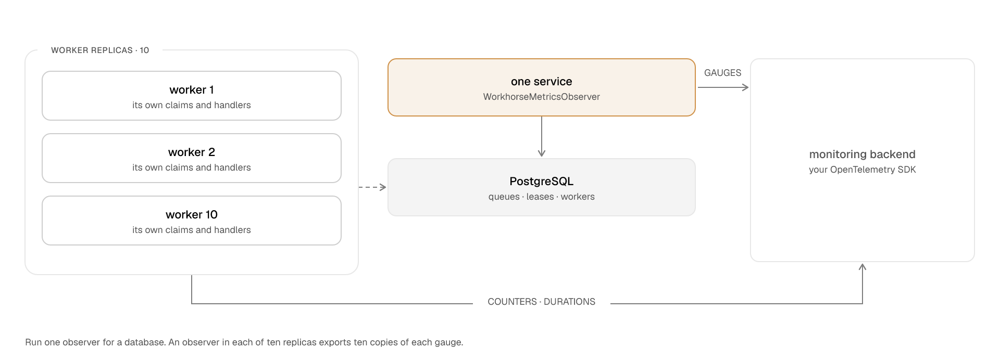

# Workhorse architecture: telemetry

This page is part of the [Workhorse architecture reference](../architecture.md). It owns
OpenTelemetry metrics, traces, logs, and baseline metrics.

## OpenTelemetry metrics

### Telemetry provider contract

`@stablemates/workhorse` has no OpenTelemetry dependency or emitted OpenTelemetry import.
`typescript/core/src/telemetry.ts` owns every instrument definition. It routes records through the
process-wide `WorkhorseTelemetryProvider`.

- Its permanent no-op provider discards records until `registerTelemetryProvider(provider)`
  installs one provider.
- Registration rejects another active provider.
- Registration returns an idempotent cleanup function that restores the no-op provider.
- Every log, span, context, and synchronous metric operation reads the current provider.
- If the provider identity changes, `lazyCounter`, `lazyHistogram`, and `lazyGauge` re-create their
  provider instrument. Thus registration can happen after core import.

ADR 0024 records the measurement that selected this lifecycle over module-scope instrument
creation.

### OpenTelemetry adapter

`@stablemates/workhorse-otel` implements the contract. `registerOpenTelemetry()` has no import side
effect. It returns `registerTelemetryProvider()`'s cleanup function.

The adapter declares these peer dependencies:

- `@opentelemetry/api >=1.9.0 <2`
- `@opentelemetry/api-logs >=0.200.0 <0.300.0`
- `@stablemates/workhorse >=0.9.0 <0.10.0`

The adapter resolves tracer, meter, logger, context, and propagation state from those host-owned API
copies. Its synchronous metric and log wrappers read the OpenTelemetry global provider again each
time. Thus, if the host registers the SDK after the adapter registration, the SDK registration still
takes effect.

### Synchronous instruments

Queue and worker operations emit these synchronous instruments:

| Instrument                                 | Kind and unit           | Recording point and attributes                                                                                                                                                                                                                   |
| ------------------------------------------ | ----------------------- | ------------------------------------------------------------------------------------------------------------------------------------------------------------------------------------------------------------------------------------------------ |
| `workhorse.tasks.enqueued`                 | counter, `{task}`       | One accepted `enqueue_batch_v1` member, grouped by `workhorse.queue.name` and `workhorse.task.type`. An outer caller transaction can still roll back after this statement returns.                                                               |
| `workhorse.tasks.enqueue.outcomes`         | counter, `{request}`    | Every `enqueue_many_v1` result, grouped by `workhorse.queue.name` and bounded `workhorse.enqueue.outcome`. Outcomes are `accepted`, `replayed`, `replaced`, `non_replaceable`, and `coalesced`. An outer caller transaction can still roll back. |
| `workhorse.tasks.claimed`                  | counter, `{task}`       | One successfully claimed task, by queue and task type. Empty claim polls emit nothing.                                                                                                                                                           |
| `workhorse.tasks.completed`                | counter, `{task}`       | One accepted `complete_v1`, by queue and task type. A rejected stale completion emits nothing.                                                                                                                                                   |
| `workhorse.tasks.failed`                   | counter, `{task}`       | One `fail_v1` result, by queue, task type, and `workhorse.attempt.outcome`.                                                                                                                                                                      |
| `workhorse.tasks.retried`                  | counter, `{task}`       | Each attempt returned to live work by failure, owned expiry, or bounded recovery, by queue and task type. Recovery rows without dimensions use `unknown` for both.                                                                               |
| `workhorse.tasks.cancellation`             | counter, `{request}`    | One `cancel_v1` result, by `workhorse.cancellation.status`.                                                                                                                                                                                      |
| `workhorse.tasks.redrive`                  | counter, `{request}`    | Every result from single or bulk redrive operations, by `workhorse.redrive.status`.                                                                                                                                                              |
| `workhorse.handler.executions`             | counter, `{execution}`  | One worker handler activation, by queue, task type, and `workhorse.handler.outcome`. Outcomes are `succeeded`, `retry`, `failed`, `canceled`, `deadline_exceeded`, `timeout`, `lease_lost`, and `suspended`.                                     |
| `workhorse.handler.duration`               | histogram, `ms`         | Wall-clock duration of the same activation, with the same attributes. An activation that ends without a recorded outcome reports `unknown`. Durable wait suspension closes an activation without closing its logical attempt.                    |
| `workhorse.handler.runtime`                | counter, `ms`           | Cumulative handler execution time by queue and task type.                                                                                                                                                                                        |
| `workhorse.handler.batch.size`             | histogram, `{task}`     | Tasks delivered in one `BatchHandler` invocation, by queue, task type, and bounded full/partial flag.                                                                                                                                            |
| `workhorse.handler.batch.linger`           | histogram, `ms`         | Time from the first member reaching its coordinator until batch dispatch, with the same attributes.                                                                                                                                              |
| `workhorse.claim.duration`                 | histogram, `ms`         | One `claim_v1`, `claim_many_v1`, or `complete_many_and_claim_v1` statement, by queue and the bounded `workhorse.claim.result` values `claimed` and `empty`.                                                                                      |
| `workhorse.leases.expired`                 | counter, `{lease}`      | Leases that `recover_expired_v1` recovers. Zero-result passes emit nothing.                                                                                                                                                                      |
| `workhorse.schedule.fired`                 | counter, `{occurrence}` | One `fire_schedule_v1` call that returns a task ID, by schedule namespace and name.                                                                                                                                                              |
| `workhorse.schedule.lag`                   | histogram, `s`          | Delay from the planned occurrence to the successful fire, with the schedule attributes.                                                                                                                                                          |
| `workhorse.worker.heartbeat.failure`       | counter, `{heartbeat}`  | Every per-task `heartbeat_many_v2` status other than `accepted`, `busy` too, by `workhorse.heartbeat.status`. TypeScript also counts the answers of `Queue.heartbeatStatus` and `Queue.tryHeartbeat`.                                            |
| `workhorse.worker.heartbeat.round_failure` | counter, `{round}`      | One TypeScript heartbeat round that rejected before PostgreSQL returned a status, by the bounded `workhorse.heartbeat.failure_reason`.                                                                                                           |
| `workhorse.maintenance.runs`               | counter, `{run}`        | Each maintenance result, by loop, phase, and skipped-lock flag.                                                                                                                                                                                  |
| `workhorse.maintenance.rows`               | counter, `{row}`        | Rows affected by the same result and attributes.                                                                                                                                                                                                 |
| `workhorse.maintenance.duration`           | histogram, `ms`         | SQL-reported duration for the same result and attributes.                                                                                                                                                                                        |
| `workhorse.maintenance.errors`             | counter, `{error}`      | Maintenance results whose `error` is non-null, with the same attributes.                                                                                                                                                                         |
| `workhorse.maintenance.drift`              | histogram, `ms`         | Delay beyond a worker maintenance loop's configured cadence, by loop.                                                                                                                                                                            |

#### Failed heartbeat rounds

A heartbeat round renews every lease of a worker in one request. The request can fail before
PostgreSQL answers, for example when the connection breaks or the round reaches its deadline. Such a
round gives no ownership verdict. Thus `workhorse.worker.heartbeat.failure` does not count it, and
every handler keeps running. The next regular round retries, and the lease watchdog of each attempt
still aborts it when its last accepted renewal is one full lease old.

The TypeScript worker counts each rejected round once in `workhorse.worker.heartbeat.round_failure`.
The worker sends at most one round at a time, so the count rate stays bounded by the heartbeat
interval and the busy retries. The counter adds no log record. `heartbeatRoundFailureReason` in
`typescript/core/src/telemetry.ts` sets `workhorse.heartbeat.failure_reason`:

| Value        | Failure                                                                                                                               |
| ------------ | ------------------------------------------------------------------------------------------------------------------------------------- |
| `timeout`    | The round deadline (`HeartbeatRoundTimeoutError`), `statement_timeout` (`57014`), or `idle_in_transaction_session_timeout` (`25P03`)  |
| `connection` | A socket or DNS error code, a SQLSTATE that starts with `08`, a server shutdown (`57P01` to `57P03`), or a terminated `pg` connection |
| `database`   | Any other SQLSTATE                                                                                                                    |
| `other`      | A failure without a SQLSTATE or a connection code                                                                                     |

Only the TypeScript worker records this counter. The other workers do not count a failed round yet.

Each lifecycle event reaches exactly one instrument. `workhorse.handler.executions` counts a handler
activation, and `workhorse.handler.duration` times it. Both are dimensioned by outcome. The queue
operation that performs the write of the activation counts that write. That counter is
`workhorse.tasks.completed`, `workhorse.tasks.failed`, or `workhorse.tasks.retried`.

### Go worker metrics

The Go worker emits these instruments from the table:

- `workhorse.tasks.claimed`, `workhorse.tasks.completed`, `workhorse.tasks.failed`, and
  `workhorse.tasks.retried`
- `workhorse.leases.expired`
- `workhorse.claim.duration`
- all five `workhorse.handler.*` instruments
- `workhorse.worker.heartbeat.failure`

It uses the same units and attribute keys as the TypeScript runtime. Recovery cannot recover the
original queue and type from its aggregate SQL result. Thus its retry count uses `unknown` for both
bounded dimensions. This matches the TypeScript fallback.

### Rust worker metrics

The Rust worker records metrics only when the crate's `opentelemetry` feature is on.
`rust/src/telemetry.rs` binds the instruments to the global meter provider when the worker is
built. The Rust worker emits these 12 instruments from the table:

- `workhorse.tasks.claimed`, `workhorse.tasks.completed`, `workhorse.tasks.failed`, and
  `workhorse.tasks.retried`
- `workhorse.leases.expired`
- `workhorse.claim.duration`
- all five `workhorse.handler.*` instruments
- `workhorse.worker.heartbeat.failure`

It uses the same units, descriptions, and attribute keys as the TypeScript runtime. The Rust worker
does not record `workhorse.schedule.*`, `workhorse.maintenance.*`, enqueue, cancellation, or redrive
instruments.

Recovery adds one to `workhorse.tasks.retried` for each entry in the `retry_dimensions` of its
result. An entry without a queue or a task type uses `unknown` for that attribute. If the `retried`
count of the result is larger than the number of entries, recovery adds the difference with
`unknown` for both attributes, as the other workers do.

### Ruby worker metrics

The Ruby worker records metrics only when the application loads `opentelemetry-metrics-api` and a
global meter provider exists. `Stablemates::Workhorse::Telemetry` declares these 18 instruments:

- `workhorse.tasks.claimed`, `workhorse.tasks.completed`, `workhorse.tasks.failed`, and
  `workhorse.tasks.retried`
- `workhorse.leases.expired`
- `workhorse.claim.duration`
- all five `workhorse.handler.*` instruments
- `workhorse.worker.heartbeat.failure`
- `workhorse.schedule.fired` and `workhorse.schedule.lag`
- `workhorse.maintenance.runs`, `workhorse.maintenance.rows`, `workhorse.maintenance.duration`, and
  `workhorse.maintenance.errors`

It uses the same units, descriptions, and attribute keys as the Python worker. Recovery uses
`unknown` for the queue and the task type of a retry that its result does not attribute. The Ruby
worker does not record `workhorse.maintenance.drift`, enqueue, cancellation, or redrive instruments.

### JVM worker metrics

The Java worker records metrics only when the application includes the optional OpenTelemetry API.
By default, `run.workhorse.internal.telemetry.Telemetry` reads `GlobalOpenTelemetry` on each use.
`WorkhorseTelemetry.of(OpenTelemetry)` gives an explicit instance instead. Without the API,
telemetry does nothing and loads no OpenTelemetry code. The Kotlin module and the Spring Boot
starter run the same Java worker.

The Java worker emits the 18 instruments of the Ruby worker and `workhorse.maintenance.drift`. The
`Instrument` enum declares them with the same units and descriptions, and `WorkerTelemetry` records
the same attribute keys. Recovery uses `unknown` for the queue and the task type of a retry that its
result does not attribute. The worker records `workhorse.maintenance.drift` with the `tick` loop and
the `background_routines` loop. The first pass of a loop records no drift. The Java worker does not
record enqueue, cancellation, or redrive instruments.

### .NET worker metrics

The .NET worker records metrics through a `System.Diagnostics.Metrics.Meter` named `workhorse`. The
runtime supplies that type, so the core has no OpenTelemetry package dependency. Without a listener,
an instrument records nothing. An application that uses OpenTelemetry adds the meter with
`AddMeter("workhorse")`.

The .NET worker emits the 19 instruments of the JVM worker.
`Workhorse.Internal.Telemetry.Instrumentation` declares them with the same units and descriptions,
and `WorkerTelemetry` records the same attribute keys. Recovery uses `unknown` for the queue and the
task type of a retry that its result does not attribute. The worker records
`workhorse.maintenance.drift` with the `tick` loop and the `background_routines` loop. The first
pass of a loop records no drift. The .NET worker does not record enqueue, cancellation, or redrive
instruments.

### Metrics observer

`WorkhorseMetricsObserver` is in `typescript/core/src/metrics-observer.ts`. It records its gauges
through the same lazy lifecycle. It does two concurrent read-only queries every `intervalMs`.
`intervalMs` defaults to 10,000 and must be a safe integer from 1,000 through 2,147,483,647. If a
timer delay is longer than that maximum, Node runs the timer every millisecond.

| Member      | Behavior                                                     |
| ----------- | ------------------------------------------------------------ |
| `start()`   | Collects immediately, then repeats on an unreferenced timer. |
| `stop()`    | Clears the timer.                                            |
| `collect()` | Provides a serialized one-shot collection.                   |
| `onError`   | Receives interval failures.                                  |

Applications must run at most one observer per database. Every observer sees the same global
PostgreSQL state.

<picture>
  <source media="(max-width: 600px) and (prefers-color-scheme: dark)" srcset="../../site/public/diagrams/observability-sources-narrow-dark.png">
  <source media="(max-width: 600px)" srcset="../../site/public/diagrams/observability-sources-narrow-light.png">
  <source media="(prefers-color-scheme: dark)" srcset="../../site/public/diagrams/observability-sources-dark.png">
  
</picture>

The timer calls `onError` and does not await it. A reporter can be synchronous or return a promise.
If the reporter throws or its promise rejects, the observer writes that failure to `console.error`.
The failure never becomes an unhandled rejection. A direct `collect()` call rejects to its caller
and does not call `onError`.

#### Queue query

`protocol/v1/manifest.json` pins the queue query as `metrics_observer`. The query joins
`queue_control` for the pause flag. It counts live rows from both `task_runtime` and
`fast_task_runtime`. A fast-tier row has no scheduled state. Thus the query counts a ready row with
a future `run_at` as scheduled, as `queue_health_v1` does. The observer records these gauges from
the query:

- `workhorse.tasks.count` for scheduled, ready, and active rows, by queue and state
- `workhorse.queue.oldest_ready.age`, which is 0 for a queue with no ready task
- `workhorse.queue.paused`
- `workhorse.lease.expired`
- `workhorse.deadline.overdue`
- `workhorse.execution_timeout.overdue`

#### Worker query

The second query groups `worker_registry` rows into mutually exclusive states for every queue in
`queue_names`:

- `running`
- `paused`
- `draining`
- `offline`, meaning the last heartbeat is at least 30 seconds old

The observer then records `workhorse.worker.count`, `workhorse.worker.capacity`, and
`workhorse.worker.active` by queue and worker state.

Capacity and active-slot observations repeat a multi-queue worker under every queue it can serve.
They describe eligible shared capacity per queue. Do not sum them across queue labels.

#### Series that disappear

Every observer gauge is synchronous. Thus an exporter with cumulative temporality repeats the last
recorded value of a series. For this reason, each observer remembers the series that its last
collection recorded. If a later collection no longer returns a series, the observer records 0 for it
once and then forgets it. This rule covers a worker group whose workers change state or leave
`worker_registry`. It also covers a queue that no longer has live rows or a `queue_control` row.

A failed collection records nothing. It keeps the remembered series for the next collection.

#### Observer attributes

The observer never uses these values as metric attributes: task IDs, worker IDs, payloads, error
text, cancellation attribution, or redrive attribution.

## OpenTelemetry traces, logs, and baseline metrics

### Host setup

The TypeScript host does these steps:

1. Install `@stablemates/workhorse-otel` and compatible API peers.
2. Configure the OpenTelemetry context manager, propagator, readers, processors, exporters, and
   resource.
3. Call `registerOpenTelemetry()` once.

Importing core or the adapter does not register a provider. If the adapter or an SDK is absent,
queue correctness does not change.

The operational instruments above provide the detailed queue, task type, outcome, and fleet
dimensions. The bundled SigNoz dashboards use those dimensions. The baseline instruments below keep
a smaller set of attributes for deployments that enforce a fixed cardinality cap.

### Go worker setup

The Go worker imports only `go.opentelemetry.io/otel`, `otel/metric`, and `otel/trace` in production
files. Its SDK metric and trace packages are test dependencies.

The application installs global providers and a W3C `propagation.TraceContext`. If they are absent,
the API instruments are no-ops.

The Go worker accepts an optional `*slog.Logger` as `WorkerOptions.Logger`. A nil logger uses a
disabled handler. Thus routine lifecycle records do not write to the process default logger.

### Trace context propagation

Each enqueue path stores a W3C trace context in the new task's `task.trace_context`:

- TypeScript `Queue.enqueueMany` creates `workhorse.enqueue` and injects that span's context.
- Python `Queue.enqueue_many` and `AsyncQueue.enqueue_many` inject the active caller context.
- Go `Queue.EnqueueMany` injects the active caller context.
- Rust enqueue injects the active OpenTelemetry context when the `opentelemetry` feature is on.
- Ruby `Queue` injects the active caller context when the application loads `opentelemetry-api`.
- The Java `Queue` creates `workhorse.enqueue` and injects that span's context.
- The .NET `Queue` creates `workhorse.enqueue`. It injects the context of `Activity.Current`
  through `DistributedContextPropagator.Current`. While a listener samples the enqueue span,
  `Activity.Current` is that span.

Each language enforces 1,024 bytes before enqueue. The constants are TypeScript
`MAX_TRACE_CONTEXT_BYTES`, Python `_telemetry.MAX_TRACE_CONTEXT_BYTES`, Go `maxTraceContextBytes`,
Ruby `Telemetry::MAX_TRACE_CONTEXT_BYTES`, Java `Telemetry.MAX_TRACE_CONTEXT_BYTES`, and .NET
`Instrumentation.MaxTraceContextBytes`. Rust
`queue::trace_context` checks the same limit inline.

The `task.trace_context` column has these rules:

- It accepts only `traceparent` and optional `tracestate`.
- It requires `traceparent`.
- It caps canonical JSONB text at the same size.
- It is separate from `task.payload`. Operator projections exclude it.
- An idempotent replay keeps the first accepted context.
- Workhorse never persists baggage.

`claim_v1` returns the stored value. Each worker extracts it before it creates the
`workhorse.handler` consumer span. The Go worker does the same extraction and creates the same
consumer span. Thus a stored enqueue or caller context can parent the handler span of any language.

Every worker parents a handler span only to the stored context of its task. A task without one
starts a new trace, even when a span is active where the worker runs. Each worker does this as
follows:

- TypeScript extracts a stored context onto `ROOT_CONTEXT`.
- Python `_telemetry.start_span` starts a consumer span from an empty `Context` and extracts a
  stored context onto it.
- Go `extractTraceContext` replaces the span in the worker's context with an empty span context
  before extraction. The Go handler context keeps the worker context's cancellation and values.
- Rust `telemetry::handler_span` sets the span's OpenTelemetry parent to the stored context, or to
  an empty `Context`. The `tracing` span keeps its contextual parent, so its log events still nest
  under the caller's `tracing` span.
- Ruby `Telemetry.span` starts a consumer span from `OpenTelemetry::Context.empty` and extracts a
  stored context onto it.
- Java `OpenTelemetryTelemetry.consumerSpan` starts from `Context.root()` and extracts a stored
  context onto it.
- .NET `WorkerTelemetry.StartAttempt` sets `Activity.Current` to `null` when the task has no stored
  context. It starts the consumer span with the extracted `ActivityContext` as its parent.

Child tasks prefer the stored context of the parent task over the ambient handler context. Thus
replay keeps the original trace chain.

### Spans

#### TypeScript spans

The TypeScript runtime emits these spans:

- `workhorse.enqueue`
- `workhorse.claim`
- `workhorse.handler`
- `workhorse.heartbeat`
- `workhorse.retry`
- `workhorse.complete`
- `workhorse.recovery`
- `workhorse.maintenance`
- `workhorse.schedule.synchronize`

Span attributes can include `workhorse.task.id`, `workhorse.task.type`, `workhorse.task.attempt`,
and `workhorse.queue.name`. Spans can carry these attributes because spans are sampled event
records, not metric dimensions. Single-request enqueue spans also carry the bounded
`workhorse.enqueue.outcome` that PostgreSQL returns.

A worker probes an unfamiliar queue with a fast claim. If the queue is on the full tier, the
`workhorse.claim` span ends without an error status. It carries `workhorse.queue.tier = "full"`.

Workhorse emits at most eight attributes on one span. It exports `TRACE_ATTRIBUTE_COUNT_LIMIT = 8`
so that SDK span limits can match it.

#### Go spans

The Go worker emits only the `workhorse.handler` consumer span. It carries these attributes:

- `workhorse.queue.name`
- `workhorse.task.id`
- `workhorse.task.type`
- `workhorse.task.attempt`
- the bounded `workhorse.handler.outcome`

#### Python spans

The synchronous Python worker emits `workhorse.claim`, `workhorse.handler`, `workhorse.retry`,
`workhorse.complete`, `workhorse.recovery`, and `workhorse.maintenance`. They have the same
attributes and parent relationships as the TypeScript spans. The Python worker does not emit
`workhorse.heartbeat`. It records a rejected heartbeat only as a log record and in
`workhorse.worker.heartbeat.failure`.

`python/src/workhorse/_telemetry.py` exports `TRACE_ATTRIBUTE_COUNT_LIMIT = 8` and
`METRIC_ATTRIBUTE_CARDINALITY_LIMIT = 2,000`.

The `stablemates-workhorse[telemetry]` extra installs `opentelemetry-api` but no SDK. In both of
these cases, worker behavior does not change:

- If the API extra is absent, the module supplies local no-op instruments.
- If the API is present without an SDK, the OpenTelemetry providers stay no-ops.

#### Rust spans

The Rust worker emits only the `workhorse.handler` consumer span. `telemetry::handler_span` creates
it as a `tracing` span. With the `opentelemetry` feature, a `tracing-opentelemetry` layer that the
application installs exports it. The span carries `workhorse.queue.name`, `workhorse.task.id`,
`workhorse.task.type`, and `workhorse.task.attempt`. If the outcome is not `succeeded` or
`unknown`, the worker sets the span status to error.

The Rust worker does not emit `workhorse.enqueue`, `workhorse.claim`, `workhorse.complete`,
`workhorse.retry`, `workhorse.heartbeat`, `workhorse.recovery`, `workhorse.maintenance`, or
`workhorse.schedule.synchronize`.

#### Ruby spans

The Ruby worker emits `workhorse.claim`, `workhorse.handler`, `workhorse.retry`,
`workhorse.complete`, `workhorse.recovery`, and `workhorse.maintenance`. They have the same
attributes and parent relationships as the Python spans. The worker emits spans only when the
application loads `opentelemetry-api`. The Ruby queue emits no `workhorse.enqueue` span.

#### JVM spans

The Java worker and queue emit `workhorse.enqueue`, `workhorse.claim`, `workhorse.handler`,
`workhorse.retry`, `workhorse.complete`, `workhorse.recovery`, and `workhorse.maintenance`.
`run.workhorse.internal.telemetry.Names` declares these names. The `workhorse.enqueue` span has the
TypeScript attributes: the queue when every request names one queue, the task type of a single
request, and `workhorse.enqueue.count`.

`run.workhorse.internal.telemetry.Telemetry` exports `TRACE_ATTRIBUTE_COUNT_LIMIT = 8` and
`MAX_TRACE_CONTEXT_BYTES = 1,024`. The Java SDK does not emit `workhorse.heartbeat` or
`workhorse.schedule.synchronize`.

#### .NET spans

The .NET worker and queue emit the spans of the JVM SDK: `workhorse.enqueue`, `workhorse.claim`,
`workhorse.handler`, `workhorse.retry`, `workhorse.complete`, `workhorse.recovery`, and
`workhorse.maintenance`. `Workhorse.Internal.Telemetry.Names` declares these names. They come from
a `System.Diagnostics.ActivitySource` named `workhorse`. An application that uses OpenTelemetry
adds it with `AddSource("workhorse")`. The `workhorse.enqueue` span has the attributes of the JVM
span.

`Instrumentation` holds `TraceAttributeCountLimit = 8` and `MaxTraceContextBytes = 1,024` as
internal constants. The .NET SDK does not emit `workhorse.heartbeat` or
`workhorse.schedule.synchronize`.

### Structured logs

The TypeScript runtime submits vendor-neutral structured records to `WorkhorseTelemetryProvider`.
The OpenTelemetry adapter emits them through `@opentelemetry/api-logs`. The Python worker uses
`opentelemetry._logs` for the matching worker event names.

#### JVM logs

The Java worker and queue emit log records through `io.opentelemetry.api.logs` of the optional
OpenTelemetry API. `Telemetry.log` sets the event name, the severity, the severity text, and the
body, and keeps the current context. The worker also writes each record to `System.Logger`. The
worker maps the `System.Logger` levels to severities in this way:

| `System.Logger` level | Severity |
| --------------------- | -------- |
| `TRACE`, `DEBUG`      | Debug    |
| `INFO`                | Info     |
| `WARNING`, `ERROR`    | Warning  |

`Telemetry.log` emits a record only for an event name in `Names.LOG_EVENTS`, which holds the
`WorkhorseLogEvent` union. An event that only the Java SDK has, such as
`workhorse.worker.claims_abandoned`, goes only to `System.Logger`. The queue emits
`workhorse.task.signal_processed` and `workhorse.task.human_wait_processed` only to OpenTelemetry.

The Java SDK does not emit these TypeScript events: the enqueue, debounce, and throttle events, the
cancellation, run-now, redrive, promotion, recovery, and policy events, the queue administration
events, `workhorse.schedules.synchronized`, `workhorse.task.heartbeat_accepted`, and
`workhorse.worker_registry.pruned`.

#### .NET logs

The .NET worker logs through `ILogger` from `Microsoft.Extensions.Logging.Abstractions`. It gets its
logger from `WorkerOptions.LoggerFactory`. Without a factory, it logs nothing. The internal types
`WorkerLog` and `DurableLog` declare each record with `LoggerMessage`. The `EventId` name of a
record is its Workhorse event name, such as `workhorse.task.heartbeat_rejected`. The
`Workhorse.Hosting` package logs its own `workhorse.hosting.*` events in the same way.

The .NET SDK has no OpenTelemetry logs dependency. It emits no OpenTelemetry log record itself. The
.NET `Queue` writes no log record.

#### Severity coverage

| Severity | Records cover                                                                                                                                                                                                                             |
| -------- | ----------------------------------------------------------------------------------------------------------------------------------------------------------------------------------------------------------------------------------------- |
| Debug    | Enqueue acceptance and replay, claims, accepted heartbeats, handler registration and execution boundaries, checkpoints, progress, schedule replay, and worker deregistration.                                                             |
| Info     | Queue and worker lifecycle, final execution outcomes, rejected heartbeats, completion and failure, cancellation, durable waits, promotion and recovery, schedule changes, redrive, and maintenance that changes rows or returns an error. |
| Warning  | Handlers that catch a durable-wait suspension signal and return normally.                                                                                                                                                                 |

#### Debug event names

- `workhorse.task.enqueued`
- `workhorse.task.enqueue_replayed`
- `workhorse.task.claimed`
- `workhorse.task.heartbeat_accepted`
- `workhorse.task.checkpoint_saved`
- `workhorse.task.progress_updated`
- `workhorse.handler.registered`
- `workhorse.handler.started`
- `workhorse.handler.finished`
- `workhorse.schedule.fire_replayed`
- `workhorse.worker.registered`
- `workhorse.worker.deregistered`

#### Info event names

- `workhorse.tasks.promoted`
- `workhorse.leases.recovered`
- `workhorse.queue.paused`
- `workhorse.queue.resumed`
- `workhorse.queue.tier_set`
- `workhorse.queue.purged`
- `workhorse.schedules.synchronized`
- `workhorse.schedule.fired`
- `workhorse.tasks.redrive_processed`
- `workhorse.task.run_now_requested`
- `workhorse.task.cancellation_processed`
- `workhorse.task.cancellation_acknowledged`
- `workhorse.task.redrive_processed`
- `workhorse.task.wait_processed`
- `workhorse.task.child_processed`
- `workhorse.task.completed`
- `workhorse.task.completion_rejected`
- `workhorse.task.failure_processed`
- `workhorse.task.heartbeat_rejected`
- `workhorse.task.ownership_expired`
- `workhorse.task.execution_finished`
- `workhorse.worker.paused`
- `workhorse.worker.resumed`
- `workhorse.worker.registration_failed`
- `workhorse.worker.started`
- `workhorse.worker.stop_requested`
- `workhorse.worker.stopped`

`workhorse.retention_policy.synchronized` and `workhorse.maintenance_policy.synchronized` record
successful configuration changes at info.

#### Conditional events

| Event                              | Severity and condition                                                                                                                                                                                   |
| ---------------------------------- | -------------------------------------------------------------------------------------------------------------------------------------------------------------------------------------------------------- |
| `workhorse.maintenance.completed`  | Info. Workhorse emits it only when the phase changes rows or returns an error. Successful no-ops and skipped advisory locks emit no log. Maintenance counters and duration histograms still record them. |
| `workhorse.worker_registry.pruned` | Debug when no stale registrations exist. Info when PostgreSQL removes registrations.                                                                                                                     |

#### Warning event names

- `workhorse.handler.signal_swallowed` carries bounded task and worker identity plus
  `workhorse.handler.outcome`. It never carries the swallowed value or error.
- `workhorse.worker.polling_only` carries `workhorse.worker.id`, `workhorse.worker.queues`, and
  `workhorse.worker.pool_max_size`, the pool maximum size that the worker found or `unknown`. A
  `Worker.run()` that starts without a notification subscription emits it once.

#### Log record attributes

The internal `logDebug`, `logInfo`, and `logWarn` functions accept the closed `WorkhorseLogEvent`
union. They set `eventName`, `severityNumber`, `severityText`, and a stable text body.

| Record kind | Attributes                                                                                                                                                                           |
| ----------- | ------------------------------------------------------------------------------------------------------------------------------------------------------------------------------------ |
| Task        | Can use `workhorse.task.id`, `workhorse.task.type`, `workhorse.task.attempt`, `workhorse.task.state`, and `workhorse.operation.status`. Owned transitions add `workhorse.worker.id`. |
| Queue       | Use `workhorse.queue.name` and can add `workhorse.task.count`.                                                                                                                       |
| Schedule    | Can use `workhorse.schedule.namespace`, `workhorse.schedule.name`, and `workhorse.schedule.count`.                                                                                   |
| Recovery    | Use `workhorse.recovery.rows_affected`, `workhorse.recovery.expired_leases`, and `workhorse.recovery.retried`.                                                                       |
| Redrive     | Can use `workhorse.redrive.target_task_id` and `workhorse.redrive.dry_run`.                                                                                                          |
| Durable     | Use the bounded status plus `workhorse.checkpoint.name` or `workhorse.wait.name`. They never use the stored value.                                                                   |
| Maintenance | Use `workhorse.maintenance.operation`, `workhorse.maintenance.phase`, `workhorse.maintenance.rows_affected`, and `workhorse.maintenance.skipped_lock`.                               |
| Worker      | Life-cycle records use `workhorse.worker.queues` for the complete configured queue array. Registration records can also use concurrency, active slots, draining, and pause state.    |
| Handler     | Completion adds `workhorse.handler.duration_ms`.                                                                                                                                     |

#### Worker registration logs

`Worker.refreshRegistration` emits `workhorse.worker.registered` in two cases:

- after the first successful registration
- when `activeSlots`, `draining`, or the PostgreSQL-owned pause result changes

The durable heartbeat still runs at `registryIntervalMs`. An unchanged refresh emits no log.

#### Log content limits

Logs can include task, worker, schedule, and checkpoint identity because logs are event records.

Workhorse never logs these values:

- payloads
- results
- error messages
- cancellation reasons
- idempotency keys
- progress and checkpoint values

The active OpenTelemetry context stays attached at emission. Thus an SDK can correlate handler logs
with the current trace. If the host installs no Logs SDK, the API stays a no-op. Queue behavior does
not change.

### Dashboard host

#### RPC body limit

`createDashboardHost` reads at most `MAX_RPC_BODY_BYTES`, 131,072 bytes, of an RPC request body.

- A request that declares a larger `content-length` receives `413` with the `PAYLOAD_TOO_LARGE`
  error envelope. This happens before the host matches any procedure.
- If a body declares no length, oRPC's `BodyLimitPlugin` enforces the same bound while it reads the
  body.

The bound is twice the 65,536-byte cap the database places on a signal payload or a human-wait
result. Every `audit.reason` accepts at most 2,000 characters, the limit the database enforces.

The embedded SDK hosts read at most 2,097,152 bytes (`2 << 20`) of an RPC request body.

- Python `DashboardHost` (`_MAX_REQUEST_BYTES`) and Ruby `Dashboard` (`MAX_REQUEST_BYTES`) check the
  declared length first. If it is larger or is not decimal digits, they answer `413` with the
  `PAYLOAD_TOO_LARGE` envelope before they read. If there is no declared length, they read at most
  one byte past the bound. They answer `413` when that byte arrives. Python reads such a body only
  when the server sets `wsgi.input_terminated`.
- Go `Handler` decodes the first JSON value from at most the bound. An envelope that crosses the
  bound fails decoding with `400`. Bytes after a complete envelope are never read.
- Rust `MAX_REQUEST_BYTES` bounds the body with `http_body_util::Limited`. A longer body answers
  `400`.
- .NET `DashboardHost.MaxRequestBytes` in `Workhorse.AspNetCore` checks the declared length first.
  If it is larger, the host answers `413` with the `PAYLOAD_TOO_LARGE` envelope before it reads.
  Otherwise, it reads the body and answers `413` when the body passes the bound.

#### RPC logs

`createDashboardHost` emits one OpenTelemetry log after `RPCHandler` returns a matched dashboard RPC
response.

| Event                               | Severity and condition                                                  |
| ----------------------------------- | ----------------------------------------------------------------------- |
| `workhorse.dashboard.rpc_completed` | Debug below 1,000 milliseconds. Warning at or above 1,000 milliseconds. |
| `workhorse.dashboard.rpc_failed`    | Error for an HTTP status of 400 or greater.                             |

Both events set these attributes:

- `rpc.system = "orpc"`
- `rpc.method`, the dot-separated procedure path
- `http.response.status_code`
- `workhorse.dashboard.rpc.duration_ms`
- `workhorse.dashboard.workspace`, the serving workspace name, in workspaces mode only.
  Single-workspace mode omits the attribute.

They never include the request input, response output, error details, headers, or URL query.

Dashboard assets, application pages, authorization failures, and schema compatibility failures do
not produce these RPC records. If there is no Logs SDK, the OpenTelemetry API discards them.

#### Compatibility check records

If the schema-compatibility check fails without a compatibility verdict, `createDashboardHost` emits
one error record, `workhorse.dashboard.compatibility_check_failed`. An example is a query that
cannot reach the database. The record carries these attributes:

- `exception.message`, the text of the underlying error
- `workhorse.dashboard.workspace`, in workspaces mode only

A compatibility verdict, such as a schema that is too old, emits no record. Its version message is
the `503` answer.

#### Workspace records

In workspaces mode, `createDashboardHost` also emits one info record at construction,
`workhorse.dashboard.workspaces_configured`. The record carries these attributes:

- `workhorse.dashboard.workspace_count`
- `workhorse.dashboard.workspace_names`
- `workhorse.dashboard.default_workspace`

Single-workspace mode emits no construction record.

The demo states its workspace mode at startup:

- `workhorse.demo.workspaces_enabled` when `DATABASE_URL_SECONDARY` provisions the staging
  workspace
- `workhorse.demo.single_workspace_fallback` when the variable is absent and the dashboard serves a
  single workspace

### Demo server

#### Write rate limit

The demo HTTP server applies a process-local token bucket to writable dashboard RPC paths.

- Each client can spend a burst of five tokens.
- Tokens refill at twelve per minute.
- The server selects the right-most `X-Forwarded-For` address that the trusted deployment proxy
  appends. If that address is absent, the server uses the socket address.
- It keeps at most 10,000 client buckets. Above that bound, it evicts the least recently used
  bucket.
- Rejected requests return `429`, `Retry-After`, and `Cache-Control: no-store`. The rejection
  happens before the request reaches the dashboard host or appends an audit row.
- Reads, assets, login routes, and `/up` do not spend tokens.

#### Request bounds

The demo server applies three further bounds before a request reaches the application:

1. If the declared `Content-Length` of a request exceeds 131,072 bytes, the server refuses it with
   `413`. If a `POST`, `PUT`, or `PATCH` arrives with `Transfer-Encoding` but no declared length,
   the server refuses it with `411`.
2. At most four operator mutations can run concurrently. Admissions beyond that answer `503` with
   `Retry-After`.
3. The server sets `server.requestTimeout` to 60,000 milliseconds. This value also bounds how slowly
   an in-limit body can arrive.

`createDemoRequestListener` returns the slot of a mutation when the answer of the application
settles, not when the response closes. Thus, if a client disconnects during a mutation, it keeps its
slot until the transaction of the mutation ends. If the client leaves before the application starts
a mutation, the application does not start it.

The application has `DEMO_REQUEST_TIMEOUT_MS`, 60,000 milliseconds, to answer. After that time, the
client receives `504`. The slot stays held until the work settles.

`runOperatorTransaction` sets a transaction-local `statement_timeout` of
`DEMO_OPERATOR_STATEMENT_TIMEOUT_MS`, 10,000 milliseconds. That value bounds each statement of an
operator transaction, not the transaction as a whole.

#### Operator work budget

Independently of the HTTP layer, every RPC that creates tasks shares a budget of
`DEMO_OPERATOR_MAX_PENDING_TASKS`, 50 tasks. Those RPCs are `enqueueTest`, `redriveTask`, and
`redriveDeadLetters`.

`assertDemoOperatorWorkBudget` counts these rows:

- `task_runtime` rows in `ready` or `active` state
- `fast_task_runtime` rows that are `active`, or `ready` with `run_at <= statement_timestamp()`

A fast-tier task delayed into the future does not count. Scheduled and blocked tasks do not count.
The count uses `statement_timestamp()` because `now()` is earlier than the lock wait. If the count
used `now()`, fast-tier work that commits during that wait would look delayed.

Each admission first takes `pg_advisory_xact_lock(hashtext('workhorse-demo:operator-work-budget'))`.
Thus concurrent admissions count the committed work of each other. They cannot go above the budget.

- An RPC refuses with `TOO_MANY_REQUESTS` unless the budget has room for every task it creates.
- A feature example of `enqueueTest` seeds up to three tasks.
- `redriveDeadLetters` clips its `limit` to the remaining room and returns a continuation cursor.
  The audit row records `admittedLimit` beside `limit`.
- Mutations that act on existing tasks stay available when the budget is full.

#### Audit retention

`public.workhorse_demo_audit` keeps rows for seven days. The demo server deletes the oldest 1,000
expired rows once at startup and once per minute. It uses the `(occurred_at, id)` index. Thus one
pass can remove more rows than the rate limiter can admit between passes.

- A failed periodic pass emits `workhorse.demo.audit_retention_failed`.
- A failed startup pass prevents the server from accepting traffic.

#### Demo log files

The demo preload always installs one `NodeSDK` and one rotating file log processor. It writes NDJSON
to `logs/<environment>/<service>.ndjson` under the repository root. The preload resolves the root
from its own location, not from the working directory.

`WORKHORSE_DEMO_ENV` supplies these values and defaults to `development`:

- the dashboard environment, `<environment>`
- the OpenTelemetry `deployment.environment.name` and `deployment.environment` resource attributes

The preload rotates the file before the next record would take the current file past 10,485,760
bytes. It keeps five numbered archives. These variables override the defaults:

| Variable                       | Overrides     |
| ------------------------------ | ------------- |
| `WORKHORSE_DEMO_LOG_DIRECTORY` | root          |
| `WORKHORSE_DEMO_LOG_MAX_BYTES` | byte limit    |
| `WORKHORSE_DEMO_LOG_ARCHIVES`  | archive count |

The server and worker use different `service.name` values, so they never write the same file.

If `WORKHORSE_DEMO_TELEMETRY = "true"`, the same SDK adds exactly one OTLP log processor plus
automatic trace and metric instrumentation. Otherwise, the trace and metric exporters stay disabled.
Local structured logs stay active.

### Baseline queue metrics

`registerQueueMetrics` adds these observable instruments. The meter reads them at collection time,
not on an emission path.

- `workhorse.queue.depth` is an observable gauge split by `workhorse.queue.name` and the
  `workhorse.task.state` values `ready`, `scheduled`, and `active`.
- `workhorse.queue.oldest_ready_age` is an observable gauge in milliseconds, split by
  `workhorse.queue.name`.
- `workhorse.queue.concurrency.limit` is the queue's configured active-task limit.
- `workhorse.queue.concurrency.active` counts active rows with unexpired leases in governed queues.
- `workhorse.queue.concurrency.blocked_ready` reports bounded ready work that policy admission
  rejects.
- `workhorse.queue.dependencies.blocked`, `workhorse.queue.dependencies.pending_edges`, and
  `workhorse.queue.dependencies.failed_resolutions` report bounded dependency pressure by queue.
  `workhorse.queue.dependencies.capped` reports lower-bound samples. None uses stable task
  identities as attributes.
- `workhorse.queue.children.waiting_parents`, `workhorse.queue.children.pending`,
  `workhorse.queue.children.unjoined_results`, `workhorse.queue.children.failed_parents`, and
  `workhorse.queue.children.canceled_parents` report bounded child orchestration by parent queue.
  `workhorse.queue.children.capped` reports lower-bound samples.
- `workhorse.queue.rate_limit.configured`, `workhorse.queue.rate_limit.available_tokens`,
  `workhorse.queue.rate_limit.throttled_ready`, and
  `workhorse.queue.rate_limit.next_eligible_delay` report rate-policy state for governed queues.

#### Oldest-ready age

Two gauges report the age of the oldest ready task in a queue. They have different sources and
units, and they report an empty queue differently. Use one of them for each alert. Their names and
units do not change.

| Gauge                              | Source                                                                   | Unit | Queue with no ready task                  |
| ---------------------------------- | ------------------------------------------------------------------------ | ---- | ----------------------------------------- |
| `workhorse.queue.oldest_ready.age` | `WorkhorseMetricsObserver`, `metrics_observer` query, every `intervalMs` | `s`  | Records 0                                 |
| `workhorse.queue.oldest_ready_age` | `registerQueueMetrics`, `queue_metric_snapshot`, at each collection      | `ms` | Records no point, so the series has a gap |

The SigNoz dashboards in `ops/signoz/dashboards/` and `docs/signoz/` chart the seconds gauge.

Set a threshold from the queue-delay SLO of the application, in the unit of the gauge. For example,
for an SLO of 60 seconds:

- `workhorse.queue.oldest_ready.age > 60`
- `workhorse.queue.oldest_ready_age > 60000`

An empty queue reads 0 on the seconds gauge, so its alert clears. On the milliseconds gauge, the
alert sees no data for that queue. Configure the backend to treat missing data as healthy for that
alert.

#### Shared aggregates

`workhorse.queue.depth` and `WorkhorseMetricsObserver`'s `workhorse.tasks.count` measure the same
live work. Both use manifest-pinned statements. `queue_health_v1`, `queue_metric_snapshot`, and
`metrics_observer` in `protocol/v1/manifest.json` own their exact aggregates over
`workhorse.task_runtime` and `workhorse.fast_task_runtime`. Each counts a fast-tier ready row with a
future `run_at` as scheduled.

Every count aggregates the `task_id` primary key. Thus a queue with no runtime rows reports zero
across the outer join, not one. Callers supply their own queue-name source and name the aggregates
they need. No caller writes its own aggregate.

#### Registration lifecycle

`registerQueueMetrics(queue)` stores the database-wide observation in core and returns a cleanup
function.

- If the no-op provider is active, core activates the observation when a provider registers.
- Provider cleanup detaches it.
- Later provider registration attaches it again until the queue cleanup runs.

Register it once per database and telemetry resource. Registering it for every worker duplicates
observations.

`Queue.queueMetricSnapshot()` groups live pressure by every queue present in any of these sources:

- `task_runtime`
- `queue_control`
- any `worker_registry.queue_names` member
- `concurrency_policy`
- `rate_limit_policy`
- `Queue.defaultQueue`

Concurrency metrics carry only `workhorse.queue.name`. Raw key values never become metric
attributes.

### Metric attributes

| Instruments                                                     | Attributes                                                                       |
| --------------------------------------------------------------- | -------------------------------------------------------------------------------- |
| Lifecycle counters and handler instruments                      | `workhorse.queue.name` and `workhorse.task.type`                                 |
| `workhorse.tasks.enqueue.outcomes`                              | Queue and bounded `workhorse.enqueue.outcome`, without task type or key material |
| `workhorse.handler.executions` and `workhorse.handler.duration` | Add the bounded `workhorse.handler.outcome`                                      |
| `workhorse.tasks.failed`                                        | Also uses the bounded `workhorse.attempt.outcome`                                |
| Claim latency                                                   | `workhorse.queue.name` and the bounded `workhorse.claim.result`                  |
| Maintenance instruments                                         | Retain their bounded loop attribute                                              |
| `workhorse.worker.heartbeat.round_failure`                      | Only the bounded `workhorse.heartbeat.failure_reason`                            |

The `workhorse.attempt.outcome` values are those `fail_v1` returns: `ready`, `scheduled`, `failed`,
`cancel_requested`, `deadline_exceeded`, `timeout_exceeded`, and `stale`.

Task IDs, worker IDs, schedule names, namespaces, tags, payload values, and error messages stay
forbidden metric attributes.

### Python worker metrics

The Python worker records these worker instruments:

- `workhorse.tasks.claimed`, `workhorse.tasks.completed`, `workhorse.tasks.failed`, and
  `workhorse.tasks.retried`
- `workhorse.claim.duration`
- `workhorse.handler.duration`, `workhorse.handler.runtime`, `workhorse.handler.executions`,
  `workhorse.handler.batch.size`, and `workhorse.handler.batch.linger`
- `workhorse.worker.heartbeat.failure`

Maintenance and schedule firing also record these instruments:

- `workhorse.leases.expired`
- `workhorse.schedule.fired` and `workhorse.schedule.lag`
- `workhorse.maintenance.runs`, `workhorse.maintenance.rows`, `workhorse.maintenance.duration`, and
  `workhorse.maintenance.errors`

Their attributes follow the same restrictions and bounded outcome vocabularies as the TypeScript
instruments.

### Cardinality

Queue and task type multiply the number of time series. Applications must keep both as stable
identifiers. Applications must not embed customer or request identity in either value.

Workhorse exports `METRIC_ATTRIBUTE_CARDINALITY_LIMIT = 2,000` for applications that configure
explicit reader limits. The value matches the OpenTelemetry JavaScript SDK default. Values beyond
the configured SDK limit enter its overflow series.

### Dashboards and alerts

The host sets deployment-wide filters as OpenTelemetry resource attributes:

- `deployment.environment.name` for the environment
- `service.name` for the emitting process

The SigNoz v6 import artifact at `docs/signoz/workhorse-business-metrics-v1.json` defines dynamic
environment, service, queue, and task-type variables.

Start production dashboards with these panels:

- ready and scheduled depth
- oldest-ready age
- claiming and handler latency percentiles
- rates for enqueueing, claiming, and completing tasks
- failure and retry rates
- expired leases
- maintenance drift

| Condition                                                                  | Alert                     | Critical                     |
| -------------------------------------------------------------------------- | ------------------------- | ---------------------------- |
| Ready depth stays above zero while claiming and completion rates stay zero | for 5 minutes             | for 15 minutes               |
| Maintenance drift, for three consecutive observations                      | exceeds twice the cadence | above five times the cadence |
| Expired leases as a share of tasks workers claim, over 10 minutes          | exceeds 1%                | —                            |
| Failures as a share of handler settlements, over 10 minutes                | exceeds 5%                | above 20%                    |

Replace the age and latency thresholds with the queue-delay and handler-duration SLOs of the
application. Do not use a library-wide guess.

### Telemetry overhead scenario

The `telemetry-context` operational scenario compares full enqueue and claiming durations for equal
baseline and instrumented cohorts. The instrumented cohort activates in-memory span and metric
exporters.

The scenario verifies these properties:

- exports
- payload isolation
- context recovery
- the absence of a dispatch index

Its stable order makes the timings diagnostic, not a performance claim.
