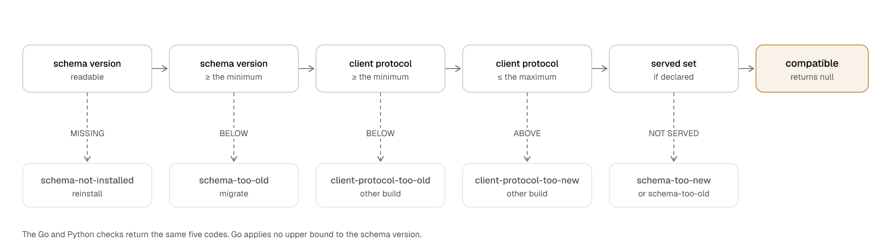

# Compatibility and support boundary

This is the supported-version contract for the published Workhorse packages. `support.json` owns
the repository matrix, each listed version's upstream end-of-life date, and local toolchain
versions. `typescript/core/src/support.ts` exposes the Node.js and PostgreSQL claims to published
packages. `.github/workflows/ci.yml` runs the matrix, and
`typescript/core/test/support-matrix.test.ts` fails when machine-readable consumers drift or a
listed version outlives its recorded date.

## What "supported" means

A version is supported when the weekly CI run exercises every declared combination. Pull requests
and pushes exercise the newest language and PostgreSQL versions for fast feedback. In particular:

- **Supported.** In the CI matrix below. A regression on one of these is a release blocker.
- **Expected to work, untested.** A PostgreSQL major newer than the tested set. Workhorse does not
  refuse to run on it, because a release cannot know about a database released after it. Bugs are
  accepted, but nothing here is evidence that it works.
- **Unsupported.** Below the minimum. `installSchema` refuses these outright rather than failing
  part way through `sql/schema.sql`, and `workhorse schema status --json` reports the server
  version and support level separately from schema compatibility.

This boundary is about correctness only. It is not a performance claim; see
[Benchmark validation is not the support boundary](#benchmark-validation-is-not-the-support-boundary).

A supported runtime is not the same as a supported release. [`SECURITY.md`](../SECURITY.md) states
which released versions receive fixes.

## Supported versions

| Runtime      | Supported         | Minimum | End of life                                                    | Notes                                                                                           |
| ------------ | ----------------- | ------- | -------------------------------------------------------------- | ----------------------------------------------------------------------------------------------- |
| Node.js      | 22, 24            | 22      | 22: 2027-04-30, 24: 2028-04-30                                 | Even-numbered releases only. `engines.node` is `>=22`.                                          |
| Python       | 3.12–3.14         | 3.12    | 3.12: 2028-10, 3.13: 2029-10, 3.14: 2030-10                    | `stablemates-workhorse` ships one `py3-none-any` wheel.                                         |
| Go           | 1.25 and newer    | 1.25    | No date; Go supports its two most recent releases              | pgx v5.11.0 is the minimum and the tested version.                                              |
| Rust         | 1.89 and newer    | 1.89    | No date; Rust supports only its latest stable release          | Tokio with `tokio-postgres` 0.7 and `deadpool-postgres`.                                        |
| Ruby         | 3.3, 3.4, 4.0     | 3.3     | 3.3: 2027-03-31, 3.4: not announced, 4.0: not announced        | `pg` 1.6 alone, behind `connection_pool`, or Active Record.                                     |
| Active Job   | 8.0, 8.1          | 8.0     | 8.0: 2026-11-07, 8.1: 2027-10-10                               | The Rails adapter. Rails dates are the end of security support.                                 |
| Java         | 21, 25, 27        | 21      | 21: 2029-12, 25: 2031-09, 27: 2027-03                          | Every JVM module compiles with `--release 21`. The dates are Temurin support.                   |
| Kotlin       | 2.2 and newer     | 2.2     | No date; the Kotlin compiler drops a language version          | `workhorse-kotlin` sets language and API version 2.2. kotlinx-coroutines 1.10.2 is the minimum. |
| Spring Boot  | 4.0, 4.1          | 4.0     | 4.0: 2026-12-31, 4.1: 2027-07-31                               | The starter. The dates are the end of open-source support.                                      |
| PgJDBC       | 42.7.12 and newer | 42.7.12 | No date; the dependency range rule applies                     | The JDBC driver of every JVM module.                                                            |
| .NET         | 10, 11            | 10      | 10: 2028-11-14, 11: not announced                              | Every package targets `net10.0`. `Microsoft.Extensions.*` 10.0.0 is the minimum.                |
| Npgsql       | 10.0.3 and newer  | 10.0.3  | No date; the dependency range rule applies                     | The driver of every .NET package.                                                               |
| EF Core      | 10.0              | 10.0    | 10.0: 2028-11-10                                               | `Workhorse.EntityFrameworkCore`. EF Core Relational 10.0.0 is the minimum.                      |
| ASP.NET Core | 10, 11            | 10      | 10: 2028-11-14, 11: not announced                              | `Workhorse.AspNetCore`. The installed runtime supplies the patches.                             |
| PostgreSQL   | 15, 16, 17, 18    | 15      | 15: 2027-11-11, 16: 2028-11-09, 17: 2029-11-08, 18: 2030-11-14 | No extension beyond the default `plpgsql` is installed.                                         |

Pull requests and pushes run the newest Node.js and PostgreSQL versions. The weekly schedule runs
every Node.js and PostgreSQL combination. It also runs the packed-package test on the newest
Node.js version, and manual runs combine the latest-version lanes with that packed test.
Pull requests and pushes also run the demo and site smoke tests.

Package managers: the repository is developed with pnpm, and the packed-install test installs the
published tarballs with pnpm. npm and yarn are not exercised in CI; the packages are plain ESM with
no install scripts, so nothing in them is package-manager specific.

The Python package declares Python 3.12 through 3.14 and includes Psycopg 3.3 through the next
major. Its `asyncpg` extra supports asyncpg 0.31 through the next major. Its package lane builds the
source distribution and universal wheel, checks inline types, runs both real drivers, and executes
every shared SQL scenario. `python/tests/test_release.py` installs the wheel and source distribution
bare, with the compatibility `psycopg` extra, and with the `asyncpg` extra. It runs the lifecycle and async enqueue examples without repository imports, then
checks that the active Python and PostgreSQL versions belong to this matrix. Pull requests and
pushes run the newest Python and PostgreSQL versions. The weekly schedule runs every Python and
PostgreSQL combination.

The Go module declares Go 1.25 or newer and requires pgx v5.11.0. That is a minimum rather than a
pin: minimal version selection lets a consumer's own module graph choose a higher pgx v5, which is
expected to work and is not tested. Its repository
lane exercises enqueue through pgx transactions, pgx pools, and `database/sql` with pgx stdlib. It
also compiles and runs a separate module through a local `replace` directive. Another external
module builds every Go example through the public import path. These tests prove the exported module
surface without repository-only imports. Pull requests and pushes run Go 1.25 against the newest
PostgreSQL. The weekly schedule runs Go 1.25 against every supported PostgreSQL major. It also runs
the suite once on the development compiler that `mise.toml` pins, against the newest PostgreSQL.
Before each Go suite run, CI records the compiler. If the compiler is not the release that CI
installed for that run, the run fails. The weekly schedule also serves the module zip from a staged
proxy and consumes it from a clean module, as the release rehearsal does. The race detector runs
only on that weekly schedule.

The Rust crate declares Rust 1.89 as its minimum and runs on Tokio through tokio-postgres and
deadpool-postgres. Pull requests and pushes run its suite once, with every optional feature, against
the newest PostgreSQL. The weekly schedule runs it against every supported PostgreSQL major. It also
runs the suite without optional features and packages the crate into a clean consumer, as the
release gate does. [ADR 0083](decisions/0083-run-each-language-suite-once-per-change.md) records
this split.

The JVM SDK has three modules: the `workhorse` core, `workhorse-kotlin`, and
`workhorse-spring-boot-starter`. Maven Central serves them. Every module compiles with `--release`
set to the Java floor. A local build
uses the JDK that `mise.toml` pins. Each JVM CI job uses the Java release of its matrix entry. Pull
requests and pushes run the JVM suite on the Java floor and on the newest tested Java release,
against the newest PostgreSQL. The weekly schedule runs every tested Java release against every
supported PostgreSQL major.
[ADR 0103](decisions/0103-shape-the-jvm-sdk-as-a-java-core-with-kotlin-and-spring-boot-modules.md)
records these floors.

A Gradle build adds the core with `implementation("run.workhorse:workhorse:0.11.0")`. A Maven
build adds
`<dependency><groupId>run.workhorse</groupId><artifactId>workhorse</artifactId><version>0.11.0</version></dependency>`.
For the Kotlin module or the starter, replace the artifact ID with `workhorse-kotlin` or
`workhorse-spring-boot-starter`. `support.json` states the two commands as `install.gradle` and
`install.maven`.

The core has two optional dependencies, the OpenTelemetry API and the Jakarta Servlet API. Its POM
marks each one `<optional>true</optional>`, so Maven does not add it. Its Gradle module metadata
puts each one in a feature variant, so Gradle adds it only when the build asks for the feature,
for example `requireFeature("opentelemetry")` or `requireFeature("servlet")`.

Java 21 and 25 are long-term releases. The Adoptium support roadmap publishes a month, not a day,
for each Temurin release. For Java 21 and 25 it states "at least" that month, so the recorded date
is the earliest end that Adoptium promises.

The Kotlin module compiles with language version and API version 2.2, and it uses the 2.2
standard library. So a caller on the Kotlin 2.2 compiler can read it, and resolves no newer
standard library. The build itself uses a newer Kotlin compiler.

The Spring Boot starter compiles against the Spring Boot floor. The `jvm` CI job tests it on the
floor. The `spring-boot` CI job tests the same jar on the newest tested Spring Boot line. A weekly
CI job tests it on the next Spring Boot snapshot. That CI job does not block a release.

The JVM floors exclude the releases with the advisories that ADR 0103 lists. The core and the
starter declare the OpenTelemetry API 1.67.0 as an optional dependency. The `jackson` feature of the
starter declares `jackson-databind` 3.1.7. Spring Boot 4.0.0 to 4.0.7 manage a PgJDBC release below
the floor, so the starter needs Spring Boot 4.0.8 or later, or a `postgresql.version` override. If
an application imports the Spring Boot BOM as Maven dependency management, or through the Spring
dependency management plugin for Gradle, the BOM selects the Jackson and OpenTelemetry versions,
which can be lower than these floors. A Gradle `platform` keeps the higher versions that the starter
declares.

The core declares the Jakarta Servlet API as an optional dependency for the dashboard backend. Its
floor is Jakarta Servlet 6.0. CI tests the dashboard backend in the Tomcat release that the newest
tested Spring Boot line manages.

The .NET SDK has four packages: `Workhorse`, `Workhorse.Hosting`, `Workhorse.EntityFrameworkCore`,
and `Workhorse.AspNetCore`. nuget.org serves them from `0.10.0`. A project adds the core with
`dotnet add package Workhorse`, and `support.json` states that command as
`install.dotnet`. Every package targets `net10.0`, and a .NET 11 application runs it without a
second target. A local build uses the .NET SDK that `mise.toml` pins, which carries the .NET 10
runtime. Pull requests and pushes run the .NET suite on .NET 10 and on .NET 11, against the newest
PostgreSQL. The weekly schedule runs every tested .NET release against every supported PostgreSQL
major.
[ADR 0107](decisions/0107-shape-the-dotnet-sdk-as-a-csharp-core-with-hosting-ef-core-and-asp-net-core-packages.md)
records these floors.

The .NET 11 CI job installs the .NET and ASP.NET Core runtimes of .NET 11 beside the pinned SDK, and
the tests run on them. Until .NET 11 ships, that CI job installs its newest release candidate, and
`support.json` lists 11 under `dotnet.prerelease`. Microsoft states the end of support of a release
when the release ships. Until then, the table says "not announced" for .NET 11.

NuGet resolves the lowest version that a range allows. Each package states each dependency as a
floor without an upper bound, so a caller who asks for nothing more gets the floor. The floors are
Npgsql 10.0.3, `Microsoft.Extensions.*` 10.0.0, and EF Core Relational 10.0.0. CI tests EF Core 10
only, because no CI job resolves the Npgsql provider for EF Core 11 yet. SM-1678 adds that CI job
after the provider ships. ASP.NET Core is a shared framework. The installed runtime supplies its
patches, so its floor is a major version. An operator must run a serviced .NET 10 or .NET 11
runtime.

### Node.js releases with a JSON.parse fault

`JSON.parse` in some Node.js releases can read an escaped object key as a different key
(nodejs/node#63785). The fault can change a value without an error, so run a release that does not
have it.

**Example.** A worker on Node.js 24.22.0 claims a task with the payload `{"orderId":7,"\\":1}`. Later
it claims a task with the payload `{"orderId":7,"\"":1}`. The handler can then receive the key `\`
in place of `"`.

The fault occurs only for a key that has an escape in its JSON text: a key with `"`, `\`, or a
control character. A key without these characters and every string value are correct. The
TypeScript worker, `Queue`, `Admin`, the adapters, and the dashboard server read jsonb values through
the database driver, and the driver uses `JSON.parse`. Workhorse code also uses `JSON.parse` for a
stored payload contract schema, and for the JSON files and arguments of the `workhorse` CLI. Thus
Workhorse cannot prevent the fault on an affected release. Workhorse code does not use `JSON.parse`
for a checkpoint input fingerprint or for the stored value comparison of `replayHandler`.

| Node.js line | Affected releases | First fixed release |
| ------------ | ----------------- | ------------------- |
| 22           | None              | Not applicable      |
| 24           | 24.0.0 to 24.22.0 | 24.22.1             |
| 26           | 26.0.0 to 26.12.0 | 26.12.1             |

Node.js 26 is not a supported line. It is in the table for an operator who runs it. `engines.node`
stays `>=22`, so npm does not refuse an affected release, and the worker does not check the release
when it starts. V8 fixed the fault in commit 93cd21e8, and Node.js 24.22.1 and 26.12.1 include that
fix. `mise.toml` and the Node.js base image of each repository Dockerfile pin Node.js 24.22.1.

### Raising a floor

Raising the Node.js, Python, Go, Ruby, Active Job, Java, Kotlin, Spring Boot, .NET, EF Core,
ASP.NET Core, or PostgreSQL minimum is a **minor** release. It is never a major and never a patch. With one exception, it is the only
way a version leaves the table above. The exception is a Java release that is not long-term: Temurin
ends its support before the Java floor. ADR 0103 tests the Java floor and the newest Java release,
so the newest release then replaces it in the table. [ADR
0058](decisions/0058-fix-the-current-line-and-gate-floors-on-upstream-end-of-life.md) records the
decision. The support matrix is deliberately not one of the governed surfaces in [What SemVer
governs](versioning.md); this rule governs it instead.

A floor rises only when the version being dropped has reached its **upstream end of life**. The
upstream project's own schedule is the authority and this repository keeps no competing one:

| Runtime      | End of life is                                             | Published at                                                                                |
| ------------ | ---------------------------------------------------------- | ------------------------------------------------------------------------------------------- |
| Node.js      | Past the release's published end-of-life date              | [nodejs/Release](https://github.com/nodejs/Release)                                         |
| Python       | Past the version's published end-of-life date              | [Python developer guide](https://devguide.python.org/versions/)                             |
| Go           | Older than the two releases the Go project supports        | [Go release policy](https://go.dev/doc/devel/release#policy)                                |
| Ruby         | Past the branch's published end-of-life date               | [Ruby maintenance branches](https://www.ruby-lang.org/en/downloads/branches/)               |
| Active Job   | Past the Rails release's security support                  | [Rails maintenance policy](https://rubyonrails.org/maintenance)                             |
| Java         | Past the Temurin release's end of availability             | [Adoptium support roadmap](https://adoptium.net/support/)                                   |
| Kotlin       | The Kotlin compiler no longer accepts the language version | [Kotlin evolution principles](https://kotlinlang.org/docs/kotlin-evolution-principles.html) |
| Spring Boot  | Past the line's end of open-source support                 | [Spring Boot support](https://spring.io/projects/spring-boot#support)                       |
| .NET         | Past the release's end of support                          | [.NET support policy](https://dotnet.microsoft.com/platform/support/policy/dotnet-core)     |
| EF Core      | Past the release's end of support                          | [EF Core releases](https://learn.microsoft.com/ef/core/what-is-new/)                        |
| ASP.NET Core | Past the .NET release's end of support                     | [.NET support policy](https://dotnet.microsoft.com/platform/support/policy/dotnet-core)     |
| PostgreSQL   | Past the major's community end-of-life date                | [PostgreSQL versioning](https://www.postgresql.org/support/versioning/)                     |

`support.json` records that date for every listed Node.js, Python, Ruby, Active Job, Java, Spring
Boot, .NET, EF Core, ASP.NET Core, and PostgreSQL version, and the `End of life` column above
publishes it. Go is the exception:
its policy is relative to whatever the current release is, so there is no published date to
transcribe and none is recorded. Kotlin has no date for the same reason: a newer compiler ends a
language version when it drops it. Node.js, PostgreSQL, Ruby, Rails, Spring Boot, .NET, and EF Core
publish a day.
The Python developer guide publishes only a month until a version retires, and the Adoptium support
roadmap publishes only a month for each Temurin release. A month-precision entry stands for that
whole month.

Ruby names a branch's end only once the branch enters security maintenance. Until then its
`support.json` date is `null`, and the table says "not announced" rather than guessing. The floor
always carries a date, because it retires first. Active Job follows its Rails release, and the
date is the end of that release's security support. Microsoft states the end of a .NET release
only when it ships, so a .NET release in `dotnet.prerelease` is the only .NET entry with a `null`
date. ASP.NET Core follows its .NET release.

Convenience is not a reason. A runtime still supported upstream keeps its place in the table even
when dropping it would simplify the code or shorten the matrix.

Notice is what makes the minor honest. The table above carries every version's upstream date from
the day that version is first supported, and `typescript/core/test/support-matrix.test.ts` fails
once a listed version is past it, so the repository notices the retirement rather than the reader.
Before the minor that drops a version, at least one published minor's changelog says so.
PostgreSQL takes two published minors of notice rather than one, because a PostgreSQL major
upgrade is a database migration the operator schedules rather than a package bump.

A floor raise is a minor because it cannot reach code that already runs. The release you installed
keeps working against the database you built it for; what a dropped runtime loses is future
releases, and every package manager in these ecosystems reports that as a resolution result.

### Moving a dependency range

`pg`, Psycopg, asyncpg, pgx, PgJDBC, the Jakarta Servlet API, Npgsql, and the
`Microsoft.Extensions.*` packages move under the same rule, in either direction, and every move is a
minor:

- **Raising a floor inside the declared major range** — a minor.
- **Widening the range to admit a new upstream major** — a minor, once CI exercises it.
- **Narrowing the range to drop an upstream major** — a minor, allowed only when that major is
  end-of-life upstream or unusable, such as an unfixed advisory with no release that carries the
  fix. It takes the same one-minor notice a runtime floor takes.

Narrowing a **peer** range is the same event as a floor raise and takes the same treatment. The
consumer who cannot move keeps the version they installed; only the next release stops resolving.

One dependency move is a major, for an ordinary governed-surface reason rather than a new one.
`NewWorker(pool *pgxpool.Pool, options WorkerOptions)` puts a pgx type in the Go module's exported
signature, so moving to pgx v6 changes an exported identifier and requires
`github.com/stablemates/workhorse/go/v2`. The general rule: a dependency whose types appear in a
governed surface moves that surface when it changes incompatibly, and that surface's own definition
of breaking decides the release. `pg` and Psycopg are bundled dependencies that a caller never
names, so no equivalent exists on the TypeScript or Python lines.

### Dependency advisories

Each package line fails its build on an advisory in its own dependency tree.
[Dependency advisories](dependency-advisories.md) states each scan and the rule for an accepted
advisory.

## JS runtime smoke tier

Node.js is the only supported runtime. Bun and Deno sit in a deliberately weaker tier declared by
`SMOKE_TESTED_JS_RUNTIMES` in `typescript/core/src/support.ts`: the `runtime-smoke` CI lane runs
`typescript/core/test/runtime-smoke.ts` — `installSchema`, then an enqueue, claim, and complete
round-trip through the built `@stablemates/workhorse` entry point — against the newest supported
PostgreSQL, under the latest release of each runtime. A green lane proves the driver connects, the
schema installs, and one task completes there. It proves nothing else: the full vitest suites run
under Node.js only, so this tier carries no correctness claim beyond the round-trip.

What the validation runs recorded:

- **Bun (2026-08-27, Bun 1.2.17, Vitest 4.1.11).** The smoke round-trip passes. Vitest 4 starts
  the unit suites: 894 of 942 collected tests passed. Remaining failures spawn `process.execPath`
  (Bun) and then load TypeScript through tsx's Node-only CJS loader, or fail to collect files
  whose Zod import is `undefined` under Bun. Harness and process-boundary issues, not a library
  failure — Node.js remains the only runtime that runs the full suites.
- **Deno (2026-08-17, Deno 2.9.5).** The smoke round-trip passes, and vitest itself runs: 563 of
  601 unit tests and 467 of 470 database tests pass. Every failure is a test that respawns
  `process.execPath` on the TypeScript sources — under Deno that child needs
  `--unstable-sloppy-imports` to resolve the repository's `.js`-suffixed imports of `.ts` files.
  The failures say nothing about the built package, which is plain ESM.
- **Node.js (2026-09-09, Node.js 24.15.0).** Benchmark baseline on the same machine and
  PostgreSQL 18.4, run as `pnpm benchmark` (`suite=all`, `profile=default`). Conventional design at
  worker concurrency 8: throughput ~3,295 tasks/s, claim p50 ~0.91 ms, p99 ~8.35 ms.
  Concurrent producer-consumer churn: throughput ~105 tasks/s, claim p50 ~0.91 ms, p99 ~2.94 ms.
- **Bun (2026-09-09, Bun 1.2.17).** The full `pnpm benchmark` suite (`suite=all`,
  `profile=default`) passes on the same PostgreSQL 18.4 and the same machine as the Node.js 24
  baseline. Conventional design at worker concurrency 8: throughput ~3,158 tasks/s, claim p50
  ~0.91 ms, p99 ~7.85 ms. Concurrent producer-consumer churn: throughput ~105 tasks/s, claim p50
  ~0.89 ms, p99 ~1.77 ms. Vitest 4 under Bun runs the unit suites: 1,299 of 1,324 tests passed,
  20 skipped. The 5 failures are test-harness issues: one supervisor test spawns
  `process.execPath` and gets a different descendant count under Bun; four demo telemetry tests
  spawn `node --require` and fail because the demo's `@stablemates/workhorse-otel` points at a
  `dist/` that is not built in this worktree. Database vitest suites: 669 of 671 tests passed,
  2 skipped, 0 failed. The raw JSON reports are in
  `docs/benchmarks/results/2026-09-09-node-24.15.0-all-default.json` and
  `docs/benchmarks/results/2026-09-09-bun-1.2.17-all-default.json`.

No runtime-specific code paths or shims exist, and none are planned. If a smoke lane turns red,
the fix is filed against the runtime story, never inlined as a conditional in the library.

### Serverless and edge runtimes

Two independent rules determine whether a serverless runtime can use Workhorse. A producer needs
a supported client and a PostgreSQL connection. A worker also needs an autonomous process that can
hold connections, renew leases, send heartbeats, and drain after a termination signal. Database
connectivity does not turn a request-scoped function into a worker host.

| Platform              | Runtime                | Enqueue with the published client | Host a worker | Requirement or boundary                                                                                                                                               |
| --------------------- | ---------------------- | --------------------------------- | ------------- | --------------------------------------------------------------------------------------------------------------------------------------------------------------------- |
| Cloudflare Workers    | Workers isolate        | No                                | No            | Hyperdrive provides verified `pg` connectivity under `nodejs_compat`, but `@stablemates/workhorse` supports Node.js, not the Workers runtime. Use a Node.js producer. |
| Vercel Functions      | Node.js                | Yes                               | No            | Use `@stablemates/workhorse` normally. The caller can pass its open `pg` transaction to `Queue.enqueue`.                                                              |
| Vercel Functions      | Edge                   | No                                | No            | The Edge runtime omits the Node.js APIs required by `pg` and `@stablemates/workhorse`. Move the route to the Node.js runtime.                                         |
| AWS Lambda            | Node.js                | Yes                               | No            | Use `@stablemates/workhorse` over a network path to PostgreSQL. Lambda owns the execution environment lifetime.                                                       |
| Cloud Run service     | Node.js, request-based | Yes                               | No            | Use `@stablemates/workhorse` in the request. Request-based CPU allocation and instance scaling cannot own a continuous worker loop.                                   |
| Cloud Run worker pool | Node.js container      | Yes                               | Yes           | Run the dedicated Workhorse worker process with at least one worker-pool instance.                                                                                    |

We verified these claims on 2026-08-18. A Wrangler 4.124 local Worker used `nodejs_compat`, the
repository's `pg` dependency, and a local Hyperdrive binding to execute `SELECT 1` against the
worktree test database. The request returned `{ "connected": true }`. This test covers the Workers
runtime and PostgreSQL transport, but local Hyperdrive does not enable Cloudflare's managed pooling
or cache. The repository's PostgreSQL integration suite covers the Node.js transaction path used by
Vercel Functions, Lambda, and Cloud Run. Provider runtime documentation supplies their lifecycle
boundaries and confirms that Vercel Edge omits the Node.js networking APIs required by `pg`.

The published [serverless guide](https://workhorse.run/docs/serverless) links each provider source
and explains where to deploy workers when the web tier is serverless.

## PostgreSQL connection poolers

A connection pooler between a Workhorse process and PostgreSQL changes which connection semantics
a client can rely on. `typescript/core/test/integration-pooling.test.ts` exercises each pooler and
mode as a separate lane: direct against PostgreSQL, then PgBouncer and PgCat each in
`pool_mode = session` and `pool_mode = transaction`. The TypeScript CI job runs all five lanes on
every supported PostgreSQL version; a checkout without a pooler runs the direct lane and reports
the pooled lanes as skipped. `pnpm test:pooling` provisions the same fixture locally.

| Operation                                                           | Direct | PgBouncer session | PgBouncer transaction                                                            | PgCat session                                                             | PgCat transaction |
| ------------------------------------------------------------------- | ------ | ----------------- | -------------------------------------------------------------------------------- | ------------------------------------------------------------------------- | ----------------- |
| Enqueue, claim, settle, heartbeat, operator reads                   | Yes    | Yes               | Yes                                                                              | Yes                                                                       | Yes               |
| Transactional enqueue inside a caller-owned transaction             | Yes    | Yes               | Yes                                                                              | Yes                                                                       | Yes               |
| `installSchema`, `migrateSchema`, `contractSchema`                  | Yes    | Yes               | Yes; each step is one `BEGIN`…`COMMIT` script                                    | Yes                                                                       | Yes               |
| Maintenance tick and every SQL `pg_(try_)advisory_xact_lock`        | Yes    | Yes               | Yes; the locks are transaction-scoped                                            | Yes                                                                       | Yes               |
| `LISTEN`/`NOTIFY` wake hints on `workhorse_tasks`                   | Yes    | Yes               | `LISTEN` succeeds but no notification is ever delivered; the fallback poll works | Relayed only with the client's next query; an idle listener hears nothing | Same              |
| Session-level `pg_advisory_lock`/`pg_advisory_unlock`               | Yes    | Yes               | Unsafe; a grant pins to a pooled backend and a second client can take the key    | Yes                                                                       | Unsafe            |
| Session state (`SET`, SQL `PREPARE`/`DEALLOCATE`, temporary tables) | Yes    | Yes               | Unsafe; state lands on a server session the client does not own                  | Yes                                                                       | Unsafe            |

Verified on 2026-09-11 against PgBouncer 1.25.2, PgCat 1.2.0, and PostgreSQL 18.6.

Two consequences matter operationally. Wake hints are dead wherever a notification cannot reach
the listener — PgBouncer in transaction mode accepts `LISTEN` then releases the server connection,
and PgCat buffers a notification until the client sends another query — while
`Queue.supportsTaskNotifications()` and the subscription's `isListening()` still report capability.
Dispatch runs entirely on the fallback poll, which is correct but slower; give the worker a pool
that reaches a session-pooled PgBouncer or PostgreSQL directly to restore hints. And every leaked
session grant or `SET` lands on a pooled backend that outlives the client that created it, so a
transaction-mode pool must never serve a code path that leaves session state behind.

Connection budget: the workers on one pool share one listener connection and one heartbeat
connection, for any number of `Queue` or `Worker` objects. A worker pool thus needs at least 3
connections: the listener, the heartbeat, and one claim. Behind a pooler that cannot deliver
notifications, the listener connection delivers nothing. It still counts against the client limit
of the pooler and against the pool of your app. A Rust listener connection is outside the pool, so
it counts only against the client limit. [Overview: Connection budgets per
language](architecture/overview.md#connection-budgets-per-language) states the budget of each
language.

A PgCat routing detail: its `pgcat.toml` names each pool statically, so a client URL's database
name must match a configured pool — unlike PgBouncer, a PgCat deployment cannot forward a database
name it was not configured for.

## Packages and versioning

Twelve packages ship from this repository. `@stablemates/workhorse` is the TypeScript durable queue.
`stablemates-workhorse` names both the Python distribution on PyPI and the Ruby gem on RubyGems. The
rest are optional TypeScript packages.

| Package                                     | Purpose                                           | Peer requirements                                                                                             |
| ------------------------------------------- | ------------------------------------------------- | ------------------------------------------------------------------------------------------------------------- |
| `@stablemates/workhorse`                    | Queue, worker, schema, CLI                        | None; includes `pg` >= 8.16.3 and < 9                                                                         |
| `@stablemates/workhorse-drizzle`            | Drizzle ORM provider                              | `@stablemates/workhorse`, `drizzle-orm` >= 0.45, `pg`                                                         |
| `@stablemates/workhorse-prisma`             | Prisma ORM provider                               | `@stablemates/workhorse`, `@prisma/client` >= 6 and < 8                                                       |
| `@stablemates/workhorse-typeorm`            | TypeORM provider                                  | `@stablemates/workhorse`, `typeorm` >= 0.3 and < 2                                                            |
| `@stablemates/workhorse-kysely`             | Kysely provider                                   | `@stablemates/workhorse`, `kysely` >= 0.29 and < 0.30                                                         |
| `@stablemates/workhorse-knex`               | PostgreSQL Knex provider                          | `@stablemates/workhorse` >= 0.11 and < 0.12, `knex` 3.3.0, `pg` 8.23.1                                        |
| `@stablemates/workhorse-otel`               | OpenTelemetry adapter                             | `@stablemates/workhorse`, `@opentelemetry/api` >= 1.9 and < 2, `@opentelemetry/api-logs` >= 0.200 and < 0.300 |
| `@stablemates/workhorse-dashboard`          | Operator dashboard and its framework-neutral host | `@stablemates/workhorse` >= 0.11.0 and < 0.12, React 19                                                       |
| `@stablemates/workhorse-dashboard-server`   | Authenticated standalone dashboard server         | `@stablemates/workhorse-dashboard-contract`                                                                   |
| `@stablemates/workhorse-dashboard-contract` | Type-only dashboard server boundary               | None                                                                                                          |
| `stablemates-workhorse`                     | Python clients, workers, and WSGI dashboard       | None; includes Psycopg >= 3.3 and < 4; `asyncpg` extra supports >= 0.31 and < 1                               |
| `stablemates-workhorse` (gem)               | Ruby clients, workers, and Rack dashboard         | None; includes `pg` >= 1.6 and < 2, `connection_pool` >= 2.5 and < 4; Active Job adapter supports >= 8.0      |

The ten TypeScript packages are versioned in lockstep and released from a single `vX.Y.Z` tag. An
optional TypeScript package always declares the core version it was released with as a peer range.
The Python package, the Go module, the Rust crate, the Ruby gem, and the JVM SDK declare no TypeScript peer
range. SQL protocol 5 and schema version 76 are their compatibility boundary instead. Their version numbers
still match the npm packages, because every line releases from one commit.

Every release publishes one version to npm, PyPI, the Go module proxy, crates.io, RubyGems, Maven
Central, and nuget.org from one source commit. The current release is `0.11.0`. “Public beta” means the release is usable for evaluation and early production adoption without a
0.x compatibility promise. The label is retired at 1.0.0 and replaced by “stable”; see
[What SemVer governs](versioning.md).

The dashboard and core may use different patch releases within the same minor line. The dashboard
server reads `workhorse.dashboard_*_v1` views and versioned functions, and a migration may not
remove, retype, or reinterpret a shipped view, so a core release remains compatible with the
dashboard it shipped beside. At 1.0.0 the dashboard's peer range on `@stablemates/workhorse` widens
from the minor line to the major line; see [Retention and removal](versioning.md#retention-and-removal).

The shared browser bundle carries no SDK version. The TypeScript, Python, Go, Rust, Ruby, or JVM
host supplies its own published version when it renders the application. Thus the dashboard reports
the package that serves it. A version-only release does not change the bundle.

While the line is `0.x`, any minor release may make a breaking change in behaviour. The schema is
not one of them: from `0.1.0` every release ships ordered, immutable migrations, and inside a major
line a migration only adds, so a client built against schema version N accepts any installed
version at or above N below the next major boundary. `migrateSchema` runs from a deployment step
before any process from the new release starts. Breaking changes are listed in
[`CHANGELOG.md`](../CHANGELOG.md) with the upgrade steps for that release, and
[ADR 0053](decisions/0053-start-migrations-at-0-1-0-and-keep-them-additive.md) states the rule.

Migration 0025 is the one exception. It is a contract step that 0.5.0 ships, so a database from
before 0.5.0 crosses it offline, with the
[0.5.0 upgrade steps](../CHANGELOG.md#050--2026-09-28).
[The fast-tier cutover](schema-lifecycle.md#the-fast-tier-cutover) explains why, and
[ADR 0077](decisions/0077-add-a-fast-task-tier-that-records-one-outcome-row-per-task.md) records
the decision.
An installation that runs cold export also stops its exporters across migration 0052, as
[the current schema policy](schema-lifecycle.md#current-policy) describes.

`.github/workflows/release.yml` publishes the ten npm packages with provenance. It then creates the
GitHub release for the tag and attaches `sql/schema.sql`. That artifact is the clean-install schema
for the version, provided so a Python or Go developer with no Node.js toolchain can create a
development database with `psql -f schema.sql`. It applies none of the CLI's guards, so deployments
run `workhorse schema install` or `workhorse schema migrate` instead.

The GitHub release becomes public only after the `crates-io`, `rubygems`, `maven-central`, and
`nuget` jobs succeed. If the version of a crate, gem, JVM artifact, or .NET package does not match
the tag, that line skips publication, and its job still succeeds. The release then still appears. A failed
crate, gem, Maven Central, or nuget.org publication ends the run before the release exists.

The asset is reachable at
`https://github.com/stablemates/workhorse/releases/download/vX.Y.Z/schema.sql`. `support.json`
states that URL once as `install.schemaDownload`, pinned to the version this repository publishes,
and `scripts/install-commands.test.ts` fails a URL that names a different version or an asset the
release step does not attach. A tag pushed before that step existed has no release and no asset;
the first release that carries one is `v0.1.0`.

Each line carries its own tag on that one commit, because npm, PyPI, and the Go module proxy have
separate build and publication identities. The Go module proxy also resolves a subdirectory module
only from a `go/`-prefixed tag. The crate, the gem, the JVM artifacts, and the .NET packages publish
from the TypeScript `vX.Y.Z` tag, so seven registries share three tags.
[ADR 0050](decisions/0050-release-0-1-0-without-a-prerelease-suffix.md) records that the tags name
one commit and one version number.

The Python package releases from its own `python/vX.Y.Z` tag. The tag must match
`python/pyproject.toml` and a heading in `python/CHANGELOG.md`. `.github/workflows/release-python.yml`
requires a successful `main` CI push run on the tagged commit that planned every CI lane. It then
runs `pnpm python:release-check`, which builds a source distribution and universal wheel with uv.
It runs no Rust check. The required `main` CI run includes `pnpm rust:gates`, and the build job of
`release.yml` runs `pnpm rust:release-check` before any npm, crate, or gem publish.
A separate `pypi` environment publishes those artifacts through PyPI trusted publishing with
`id-token: write`.
Before publication, the publish task generates a PEP 740 attestation beside each distribution.
An attestation rehearsal job proves on every run, dry runs included, that the pinned uv uploads them.

The Go module releases from its own `go/vX.Y.Z` tag. `scripts/release-go.sh X.Y.Z` requires
a clean worktree and a matching `go/CHANGELOG.md` heading. It also requires that `HEAD` is an
ancestor of `origin/main`, and that `vX.Y.Z` and `python/vX.Y.Z` on origin point to `HEAD`. It
rehearses the module release and resets the test database. If the `origin` repository has a
successful `main` CI push run for exactly `HEAD` that planned every CI lane, the script runs only
`pnpm go:test` and `pnpm go:vuln`. If not, it runs `pnpm check`. It then creates an annotated tag
and pushes that tag to `origin`.

## What SemVer governs

A major release can make a breaking change. [What SemVer governs](versioning.md) states which
artifacts are governed, what a breaking change is for each one, and what 1.0.0 changes.

## Protocol and schema compatibility

The durable protocol is the PostgreSQL schema, not the TypeScript API. Its guarantees:

- **The runtime declares a floor; the database declares the ceiling.** If the single row in
  `workhorse.schema_version` is at or above `MINIMUM_SCHEMA_VERSION`, a runtime accepts it. The
  runtime applies no upper bound of its own.

  That floor is the first schema version that contains the newest schema object that the release
  calls. This includes the statement catalogues of the release and the dashboard host that it
  ships. Thus the compatibility check refuses a schema that the release fails on. If a process runs
  the check at startup, it stops before its first call.

  When a release starts to call something newer, it raises the floor. Thus the deployment pipeline
  migrates before any process from the new release starts. Inside a major line, a migration only
  adds. Thus a schema that is only newer still has every function that the runtime calls. If the
  runtime refuses that schema, each rolling deployment becomes an outage.

  The ceiling is `workhorse.protocol_version`. In that table, the installed schema lists the client
  protocols that it still answers. A contract step drops the protocols that it stops serving. Then
  the compatibility check of an older runtime refuses the schema. The operator runs that contract
  step, and a release never runs it for the operator. Thus a mixed fleet mid-deploy is supported at
  every version boundary, also at a major one.

  Migration 0025 is the one exception: 0.5.0 ships it as a contract step that retires protocols 1
  through 4. Thus a database from before 0.5.0 crosses it offline, with every worker and producer
  stopped. [The fast-tier cutover](schema-lifecycle.md#the-fast-tier-cutover) gives these steps.

  See [Retention and removal](versioning.md#retention-and-removal).

- **Installation is clean-database only; migration owns every upgrade from 0.2.0.** `installSchema`
  refuses to interpret an older or unversioned `workhorse` schema. `migrateSchema` applies ordered,
  immutable, transactional migrations forward from a baseline. The file `sql/releases/0006.sql`
  freezes that baseline: schema 6, the 0.2.0 clean install.

  The supported floor is that baseline. Version 0.1.x has no production install, and the migration
  chain does not include it. Thus `migrateSchema` refuses a schema below 6. It names Workhorse 0.2.1
  as the last release that migrates one
  ([ADR 0073](decisions/0073-prune-the-migration-chain-to-the-0-2-0-baseline.md)).

  A deployment runs `migrateSchema` from a pipeline step before any process from the new release
  starts. No component migrates on start. `docs/schema-lifecycle.md` records the execution
  contract, the expand/contract rollout rules, and the backup and recovery guidance.

- **Correctness-sensitive transitions stay in versioned SQL functions.** SQL owns the claim,
  completion, retry, cancellation, deadline, and maintenance transitions. A client that speaks the
  same schema version speaks the same protocol. The language of the client does not change this.
- **Task payloads are caller-owned JSON.** Workhorse stores and returns them unchanged. Workhorse
  keeps trace context and other Workhorse metadata next to the payload. It never merges them into
  the payload.
- **The dashboard wire contract is versioned separately.** `dashboard/v1` pins the oRPC envelopes,
  HTML placeholders, request order, and procedure schemas. The TypeScript, Python, Go, Rust, Ruby,
  and JVM backends use them. An application should embed a shipped backend. It should not call
  those procedures as a public operator API.

<picture>
  <source media="(max-width: 600px) and (prefers-color-scheme: dark)" srcset="../site/public/diagrams/schema-compatibility-narrow-dark.png">
  <source media="(max-width: 600px)" srcset="../site/public/diagrams/schema-compatibility-narrow-light.png">
  <source media="(prefers-color-scheme: dark)" srcset="../site/public/diagrams/schema-compatibility-dark.png">
  
</picture>

The TypeScript, Python, Go, Rust, Ruby, and JVM clients and workers implement this protocol. Python
runs the same canonical SQL fixtures and request mapping through Psycopg, plus transaction
integration through Psycopg async and asyncpg. Its synchronous and asynchronous workers share one
lifecycle core; the asynchronous surface uses native Psycopg or asyncpg query and notification
connections. The Go worker supports bounded multi-queue dispatch, fenced ownership, cooperative
cancellation, durable checkpoints, durable timers, and graceful drain. Repository tests compile and
exercise external module consumers before a release can create the module tag. The Rust crate runs
every `protocol/v1` fixture category through `rust/tests/protocol_conformance.rs`, and
`rust/tests/conformance/expected-unsupported.json` lists no exception.

## Release process

Every release publishes the same version of each package line from one source commit.
[Release process](releasing.md) states the release train, the steps for each registry, and the
recovery from a partly published release.

## Benchmark validation is not the support boundary

Recorded benchmark evidence in [`docs/benchmarks/`](benchmarks/) comes from a single configuration:
one PostgreSQL major, one machine, one storage profile, documented per run in that directory. That
configuration is fixed on purpose, because comparing throughput across machines is meaningless.

The consequence is that the two boundaries are different sizes, and neither implies the other:

- The **support boundary** is the CI matrix above. It says that Workhorse is correct on those
  versions — every invariant, integration, and lifecycle test passes there.
- The **benchmark boundary** is one configuration. It says what throughput and latency were measured
  there, and nothing about any other version or machine.

So a supported version is not automatically a version with published performance numbers, and the
benchmarked configuration is not a statement that other supported versions are slower or faster.
Requirements for making a performance claim at all are in [`benchmarking.md`](benchmarking.md);
until a scenario has a recorded live artifact, no performance claim is made for any version.

## Upgrade notes

[Upgrade notes](upgrading.md) states the migrations, the schema version, and the steps of each
upgrade between minor lines.
