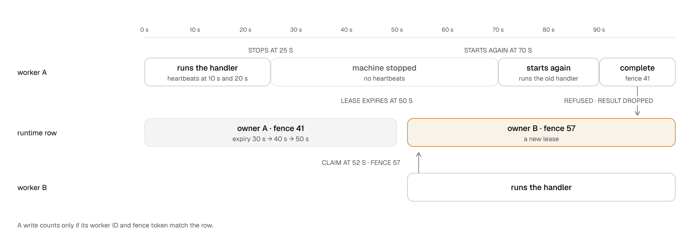

# Who owns a task right now, and how do fence tokens prove it?

Only the worker that owns a task can change the state of the task. Workhorse uses leases and fence
tokens to make sure of this. Almost each other rule in Workhorse depends on this mechanism.

A **lease** is the right of one worker to run one task until a time limit. A **fence token** is a
number that Workhorse gives to each claim. A later claim always gets a higher number.

## Know which worker owns a task

**Example.** Worker A runs an invoice task. While the handler runs, the machine of worker A stops.

1. At 0 s, worker A claims the task. Workhorse writes three values on the runtime row: the worker
   ID of A, an expiry at 30 s, and the fence token 41.
2. At 10 s and at 20 s, worker A sends a heartbeat. A heartbeat tells PostgreSQL that the worker
   still runs the task. After the heartbeat at 20 s, the lease expires at 50 s.
3. At 25 s, the machine of worker A stops. The heartbeats stop too, and nothing tells the database.
4. At 50 s, the lease expires.
5. Soon after, a worker finds the expired lease. It makes the task available for another attempt.

The lease gives each task one owner at a time. If the owner stops, the lease expires, and the task
does not stay with a stopped worker. A worker does this check during its usual maintenance, so you
do not run a separate service for it.

Reference: claim, lease, and recovery

| Step    | Function             | Effect on `task_runtime`                                          |
| ------- | -------------------- | ----------------------------------------------------------------- |
| Claim   | `claim_many_v1`      | Sets `worker_id`, `expires_at`, and a new `fence_token`.          |
| Renew   | `heartbeat_many_v2`  | Moves `expires_at` for each accepted lease.                       |
| Recover | `recover_expired_v1` | Returns expired rows to `ready` or `scheduled`. Clears the owner. |

**Fence tokens.** Every claim takes the next value of the sequence `fence_token_seq`. The sequence
covers the whole database, not one task or queue. So a later claim always has a higher token.

**Defaults (TypeScript)**

| Option        | Default                           |
| ------------- | --------------------------------- |
| `leaseMs`     | 30,000 ms                         |
| `heartbeatMs` | `max(100, floor(leaseMs / 3))` ms |

`heartbeatMs` must be shorter than `leaseMs`. The smallest supported value is 100 ms. A worker
accepts a shorter value, but on a loaded host it can renew no lease.

**Recovery cadence.** Each worker calls `tick_v1` once per `maintenanceIntervalMs` (TypeScript
default 1,000 ms). A tick skips the expired-lease scan when another tick ran it within half the
shortest maintenance interval among live registered workers. Unregistered workers do not count.
While registered workers keep ticking, a tick reaches the scan at least once per shortest
registered interval, unless other recovery work fills the limit first. With no live registered
worker, every tick runs the scan. Each run recovers a bounded batch of expired rows.

More detail: [Task lifecycle: Claim](../architecture/lifecycle.md#claim), [Task lifecycle: Worker options](../architecture/lifecycle.md#worker-options), and [Task lifecycle: Maintenance cadence](../architecture/lifecycle.md#maintenance-cadence).

## Stop a late write from an old owner

A stopped worker can start again later and try to finish its old task. The fence token prevents
this write.

**Example.** The invoice task from the previous example is available again.

1. At about 52 s, worker B claims the task. The claim gets a new, higher fence token: 57. Other
   claims occurred between the two claims, so the token is not 42.
2. At 70 s, the machine of worker A starts again. Its old handler continues to run.
3. At 90 s, the handler finishes. Worker A tries to record that the task is complete. The write has
   the fence token 41.
4. The row has the fence token 57, so PostgreSQL refuses the write.

<picture>
  <source media="(max-width: 600px) and (prefers-color-scheme: dark)" srcset="../../site/public/diagrams/leases-and-fences-narrow-dark.png">
  <source media="(max-width: 600px)" srcset="../../site/public/diagrams/leases-and-fences-narrow-light.png">
  <source media="(prefers-color-scheme: dark)" srcset="../../site/public/diagrams/leases-and-fences-dark.png">
  
</picture>

Each lifecycle write of a worker has the worker ID and the fence token of the claim. Examples are a
heartbeat, a checkpoint, and the completion. The SQL function compares the two values with the row
before it writes. If they are different, the function writes nothing. Thus, an old handler can
continue to run, but it cannot write the outcome of the task.

The architecture reference often says "locks the exact active worker and fence generation". This
phrase means that the write occurs only if the worker still owns the task.

Reference: fenced writes

These functions lock the exact active `task_id`, `worker_id`, and `fence_token` row before they
write:

- `heartbeat_v1`, `heartbeat_v2`, `heartbeat_many_v1`, and `heartbeat_many_v2`;
- `complete_v1` and `fail_v1`;
- `schedule_wait_v1`, `wait_for_signal_v1`, and `wait_for_human_v1`;
- `update_progress_v1` and `save_checkpoint_v1`.

A mismatch writes nothing. A heartbeat reports it as `stale`. `heartbeat_v2` and `heartbeat_many_v2`
do not wait for a row that another transaction locks. They report that lease as `busy` and write
nothing.

More detail: [Task lifecycle: Terminal transitions](../architecture/lifecycle.md#terminal-transitions).

## Keep the lease while the handler runs

The worker sends heartbeats for you. A timer in the worker sends one heartbeat round at a time. Each
round renews each lease that the worker has. You do not call a heartbeat function.

Each round falls due one heartbeat interval after the previous round started, not after it ended.
Thus a slow or failed round does not move the next round toward the end of the lease.

If a round fails because of a network error, the tasks continue to run. The next round tries again.
One failed round does not change who owns a task.

A heartbeat renews only a lease that is still live when PostgreSQL checks it. A late heartbeat cannot
start an expired lease again.

A round on the reserved connection also has a deadline that is shorter than one heartbeat interval.
If the heartbeat takes too long, PostgreSQL ends it before the deadline. The round then renews no lease, and its
heartbeat holds no row lock after the deadline. Only a commit that PostgreSQL has already started
can still finish later.

**Example.** The heartbeat at 10 s moved the expiry of the invoice task to 40 s. The heartbeat
interval is 10 s.

1. At 20 s, worker A sends the next heartbeat round. Its deadline is 27.5 s.
2. The database is slow, and the heartbeat does not finish.
3. At about 24 s, PostgreSQL ends the heartbeat. The round renews no lease.
4. At 30 s, one interval after the failed round started, worker A sends the next round. The
   database answers in time, so PostgreSQL renews the lease before it expires at 40 s.

A very short heartbeat interval gives a short deadline. On a loaded host, that deadline can be
shorter than one round needs, and the worker can then renew no lease. Do not set an interval below
the supported minimum.

After the handler returns, the worker must still check the result and write the completion. This
write can wait for a connection from a busy pool. In TypeScript, Python, and Go, the worker renews
the lease until this write is complete. Thus, Workhorse does not give a finished task to another
worker. A Rust task stops its heartbeats when its handler returns. A Ruby or JVM task keeps its
heartbeats while the worker checks the result. It stops them before the worker writes the final
transition.

## Keep the lease while another transaction holds the task

Some operations lock the row of the task for a short time, for example a progress update or a
checkpoint of your handler. The heartbeat does not wait for that lock. It reports the lease as busy
and renews nothing. The worker then tries again soon, with only the busy leases.

**Example.** The heartbeat at 10 s moved the expiry of the invoice task to 40 s. The handler saves
a checkpoint at 20 s.

1. At 20 s, worker A sends the next heartbeat round. The checkpoint holds the row lock.
2. The heartbeat answers busy at once. It renews nothing, and the task continues to run.
3. About 150 ms later, worker A sends a retry with only the invoice task.
4. The checkpoint has committed, so PostgreSQL renews the lease. The expiry moves to about 50 s.
5. At 30 s, worker A sends its next regular round, as planned.

A busy answer is not a verdict about ownership. It does not prove that the worker still owns the
task, and it does not extend the local countdown. If every round and every retry is busy until the
lease ends, the worker stops the task as a lost lease. A retry is an opportunity to renew, not a
guarantee. A transaction that holds the row for longer than the lease, such as a long transaction
of your own code, can still cost the lease.

Reference: busy leases and retries

| Value               | Rule                                                                            |
| ------------------- | ------------------------------------------------------------------------------- |
| `busy`              | Another transaction holds the row. No renewal and no ownership verdict.         |
| Busy retry delay    | `base × (1 + random)`, with `base = min(100 ms, interval / 8)`                  |
| Busy retry deadline | The earliest of the round deadline, the next regular slot, and the watchdog end |
| Busy retry minimum  | 20 ms (8 ms + 12 ms). A bounded retry with less time sends nothing.             |
| Regular rounds      | Unchanged. A busy retry does not move them.                                     |

With the defaults (30,000 ms lease, 10,000 ms interval), the regular rounds at 10 s and 20 s can
both be busy before the watchdog ends at 30 s. Busy retries run between them.

`SKIP LOCKED` does not stop every wait: an update-chain wait can still occur, and the round
deadline bounds it. `heartbeat_v1` and a custom `WorkerQueueApi` without `heartbeatMany` still wait
for a row lock and never report `busy`. TypeScript `Queue.tryHeartbeat()` calls `heartbeat_v2`,
which renews one lease by the rule of `heartbeat_many_v2`, but it has no busy retry.

More detail: [Task lifecycle: Batched renewal](../architecture/lifecycle.md#batched-renewal), [Task lifecycle: A renewal that meets a lock](../architecture/lifecycle.md#a-renewal-that-meets-a-lock), [Task lifecycle: Busy retry](../architecture/lifecycle.md#busy-retry), and [Task lifecycle: Supported heartbeat interval](../architecture/lifecycle.md#supported-heartbeat-interval).

Reference: heartbeat functions and results

**`heartbeat_many_v2(p_worker_id, p_leases jsonb)`**

- `p_leases` holds 1 to 100 entries of `{ taskId, fenceToken, leaseMs }`.
- On both tiers, the function locks the worker's rows in `task_id` order with `SKIP LOCKED`.
- The function reads `clock_timestamp()` after those locks.
- One `UPDATE ... FROM` for each tier renews only the rows that it locked.
- The function returns `(ordinal, task_id, status)` in input order.

`heartbeat_many_v1` has the same input. It waits for a locked row and never returns `busy`.

**`heartbeat_v2(p_task_id, p_worker_id, p_fence_token, p_lease_ms)`** renews one lease. It returns
the status that `heartbeat_many_v2` gives that lease, and `stale` for a null task ID or fence token.
`heartbeat_v1` takes the same input. It waits for a locked row and never returns `busy`.

**Schedule.** A round falls due one heartbeat interval after the previous round started. Only one
round is in flight at a time. A round that ends after its next slot starts one overdue round, and
the scheduler does not replay the other missed slots.

**Round deadline.** The deadline of a round on the reserved connection is
`max(1 ms, interval × 3 / 4, min(50 ms, interval))`. From an interval of 200 ms up, that is three
quarters of the interval. Up to 50 ms, it equals the interval, as before SM-1444. After one
timed-out round, an attempt keeps its lease when `2 × interval + round deadline < lease`. This rule
gives a margin only where the deadline is below the interval. The defaults meet it. Up to an interval
of 50 ms, a timed-out round leaves about 0 ms of margin. Near the 8 ms minimum of the settings
statement, renewal depends on the host load and the driver. The worker does not reject settings
that do not meet the rule.

**Smallest supported interval.** The smallest supported interval is 100 ms, in all six SDKs. Its
round deadline is 75 ms. Below 100 ms, the worker accepts the interval and its behavior does not
change. On a loaded host, each round can then miss its deadline, and the worker can renew no
lease.

A round on the reserved connection sends one transaction for every worker on the pool. Its one
`heartbeat_pool_v1` statement calls `heartbeat_many_v2` for each batch of up to 100 leases of one
worker. Before the statement, the round sets `statement_timeout` and
`idle_in_transaction_session_timeout` each to one quarter of the time left before its deadline. The
worker counts the renewals only after `COMMIT` succeeds. No setting bounds `COMMIT`.

**Statuses** (`heartbeat_v1`, `heartbeat_v2`, and `heartbeat_many_v2`)

| Status              | Effect                                                            |
| ------------------- | ----------------------------------------------------------------- |
| `accepted`          | Updates the heartbeat time, `expires_at`, and `updated_at`.       |
| `busy`              | No change. Only `heartbeat_v2` and `heartbeat_many_v2` return it. |
| `cancel_requested`  | No change.                                                        |
| `deadline_exceeded` | No change.                                                        |
| `timeout_exceeded`  | No change.                                                        |
| `stale`             | No change. The worker no longer owns this fence.                  |

**Lease watchdog.** Each attempt also keeps a local countdown. It starts when the claim request
leaves. Every `accepted` heartbeat restarts it from the moment that round's request left. A `busy` answer
does not restart it. Both
moments come before the database renews, so the local countdown never ends after the stored
`expires_at`.

| SDK          | Watchdog                                                                              |
| ------------ | ------------------------------------------------------------------------------------- |
| TypeScript   | `TaskAttempt`                                                                         |
| Python       | The expiration thread of the attempt                                                  |
| Go           | The watchdog timer of the attempt                                                     |
| Rust         | The `watchdog` timer in `Inner::execute` (`CancelReason::LeaseLost`)                  |
| Ruby         | The `workhorse-expiration-<task ID>` thread of the attempt (`:lease_lost`)            |
| Java, Kotlin | The `workhorse-expiration-<task ID>` virtual thread (`CancellationReason.LEASE_LOST`) |

The Rust worker matches each heartbeat result to the fence token of the claim. If a suspended task
resumes while an old round is returning, that round cannot renew or cancel the resumed handler.

More detail: [Task lifecycle: Heartbeat](../architecture/lifecycle.md#heartbeat), [Task lifecycle: Pool renewal](../architecture/lifecycle.md#pool-renewal), [Task lifecycle: Heartbeat round deadline](../architecture/lifecycle.md#heartbeat-round-deadline), [Task lifecycle: Supported heartbeat interval](../architecture/lifecycle.md#supported-heartbeat-interval), and [Task lifecycle: Heartbeat schedule](../architecture/lifecycle.md#heartbeat-schedule).

## What this means for you

Usually, you do not think about leases and fence tokens. But they explain two results that you can
see:

- If the process of a worker stops for longer than the lease, another worker can run the task
  again. Workhorse then refuses the final write of the first worker.
- "The handler still runs" and "the worker still owns the task" are two different facts. Heartbeats
  keep the second fact true.

## Next

- [030-delivery-guarantees.md](030-delivery-guarantees.md) — what it means for you when a task runs
  again
- [110-retries.md](110-retries.md) — what occurs on the next attempt
- [310-workers.md](310-workers.md) — the process that holds the lease

---

Exact semantics of claim, heartbeat, and recovery:
[`architecture/lifecycle.md`](../architecture/lifecycle.md#claim).
