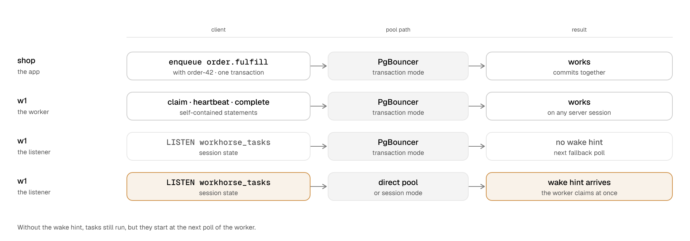
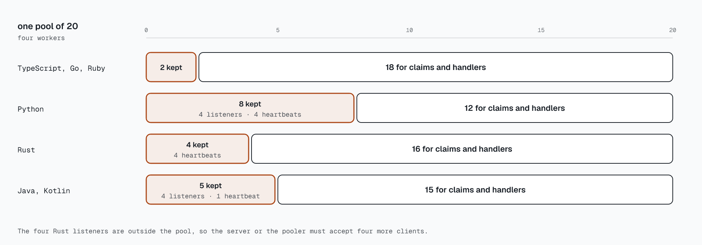

# Can I run Workhorse behind a connection pooler?

<!-- scenario-names: shop, order.fulfill, w1, email, billing, order-42 -->

A connection pooler is a proxy between your app and PostgreSQL. It lets many clients share a small
number of server sessions. A server session is one PostgreSQL connection with its own state.
PgBouncer and PgCat are connection poolers.

You can run Workhorse behind a connection pooler. Every queue operation works in session mode and
in transaction mode. In session mode, the pooler gives a client one server session until the client
disconnects. In transaction mode, the pooler gives a client a server session for one transaction
only. Only the wake-hint listener needs a dedicated session. If the listener gets no notifications,
tasks start later, but they still run, because the worker also polls.

## Run queue operations through any pool mode

**Example.** An app called `shop` reaches PostgreSQL through PgBouncer in transaction mode. The app
accepts order `order-42`.

1. A request handler inserts `order-42` and enqueues `order.fulfill` in one transaction. PgBouncer
   keeps one server session until the commit.
2. A worker claims the task. The claim runs on a server session that PgBouncer selects.
3. The worker sends heartbeats and completes the task. These statements can run on other server
   sessions.
4. A deployment step migrates the schema through the same pooler. Each migration step commits its
   own transaction, and its lock ends with that transaction.

All four operations work. Workhorse keeps the lease and the fence token in the runtime row of the
task, not in a session. Each statement that Workhorse sends is self-contained. A self-contained
statement needs no state from an earlier statement. Each lock that the schema takes is
transaction-scoped.

A transaction that your app owns commits or rolls back the queue writes as usual. Thus,
[transactional enqueue](200-transactional-enqueue.md) works behind the pooler.

Session state is state that stays on a server session after a transaction. Examples are a `LISTEN`,
a session-level advisory lock, and a `SET`. In transaction mode, session state stops working, or
the next client of that server session gets it. Workhorse needs no session state for correct
results.

The conformance suite runs each pooler and pool mode as a separate lane in CI. The reference table
shows the result of these runs.

Reference: operations under each pooler

`typescript/core/test/integration-pooling.test.ts` runs each case as a separate lane: direct, then
PgBouncer and PgCat, each with `pool_mode = session` and `pool_mode = transaction`.

| Operation                                              | Direct | PgBouncer session | PgBouncer transaction         | PgCat session                 | PgCat transaction             |
| ------------------------------------------------------ | ------ | ----------------- | ----------------------------- | ----------------------------- | ----------------------------- |
| Enqueue, claim, settle, heartbeat, operator reads      | Yes    | Yes               | Yes                           | Yes                           | Yes                           |
| Transactional enqueue in your own transaction          | Yes    | Yes               | Yes                           | Yes                           | Yes                           |
| `installSchema`, `migrateSchema`, `contractSchema`     | Yes    | Yes               | Yes                           | Yes                           | Yes                           |
| Maintenance tick and transaction-scoped advisory locks | Yes    | Yes               | Yes                           | Yes                           | Yes                           |
| `LISTEN`/`NOTIFY` wake hints on `workhorse_tasks`      | Yes    | Yes               | Accepted but never delivered  | Buffered until the next query | Buffered until the next query |
| Session-level advisory locks                           | Yes    | Yes               | Unsafe: no exclusion, leaks   | Yes                           | Unsafe: no exclusion, leaks   |
| Session state (`SET`, `PREPARE`, temporary tables)     | Yes    | Yes               | Unsafe: leaks between clients | Yes                           | Unsafe: leaks between clients |

**Statements.** No production code path changes a session setting, holds a cursor, or takes a
session-level advisory lock. A migration step and a heartbeat round set transaction-local values
only, and those values end with the transaction.

**Locks.** Every Workhorse advisory lock uses `pg_advisory_xact_lock`, `pg_try_advisory_xact_lock`,
or `pg_advisory_xact_lock_shared`. That includes the schema-migration lock.

**Schema operations.**

- `installSchema` sends `schema.sql` as one multi-statement simple query.
- Each migration step is one `BEGIN`…`COMMIT` script. It takes its transaction-scoped lock behind
  `SET LOCAL lock_timeout`.

More detail: [Overview: Connection poolers](../architecture/overview.md#connection-poolers).

## Give the listener a direct or session-mode pool

The listener is a connection that a worker holds for `LISTEN workhorse_tasks`. When a task becomes
ready, PostgreSQL sends a notification on that channel. This notification is a wake hint. It tells
the worker to claim at once, before its next poll. The pooler decides if the wake hint arrives.

**Example.** Worker `w1` reaches PostgreSQL through PgBouncer in transaction mode.

1. At start, `w1` sends `LISTEN workhorse_tasks`. PgBouncer returns success and releases the server
   session.
2. The app enqueues a task. PostgreSQL sends the notification, but no server session listens for
   `w1`.
3. `w1` gets no notification and no error.
4. At its next fallback poll, `w1` claims the task and runs it.

<picture>
  <source media="(max-width: 600px) and (prefers-color-scheme: dark)" srcset="../../site/public/diagrams/pgbouncer-paths-narrow-dark.png">
  <source media="(max-width: 600px)" srcset="../../site/public/diagrams/pgbouncer-paths-narrow-light.png">
  <source media="(prefers-color-scheme: dark)" srcset="../../site/public/diagrams/pgbouncer-paths-dark.png">
  
</picture>

The task runs correctly, but it starts later than it can.

PgBouncer in session mode delivers notifications as usual. PgCat holds a notification until the
client sends another query. An idle listener sends no query, so PgCat fails in both pool modes. In
each failed case, the worker still reports that it listens. The worker continues to claim on its
fallback poll, so tasks run, but they start later.

To keep wake hints, give the worker a pool that connects directly to PostgreSQL or through
PgBouncer in session mode:

- The Drizzle and TypeORM adapters listen on the node-postgres pool of the ORM, or on the pool that
  you give as the option `pool`. Connect that pool directly or through a session-mode PgBouncer
  database.
- The Prisma, Kysely, and Knex adapters take a `pool` option for this purpose. Give it a direct pool
  or a session-mode PgBouncer pool.
- A worker needs a pool for its listener and its heartbeat connection. A `Queue` on a queryable
  without `connect()` and without an attached pool cannot create a worker.

Reference: listener behavior and polling

**Behavior by pooler**

| Pooler and mode               | Behavior                                                                                                   |
| ----------------------------- | ---------------------------------------------------------------------------------------------------------- |
| PgBouncer session mode        | Delivers `NOTIFY` normally.                                                                                |
| PgBouncer in transaction mode | Accepts `LISTEN`, returns success, then releases the server connection. No notification is ever delivered. |
| PgCat, either pool mode       | Relays a buffered notification only with the client's next query result.                                   |

No error reaches `onNotificationError` in the failing cases. `Queue.supportsTaskNotifications()`
checks the pool's shape, not its pooling mode, so it still reports the capability.

**Pool source for the listener (TypeScript)**

| Adapter              | Pool source                                         |
| -------------------- | --------------------------------------------------- |
| Drizzle              | `pool` option, or else `$client`                    |
| TypeORM              | `pool` option, or else `driver.master`              |
| Prisma, Kysely, Knex | `pool` option. Without it, `createWorker()` throws. |

**Polling warnings (every language)**

- A worker never polls because its pool is small. A worker on a pool below 3, or on a pool of
  unknown size, fails at construction. A JVM `DataSource` with no declared `poolMaxSize` and a .NET
  data source with `Pooling=false` are the exceptions: the startup check is their guard.
- TypeScript: when `Worker.run()` starts with no subscription, it logs
  `workhorse.worker.polling_only` at warn level once. Its record carries
  `workhorse.worker.pool_max_size`: the size that the worker found, or `unknown`. A custom
  `WorkerQueueApi` that returns no subscription causes this warning.
- JVM: when the listener does not listen by the end of its startup wait, the worker logs
  `workhorse.worker.polling_only` once, with `workhorse.worker.pool_max_size`.
- .NET: in the same case, the worker logs `workhorse.worker.polling_only` with the worker ID only.
- Python and Ruby log no polling warning.
- Go: with `PollingOnly`, the worker logs "PostgreSQL notification listener disabled; worker is
  using polling". When the listener fails, it logs "PostgreSQL notification listener unavailable;
  worker is using polling".
- Rust: the listener is outside the pool. Without a `listen_config`, the worker polls and logs
  "PostgreSQL notification listener unavailable; worker is using polling" with
  `workhorse.worker.id` only. With `polling_only`, it logs no listener warning.

**Fallback poll.** A `Worker.run()` with a live listener polls every 5,000 ms by default, with ±10%
jitter. Before its `LISTEN` succeeds, and while it reconnects, the worker starts at 250 ms instead.
A lost listener wakes the worker, and its backoff restarts at 250 ms. An explicit `pollMs` replaces
both bases. While the listener is live, the worker waits the explicit value without the 5,000 ms
cap.

More detail: [Operations and CLI: Polling-only cases](../architecture/operations.md#polling-only-cases), [Operations and CLI: Polling cadence](../architecture/operations.md#polling-cadence), [Overview: Polling warnings](../architecture/overview.md#polling-warnings), and [Schema and SQL protocol: .NET connections](../architecture/schema-and-protocol.md#net-connections).

## Budget the connections that each worker holds

A worker holds two connections that its handlers cannot use: a listener connection and a heartbeat
connection. All the workers on one pool share these two connections, so the count does not grow
with the number of workers. Count them when you set the pool size.

**Example.** Two TypeScript workers, `email` and `billing`, run in one process on one node-postgres
pool.

1. `email` starts. It takes one pooled connection for the shared listener.
2. `email` takes one more pooled connection for the shared heartbeat connection.
3. `billing` starts. It uses the same listener and the same heartbeat connection, and it takes no
   new connection.
4. Both workers run handlers. Claims and handlers use the remaining connections of the pool.

Every language follows this rule. The workers that share the two connections are the workers on one
pool identity. A pool identity is the key that a language uses to find the workers on one pool. In
TypeScript, Go, Python, and Ruby, the key is the pool object. In Rust, the clones of one pool share
one key. On the JVM, the key is the `DataSource` object. In .NET, the key is the
`NpgsqlDataSource` object.

Rust is different in one way. The Rust listener opens its connection outside the pool, from the
`listen_config` of the workers. Thus all the Rust workers on one pool must give the same
`listen_config`.

On the JVM, a wrapper of a `DataSource` is a different `DataSource`. A worker on the wrapper thus
gets its own listener connection and its own heartbeat connection. One worker on a wrapper and one
worker on its delegate hold four reserved connections of one physical pool. To share the two
connections, give all the workers the same `DataSource` object. In .NET, give all the workers the
same `NpgsqlDataSource` object for the same reason. The worker does not unwrap a data source.

A .NET worker takes an `NpgsqlDataSource`, and it refuses a data source with Npgsql multiplexing.
Multiplexing lets many commands share one physical connection, but the listener and the heartbeat
hold their connections for a long time. Npgsql reads a notification only during a query or a wait.
Thus the .NET listener sends its own keepalive query on a quiet connection, and it does not change
the `Keepalive` setting of your connection string.

Behind a pooler that cannot deliver notifications, the listener connection delivers nothing. But
the connection still counts against the client limit of the pooler and against the pool of your
app. Include this connection in your budget. The Rust listener connection counts only against the
client limit, because it is outside the pool.

Count these connections before handlers take any connection. For example, four workers share one
pool of 20 connections. The workers hold one listener connection and one heartbeat connection from
the pool, so 18 connections remain for claims and handlers. In Rust, the workers hold only the
heartbeat connection in the pool, so 19 connections remain. The server or the pooler must accept
one more client for the Rust listener connection.

<picture>
  <source media="(max-width: 600px) and (prefers-color-scheme: dark)" srcset="../../site/public/diagrams/pgbouncer-budget-narrow-dark.png">
  <source media="(max-width: 600px)" srcset="../../site/public/diagrams/pgbouncer-budget-narrow-light.png">
  <source media="(prefers-color-scheme: dark)" srcset="../../site/public/diagrams/pgbouncer-budget-dark.png">
  
</picture>

Reference: connections each language holds

| Language   | Pool identity                                                                        | Listener connection                                                                                                                                                     | Heartbeat connection                                                                           |
| ---------- | ------------------------------------------------------------------------------------ | ----------------------------------------------------------------------------------------------------------------------------------------------------------------------- | ---------------------------------------------------------------------------------------------- |
| TypeScript | The pool object, such as a node-postgres `Pool`.                                     | One `TaskNotificationHub` per pool, holding one pooled connection.                                                                                                      | One per pool. The last holder returns it to the pool.                                          |
| Go         | The `*pgxpool.Pool` object.                                                          | One `taskNotificationHub` per pool. None under `PollingOnly`.                                                                                                           | One per pool. When the last holder releases it, `closeAndRemove` closes it.                    |
| Ruby       | The pool object.                                                                     | One `Worker::Listener.shared(pool)` per pool, holding one pool connection. None under `polling_only`.                                                                   | One `Worker::Heartbeat.dedicated(pool)` per pool, held while a worker runs or a lease remains. |
| Python     | The pool object, in each of three domains: psycopg sync, psycopg async, and asyncpg. | One per pool object, holding one pool connection. The domains never share.                                                                                              | One per pool object. The last worker gives it back to the pool.                                |
| Rust       | The address that `Pool::manager()` returns.                                          | One per pool identity, opened by `notifications::listen` from `WorkerOptions::listen_config`, outside the pool. None under `polling_only` or without a `listen_config`. | One per pool identity, from the pool. The last run gives it back to the pool.                  |
| JVM        | The `DataSource` object, by reference identity.                                      | One `Listener.shared(dataSource)` per `DataSource`, holding one connection while any worker runs. None under `pollingOnly(true)`.                                       | One per `DataSource`, held while any worker or attempt runs.                                   |
| .NET       | The `NpgsqlDataSource` object, by reference identity.                                | One listener per `NpgsqlDataSource`, holding one pooled connection on a dedicated thread. It runs `SELECT 1` after one quiet poll interval. None under `PollingOnly`.   | One per `NpgsqlDataSource`, on a dedicated thread, held while any worker or attempt runs.      |

- With 4 workers on one pool of 20, 18 pooled connections remain. In Rust, 19 remain, and 1 more
  client connects outside the pool.
- On the JVM, one worker on a wrapper and one worker on its delegate hold 4 reserved connections of
  one physical pool.
- If two Rust workers on one pool give different `listen_config` values, the second worker refuses
  to start.
- The .NET `Queue`, `Admin`, and `Worker` constructors throw `ArgumentException` for a data source
  with `Multiplexing=true`.
- If a .NET keepalive or wait fails, the listener disposes the connection, logs one warning, and
  connects again with backoff. After it connects, it runs `LISTEN` again and wakes the workers once.

More detail: [Overview: Connection budgets per language](../architecture/overview.md#connection-budgets-per-language), [Schema and SQL protocol: JVM connections](../architecture/schema-and-protocol.md#jvm-connections), and [Schema and SQL protocol: .NET connections](../architecture/schema-and-protocol.md#net-connections).

## Keep a dedicated heartbeat connection

A heartbeat renews the lease of a running task. A worker sends its heartbeats on a dedicated
connection, so busy handlers cannot delay them. The workers on one pool share this connection, as
the previous section describes.

**Example.** A worker with concurrency 8 shares a pool with its handlers. Each handler holds a
pooled connection for a slow report query. Suppose that the heartbeat uses the same pool.

1. The handlers hold all the pooled connections.
2. A heartbeat round becomes due. The heartbeat waits behind the handlers for a free connection.
3. The heartbeat does not run in time, so all the leases expire at the same time.
4. The worker tells each handler to stop.
5. Recovery puts each task back in the queue.

Thus, each pool keeps a dedicated heartbeat connection, and the heartbeat never waits for the
shared pool. Every worker uses this connection, and no option disables it. Count this connection
in addition to the listener and the handler connections. The pool must also leave room for
statements, so the pool has a minimum size. If the pool is smaller, or does not state its size,
the worker fails when you construct it. The error names the size that it found, the size that it
needs, and the next step.

Two pools are exceptions, because they do not state their size. A Java `DataSource` does not state its size. On the JVM, you can
declare the size with `poolMaxSize`, and the worker refuses a declared size that is too small. A
.NET worker reads `Max Pool Size` from the connection string of its `NpgsqlDataSource`, and it
refuses a size that is too small. With `Pooling=false`, the .NET data source has no size. Without a
known size, the startup check is the only check.

The workers on one pool renew their leases together, in one transaction for each round. A round thus
needs the same number of round trips to PostgreSQL for one worker or for many workers. That
transaction locks the task rows of every worker in the round until it commits.

Every worker checks the pool when it starts. Within its startup budget, the worker first gets the
heartbeat connection. Then it borrows one more connection for a short check, and returns it at
once. If the pool cannot give these connections in time, the worker does not start. Its error names
the pool and the budget.

The listener is best effort, so the worker starts without it and polls. The check proves only that
the pool has room at that moment.

While the heartbeat has no connection, no worker on the pool claims a new task. Running tasks
continue. A fast-tier completion settles its task and claims nothing. The heartbeat asks the pool
for a new connection at once. When the new connection is ready, the workers claim again at once.

The heartbeat connection runs only self-contained statements, so it works in every pool mode.

On the JVM, the worker trusts the declared `poolMaxSize`. If you make the pool smaller than the
declared size, the startup check can still pass, and claims can then wait for a free connection.

Reference: heartbeat reservation

**Minimum pool.** Every worker needs a pool of at least 3 connections: the listener, the heartbeat
connection, and one statement. In Rust, the listener is outside the pool, so the pool of 3 holds the
heartbeat connection and two statement connections. No option disables the heartbeat connection.
TypeScript, Python, and Ruby also refuse a pool whose size is unknown. A `DataSource` reports no
size, so the JVM checks only a size that `poolMaxSize` declares. A .NET worker reads
`Max Pool Size`, and with `Pooling=false` it checks only at startup. The error at construction
names the size that the worker found, the size that it needs, and the next step.

**Startup check.** The startup budget is the larger of the heartbeat interval and 5 s. One deadline
bounds both steps, in this order:

1. The worker reserves the heartbeat connection, or uses the one that another worker on the pool
   holds.
2. The worker borrows one ordinary connection, runs the compatibility query on it, and returns it
   at once.

If a step does not end within the budget, the worker refuses to start. The error describes the
pool and names the budget. An incompatible schema keeps its own error. The JVM
and .NET workers wait for the listener between the two steps, and that wait does not count against
the budget. The other languages do not wait for the listener at startup.

**Claim gate.** While the pool holds no usable heartbeat connection, no worker on it claims a task.
The worker reads the gate again immediately before each attempt of a claim statement, a deadlock
resend included. A fast-tier completion then runs with a claim limit of 0. A failed renewal or a
busy lease does not close the gate.

**Replacement.** The heartbeat asks for a replacement at once, also when no task runs. It retries
after a backoff that grows to at most the heartbeat interval. Python multiplies each wait by a
random factor from 0.9 to 1.1, and then applies the cap. When the replacement is ready, the workers
claim at once.

| Language   | Refusal of a small pool                                                              | Refusal at startup                   |
| ---------- | ------------------------------------------------------------------------------------ | ------------------------------------ |
| TypeScript | The `Worker` constructor throws.                                                     | `Worker.run()` rejects.              |
| Go         | `NewWorker` returns an error.                                                        | `Run` and `RunOnce` return an error. |
| Python     | `ValueError`                                                                         | `TimeoutError`                       |
| Ruby       | `ArgumentError`                                                                      | `WorkerStartupError`                 |
| Rust       | `Worker::new` returns `Error::InvalidArgument`.                                      | `run` returns an error.              |
| JVM        | `build()` throws when `poolMaxSize` is below 3.                                      | `WorkhorseException`                 |
| .NET       | The `Worker` constructor throws `ArgumentException` when `Max Pool Size` is below 3. | `WorkerStartupException`             |

A TypeScript `WorkerQueueApi` that is not a `Queue` is not checked.

**Bounded rounds.** The TypeScript worker bounds each round on the reserved connection by
`heartbeatRoundMs`, a deadline of at most `heartbeatMs`. The round sends `BEGIN`, a settings
statement, one `heartbeat_pool_v1` statement, and `COMMIT`. Transaction-local server timeouts make
PostgreSQL end the heartbeat by the same deadline.

The rounds of the workers on the pool share that transaction. Before the first round sends
`heartbeat_pool_v1`, each waiting round joins it if its deadline is not earlier than that of the
first round. A round that does not join waits for the next transaction. Go, Python, and Rust share
the transaction in the same way on their dedicated heartbeat connection. In Ruby and the JVM, one
heartbeat thread for each pool sends one statement for every worker. The .NET worker still sends
one transaction with one `heartbeat_many_v2` statement for each worker and each 100 leases.

A TypeScript round that fails destroys the connection, and asks the pool for a new one when it
ends. The connect thus starts before the next round. If the connect is still pending when the next
round starts, that round waits for it. The rest of the wait counts against the deadline of that
round.

More detail: [Overview: Connection budgets per language](../architecture/overview.md#connection-budgets-per-language), [Task lifecycle: Heartbeat connection](../architecture/lifecycle.md#heartbeat-connection), [Task lifecycle: Heartbeat readiness](../architecture/lifecycle.md#heartbeat-readiness), [Task lifecycle: Pool renewal](../architecture/lifecycle.md#pool-renewal), [Task lifecycle: Heartbeat round deadline](../architecture/lifecycle.md#heartbeat-round-deadline), [Schema and SQL protocol: Shared pool connections](../architecture/schema-and-protocol.md#shared-pool-connections), [Schema and SQL protocol: JVM connections](../architecture/schema-and-protocol.md#jvm-connections), and [Schema and SQL protocol: .NET connections](../architecture/schema-and-protocol.md#net-connections).

## Size the pool for a fast-tier worker

On a [fast-tier](305-fast-tier.md) queue, a worker with high concurrency divides its slots into
cohorts. A cohort is a fixed group of the slots of a worker that sends its completions in one batch.
Each cohort can hold its own connection. Thus, the handlers of one cohort continue to run while the
completion of another cohort waits.

The pool size sets the default number of cohorts. On a small pool, the listener and the heartbeat
connection take two connections. In Rust, only the heartbeat connection comes from the pool, so it
takes one connection. The worker selects only as many cohorts as the remaining connections allow. On a larger pool, more connections remain, so the worker selects more cohorts.
Then more completion round trips can occur at the same time.

This rule applies in each language if the pool states its size. A Java `DataSource` does not state
its size, so the Java default has a cap only if you declare the size with `poolMaxSize`. The .NET
default has a cap only if pooling is on. Workhorse never limits an explicit `cohorts`
option.

Reference: default cohorts

`defaultDispatchCohorts(concurrency, spareConnections)` picks:

- 1 below concurrency 8;
- otherwise `ceil(concurrency / 8)`, clamped to 2 through 8;
- then capped at the spare connections, and never below 1.

A `DataSource` reports no pool size, so the Java worker applies the third rule only to a declared
`poolMaxSize`. The .NET worker applies the third rule only when `Pooling` is true.

**Spare connections**

| Language   | Spare connections                                                                                    |
| ---------- | ---------------------------------------------------------------------------------------------------- |
| TypeScript | `options.max`, minus 1 for the listener when notifications are supported, minus 1 for the heartbeat. |
| Go         | `MaxConns`, minus 1 unless `PollingOnly`, minus 1 for the heartbeat.                                 |
| Python     | Pool size, minus 1 for the listener, minus 1 for the heartbeat.                                      |
| Ruby       | Pool size, minus 1 unless `polling_only`, minus 1 for the heartbeat.                                 |
| Rust       | `max_size`, minus 1 for the heartbeat. The listener sits outside the pool.                           |
| Java       | `poolMaxSize`, minus 1 for the listener when the worker listens, minus 1 for the heartbeat.          |
| .NET       | `Max Pool Size`, minus 1 for the listener when the worker listens, minus 1 for the heartbeat.        |

In TypeScript, pools of 3, 4, 6, and 10 connections give a concurrency-64 worker 1, 2, 4, and 8
cohorts. A TypeScript database with an attached pool, such as a Prisma or Kysely adapter, runs
statements outside that pool, so its default is not capped.

More detail: [Fast tier: Dispatch cohorts](../architecture/fast-tier.md#dispatch-cohorts), [Fast tier: TypeScript worker](../architecture/fast-tier.md#typescript-worker), [Fast tier: JVM worker](../architecture/fast-tier.md#jvm-worker), [Fast tier: .NET worker](../architecture/fast-tier.md#net-worker), and [Schema and SQL protocol: JVM worker](../architecture/schema-and-protocol.md#jvm-worker).

## Avoid the unsafe pooler setups

Some pooler setups fail without an error. Tasks continue to run, so the problem is easy to miss.

**Example.** A team moves its worker pool behind PgCat to use fewer connections.

1. The worker starts and reports that it listens. No error occurs.
2. The app enqueues tasks. PgCat holds each notification.
3. Each task waits for the fallback poll of the worker.

The same result occurs behind PgBouncer in transaction mode.

Do not use these setups:

- **A worker pool behind PgCat or behind a transaction-mode pooler.** The wake hints stop, and no
  error tells you.
- **Session-level advisory locks in transaction mode.** These locks are not the transaction-scoped
  locks that Workhorse uses. Two clients can hold the same lock, because each statement can run on
  a different server session. A lock also stays after the client that took it ends its checkout.
- **Session state that a client leaves on a server session.** The next client of that server
  session gets the state.

PgCat also limits the databases that a client can reach. Its configuration names each pool, so a
client can connect only to a database that the configuration names. A wildcard entry in PgBouncer
forwards each database name, so PgBouncer can avoid this limit.

Reference: unsafe cases by pooler

| Case                                                                | PgBouncer transaction | PgCat session             | PgCat transaction         |
| ------------------------------------------------------------------- | --------------------- | ------------------------- | ------------------------- |
| `LISTEN`/`NOTIFY` wake hints                                        | Never delivered       | Held until the next query | Held until the next query |
| Session-level `pg_advisory_lock`/`pg_advisory_unlock`               | Unsafe                | Works                     | Unsafe                    |
| Session state (`SET`, SQL `PREPARE`/`DEALLOCATE`, temporary tables) | Unsafe                | Works                     | Unsafe                    |

Session advisory locks pin to whichever server session ran them, and they outlive the client
checkout. Under transaction pooling, a second client can acquire a held key. The session forms
exist only in Workhorse test harnesses.

PgCat's `pgcat.toml` names each pool statically. A client URL's database name must match a
configured pool. PgBouncer's wildcard `[databases]` entry forwards any database name.

More detail: [Overview: Advisory locks](../architecture/overview.md#advisory-locks).

## Next

- [310-workers.md](310-workers.md) — run workers and choose their pool
- [200-transactional-enqueue.md](200-transactional-enqueue.md) — enqueue a task in the transaction
  of your app
- [020-leases-and-fences.md](020-leases-and-fences.md) — the lease that the heartbeat renews

---

Exact lock names, listener behavior, connection budgets, and lane coverage:
[`architecture/overview.md`](../architecture/overview.md#connection-poolers).
